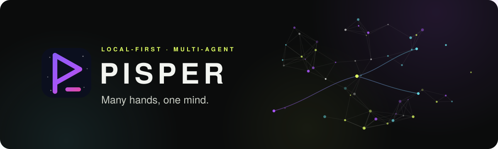

<p align="right"><a href="./README.md">简体中文</a> · <strong>English</strong></p>

<a id="top"></a>

<p align="center">
  
</p>

<p align="center">
  A cross-device multi-agent app for desktop, terminal, and mobile. Branch agent work from any completed Turn and run the branches in parallel.
</p>

<p align="center">
  <a href="https://github.com/ling-kong-ran/pisper/releases"></a>
  <a href="https://github.com/ling-kong-ran/pisper/stargazers"></a>
  <a href="./LICENSE"></a>
  
  
</p>

<p align="center">
  <a href="https://github.com/ling-kong-ran/pisper/releases/latest">
    
  </a>
</p>

<p align="center">
  <a href="https://github.com/ling-kong-ran/pisper/releases?q=app-v">App Releases</a>
</p>

<p align="center">
  <a href="#quickstart">Quick start</a> ·
  <a href="#features">Feature map</a> ·
  <a href="#data-safety">Data safety</a> ·
  <a href="./README.md">简体中文</a>
</p>

<a id="why"></a>

## ✨ Why Pisper

- **Branch conversations like code.** Spawn a new session from any completed Turn with full context, leaving the source untouched; stable Turn labels pin key moments as searchable anchors — like Git, but for agents.
- **Truly parallel agents.** Every session gets its own model, context, working directory and permissions. Drag tabs to split the view and watch them race.
- **Hot and cold tools.** Core tools live in context; plugins, MCP servers and skills are activated on demand through a discover/call gateway and retired when done — endless capability without stuffing the context like a junk drawer.
- **Stable prefix, hot cache.** Canonically ordered tool definitions and hash-based prompt-shape diagnostics keep provider prompt caches hitting — long sessions get faster and cheaper.
- **Missing a capability? Just ask.** Pisper writes, validates and installs local plugins by itself — callable from the very next turn.
- **Independent on your phone, connected when you want.** The Android / iOS app bundles the same Node/Pisper Runtime, standard sessions, and React interface as Desktop, hiding only capabilities the device cannot host. It can also pair with Desktop, prefer LAN, and fall back to Iroh P2P while retaining TLS fingerprint pinning and device Bearer tokens.
- **Your data stays on your machine.** The runtime binds to 127.0.0.1 by default, known secret formats are redacted, and inferred memories wait for your approval. Your context, your call.

<a id="features"></a>

## 🗺️ Feature map

| 🌿 Parallel & branching | 🧩 Extensibility |
| --- | --- |
| Split-view parallel sessions · Session Tree branching · Stable Turn labels · Ctrl+K cross-session jump · Per-session model/directory/permissions | Self-generated local plugins · Connect external MCP servers · Built-in MCP server for other local agents · Skill center · Multi-provider model configuration |
| **⚡ Automation & notifications** | **🖥️ Desktop & terminal, one core** |
| Visual workflows · Scheduled tasks · Feishu / WeChat channels · Project memory · Git & SVN changes | Ratatui TUI sharing the Desktop Runtime · Android / iOS on-device Runtime or Desktop connection · Desktop pets (Petdex) · Independent Desktop / TUI / Runtime / App updates |

Want another agent on the same computer to use Pisper? Enable the built-in server on the MCP page and copy its connection settings. It exposes sessions, memory, workflows, and more behind a token.

<a id="pi-runtime"></a>

## 🧠 Built on Pi Coding Agent

Pisper uses [Pi Coding Agent](https://github.com/earendil-works/pi/tree/main/packages/coding-agent) as its underlying Agent Runtime. Starting from Pi's model integration and tool execution foundation, Pisper adds focused product and runtime optimizations for sustained multi-agent work:

- **Runtime and session orchestration**: independent sessions, parallel execution, Turn branching, working directories, and permission policies become one durable multi-agent system.
- **Context and performance**: hot/cold tool tiers, discover/call loading, stable tool definitions, and prompt-shape diagnostics reduce context pressure and improve provider prompt-cache hit rates.
- **A complete product layer**: Desktop, the Ratatui TUI, and mobile experiences; on-device mode runs the same Node/Pisper Agent, Providers, sessions, HTTP/SSE, and React interface, hiding capabilities that the embedded Node host cannot provide on that device.

<a id="quickstart"></a>

## 🚀 Quick start

### Option 1: Desktop app (recommended)

Grab the installer for your platform from [Releases](https://github.com/ling-kong-ran/pisper/releases/latest). **TUI and Runtime are bundled — no Node.js required.**

Choose your system and architecture:

| System | Package and offline requirements |
| --- | --- |
| Windows x64 standard (recommended) | `*-setup.exe` without `-offline-`: smaller download, reuses installed WebView2 or installs it online if missing. Works offline when WebView2 is already installed. |
| Windows x64 full offline | `*-offline-setup.exe`: includes the complete WebView2 installer for offline machines where the runtime is missing or its availability is unknown. This makes the package substantially larger. |
| macOS | Choose the Apple Silicon or Intel DMG. Uses the system WKWebView; no additional browser engine download. |
| Linux x64 | AppImage may require FUSE; DEB is available for Debian / Ubuntu. Prepare distribution-specific system libraries before offline deployment; DEB may require packages such as WebKitGTK. |

Windows automatic updates use the standard package, avoiding repeated WebView2 installer downloads. **The full offline package does not include on-demand local speech models.** Models, external MCP programs, and extensions still need separate preparation on every platform; conversations need a reachable model service, which can be on your intranet. Older releases may not offer both Windows variants; check the actual release assets.

If WebView2 is missing, the standard installer explains what it is, why internet access is needed, and how to choose the offline package before installing the dependency. Installation failures retain error codes and recovery guidance. Missing bundled files and Runtime initialization failures also display native startup messages. For Linux system-library failures before the application can execute, launch it from a terminal to see the missing library name.

<details>
<summary>macOS says the app "can't be opened"?</summary>

Pisper is not notarized by Apple yet. Make sure the installer came from the official Releases, then choose **Open Anyway** in **System Settings → Privacy & Security**. If that option is missing:

```bash
sudo xattr -rd com.apple.quarantine /Applications/Pisper.app
```

Only run this on an app downloaded from the official Releases and placed in `/Applications`.

</details>

<details>
<summary>Linux AppImage won't start?</summary>

```bash
chmod +x Pisper_*_linux_x86_64.AppImage
./Pisper_*_linux_x86_64.AppImage
```

If FUSE is missing, install `libfuse2` or `libfuse2t64`, or use the `.deb` instead:

```bash
sudo apt install ./Pisper_*_linux_x86_64.deb
```

</details>

### Option 2: Mobile app

On first launch, the Android / iOS app starts its bundled on-device Runtime and opens the normal Pisper interface. Connecting to Desktop is an optional setting and never blocks first use. Download the packages from App Releases:

| Platform | Download | Installation status |
| --- | --- | --- |
| Android | [Download the signed APK](https://github.com/ling-kong-ran/pisper/releases?q=app-v) | Signed arm64 APK, ready to install. Android may ask you to allow installs from this source when sideloading for the first time. |
| iOS | [Download the unsigned IPA](https://github.com/ling-kong-ran/pisper/releases?q=app-v) | **Unsigned** and not directly installable. Re-sign it with AltStore, Sideloadly, or your own Apple Developer account. |

**Run on this phone**

<details>
<summary>Show steps</summary>

1. On first launch, wait for the bundled Runtime to become ready; the app then opens the normal Pisper interface. To return from a remote Desktop, open **Settings → Servers → Run on this device**.
2. Configure a Provider and model. Sessions, Provider settings, and the workspace stay in the App's private data directory.
3. The Runtime API listens only on a loopback port. If the user enables the built-in MCP server, it also listens on 127.0.0.1:5175. Android/iOS hides unsupported Shell, MCP, workflow, and related features according to the embedded Node host's actual module capabilities.

</details>

**Connect to Desktop**

<details>
<summary>Show steps</summary>

1. For initial pairing, put the phone and computer on the same LAN when possible, then enable **Settings → Remote access** on Desktop.
2. On the phone, open **Settings → Servers → Add server**, allow local-network access, choose the discovered Desktop, and request access. A device token is issued only after the Desktop user explicitly approves the request.
3. When the devices are not on the same LAN or discovery fails, generate a one-time QR code on Desktop and scan it, or enter its values manually. A QR screenshot can be sent to a remote phone. Every path pins the TLS fingerprint and uses device Bearer authentication; established connections prefer LAN and fall back to Iroh P2P.

</details>

The app remembers the currently selected on-device or remote Runtime.

### Option 3: npm (Node.js 20+)

```bash
npm i -g pisper
pisper web   # open the Web UI and local configuration page
```

On first run, use `/provider` to choose a Provider and configure an API key. Available commands and arguments: **[TUI Command Reference](./src-tui/README.en.md)**.

### Option 4: From source

<details>
<summary>Expand</summary>

Requires Node.js 20+, npm, and at least one model provider with an API key.

```bash
git clone https://github.com/ling-kong-ran/pisper.git
cd pisper
npm install
npm run dev
```

Desktop development and packaging:

```bash
npm run desktop:webview:dev
npm run desktop:webview:build
```

Mobile App: `npm run build:ios` produces a locally signed debugging IPA for real devices.

</details>

Data lives in `~/.pisper/agent` by default; override with `PISPER_AGENT_DIR`.

<a id="data-safety"></a>

## 🔒 Data safety

There is no "our cloud" in Pisper. Your data is held by the local Runtime. Providers, external MCP servers, search and channels you configure and call, or local MCP clients you explicitly enable and give a token, can receive the data needed for their requests.

- **Loopback by default**: the Desktop Runtime binds its normal endpoint to 127.0.0.1; the on-device mobile Runtime listens only on a random loopback port. LAN HTTPS and Iroh P2P start only after Desktop remote access is explicitly enabled. Iroh transports raw encrypted bytes while TLS fingerprint pinning and device Bearer tokens protect the upper layer. Pi telemetry is off by default.
- **Redaction and sandboxed credentials**: common API keys, Bearer/JWT tokens, private keys, and connection strings are replaced before memories are persisted or summaries are shown. On-device Provider credentials and remote device tokens currently remain in the App-private directory under OS sandbox and file permissions; Android Keystore / iOS Keychain integration is still pending.
- **Permission boundaries**: approval-required, workspace-write and full-access modes; credentials are never echoed back to agents through ordinary config APIs, and the host shell strips common credential environment variables.
- **Opt-in MCP server**: off by default, bound to 127.0.0.1, and protected by a separate Bearer token. A local client holding that token can call every exposed tool.
- **Memory on approval**: automatically inferred memories sit in a review queue and are never recalled until you confirm them.

> Honest boundary: redaction only recognizes common secret formats; it is not full DLP, a sandbox, or end-to-end encryption. Desktop Runtime Provider credentials still live in the local Agent data directory, so protect that directory and its backups. Mobile secure storage does not replace device lock screens, OS updates, or trusted sideload sources.

## 🧩 Components & independent updates

Desktop, TUI, Runtime, and the mobile App are versioned, signed, and updated independently, with automatic rollback to the bundled version on component failure. Desktop provides one component-update entry; the mobile App uses its own release manifest.

Native components are managed in Features → Extensions → Component studio: an agent generates them with `component_create`, or you drop a folder with `manifest.json` (`runtime: "native"`) and `component.js` into `custom-ui/` in the data directory, and changes hot-reload automatically. A component can be placed in four spots: the component column on the right of All agents (folded into a “Components N” header button in narrow windows, listed after the agents on phones), a component tab in the session inspector (all sessions or one project), a full page under Features → My components, and a floating window (not shown on phones). Legacy iframe components and the built-in focus island are no longer supported: the first start after upgrading moves old component folders, unchanged, to `custom-ui-trash/` in the data directory.

## 📚 Docs

| Doc | Contents |
| --- | --- |
| [TUI Command Reference](./src-tui/README.en.md) | CLI commands, Slash commands, and arguments |

<a id="development"></a>

## 🛠️ Development

The Agent Runtime deeply integrates [Pi Coding Agent](https://github.com/earendil-works/pi/tree/main/packages/coding-agent). The product layer is primarily React, TypeScript, Tauri, Rust, and Node SEA.

```bash
npm run check   # typecheck + lint + i18n + format + startup check
npm test        # runtime tests
npm run build   # production build
```

[Issues](https://github.com/ling-kong-ran/pisper/issues) and [Pull Requests](https://github.com/ling-kong-ran/pisper/pulls) are welcome. Never commit API keys, bot credentials, or personal data from `~/.pisper/agent`.

## 🙏 Acknowledgements

Thanks to [Pi Coding Agent](https://github.com/earendil-works/pi/tree/main/packages/coding-agent), [Petdex](https://petdex.dev), and the open-source software this project builds on.

Contributors:

- [@mik-myp](https://github.com/mik-myp) — frontend TypeScript architecture, shadcn/ui / AI Elements, Zustand and i18n refactor ([#1](https://github.com/ling-kong-ran/pisper/pull/1))

---

<p align="center">
  <strong>If Pisper helps you, a ⭐ means the world — it's what keeps the project growing.</strong><br />
  <sub>Share it with anyone who uses coding agents as a serious productivity tool.</sub>
</p>

<p align="center">
  <a href="./LICENSE">MIT License</a> · © Pisper Contributors ·
  <a href="#top">Back to top ↑</a>
</p>
