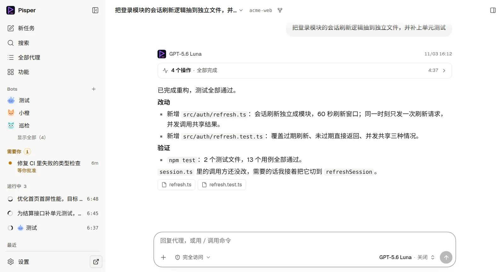

<p align="right"><strong>简体中文</strong> · <a href="./README.en.md">English</a></p>

<a id="top"></a>

<p align="center">
  
</p>

<h3 align="center">几个代理同时干活，谁在等你、谁在跑、谁做完了，一眼看清。</h3>

<p align="center">
  跨桌面、终端与手机的多代理应用。三端共用同一个内核——换设备，现场不换。
</p>

<p align="center">
  <a href="https://github.com/ling-kong-ran/pisper/releases/latest"></a>
  <a href="https://www.npmjs.com/package/pisper"></a>
  <a href="https://github.com/ling-kong-ran/pisper/stargazers"></a>
  <a href="./LICENSE"></a>
  
</p>

<p align="center">
  <a href="https://github.com/ling-kong-ran/pisper/releases/latest"></a>
</p>

<p align="center">
  <a href="https://pisper.cc">官网</a> ·
  <a href="https://pisper.cc/guide.html">使用教程</a> ·
  <a href="https://pisper.cc/changelog.html">开发日志</a> ·
  <a href="#quickstart">安装</a> ·
  <a href="#features">能力</a> ·
  <a href="#data-safety">数据安全</a>
</p>

<p align="center">
  <a href="docs/shots/desktop-overview.png"></a>
</p>

<a id="why"></a>

## ✨ 为什么用 Pisper

<table>
  <tr>
    <td width="33%" valign="top">
      <h4>⚡ 几件事，同时进行</h4>
      每个代理一行，按“需要你、运行中、今天完成”分组。谁在等你批准一眼就知道，高风险命令就地允许或拒绝，不用逐个点进会话。
    </td>
    <td width="33%" valign="top">
      <h4>🌿 走错了，能回头</h4>
      会话树保留每一条分支：按轮回退文件、从任意回合另开，原来的对话一字不改。给关键回合打标记，随时跳回去。
    </td>
    <td width="33%" valign="top">
      <h4>📱 换设备，现场不换</h4>
      桌面、终端和手机共用同一个内核。手机上的代理在本机运行，也能配对桌面，在路上直接批准命令。
    </td>
  </tr>
</table>

<table>
  <tr>
    <td width="70%" valign="top">
      <a href="docs/shots/desktop-session.png"></a>
      <p align="center"><sub>桌面 · 会话</sub></p>
      <a href="docs/shots/cli.png"></a>
      <p align="center"><sub>终端 · Ratatui</sub></p>
    </td>
    <td width="30%" valign="top">
      
      <p align="center"><sub>手机 · 本机运行</sub></p>
    </td>
  </tr>
</table>

<a id="features"></a>

## 🗺️ 能力

| | 能力 | 说明 |
| :---: | --- | --- |
| 🧵 | **并行代理** | 侧栏常驻需要你、运行中和最近的会话；每个会话有自己的模型、目录和权限，批准、提问卡片就在对话里处理。`Ctrl/⌘ + K` 打开命令面板，跨会话直达。 |
| 🌳 | **会话树与分支** | 从任意回合另开、按轮回退文件、给回合打标记；切换路径不删上下文。 |
| 🧭 | **Plan · Goal · Team** | 三种推进方式：先出计划、盯着目标跑到底，或者交给一支代理小队。 |
| 🪄 | **子代理** | 给 fast / standard / strong 三档各配一个模型：检索整理交给便宜的快模型，设计和排错交给强模型，工具范围按任务收窄。 |
| 🛡️ | **审批与权限规则** | 审批后写入、自动审批、完全访问三档；按命令开头批量允许或禁止，危险命令单独拦下。 |
| 🌐 | **网页与电脑操作** | 代理在右侧浏览器里打开、操作网站，沿用你的登录状态；Computer Use 操作电脑上的应用。点击、填写和操作电脑都先出批准卡片。 |
| 🖥️ | **远程电脑** | 经 SSH 或执行器连上另一台机器，文件和命令工具在对方机器上运行，审批照常生效。 |
| 🧩 | **工具 · 插件 · MCP** | 核心工具常驻，插件、MCP 与技能按需激活、用完即退；缺能力直接说，代理会写插件补上；也能开启内置 MCP 服务，让本机其他代理调用 Pisper。 |
| 🎙️ | **语音输入与对话模式** | 说话转文字，编辑后发送；对话模式下自动提交、语音回复。 |
| 🔀 | **可视化工作流** | Prompt、文件、MCP 与通知连成一张图，重复的事交给流程跑。 |
| ⏰ | **定时任务与通知** | 到点自动开跑，结果经飞书、微信等渠道推给你，不用一直盯着屏幕。 |
| 🧠 | **记忆** | 偏好、决策和事实直接记住，过时的自动淘汰；拖动时间轴，看它们一步步怎么变过来。 |
| 🔁 | **模型与备用模型** | 多 Provider 配置；主模型重试后仍不可用或额度用尽时，按顺序切到备用模型接着跑。 |
| 🎨 | **原生组件** | 一句话让代理做一个组件，放进组件栏、会话检查器、整页或浮窗；导入前先看源码与扫描结果，每次改动都能回滚。 |
| 📦 | **Git · SVN · 桌面宠物** | 检查器里看工作区改动，支持 Git 与 SVN；还有来自 Petdex 的桌面宠物陪你干活。 |

> 每一项的用法见 **[使用教程](https://pisper.cc/guide.html)**。

<a id="bots"></a>

## 🤖 Pisper Bot <sup>实验功能</sup>

<a href="docs/shots/desktop-bot.png"></a>

给常干的事建几个 Bot：每个 Bot 就是一个一直开着的会话，加上它是谁、管什么的设定。点开就接着聊，前情它都记得；改文件、跑命令它自己来，碰到危险操作或做不了时才找你。

- **在聊天软件里叫它**：飞书、微信里发一句，它就去做。
- **定时让它做事**：每天巡检依赖、整理日报，到点自己开跑。
- **去另一台电脑上干**：把活派到远程机器上。
- **拉几个 Bot 进群**：@ 谁就叫醒谁；不 @ 时由群里判断该谁答，只叫醒合适的那一个。

Bots 默认关闭，在 **设置 › 实验功能** 里打开；关掉后 Bot 和它们的会话都不再显示，记录保留。见 [Bot 教程](https://pisper.cc/guide.html#bots)。

<br clear="right" />

<a id="quickstart"></a>

## 🚀 安装

### 💻 桌面版（推荐）

从 [Releases](https://github.com/ling-kong-ran/pisper/releases/latest) 下载对应平台的安装包。**自带终端界面与 Runtime，不用装 Node.js。**

| 系统 | 安装包 | 说明 |
| --- | --- | --- |
| **Windows x64** | `*-setup.exe` | 普通包（推荐），复用系统已有的 WebView2，缺失时联网安装。自动更新也走它。 |
| | `*-offline-setup.exe` | 完整离线包，额外带 WebView2 安装器，适合缺少 WebView2 的内网电脑，体积明显更大。 |
| **macOS** | `*.dmg` | 仅支持 Apple Silicon，使用系统 WKWebView。 |
| **Linux x64** | `*.AppImage` / `*.deb` | AppImage 可能需要 FUSE；DEB 可能依赖 WebKitGTK 等系统库。 |

离线包不含按需下载的本地语音模型；模型对话需要能访问到的模型服务（内网服务也可以）。

<details>
<summary><b>macOS 提示「无法打开」？</b></summary>
<br />

Pisper 尚未经过 Apple 公证。确认安装包来自官方 Releases 后，在 **系统设置 → 隐私与安全性** 中选择 **仍要打开**。若没有该选项：

```bash
sudo xattr -rd com.apple.quarantine /Applications/Pisper.app
```

只对从官方 Releases 下载并放进 `/Applications` 的应用使用这条命令。

</details>

<details>
<summary><b>Linux AppImage 无法启动？</b></summary>
<br />

```bash
chmod +x Pisper_*_linux_x86_64.AppImage
./Pisper_*_linux_x86_64.AppImage
```

缺少 FUSE 时安装 `libfuse2` 或 `libfuse2t64`，也可以改用 DEB：

```bash
sudo apt install ./Pisper_*_linux_x86_64.deb
```

程序启动前就报系统库错误时，从终端启动可以看到缺的是哪个库。

</details>

### 📱 手机 App

安装包在 [App Releases](https://github.com/ling-kong-ran/pisper/releases?q=app-v)。首次启动会直接进入内置的本机 Runtime——代理、工具和会话都在手机上运行，它不是桌面的遥控器。

| 平台 | 安装包 | 说明 |
| --- | --- | --- |
| **Android** | 已签名 arm64 APK | 可直接安装，首次侧载时按系统提示允许安装来源。 |
| **iOS** | 未签名 IPA | 不能直接安装，需要用 AltStore、Sideloadly 或自己的开发者账号重签。 |

<details>
<summary><b>连接桌面端</b></summary>
<br />

1. 首次配对时让手机和电脑在同一局域网，桌面端打开 **设置 → 远程访问** 并开启。
2. 手机进入 **设置 → 服务器 → 添加服务器**，允许本地网络访问，选择发现的桌面并发起申请；桌面明确批准后才签发设备令牌。
3. 不在同一局域网时，在桌面生成一次性二维码，手机扫码或手动输入。连接优先走局域网，不通时回退 Iroh P2P；所有路径都校验 TLS 指纹并使用设备令牌。

手机会记住当前使用的本机或远程 Runtime；Shell、MCP、工作流等手机上跑不了的能力会自动隐藏。

</details>

### ⌨️ npm

需要 Node.js 20 或更高版本；安装时会下载终端界面和 Runtime。

```bash
npm i -g pisper
pisper            # 终端界面；首次用 /provider 配置模型
pisper web        # 打开网页界面
```

命令与参数见 [TUI 命令参考](./src-tui/README.md)。

### 🧪 从源码运行

<details>
<summary><b>展开</b></summary>
<br />

需要 Node.js 24、npm，以及至少一个模型 Provider 与 API Key。

```bash
git clone https://github.com/ling-kong-ran/pisper.git
cd pisper
npm ci
npm run dev                   # Web 与 API，默认 http://127.0.0.1:5173
npm run desktop:webview:dev   # 桌面壳
```

</details>

数据默认保存在 `~/.pisper/agent`，可以用环境变量 `PISPER_AGENT_DIR` 改到别处。

<a id="data-safety"></a>

## 🔒 数据安全

Pisper 没有“我们的云”。会话、记忆和配置都在你自己的设备上；只有你配置并实际调用的模型服务、外部 MCP、搜索和渠道，才拿得到对应任务需要的数据。

- **默认只听本机**：桌面 Runtime 绑定 127.0.0.1，手机本机 Runtime 只听随机回环端口。开启远程访问后才会启动局域网 HTTPS 与 Iroh P2P，由 TLS 指纹和设备令牌保护。Pi 遥测默认关闭。
- **敏感先脱敏**：常见 API Key、Bearer/JWT、私钥与连接串，在记忆落盘和摘要展示前被替换；凭据不经普通接口回显给代理，宿主 Shell 会移除常见凭据环境变量。
- **权限有边界**：审批后写入、自动审批、完全访问三档，危险命令与浏览器、电脑操作单独确认。
- **对外 MCP 自己开**：内置 MCP 服务默认关闭，只听 127.0.0.1，使用单独令牌。
- **记忆可追溯**：每次改动都有记录、可以撤销；你亲口说过的不会被模型的推断顶掉，你删除的内容连同对话原文一起清除。

> **边界说明**：脱敏只识别常见格式，不是完整的 DLP、沙箱或端到端加密。Provider 凭据保存在本机数据目录（手机上在 App 私有目录，尚未迁入 Keystore / Keychain），请保护好这个目录和它的备份。

## 🔄 独立更新

Desktop、TUI、Runtime 与手机 App 各自有版本、各自签名、各自更新，更新失败自动回退到内置版本。桌面端在设置里统一检查组件更新。

<a id="pi-runtime"></a>

## 🧠 基于 Pi Coding Agent

Pisper 以 [Pi Coding Agent](https://github.com/earendil-works/pi/tree/main/packages/coding-agent) 作为底层 Agent Runtime，在它的模型接入与工具执行之上，做了面向多代理日常使用的产品层：

- **会话编排**：并行会话、会话树、工作目录与权限策略、子代理与 Bot，组织成可以长期运行的多代理系统。
- **上下文与缓存**：工具冷热分层、discover/call 按需加载、稳定排序的工具定义与提示词形态诊断，尽量吃满 Provider 的 prompt cache。
- **三端产品**：Tauri 桌面、Ratatui 终端与 Android / iOS，手机本机模式运行同一套 Node Runtime、HTTP/SSE 与 React 界面。

<a id="development"></a>

## 🛠️ 开发

产品层主要用 React、TypeScript、Tauri、Rust 与 Node SEA。

```bash
npm run check   # 类型、lint、i18n、格式与启动检查
npm test        # runtime/tests 下的全部测试
npm run build   # 生产构建（含体积预算与 Safari 兼容检查）
```

仓库约定见 [AGENTS.md](./AGENTS.md)。欢迎提交 [Issue](https://github.com/ling-kong-ran/pisper/issues) 与 [Pull Request](https://github.com/ling-kong-ran/pisper/pulls)；请勿提交 API Key、机器人凭据，或 `~/.pisper/agent` 中的个人数据。

## 📚 文档

| 文档 | 内容 |
| --- | --- |
| [使用教程](https://pisper.cc/guide.html) | 从安装、配置模型到 Bot、工作流、记忆与多端的完整说明 |
| [开发日志](https://pisper.cc/changelog.html) | 每个版本改了什么 |
| [TUI 命令参考](./src-tui/README.md) | 终端界面的命令、Slash command 与参数 |
| [隐私](https://pisper.cc/privacy.html) · [支持](https://pisper.cc/support.html) | 数据如何处理，遇到问题去哪里找 |

## 🙏 致谢

感谢 [Pi Coding Agent](https://github.com/earendil-works/pi/tree/main/packages/coding-agent)、[Petdex](https://petdex.dev) 及本项目使用的开源软件。

贡献者：

- [@mik-myp](https://github.com/mik-myp) — 前端 TypeScript 架构、shadcn/ui / AI Elements、Zustand 与 i18n 重构（[#1](https://github.com/ling-kong-ran/pisper/pull/1)）

---

<p align="center">
  <strong>如果 Pisper 对你有用，点一颗 ⭐ —— 这是让项目继续生长的最大动力。</strong><br />
  <sub>也欢迎分享给每一个把代理当生产力工具的人。</sub>
</p>

<p align="center">
  <a href="./LICENSE">MIT License</a> · © Pisper Contributors ·
  <a href="#top">返回顶部 ↑</a>
</p>
