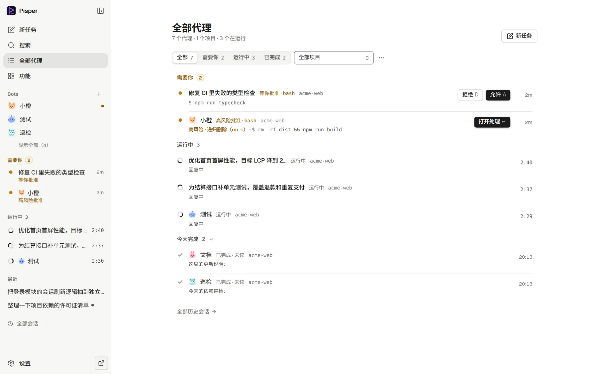
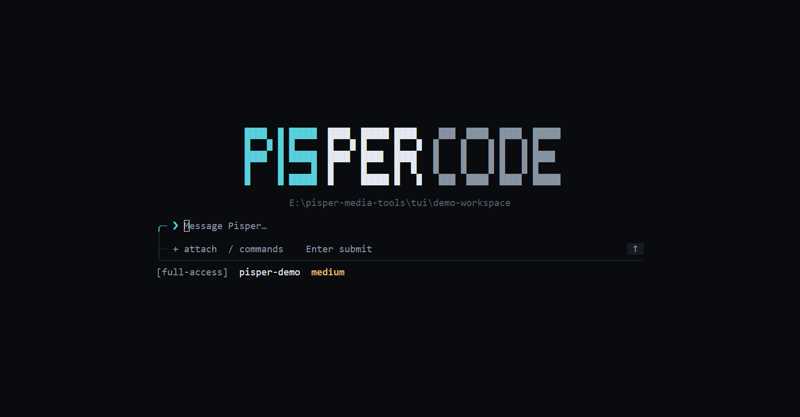
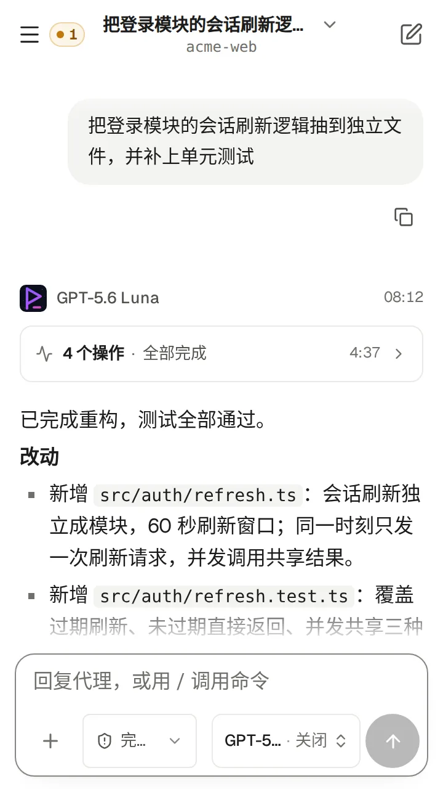
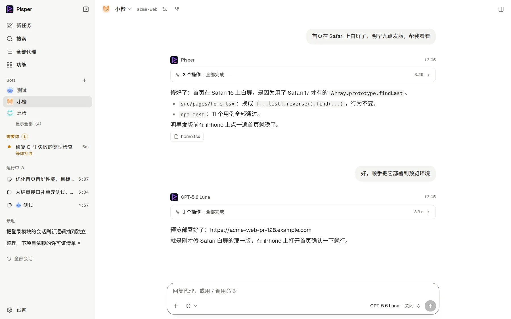

<p align="right"><strong>简体中文</strong> · <a href="./README.en.md">English</a></p>

<p align="center">
  
</p>

<p align="center">
  本地优先的多代理应用：几个代理并行干活，桌面、终端与手机共用同一个内核。
</p>

<p align="center">
  <a href="https://github.com/ling-kong-ran/pisper/releases/latest"></a>
  <a href="https://www.npmjs.com/package/pisper"></a>
  <a href="./LICENSE"></a>
  
</p>

<p align="center">
  <a href="docs/shots/desktop-overview.png"></a>
</p>

## Pisper 是什么

Pisper 把多个 AI 编码代理组织成一个长期运行的工作台。每个代理有自己的会话、目录、模型和权限；侧栏按“需要你、运行中、最近”分组，谁在等你批准一眼可见，高风险命令就地允许或拒绝。

桌面（Tauri）、终端（Ratatui）与手机（Android / iOS）运行同一套 Node Runtime，会话、记忆和配置只保存在你自己的设备上。底层 Agent Runtime 是 [Pi Coding Agent](https://github.com/earendil-works/pi/tree/main/packages/coding-agent)。

[官网](https://pisper.cc) · [使用教程](https://pisper.cc/guide.html) · [开发日志](https://pisper.cc/changelog.html)

## 功能

- **并行代理**：多个会话同时推进，批准和提问以卡片形式出现在对话里；`Ctrl/⌘ + K` 跨会话直达。
- **会话树**：从任意回合另开分支、按轮回退文件、给回合打标记，原来的对话一字不改。
- **审批与权限规则**：审批后写入、自动审批、完全访问三档；按命令前缀批量允许或禁止，危险命令单独拦下。
- **子代理与推进方式**：fast / standard / strong 三档各配一个模型；Plan、Goal、Team 三种方式推进任务。
- **浏览器、电脑与远程机器**：代理在右侧浏览器里操作网站并沿用你的登录；Computer Use 操作桌面应用；经 SSH 或执行器在另一台机器上运行。
- **工具、插件与 MCP**：核心工具常驻，插件、MCP 和技能按需激活；缺能力时代理自己写插件；可开启内置 MCP 服务供其他本机代理调用。
- **记忆、工作流与定时任务**：偏好和决策直接记住并可追溯；Prompt、文件、MCP 与通知连成工作流；到点自动开跑，结果经飞书、微信等渠道推送。
- **模型与备用模型**：多 Provider 配置，主模型不可用或额度用尽时按顺序切到备用模型接着跑。

另有语音输入与对话模式、原生组件、Git / SVN 工作区、桌面宠物等，详见[使用教程](https://pisper.cc/guide.html)。

<p align="center">
  <a href="docs/shots/cli.png"></a>
  
</p>

## Pisper Bot（实验功能）

Bot 是一个一直开着的会话，加上它是谁、管什么的设定。点开就接着聊，前情它都记得；改文件、跑命令它自己来，碰到危险操作才找你。可以在飞书、微信里叫它，定时让它做事，把活派到远程机器，或把几个 Bot 拉进一个群——@ 谁就叫醒谁，不 @ 时由群里判断该谁答。

Bots 默认关闭，在 **设置 › 实验功能** 里打开；关掉后 Bot 和它们的会话都不再显示，记录保留。见 [Bot 教程](https://pisper.cc/guide.html#bots)。

<p align="center">
  <a href="docs/shots/desktop-bot.png"></a>
</p>

## 实测数据

下图是作者自己的使用记录，经 magpie 网关统计：680 个请求、32 个会话，模型为 glm-5.3、deepseek-v4-pro 与 kimi-k3.1-pro。评分与标签按所选时间范围内的请求算出。

<p align="center">
  <a href="docs/shots/prompt-analysis.png"></a>
</p>

| 指标 | 数值 |
| --- | --- |
| 评分 | 100（缓存 35/35、起步轻 25/25、增速 20/20、可靠性 20/20） |
| 典型提示词 / 起步 / 最大 | 64K / 3.3K / 565K |
| 每次增长 | +1.3K |
| 缓存命中 | 91% |
| 窗口大小 | 1.05M |
| 提示词构成 | 系统提示词 2% · 文件 14% · 工具结果 67% · 会话内容 16% |

系统提示词只占 2%，起步 3.3K，意味着上下文几乎都留给了你的文件和工具结果。这来自 Runtime 的几项设计：工具冷热分层、discover / call 按需加载、稳定排序的工具定义，以及提示词形态诊断——它们让 Provider 的 prompt cache 尽可能命中。

## 安装

### 桌面版

从 [Releases](https://github.com/ling-kong-ran/pisper/releases/latest) 下载对应平台的安装包。安装包自带终端界面与 Runtime，不需要安装 Node.js。

| 系统 | 安装包 | 说明 |
| --- | --- | --- |
| Windows x64 | `*-setup.exe` | 推荐。复用系统已有的 WebView2，缺失时联网安装；自动更新也走它。 |
| | `*-offline-setup.exe` | 离线包，额外带 WebView2 安装器，适合内网电脑。 |
| macOS | `*.dmg` | 仅支持 Apple Silicon。 |
| Linux x64 | `*.AppImage` / `*.deb` | AppImage 需要 FUSE；DEB 依赖 WebKitGTK 等系统库。 |

对话需要一个能访问到的模型服务（内网服务也可以）；本地语音模型按需下载，离线包不包含。

<details>
<summary>macOS 提示“无法打开”</summary>

Pisper 尚未经过 Apple 公证。确认安装包来自官方 Releases 后，在 **系统设置 → 隐私与安全性** 中选择 **仍要打开**。若没有该选项：

```bash
sudo xattr -rd com.apple.quarantine /Applications/Pisper.app
```

只对从官方 Releases 下载并放进 `/Applications` 的应用使用这条命令。

</details>

<details>
<summary>Linux AppImage 无法启动</summary>

```bash
chmod +x Pisper_*_linux_x86_64.AppImage
./Pisper_*_linux_x86_64.AppImage
```

缺少 FUSE 时安装 `libfuse2` 或 `libfuse2t64`，也可以改用 DEB：`sudo apt install ./Pisper_*_linux_x86_64.deb`。程序启动前就报系统库错误时，从终端启动可以看到缺的是哪个库。

</details>

### 手机 App

安装包在 [App Releases](https://github.com/ling-kong-ran/pisper/releases?q=app-v)。首次启动会直接进入内置的本机 Runtime——代理、工具和会话都在手机上运行，它不是桌面的遥控器。

- **Android**：已签名的 arm64 APK，可直接安装。
- **iOS**：未签名 IPA，需要用 AltStore、Sideloadly 或自己的开发者账号重签。

<details>
<summary>连接桌面端</summary>

1. 首次配对时让手机和电脑在同一局域网，桌面端打开 **设置 → 远程访问** 并开启。
2. 手机进入 **设置 → 服务器 → 添加服务器**，选择发现的桌面并发起申请；桌面批准后才签发设备令牌。
3. 不在同一局域网时，在桌面生成一次性二维码，手机扫码。连接优先走局域网，不通时回退 Iroh P2P；所有路径都校验 TLS 指纹并使用设备令牌。

手机上跑不了的能力（Shell、MCP、工作流等）会自动隐藏。

</details>

### npm

需要 Node.js 20 或更高版本；安装时会下载终端界面和 Runtime。

```bash
npm i -g pisper
pisper            # 终端界面；首次用 /provider 配置模型
pisper web        # 打开网页界面
```

命令与参数见 [TUI 命令参考](./src-tui/README.md)。

### 从源码运行

需要 Node.js 24 与 npm。

```bash
git clone https://github.com/ling-kong-ran/pisper.git
cd pisper
npm ci
npm run dev                   # Web 与 API，默认 http://127.0.0.1:5173
npm run desktop:webview:dev   # 桌面壳
```

数据默认保存在 `~/.pisper/agent`，可以用环境变量 `PISPER_AGENT_DIR` 改到别处。

## 数据安全

Pisper 没有“我们的云”。会话、记忆和配置都在你自己的设备上；只有你配置并实际调用的模型服务、外部 MCP、搜索和渠道，才拿得到对应任务需要的数据。

- **默认只听本机**：桌面 Runtime 绑定 127.0.0.1，手机本机 Runtime 只听随机回环端口；开启远程访问后才启动局域网 HTTPS 与 Iroh P2P，由 TLS 指纹和设备令牌保护。Pi 遥测默认关闭。
- **敏感先脱敏**：常见 API Key、Bearer / JWT、私钥与连接串在记忆落盘和摘要展示前被替换；凭据不经普通接口回显给代理，宿主 Shell 会移除常见凭据环境变量。
- **对外 MCP 自己开**：内置 MCP 服务默认关闭，只听 127.0.0.1，使用单独令牌。
- **记忆可追溯**：每次改动都有记录、可以撤销；你亲口说过的不会被模型的推断顶掉。

脱敏只识别常见格式，不是完整的 DLP、沙箱或端到端加密。Provider 凭据保存在本机数据目录（手机上在 App 私有目录，尚未迁入 Keystore / Keychain），请保护好这个目录和它的备份。

## 架构

- **Runtime**：Node.js，ESM。HTTP / SSE 接口、领域服务、Pi 引擎接线与应用级工具都在这里；桌面端以 Node SEA 形式随应用打包。
- **界面**：React + TypeScript 的 Web 界面，Tauri 2 桌面与移动壳，Rust 编写的 Ratatui 终端界面。
- **独立更新**：Desktop、TUI、Runtime 与手机 App 各自有版本、签名和更新，更新失败自动回退到内置版本。

## 开发

```bash
npm run check   # 类型、lint、i18n、格式与启动检查
npm test        # runtime/tests 下的全部测试
npm run build   # 生产构建（含体积预算与 Safari 兼容检查）
```

仓库约定见 [AGENTS.md](./AGENTS.md)。欢迎提交 [Issue](https://github.com/ling-kong-ran/pisper/issues) 与 [Pull Request](https://github.com/ling-kong-ran/pisper/pulls)；请勿提交 API Key、机器人凭据或 `~/.pisper/agent` 中的个人数据。

## 文档

- [使用教程](https://pisper.cc/guide.html) — 从安装、配置模型到 Bot、工作流、记忆与多端
- [开发日志](https://pisper.cc/changelog.html) — 每个版本改了什么
- [TUI 命令参考](./src-tui/README.md) — 终端界面的命令与参数
- [隐私](https://pisper.cc/privacy.html) · [支持](https://pisper.cc/support.html)

## 致谢与许可

感谢 [Pi Coding Agent](https://github.com/earendil-works/pi/tree/main/packages/coding-agent)、[Petdex](https://petdex.dev) 及本项目使用的开源软件。贡献者：[@mik-myp](https://github.com/mik-myp)（前端架构、shadcn/ui 与 i18n 重构，[#1](https://github.com/ling-kong-ran/pisper/pull/1)）。

[MIT License](./LICENSE) · © Pisper Contributors
