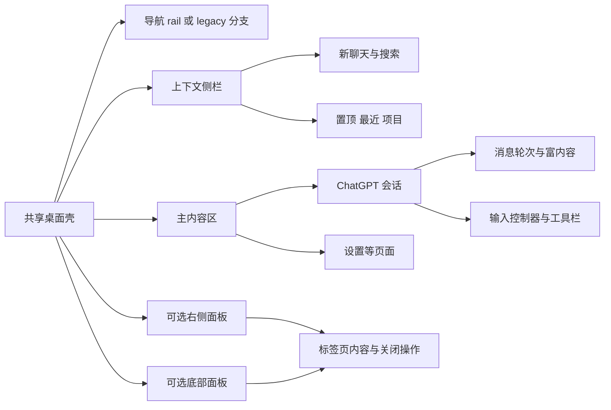

# ChatGPT 前端设计与交互实现分析

> 第六轮 · 2026-10-20 · 本机安装版本 26.1013.40934（20770）
>
> 这是一份基于 REA 与安装包资源的前端实物分析，覆盖实际样式、布局、排版、控件和事件处理。数值来自包内声明或代码公式，不把拟议设计当作现状，也不以其他产品为参照。

## 阅读导航

- [一、对象、方法与覆盖范围](#scope)
- [二、页面结构、导航、面板与设置](#navigation)
- [三、字体、排版、颜色、几何与动效](#visual)
- [四、按钮与浮层组件的完整行为](#controls)
- [五、输入框、附件、模型及消息交互](#conversation)
- [六、跨区域的前端机制与边界状态](#crosscutting)
- [七、弹窗、菜单与页面状态补全](#dialogs-states)
  - [共享浮层、键盘与焦点](#dialog-primitives)
  - [会话、首页、来源与项目状态](#conversation-states)
  - [设置、归档与记忆管理](#settings-states)
  - [登录、引导与订阅表单](#auth-billing-states)
- [八、全局聊天搜索、受保护会话与遗漏设置页](#search-pin-settings)
  - [全局聊天搜索](#global-chat-search)
  - [受保护会话与Account PIN](#protected-conversation-pin)
  - [账户、安全登录与通知](#account-security-notifications)
  - [时间管理与可信联系人](#wellbeing-settings)
- [九、高级账户保护、登录连接、年龄验证与语音设备](#advanced-settings)
  - [高级账户保护](#advanced-account-protection)
  - [登录连接与权限](#login-connection-permissions)
  - [年龄验证](#age-verification)
  - [语音与设备设置](#voice-device-settings-deep)
- [十、页面清点与剩余页面族补全](#page-inventory)
  - [GPT、Images与Library](#gpt-library-deep)
  - [应用、插件与连接授权](#apps-integrations-deep)
  - [Family、独立核验与个人账单](#family-billing-deep)
  - [计划任务、快捷键、协议与许可证](#scheduled-settings-deep)
  - [广告、密码、云电脑、Work与Space/Agent](#remaining-settings-deep)
  - [公开资料与工作区团队](#profile-team-deep)
  - [Health、Finances、Maps、Shopping与CME](#specialized-pages-deep)
  - [Business入口与结算状态](#business-checkout-deep)
  - [Business详情管理](#business-details-deep)
  - [Sites页面族](#sites-pages-deep)
- [十一、证据、校验与尚不能确定的内容](#evidence)

配套：[页面覆盖台账](page-coverage.md)、[主路由逐项索引](route-inventory.json)、[全部按钮变体](button-variants.md)、[逐条证据与原文](evidence-details.md)、[机器可读证据](evidence-index.json)、[使用到的源文件摘要](source-manifest.json)、[字体文件元数据](font-metadata.json)。

## 一、对象、方法与覆盖范围

### 研究对象

| 项目                    | 核实值                                                             |
| ----------------------- | ------------------------------------------------------------------ |
| 安装对象                | `/Applications/ChatGPT.app`                                        |
| 版本 / build            | 26.1013.40934 / 20770                                              |
| 主资源                  | `Contents/Resources/app.asar`                                      |
| ASAR 字节数             | 582,430,926                                                        |
| SHA-256                 | `5ddc4e48259aa6f979e04529b1a5a4ae54b0f5c4ad6db5c6e004924c10916ddb` |
| bundle identifier       | `com.openai.codex`                                                 |
| 可执行文件 / HTML title | ChatGPT / ChatGPT                                                  |
| 内部包名 / productName  | openai-codex-electron / Codex                                      |
| 最低 macOS 声明         | 13.0                                                               |

应用显示名、内部包名与页面产品模式并不相同。这个安装包包含 ChatGPT、Work 及共享桌面壳资源；本报告只将有调用链支持的分支归入 ChatGPT 对话。共享基础组件另行标注，专属代码工具不能因为同在安装包中就当作 ChatGPT 普通聊天能力。

### 怎样检查与本轮增量

第二轮由 REA 对原 ASAR 建立资源身份与 JavaScript 静态关系；随后针对字体加载、布局面板、popover、输入控制器、消息编辑、评分与停止确认等 31 个小模块进行两组定向解析。两组均无解析失败，共读取 148,096 字节、遍历 44,382 个 AST 节点。巨大共享包和实际调用处则结合惰性文本提取、Babel AST 与精确片段交叉追踪，没有执行目标 JavaScript。

第三轮再次核对同一 ASAR 摘要，新增三批 **35 个定向模块**解析，读取 198,554 字节、遍历 50,378 个 AST 节点，0 解析失败。围绕弹窗、菜单、认证、订阅、设置与页面边界状态补充实际调用链，并与共享包中的消费者、关闭回调和异步处理交叉检查。批次可能复查已有模块，不能将累计批次数相加当作去重覆盖率。

第四轮补充两批 **16 个定向模块**，读取262,819字节、遍历77,987个AST节点，0解析失败；围绕全局聊天搜索、PIN和遗漏设置继续检查共享消费者与精确代码片段，新增121条引用。REA统计只描述选中模块的解析，旁证文本追踪不冒充完整自动恢复。

第五轮补充三批 **17 个定向模块**，读取334,259字节、遍历91,621个AST节点，0解析失败；新增262条证据，覆盖高级账户保护、登录连接权限、年龄验证及语音设备，并进一步检查Persona宿主SDK、声音选择器、快捷键和词典消费者。自动语义图仍有节点与未知关系保留上限；本轮结合原文片段追踪，不以解析成功替代完整语义覆盖。

第六轮补充八批 **82 个定向模块选择**，读取3,115,963字节、遍历877,944个AST节点，0解析失败；新增738条精确证据，并建立根路由/设置覆盖台账。选中模块数量不是去重覆盖率，自动语义图仍为partial/truncated；全文消费者追踪和具体原文引用另行保留。

资源层提取并校验 **15,246 个前端文件**：14,853 个 JS、323 个 CSS、67 个字体文件、3 个 HTML，共 405,176,594 字节。这是清单与摘要校验范围，不是逐一恢复了 14,853 个模块的业务语义。没有恢复原始 TypeScript 源码，也没有发现可用的 source map 文件；资源末尾的 sourceMappingURL 注释本身不等于 map 存在。

字体部分用 fontTools 检查实际 WOFF2 的字重、版本、字符映射和度量；交互部分追到条件表达式与 handler，避免仅从按钮文案猜测。本文保留颜色、尺寸变量的覆盖层次，而非把最先找到的 CSS 值视为屏幕最终值。

### 证据等级与数值口径

| 标记方式          | 所代表的事实                          | 不代表什么                             |
| ----------------- | ------------------------------------- | -------------------------------------- |
| 静态声明          | CSS、字体元数据、JS 常量确实存在      | 当前页面一定消费它                     |
| 调用链 / handler  | 调用方、条件和动作可从代码连起来      | 当前账号权限允许、后端成功、已运行验证 |
| 基础值 / fallback | 没有更高优先级覆盖时的值              | 用户当前字号、主题与布局               |
| 公式换算          | 在给定rem、窗口宽度等假设下的数学结果 | 实测尺寸、截图标尺                     |
| 未验证            | 尚无运行时、设备或完整链路证据        | 功能不存在或必然失败                   |

本文 px 换算若来自 Tailwind spacing，统一按 `1rem=16px` 举例；设置里的 UI 字号14px不等于根rem变成14px。浏览器缩放、系统文本设置、CSS继承和主题运行时写入都可能影响最后呈现。

### 前端内容覆盖表

| 领域             | 本文已分析                                                                                    | 仍未实测或未完整追踪                                   |
| ---------------- | --------------------------------------------------------------------------------------------- | ------------------------------------------------------ |
| 字体与排版       | 字体文件、全局与局部字体、字号级联、字重、字距、Markdown层级、打印                            | 中文最终fallback、当前用户computed style               |
| 布局             | rail/侧栏、主区、右/底面板、宽度公式、断点、滚动容器                                          | 当前窗口像素坐标与所有嵌套继承                         |
| 视觉             | 灰阶、语义色、主题生成、圆角、描边、阴影、透明度、动效                                        | 当前主题最终色值与全界面对比度                         |
| 输入             | 富文本/草稿、发送停止条件、快捷键、IME、附件、工具和模型                                      | 所有账户/服务端能力组合                                |
| 消息             | 复制、编辑、反馈、反应、重试、版本、引用、代码块                                              | 所有富卡片/第三方小组件的完整生命周期                  |
| 导航与设置       | 搜索、排序、可见性、外观、未保存保护、项目设置、分享                                          | 每个设置分区全部表单与后端策略                         |
| 图片与语音       | 查看器、失败回退、图库操作门槛、语音phase与静音控制                                           | 真正设备授权、录音播放、实时音视频                     |
| 辅助能力         | 焦点、ARIA、触摸、RTL逻辑padding、reduced-motion、加载与恢复                                  | 屏幕阅读器整体验收、全部语言与移动端                   |
| 登录与订阅表单   | 登录布局、认证交接/错误、首次引导、变更确认、支付方法与初始化失败                             | 实际provider登录、支付SDK iframe、验证挑战、端到端结果 |
| 管理与数据       | 数据控制、归档、个性化、保存记忆、About You、导出失败分类                                     | 全部企业管理、其他专业页面及未追踪后台策略             |
| 搜索与受保护内容 | 全局聊天搜索、PIN输入/创建/修改/锁定、取消门禁、后台重锁与重置交接                            | 实际账号内容搜索、PIN策略与浏览器重认证                |
| 补充设置         | 账户、安全会话/历史、密钥改名、Lockdown、通知渠道、时间计划、可信联系人                       | 实际账户修改、外部认证、邀请与跨地区行为               |
| 高级设置         | 高级保护、登录授权详情与移除、年龄验证状态机、语音设备/声音/词典/快捷键                       | 远端认证、Persona内容页、实际设备权限和服务端状态      |
| 新增页面族       | GPT/Builder/Images/Library、应用连接、Family/账单、计划、Profile/Team、专门页、Business/Sites | 详见页面台账中的部分、仅入口、外部边界                 |
| 弹窗与菜单       | 模态/非模态、焦点、Escape/外部点击、提交关闭保护、上下文菜单、嵌套选择器                      | 当前平台原生菜单、完整读屏与真实事件顺序               |

当前环境拒绝对 `com.openai.codex` 进行 Computer Use，因此没有取得运行界面截图、DOM 或 computed styles。没有改用其他渠道绕过这一限制。本文提供可审计的包内实现分析，不能标成“全页面、全账户、全平台均已实测”。

## 二、页面结构、导航、面板与设置

下面的结构图只表达已确认的组件关系与可选区域，不是截图，也不承诺所有区域同时可见。

资料来源：本次提取并经校验摘要的 `sources/webview` 前端包。本文不使用官网资料，不比较其他产品，不提出替代设计。证据索引为同目录 `navigation-panels-evidence.json`，每项包含原文件相对路径、Python Unicode 字符偏移与不超过 600 字符的精确片段。本文中的 N 编号可直接定位原文。

**范围与判断标准：** 已确认表示交付包内存在相应结构、CSS 或 handler；不表示当前用户已获灰度、权限、原生能力或网络后端支持。一个字符串只证明有该文案，只有结合 render 条件/handler 才描述可执行行为。保留源码中的 class 和 token，不在缺少 token 求值时擅自转换为像素。JS 数字宽度与 CSS 明示 px 分开记录。

### 真实主导航入口与壳结构

真正主聊天侧栏在 `app-initial-90eb42395b7d.js` 中，主壳于约 11,389,000 字符开始；`sidebarElectron.chatHistoryNavigation` 明确标注主导航 landmark 为 **Chat history**，其说明包含 new chat、projects、recent chats。渲染为 `nav`，含 role/navigation 和动态 aria-label。主壳会按当前 feature area 切换上下文侧栏：Home、Scheduled、Customize、Orbit、Space、Code Review、Activity，而非将它们同时塞进主聊天列表。（[N005](evidence-details.md#n005)）

不能将名称相近的 chunk 当作主侧栏：`sidebar-c9ecbc40b55b.js` 是 Meetings，`sidebar-9d911fe8066f.js` 是 Code Review，`sidebar-ff796cb661ef.js` 是 Scheduled。这三者不是本节主聊天导航的尺寸或列表结构来源。

主壳有 legacy 与 rail 的分支；`R !== 'legacy'` 决定 rail 路线。productMode 为 `work` 时将 sidebarMode 映射为 `chatgpt`，其余映射为 `codex`。Work 的云聊天和本地聊天内容分别接受能力判定。这个包含有共享多产品面的壳，不能把 Codex 专属入口写成任何 ChatGPT 用户固定可见的菜单。（[N006](evidence-details.md#n006)）

导航 rail 是与内容侧栏分离的纵向 flex 容器：`relative flex min-h-0 shrink-0 flex-col items-center gap-2 px-2 pb-2 select-none`；浏览器分支附加 `w-13`、行高变量 36px、横向 row padding 8px，窄屏可加边框。rail 的列表部分自行滚动，使用渐隐遮罩与隐藏 scrollbar。底部设置入口不属于聊天滚动列表。（[N007](evidence-details.md#n007)）

页面装饰表面由 `._PageSurface_etoz9_2` 定位在标题栏以下、navigation rail 之后，圆角来自 window-radius、阴影来自 page-surface-shadow，且 `pointer-events:none`；可见容器结构与交互内容分层。不能将装饰 div 当作真正的点击面板。（[N096](evidence-details.md#n096)）

### 宽度、响应式与面板

| 对象             | 提取包内实际约束                                                                                                                           | 证据                                                               |
| ---------------- | ------------------------------------------------------------------------------------------------------------------------------------------ | ------------------------------------------------------------------ |
| 左侧栏宽度       | 本地键 `sidebar-width`；默认值 340；有限数值经过 `max(minimum, min(value,520,availableWidth-240))`，minimum 默认 240；非法数值回退至少 340 | [N001](evidence-details.md#n001)                                   |
| 小屏左侧栏       | 查询与 CSS 均使用 768px；只有启用 `data-app-shell-responsive-sidebar=true` 的壳在该断点以下令面板宽度为 0、隐藏响应式面板、去掉主区左边框  | [N001](evidence-details.md#n001)、[N004](evidence-details.md#n004) |
| 右面板           | 默认 600 时：`max(320, min(shellHeight*1.6,mainWidth-500), min(640,mainWidth-352))`；之后还经过模式上限校正                                | [N002](evidence-details.md#n002)、[N003](evidence-details.md#n003) |
| 右面板 widthMode | full 上限为可用全宽；unified 预留 320；regular 预留 352；函数使上限至少为 320                                                              | [N003](evidence-details.md#n003)                                   |
| 右面板持久化     | `app-shell:right-panel-width:v3`；新格式存 0–1 比例，已有像素值经转换，读取再按当前可用区间计算实际宽度                                    | [N002](evidence-details.md#n002)、[N003](evidence-details.md#n003) |

侧栏宽度公式中的可用宽度参数是调用时传入的约束，不表示每个渲染点都始终传入；极窄窗口还由响应式分支处理。右面板的最小宽度是函数级约束，不能由此声称所有窗口在 320px 以下仍会同时保留全部区域。

右面板/底面板切换不只是一个 CSS `display` 状态。浏览器面板 toggler 查活动 browserTab、当前 bottom/right 目标、已有 tab 与可见状态；关闭会通知相应浏览器服务，打开时优先复用目标 tab 或最后一个浏览器 tab，必要时创建/激活新的目标。（[N079](evidence-details.md#n079)）

面板工具按钮默认 toolbar、ghost，`pressed` 时变为 secondary；outline 按钮在 pressed 时用 outlineActive。共用组件提供 `aria-label`、`aria-pressed`、disabled、uniform，以及支持快捷键文本的延迟 tooltip。（[N078](evidence-details.md#n078)）

Tab strip 向下传 `onActivateTab`、`onCloseTab`、关闭后的 focus fallback、reducedMotion、keyboardNavigationDisabled；单个主标签仍使用水平 `role=tablist`。关闭按钮有完整的 “Close {title} tab” 可访问名称，handler 调用 `closeTab`。紧凑标签的关闭按钮默认透明且无 pointer events，在 hover、focus-within 或自身 focus-visible 时出现；mousedown 阻止默认及冒泡，pointerdown 阻止冒泡，避免关闭操作同时激活标签。（[N091](evidence-details.md#n091)–[N094](evidence-details.md#n094)）

底部面板专门存在 **Hide bottom panel** 分支，其文案定义为隐藏但保留 tabs；另有 Close 分支。文档必须区分隐藏容器、关闭 tab 与销毁内容生命周期。（[N095](evidence-details.md#n095)）

### 聊天侧栏的组织与动作

- New chat：ChatGPT 分支读取当前 homeComposerMode；模式为空返回 null；Codex 分支采用 work。点击时根据 chat 模式和能力选择 ChatGPT 启动流程，或通过分派器创建项目/非项目聊天；同时注册 `newTask` 命令。不能把所有 New chat 归结为单一固定 URL 跳转。（[N014](evidence-details.md#n014)、[N015](evidence-details.md#n015)）
- Search：点击向 host 派发 `chat-search-command-menu`；tooltip 的快捷键由 `openCommandMenu` 当前配置解析，代码没有在这个入口硬编码 Cmd+K。（[N012](evidence-details.md#n012)、[N013](evidence-details.md#n013)）
- 统一会话列表明确有 Pinned 与 Recents。这里 Recents 的文本说明是统一 ChatGPT chats 和 Codex tasks；实际内容仍受产品面和权限条件影响。（[N016](evidence-details.md#n016)）
- Projects 列表有请求中、失败与 Retry。失败时 Retry 调用 `refetchProjectList`，按钮 loading 跟随请求状态。（[N017](evidence-details.md#n017)）
- 组织菜单的消息表包含 By project、By connection、In one list；实际 Sort chats 子菜单传入的是 `updated_at` 与 `manual`。虽然消息表还声明 Created，不能仅凭这条字符串写出“当前菜单提供按创建时间排序”。（[N018](evidence-details.md#n018)、[N019](evidence-details.md#n019)）
- 聊天行操作消息表包括 Archive、Pin/Unpin、Project、Rename、Section；其是否显示仍由具体 item builder 决定。标题重命名与 emoji 保存是可区分结果：有“标题已保存，但 emoji 未保存”的专门错误。（[N020](evidence-details.md#n020)、[N021](evidence-details.md#n021)）

导航目标的固定与聊天固定是两种对象。Explore 的目标 pin 上限是 **8**，不应误写成聊天只能置顶 8 条。（[N010](evidence-details.md#n010)、[N011](evidence-details.md#n011)）

导航 rail 和 Customize 支持拖动排序；onDragEnd 只对合法 active/over 目标执行重排。无障碍文案包含拾取、移动、释放、取消、当前位置/总数。Customize 提示使用 Space 或 Enter 拾取，方向键移动，再次确认放下或 Escape 取消。（[N008](evidence-details.md#n008)、[N009](evidence-details.md#n009)）

### 命令菜单与全局搜索

命令菜单同时容纳 quick actions、命令分组、聊天、Page、浏览器 tab 等，权限不同意味着可搜索集合不同。不能假定已安装插件、所有云会话或所有 Space 页面都可搜索。

聊天查询先 trim，再经过 `ii(I,xo)`，其中 `xo=200`。逐 host 查询键为 `['command-menu-thread-search',host,debouncedQuery,limit]`；只有功能允许、搜索计划包含 content results 且去抖查询非空时请求。staleTime 为 30 秒。调用方在去抖结果与当前输入相等时才采用 host 异步结果，避免旧 query 直接混入新结果；云 ChatGPT 结果和已加载聊天结果在同一合并函数汇总。（[N022](evidence-details.md#n022)–[N024](evidence-details.md#n024)）

Page 的查询限定 scope=space、limit=5，并受 Space 能力和非空查询限制。空查询显示 Recent Pages，其说明是最多五个本地记忆的最近打开页面。不要把这个局部 5 条限制扩展到所有搜索结果。（[N025](evidence-details.md#n025)、[N026](evidence-details.md#n026)）

菜单具备隐藏但可访问的标题和说明；外层 Dialog 为 fixed、left-1/2、水平平移、z-50，内容的真正底色在 cmdk-root。（[N027](evidence-details.md#n027)）

| 结构                             | CSS 还原                                                                      |
| -------------------------------- | ----------------------------------------------------------------------------- |
| 普通命令菜单宽度                 | `min(520px,92vw/windowZoom)`                                                  |
| 列表高度                         | `min(300px,max(120px,90vh/windowZoom-64px))`                                  |
| 全局菜单列表高度上限             | 440px，仍受视口约束                                                           |
| 顶部位置                         | 至少 spacing*4/windowZoom，或按最大菜单高度垂直居中                           |
| cmdk 外观                        | surface-elevated-secondary、shadow-2xl、radius-2xl；深色分支显式 border-color |
| item                             | 全宽、content-visibility:auto、最小 spacing*6 高、radius-lg、默认 opacity .75 |
| item disabled                    | cursor default、opacity .25                                                   |
| item hover/selected/focus/active | 背景统一变为 primary-ghost-hover、opacity 1                                   |

以上来自 [N028](evidence-details.md#n028)、[N029](evidence-details.md#n029)。查询无匹配、搜索中、ChatGPT 搜索失败可重试、无聊天引导等为组件中的不同状态，不应拿一个空白列表代表所有错误。

### 设置导航、可见性与离开保护

设置页是应用壳内页面，不应一概画成居中小弹窗。专用 settings navigation 包含 Search settings、清除搜索、结果为空；全页传入 `canCollapse:false` 和分组模式。设置的可见集合与可搜索集合分开传递。（[N030](evidence-details.md#n030)、[N031](evidence-details.md#n031)）

`use-visible-settings-sections` 决定项目、宿主、认证、能力、插件与灰度可见性。例如 Appearance 直接 visible=true；Voice 要求 dictationHistory 或其他语音能力条件；Debug、Pets、browser-use 等另有条件。不能用全包 registry 的数量当作某个账户会看到的设置数量。（[N032](evidence-details.md#n032)）

搜索索引也会过滤不可见的半透明侧栏和 Dock icon 选项。搜索命中可携带 targetId/targetText/navigationKey；进入 Appearance 时深定位可默认展开 Advanced，而普通访问未必展开。（[N033](evidence-details.md#n033)、[N042](evidence-details.md#n042)）

离开有未保存内容的设置页时使用 compact 确认对话框，隐藏右上关闭图标。Keep editing 只清 pendingNavigation；Discard form 提交阻止默认行为，保存待执行导航到局部，先清 pending 再调用它。这个处理避免确认框因旧 pending 状态再次触发。（[N034](evidence-details.md#n034)、[N035](evidence-details.md#n035)）

### Appearance：主题、颜色、字体和重置

本节是设置交互还原；具体 token 计算和运行时主题覆盖见本文视觉章节。

#### 模式与分组

Appearance 默认模式为 system，枚举 system/light/dark。模式选择为三列 radiogroup，`w-68 max-w-full grid-cols-3 gap-4`；每项是真实 radio，视觉缩略图 4:3、圆角，支持焦点 outline。模式提交调用持久化函数且 `optimistic:false`。（[N036](evidence-details.md#n036)、[N038](evidence-details.md#n038)–[N041](evidence-details.md#n041)）

首段 Visual style 包含模式、theme、颜色与主 UI font。第二段 Advanced 可展开，按钮有 aria-controls/aria-expanded。Separate light and dark modes 是本地展示开关：关闭只展示当前 effective variant；开启显示 light 与 dark 两份已存配置，不会自行覆盖任何一份主题值。（[N042](evidence-details.md#n042)–[N045](evidence-details.md#n045)）

#### 颜色与系统背景

Accent、Background、Foreground 是分别编辑的角色。色值输入会移除非十六进制字符和多余 #、截断至 6 位，仅在严格 `#RRGGBB` 时调用 onChange 并存为小写；无效草稿不立刻写入权威主题。（[N047](evidence-details.md#n047)）

色值胶囊 `h-7 w-24`、圆形色块 `size-3.5`，输入文本大写、等宽数字；focus-within 有 ring。popover end 对齐、sideOffset=8、rounded-xl/p-3；色盘 h-34/w-34。（[N048](evidence-details.md#n048)）

Contrast 滑杆 min=0、max=100、step=1，并显示数值；轨道渐变根据当前 accent 和 surface 计算。（[N049](evidence-details.md#n049)）

Translucent sidebar 仅在系统背景能力未明确返回不支持时出现；开关勾选等于 `!opaqueWindows`，写入时同样取反。它不是独立的“透明度百分比”。（[N045](evidence-details.md#n045)、[N046](evidence-details.md#n046)）

#### 字体选择器与字号

系统字体通过 `systemFonts.getFontFamilies()` 原生桥枚举；缺少桥或结果为空可用自定义 CSS font-family 输入。查询不重试且 staleTime 无限；查询中显示图标 spinner。（[N050](evidence-details.md#n050)、[N051](evidence-details.md#n051)）

字体选择分 family、style、both 三种控件模式。UI font 默认 System，Content font 可跟随 UI font；代码字体的族列表要求其所有 faces 均标记 isMonospaced。选择系统字体族使用首个 face；选择非首个 face 记录 family/fullName/postscriptName 并请求字体 face loader。（[N051](evidence-details.md#n051)、[N054](evidence-details.md#n054)）

字体族下拉 end 对齐、tall/menuWide；样式下拉 menuNarrow。按钮 `w-full max-w-36 max-sm:max-w-none`；小屏可以铺满行。系统字体不可枚举时保留 CSS 字体或 fallback list 输入，通过 Enter 或 Use custom font value 提交，空白 trim 为 null。（[N052](evidence-details.md#n052)、[N053](evidence-details.md#n053)）

| 偏好           | 默认 | schema 范围 | 提交方式                        |
| -------------- | ---: | ----------: | ------------------------------- |
| UI font size   |   14 |       11–16 | pointerUp 检测变化、blur、Enter |
| Code font size |   12 |        8–24 | 相同                            |

输入使用 type=number、step=1、w-16，旁边显示 px。parseFloat 后必须 schema 校验；非法值恢复旧数值，有变化才保存。不要写成每次键入都立即提交。（[N036](evidence-details.md#n036)、[N037](evidence-details.md#n037)、[N055](evidence-details.md#n055)、[N056](evidence-details.md#n056)）

Font smoothing 仅 macOS 显示；非 macOS 直接不渲染，文案描述 native macOS font anti-aliasing。（[N057](evidence-details.md#n057)）

#### 重置

Reset to default 仅在分模式展示开启、相关高级偏好变化、或者任一主题有高级变更时显示。点击立即先关闭分模式展示，再并行重置高级偏好与 light/dark 高级主题设置，期间 disabled；使用 Promise.allSettled，部分失败也会显示错误。不能将它描述为保证原子成功，也不是删除全部个人设置。（[N058](evidence-details.md#n058)）

### 项目设置与来源列表

ChatGPT Project settings 与本地 source-folder Create project 是不同对话框。本节只还原 ChatGPT 项目设置。

项目名称 trim 后必填、最大 50 字符；emoji、theme、name、instructions 分开持有草稿。可写权限和 projectCrudStatus 联合产生可编辑判定。Save 需要可编辑、没有保存/待处理操作、名字有效，且名称/外观/指令至少一项确有变化。提交成功关闭，失败保留草稿并设置错误状态；操作未完成时阻止关闭。（[N059](evidence-details.md#n059)–[N062](evidence-details.md#n062)）

主 form 限高 `calc(100vh - 6rem)`、min-h-0、gap-4、overflow-hidden。名称输入 h-10，圆角 xl、focus-within 边框；来源列表可独立滚动。空来源区高 320px、虚线边框、rounded-2xl、中心文案、键盘焦点环；非空来源列表 max-height 320px，纵向滚动、横向隐藏、渐隐遮罩。（[N063](evidence-details.md#n063)–[N065](evidence-details.md#n065)）

来源类型包括文件、connector、保存的回复。来源状态文案区分 Uploading、Synced、Sync failed、Not synced、Syncing；服务器来源加载失败、部分来源加载失败、删除来源失败是不同反馈。拖放在允许写入时 dropEffect=copy，否则 none；拖入后使用 overlay 提示区域，提交 drop 时移除 overlay。

Advanced 提供自定义指令与只读能力说明：project-only/open memory 的说明写明不能在此更改；Space/Library access 的说明写明私有项目可访问，共享后禁用。这些文字是设置 UI 的契约说明，不等同于本轮已验证服务器实施。指令的前端限长常量为 8000。（[N066](evidence-details.md#n066)、[N067](evidence-details.md#n067)）

### 分享对话框：链接生命周期和受众差异

分享不是一个永远固定的“复制 URL”弹窗。组件接收 conversation、message slice、prompt、image/image series、widget、接收者再分享等上下文，并由账户结构/已有链接决定 public 或 workspace 受众。

状态分别为 idle、creating、copied；错误独立存储。主按钮可显示 Create link、Copy link、Copied、Update link：已有链接且 node 不同可能需要更新；图片与 prompt 不一定走同一会话 share API。（[N068](evidence-details.md#n068)、[N069](evidence-details.md#n069)）

点击时如果 creating、图片预览源尚不可用或外部 provider 的 actionsDisabled 为真，直接 return。后续清错误、进入 creating、创建或复用链接、复制；复制失败保留“链接已创建但无法复制”的区别；成功设 copied，并按内容类型与 keep-open 条件决定是否关闭。（[N070](evidence-details.md#n070)、[N071](evidence-details.md#n071)）

失败细分 blocked、create-failed、copy-failed；都回到 idle，使用不同提示。不能把权限拒绝和剪贴板失败混为同一“网络错误”。（[N072](evidence-details.md#n072)）

公开聊天说明表示分享至当前点，记忆来源不共享；工作区说明另有“之后增加的消息也会对成员可见”分支；项目共享说明还明确项目文件与 custom instructions 不会通过此链接暴露。**不得一概写成所有分享都是永久冻结快照，也不得把公开与工作区分享文案互换。**（[N073](evidence-details.md#n073)、[N074](evidence-details.md#n074)）

通用 share destination 控件支持 busy spinner、aria-busy、可选 polite 宣告；尺寸存在大/紧凑实验分支，不能将某一张截图尺寸当作唯一全局规范。

### 弹窗 shell 与图片 sheet

DialogShell 抽象 headerContent/headerActions/footer、标题/副标题、提交、portal、开关焦点回调，以及 isDismissalDisabled。禁止关闭时既不响应 onOpenChange 的关闭请求，也把 shouldIgnoreClickOutside 传给基础 Dialog；form 提交先 preventDefault/stopPropagation，再检查禁止状态。（[N075](evidence-details.md#n075)、[N076](evidence-details.md#n076)）

Image sheet 是特殊 presentation：满宽贴底、自动高度、顶部 40px 圆角、底部无额外 padding；浅色 #fff、深色 #212121；OpenAI Sans，带专门阴影、scrim 和 backdrop 模糊。不要把这个特殊图片分享 sheet 的样式复制为所有普通设置弹窗尺寸。（[N077](evidence-details.md#n077)）

### 图片查看器与生成图 gallery

图片 lightbox 保持选中索引及失败 URL 集合。原图预览解析失败时可回退 fallbackSrc；原图和 fallback 都失败时展示 Couldn't load this image 与 Try again，重试从失败集合移除对应地址。位置显示 current of total，只有多图时呈现。（[N080](evidence-details.md#n080)）

关闭时阻止默认 autofocus，再恢复原焦点；前后导航到首尾时 handler 为 undefined，逻辑不是循环轮播。图片 overlay 使用 readOnly/no-referrer；是否走 overlay 由实验参数 image_overlay_enabled 和 portal/平台上下文共同决定，不是包内唯一查看器。（[N081](evidence-details.md#n081)、[N082](evidence-details.md#n082)）

对外链图片，安全检查结束前不渲染；逐图过滤不允许 URL，安全 thumbnail 可作 fallback；安全过滤后无图则返回 null。favorite 操作也会受阻止外部数据流、product reference、sidebar conversation 等上下文限制。（[N083](evidence-details.md#n083)）

生成图 gallery 与一般外链图片不同：编辑按钮要求功能允许、可编辑、非 preview、status=completed；有前后图时导航跳过 preview 状态。缩略导航单项 size-14、rounded-lg；容器纵向滚动 gap-2/p-1。水平轨道 gap-2，duration-basic/ease-out，motion-reduce 下关闭 transition。（[N084](evidence-details.md#n084)–[N086](evidence-details.md#n086)）

gallery 的 Canvas 文案明确用于多个生成图的 image canvas；它不能被写成传统文字/代码 Canvas。Share、Save、Edit 与 Canvas 是不同动作，不能以“图片点击即可编辑”概括。（[N087](evidence-details.md#n087)）

### 语音入口附近的控制状态

本轮定位到共享 composer 内语音控制函数，接收 action、isMuted、phase、presentation。presentation 有 default/integrated 两种文案风格。phase 至少区分 starting、active、stopping：starting 的 end action 显示 Cancel voice chat，stopping 显示 Ending 并禁用，其他状态显示 Stop voice chat。停止按钮为 composerPrimary、圆形、uniform；停止中使用 spinner 与 aria-disabled。（[N088](evidence-details.md#n088)、[N090](evidence-details.md#n090)）

麦克风静音与输出静音独立控制。麦克风已静音时 dangerSolid；integrated 未静音可为 secondary，default 可为 ghost；输出已静音使用 outlineActive。静音按钮只有 phase=active 时启用。控件有 tooltip 和明确的 mute/unmute 可访问名称。（[N089](evidence-details.md#n089)）

这些控制证明已有语音会话后的前端状态表达；本轮没有完整追踪新会话语音启动入口全部 entitlement、设备授权和 session 创建链，不能写成“任意聊天都能直接启动语音”。

## 三、字体、排版、颜色、几何与动效

本章仅描述本机安装包中可核实的实现，不包含重建设计建议。检查对象是 ChatGPT.app 中的共享前端与明确 ChatGPT 页面资源。共扫描 323 个 CSS 文件，建立下面所选规则的消费和覆盖关系；不能将 CSS 的存在等同于当前账户的页面已挂载。证据编号对应 `typography-visual-evidence.json`，offset 是 Python Unicode 字符索引，所有原文片段≤600字符。

### 首先区分根字号、UI 字号、正文与平台覆盖

`html,:host` 的基础规则指定行高1.5、tab-size4、系统字体回退、字体特性、禁用合成字重、字体抗锯齿和默认字距；该规则没有把根字号设为14px。`body` 使用 `--font-ui-family` 和 `--font-ui-weight`，没有在本条规则设置 `font-size`。因此UI默认14px不等于1rem=14px。文中rem换算仅以根字号16px为示例，实际根字号/浏览器缩放未经computed style测量。[[V001](evidence-details.md#v001)、[V002](evidence-details.md#v002)]

静态共享UI token和运行时字号同步是两层。设置定义给 `sansFontSize` 默认14、`codeFontSize` 默认12。运行时把UI字号写为 `--font-ui-size`，把代码字号写为 `--font-code-size`，再按 `选定UI字号/14` 计算下表token并 `Math.round` 成整数px，写到documentElement和body。这个过程没有把根font-size改为14px。[[V006](evidence-details.md#v006)、[V007](evidence-details.md#v007)、[V008](evidence-details.md#v008)、[V009](evidence-details.md#v009)、[V010](evidence-details.md#v010)]

| UI token      | 共享CSS初值 | 运行时缩放表中14px基准值 | 默认对应行高因子     |
| ------------- | ----------: | -----------------------: | -------------------- |
| `--text-xs`   |      `11px` |                     12px | `calc(1 / .75)`      |
| `--text-sm`   |      `12px` |                     13px | `calc(1.25 / .875)`  |
| `--text-base` |      `14px` |                     14px | `calc(1.5 / 1)`      |
| `--text-lg`   |      `16px` |                     16px | `calc(1.75 / 1.125)` |
| `--text-xl`   |      `28px` |                     28px | `calc(1.75 / 1.25)`  |
| `--text-2xl`  |      `36px` |                     36px | `calc(2 / 1.5)`      |
| `--text-3xl`  |      `48px` |                     48px | `calc(2.25 / 1.875)` |
| `--text-4xl`  |      `72px` |                     72px | `calc(2.5 / 2.25)`   |

这些行高因子属于CSS token，并不是统一的像素行高；组件若显式指定 `leading-6` 或覆盖line-height，应以组件规则为准。静态browser分支把 `text-xs/sm/base/lg/xl/2xl/3xl/4xl` 设为 `.75/.875/1/1.125/1.25/1.5/1.875/2.25rem`，Electron分支把sm/xs设为13/12px且 `--font-ui-weight:430`；扩展分支取VS Code字号和字重。运行时内联变量再参与级联，所以不能仅根据browser CSS推断最终聊天为16px。[[V003](evidence-details.md#v003)、[V013](evidence-details.md#v013)、[V014](evidence-details.md#v014)、[V015](evidence-details.md#v015)、[V010](evidence-details.md#v010)]

### 字体家族与真实字体文件

共享默认UI字体：`-apple-system, BlinkMacSystemFont, "Segoe UI", sans-serif`；代码字体：`ui-monospace, "SFMono-Regular", "SF Mono", menlo, consolas, "Liberation Mono", monospace`；内容字体 `--font-content` 取 `--codex-content-font-family`，缺省才取 `--font-sans`。browser系统栈还含 `-apple-system-body`、ui-sans-serif、system-ui、Helvetica、Apple Color Emoji、Arial、Segoe UI Emoji/Symbol。[[V005](evidence-details.md#v005)、[V013](evidence-details.md#v013)]

OpenAI Sans不是可从资源存在推断出的全局默认。全局字体选择优先 `E.fonts.ui`；否则只有 `h&&g` 成立才采用 `"OpenAI Sans", "OpenAI Sans Fallback"`。g来自useOpenAISans设置，h来自fNl；本构建fNl的函数体直接返回false。因此该自动fallback路径在所读构建中不会因默认useOpenAISans=true就启用。显式 `font-openai-sans` 类仍然存在，例如标题组件、模式选择器ChatGPT/ChatGPT Work文本；这些局部选择与全局fallback门槛互不等价。[[V011](evidence-details.md#v011)、[V012](evidence-details.md#v012)、[V021](evidence-details.md#v021)、[V020](evidence-details.md#v020)]

CSS注册三个OpenAI Sans字重400/500/600，均normal、font-display:swap。400对应Arial fallback有size-adjust103.185%、ascent-override92.2614%、descent-override23.3561%、line-gap0；500/600各有不同的度量调整值。它们是减少替代字体布局跳变的明确实现，不是中文字体覆盖。[[V016](evidence-details.md#v016)、[V017](evidence-details.md#v017)]

本次用fontTools实际读取WOFF2的name/head/maxp/OS/2/hhea/cmap表；完整数值与SHA-256保存在 `font-metadata.json`。下列均非可变字体（无fvar轴），且cmap不含U+4E00–U+9FFF统一汉字：

| 文件                                          | family/subfamily名称           | 内置版本                        | OS/2字重 |  UPM | glyph数 |
| --------------------------------------------- | ------------------------------ | ------------------------------- | -------: | ---: | ------: |
| `OpenAISans-Regular-c56711d328c4.woff2`       | OpenAI Sans / Regular          | Version 1.110                   |      400 | 1000 |     753 |
| `OpenAISans-Semibold-e259229c5327.woff2`      | OpenAI Sans Semibold / Regular | Version 1.114                   |      600 | 1000 |     830 |
| `OpenAISans-Medium-7b9c963f9063.woff2`        | OpenAI Sans Medium / Regular   | Version 1.110                   |      500 | 1000 |     753 |
| `OpenAISerif-Light-5ecdb837da98.woff2`        | OpenAI Serif Light / Regular   | Version 1.000;Glyphs 3.5 (3530) |      300 | 1000 |     508 |
| `carlito-latin-400-normal-11f827802cc9.woff2` | Carlito / Regular              | Version 1.104                   |      400 | 2048 |     329 |
| `carlito-latin-700-normal-d0e833a43e47.woff2` | Carlito / Bold                 | Version 1.104                   |      700 | 2048 |     330 |

Semibold/Medium字体内部的subfamily是Regular，字重应以OS/2 600/500及CSS @font-face联合判断，不能仅看subfamily字符串。以上结果证明这些文件不提供普通汉字；系统中文具体回退到哪一字体仍需运行环境验证。OpenAI Serif Light只在control-panel的显式openAISerif类及其KaTeX后代中有本次找到的CSS应用，不能扩展成聊天正文字体。[[V022](evidence-details.md#v022)]

自定义字体采用 `Codex selected <PostScriptName>` 别名，FontFace以local(PostScriptName)、local(fullName)加载；loadingByAlias与loadedAliases避免重复加载。候选家族的解析使用16px canvas测量与monospace/serif基线比较，并把Apple系统别名归一到system-ui。UI、代码、内容字体可以分别配置。[[V018](evidence-details.md#v018)、[V019](evidence-details.md#v019)、[V008](evidence-details.md#v008)]

### 语义排印层级与组件实际消费

#### font-heading / font-text 语义token

下表是共享语义token原值；括号px只按根16px换算。它们与上一节text-xs/sm/base工具类不是同一套数值，不能互相替代。heading权重引用600；普通text权重400；tight字距−.025em、normal0、wide.025em。[[V004](evidence-details.md#v004)、[V023](evidence-details.md#v023)、[V024](evidence-details.md#v024)、[V025](evidence-details.md#v025)、[V026](evidence-details.md#v026)、[V027](evidence-details.md#v027)、[V028](evidence-details.md#v028)、[V029](evidence-details.md#v029)、[V030](evidence-details.md#v030)、[V031](evidence-details.md#v031)]

| token系列       | 字号              | 行高               | 字重                          | 字距                     |
| --------------- | ----------------- | ------------------ | ----------------------------- | ------------------------ |
| `heading-5xl`   | `4.5rem` (72px)   | `4.5rem` (72px)    | `var(--font-weight-semibold)` | `var(--tracking-tight)`  |
| `heading-4xl`   | `3.75rem` (60px)  | `3.75rem` (60px)   | `var(--font-weight-semibold)` | `var(--tracking-tight)`  |
| `heading-3xl`   | `3rem` (48px)     | `3rem` (48px)      | `var(--font-weight-semibold)` | `var(--tracking-tight)`  |
| `heading-2xl`   | `2.25rem` (36px)  | `2.625rem` (42px)  | `var(--font-weight-semibold)` | `var(--tracking-tight)`  |
| `heading-xl`    | `2rem` (32px)     | `2.375rem` (38px)  | `var(--font-weight-semibold)` | `var(--tracking-tight)`  |
| `heading-lg`    | `1.5rem` (24px)   | `1.75rem` (28px)   | `var(--font-weight-semibold)` | `var(--tracking-normal)` |
| `heading-md`    | `1.25rem` (20px)  | `1.625rem` (26px)  | `var(--font-weight-semibold)` | `var(--tracking-normal)` |
| `heading-sm`    | `1.125rem` (18px) | `1.625rem` (26px)  | `var(--font-weight-semibold)` | `var(--tracking-normal)` |
| `heading-xs`    | `1rem` (16px)     | `1.5rem` (24px)    | `var(--font-weight-semibold)` | `var(--tracking-normal)` |
| `text-lg`       | `1.125rem` (18px) | `1.8125rem` (29px) | `var(--font-weight-normal)`   | `var(--tracking-normal)` |
| `text-md`       | `1rem` (16px)     | `1.5rem` (24px)    | `var(--font-weight-normal)`   | `var(--tracking-normal)` |
| `text-sm`       | `.875rem` (14px)  | `1.25rem` (20px)   | `var(--font-weight-normal)`   | `var(--tracking-normal)` |
| `text-xs`       | `.75rem` (12px)   | `1.125rem` (18px)  | `var(--font-weight-normal)`   | `var(--tracking-wide)`   |
| `text-2xs`      | `.625rem` (10px)  | `.875rem` (14px)   | `var(--font-weight-normal)`   | `var(--tracking-wide)`   |
| `text-3xs`      | `.5rem` (8px)     | `.75rem` (12px)    | `var(--font-weight-normal)`   | `var(--tracking-wide)`   |
| `small-caps-md` | `.6875rem` (11px) | `.9375rem` (15px)  | `var(--font-weight-semibold)` | `.65px`                  |
| `small-caps-lg` | `.8125rem` (13px) | `1.1875rem` (19px) | `var(--font-weight-semibold)` | `.6px`                   |

命名型应用排印还有heading-lg24px、heading-app28px、heading-md20px、heading-sm18px、document14px；card-title22px/28px、字重510、字距−.26px；control-label13px/18px、字重510、字距−.08px；form-title字重590、字距−.02em，form-body字距−.15px。部分命名标题也在运行时缩放表中；这不是所有标题都固定24px。[[V032](evidence-details.md#v032)、[V010](evidence-details.md#v010)]

#### ChatGPT消息Markdown正文

输出Markdown根将正文大小记作F：默认F来自codex-chat-font-size，行高=1.625F，小字号=max(code字号,.875F)，内部间距单位S=F/4。browser Markdown宿主大小取text-base/text-sm。段落、标题、列表和表格消费font-content；可视化块单独使用font-sans。用户消息tone应用color-text-user-message，并把直接段落上下边距清零。[[V033](evidence-details.md#v033)、[V034](evidence-details.md#v034)、[V037](evidence-details.md#v037)、[V038](evidence-details.md#v038)、[V039](evidence-details.md#v039)]

| 内容     | 字号   | 行高         | 外边距                                 |
| -------- | ------ | ------------ | -------------------------------------- |
| 普通段落 | F      | 1.625F       | 默认底S；用户消息直接段落margin-block0 |
| H1       | 1.5F   | 8S=2F        | 顶4S、底2S                             |
| H2       | 1.25F  | 7S=1.75F     | 顶4S、底S                              |
| H3       | 1.125F | 7S=1.75F     | 顶4S、底S                              |
| H4       | F      | 6S=1.5F      | 顶4S、底0                              |
| H5/H6    | F      | Markdown行高 | 0                                      |

以上标题权重600；这是Markdown输出自身的比例体系，不能拿共享font-heading-5xl的72px套到回复H1。紧凑消息模式另设助手正文行高=F+4px、字距−.01em。输入编辑器中的Markdown H1/H2/H3反而分别使用text-heading-lg/md/sm，因此输入与输出的标题样式并不完全相同。[[V035](evidence-details.md#v035)、[V036](evidence-details.md#v036)、[V040](evidence-details.md#v040)、[V041](evidence-details.md#v041)]

### 浅深主题与颜色覆盖顺序

#### 从基础灰阶到运行时主题

可核实的链条是：基础灰阶/品牌色 → 语义色 → 非extension app-color fallback → color-mix能力覆盖 → platform与局部组件 → 运行时主题生成及内联变量。data-theme决定lightningcss-light/dark分支。gray-*是主题感知色阶，gray-fixed-*不反转。[[V042](evidence-details.md#v042)、[V043](evidence-details.md#v043)、[V044](evidence-details.md#v044)、[V045](evidence-details.md#v045)]

| gray编号 | 浅色      | 深色      |
| -------- | --------- | --------- |
| 0        | `#fff`    | `#0d0d0d` |
| 25       | `#fcfcfc` | `#101010` |
| 50       | `#f9f9f9` | `#131313` |
| 75       | `#f3f3f3` | `#161616` |
| 100      | `#ededed` | `#181818` |
| 150      | `#dfdfdf` | `#1c1c1c` |
| 200      | `#cdcdcd` | `#212121` |
| 250      | `#b9b9b9` | `#282828` |
| 300      | `#afafaf` | `#303030` |
| 350      | `#9f9f9f` | `#393939` |
| 400      | `#8f8f8f` | `#414141` |
| 450      | `#767676` | `#4f4f4f` |
| 500      | `#5d5d5d` | `#5d5d5d` |
| 550      | `#4f4f4f` | `#767676` |
| 600      | `#414141` | `#8f8f8f` |
| 650      | `#393939` | `#9f9f9f` |
| 700      | `#303030` | `#afafaf` |
| 750      | `#282828` | `#b9b9b9` |
| 800      | `#212121` | `#cdcdcd` |
| 850      | `#1c1c1c` | `#dcdcdc` |
| 900      | `#181818` | `#ededed` |
| 925      | `#161616` | `#f3f3f3` |
| 950      | `#131313` | `#f3f3f3` |
| 975      | `#101010` | `#f9f9f9` |
| 1000     | `#0d0d0d` | `#fff`    |

#### 非extension共享壳的CSS fallback色板

下面是CSS层声明及同一文件中的color-mix覆盖，**不是当前用户主题的最终像素色**。只有对照后续运行时主题生成才可能得到最终值。[[V046](evidence-details.md#v046)、[V047](evidence-details.md#v047)、[V048](evidence-details.md#v048)、[V049](evidence-details.md#v049)、[V050](evidence-details.md#v050)、[V051](evidence-details.md#v051)]

| 角色                      | 浅色fallback | 深色fallback | 能力覆盖/透明度                                                  |
| ------------------------- | ------------ | ------------ | ---------------------------------------------------------------- |
| surface                   | #fff         | #181818      | 本条没有color-mix覆盖                                            |
| surface-under             | #f9f9f9      | black        | 同上                                                             |
| editor-opaque             | #ededed      | #212121      | 支持color-mix时浅色只保留40%，名称opaque不代表这一分支完全不透明 |
| elevated-primary          | #fff         | #212121      | 支持color-mix时浅70%、深96%                                      |
| elevated-primary-opaque   | #fff         | #282828      | 固定色fallback                                                   |
| elevated-secondary        | 前景色       | #fff         | 支持color-mix时浅2%、深3%                                        |
| elevated-secondary-opaque | #ededed      | #212121      | 浅40%、深固定                                                    |
| foreground                | #1a1c1f      | #dfdfdf      | 基础文字                                                         |
| foreground-secondary      | 主前景       | #fff         | 浅主前景70%、深白70%                                             |
| foreground-tertiary       | 主前景       | #fff         | 浅主前景50%、深白50%                                             |

组件角色映射：color-surface→app surface；secondary→surface-under；tertiary→editor-opaque；color-text/prose→app foreground；color-text-secondary优先app-color-text-secondary，缺省取foreground；tertiary→foreground-tertiary。border/subtle/strong分别优先app border/light/heavy，focus ring取app border-focus；默认border在没有显式app值时是前景8%的透明混合。透明token不能在不知道背景时化约成一个最终hex。[[V052](evidence-details.md#v052)、[V053](evidence-details.md#v053)、[V054](evidence-details.md#v054)、[V055](evidence-details.md#v055)]

#### 运行时主题是真实的后续覆盖层

外观控制器将light/dark配置送入Ses/Ces/Tes：主题输入包括accent、contrast、surface、ink；先构造editorBackground和surfaceUnder，再分别通过浅/深算法导出边框、按钮、浮层、文字等。Tes更新documentElement.dataset.theme，并将两套主题变量交给主题写入函数。Oes明确输出app-color变量，同时设置用户消息背景为文字色5%的color-mix等。因此“ChatGPT背景恒为#fff/#181818”并不被源码支持；它们只是CSS fallback。[[V056](evidence-details.md#v056)、[V057](evidence-details.md#v057)、[V060](evidence-details.md#v060)]

可直接读到的动态透明度例子：浅色边框alpha=.06+contrast×.04，heavy=.09+contrast×.06，light=.04+contrast×.02；深色常规边框同公式，heavy=.12+contrast×.06，light=.03+contrast×.02。浅色/深色按钮hover/active和accent surface也由contrast参与计算。没有当前持久配置，不能给它们填一个唯一实测色值。[[V058](evidence-details.md#v058)、[V059](evidence-details.md#v059)]

#### 两个必须保留作用域的局部主题

企业欢迎/首页surface类明确覆盖：surface浅#fff/深#212121；secondary浅#e8e8e8/深#303030；tertiary浅#f3f3f3/深#414141；主文浅#0d0d0d/深#fff；次文#5d5d5d/#cdcdcd；三级#8f8f8f/#afafaf；info蓝#3a83f7/#63a8f8；普通边框黑10%/白约15%。JS只有enterprise非空时将surface类与Enterprise容器组装。这组传统ChatGPT风格色板不能推广为所有会话的全局主题。[[V061](evidence-details.md#v061)、[V062](evidence-details.md#v062)、[V063](evidence-details.md#v063)]

紧凑消息气泡有独立默认：文字浅#0c274a/深#f6fafe，背景浅#e8f3fe/深#173e76；可被compact-message-bubble-foreground/background覆写。宽度fit-content，最大min(456px,100%)；padding为2×spacing、3×spacing；半径4×spacing，corner-shape superellipse(1)。这是紧凑分支，不能覆盖普通消息外观结论。[[V064](evidence-details.md#v064)、[V040](evidence-details.md#v040)]

### 几何尺寸、描边、阴影与层叠

#### 间距和圆角

spacing=.25rem；基础半径2xs/xs/sm/md/lg/xl/2xl/3xl/4xl依次为.125/.25/.375/.5/.625/.75/1/1.25/1.5rem；radius-full9999px。root scale初始1，但支持corner-shape superellipse(1.5)时，--corner-radius-scale变为1.25，rounded-md/lg/xl/2xl/3xl/4xl等同时使用superellipse。因此这些等级在Electron的支持环境下不能简单报为8/10/12/16/20/24px。browser将scale恢复1、corner-shape恢复round，同时基础xs/sm/md/lg改为.125/.25/.375/.5rem，3xl/4xl改为1.5/2rem。[[V065](evidence-details.md#v065)、[V066](evidence-details.md#v066)、[V067](evidence-details.md#v067)、[V068](evidence-details.md#v068)、[V069](evidence-details.md#v069)]

输入框有独立半径token：shared composer=5.5×spacing且round；browser=7×spacing且superellipse(1.1)。在根16px时分别22px/28px，但仍是CSS变量换算，并非截图测量。[[V070](evidence-details.md#v070)、[V069](evidence-details.md#v069)]

#### 组件尺寸基元

| control-size |  4xs |   3xs | 2xs |    xs |   sm |  md |   lg |  xl |  2xl | 3xl |
| ------------ | ---: | ----: | --: | ----: | ---: | --: | ---: | --: | ---: | --: |
| rem          | 1.25 | 1.375 | 1.5 | 1.625 | 1.75 |   2 | 2.25 | 2.5 | 2.75 |   3 |
| 根16px换算   |   20 |    22 |  24 |    26 |   28 |  32 |   36 |  40 |   44 |  48 |

control-gutter2xs/xs/sm/md/lg/xl为6/8/10/12/14/16px（根16px），pill scaling1.33；icon-xs/sm/md/lg/xl/2xl为14/16/18/20/22/24px。具体按钮还会使用其size变体，不等于每个“中号”按钮都32px。[[V082](evidence-details.md#v082)、[V083](evidence-details.md#v083)]

共享静态toolbar46px、toolbar-sm36px、pane40px、titlebar11×spacing；browser另有52px覆盖。正文容器在browser/electron/chrome-extension body声明48rem，宽Markdown56rem；CSS侧栏fallback偏好275px，clamp最小240px、最大min(520px,100vw−320px)，但它消费codex-sidebar-preferred-width，运行时注入优先，不能称真实初始侧栏275px。[[V075](evidence-details.md#v075)、[V076](evidence-details.md#v076)]

root层另外声明suggestion-menu最大高320px、输入行高5×spacing、最小高11×spacing、水平padding3×spacing、占位opacity.5；conversation-item-gap16px、grouped-item-gap4px。这些root变量可能被body/平台/输入变体覆写，必须在相同DOM继承链判断。overlay最大层级变量2147480000是专用上界，不能推断所有弹窗都使用这一z-index。[[V077](evidence-details.md#v077)、[V078](evidence-details.md#v078)、[V079](evidence-details.md#v079)]

#### 阴影和透明遮罩

| token        | 原始值                         |
| ------------ | ------------------------------ |
| `shadow-sm`  | `0px 1px 2px -1px #00000014`   |
| `shadow-md`  | `0px 2px 4px -1px #00000014`   |
| `shadow-lg`  | `0px 4px 8px -2px #0000001a`   |
| `shadow-xl`  | `0px 8px 16px -4px #0000001f`  |
| `shadow-2xl` | `0px 16px 32px -8px #00000030` |

[[V071](evidence-details.md#v071)]

elevation-stroke使用.5px描边；elevation-prominent叠加描边、0 3px 7.5px黑4%和0 0 20px黑5%；elevation-sidebar类似但更淡；输入框elevation-composer为1px黑4%描边、2px/8px黑4%阴影、4px/80px/8px黑约2.4%的大范围阴影，深色额外inset 0 0 1px白20%。小于40rem时大阴影blur80px改40px。模态backdrop默认浅#0000004d、深#00000080，fade backdrop带1px blur。[[V072](evidence-details.md#v072)、[V073](evidence-details.md#v073)、[V074](evidence-details.md#v074)]

### 响应式、动效与可访问性样式

共享断点token：xs20rem、sm40rem、md48rem、lg64rem、xl80rem、2xl96rem；这是工具类生成边界，不能直接对应“手机/平板/桌面”的单一页面布局。composer-footer还使用容器宽度≤300、≤440、≤520px的标签收缩规则，其中权限标签520px条件限定browser；共享输入另有Electron≤475px隐藏条件。[[V065](evidence-details.md#v065)、[V080](evidence-details.md#v080)、[V081](evidence-details.md#v081)]

默认transition .15s；命名basic/moderate/relaxed为.15/.2/.3s；enter曲线(.19,1,.22,1)，exit(.8,0,.4,1)，move(.65,0,.35,1)。这组是基础节奏，特定动画使用自己的时长。[[V084](evidence-details.md#v084)、[V083](evidence-details.md#v083)]

ChatGPT反应图标rise400ms，以cubic-bezier(0,0,.2,1)上移38.72px并放大1.67；settle450ms，延迟650ms，回落包含1px/.98和−.25px/1.005的轻微过冲；fade-in120ms。减少动态效果时glyph/background均取消动画。搜索命中highlight4.5s，黄色背景alpha从.52经.24降至0、光晕从.42经.22降至0；减少动态效果保留静态初始高亮，Safari也有静态回退。[[V089](evidence-details.md#v089)、[V090](evidence-details.md#v090)、[V091](evidence-details.md#v091)、[V092](evidence-details.md#v092)]

可核实的可访问性外观：按钮focus-visible使用2px outline、默认offset2px；forced-colors对composer补充边框；输入布局动画遵循data-reduced-motion用户设置，未指定时遵循系统prefers-reduced-motion；ChatGPT反应按钮在coarse pointer下最小宽40px；thread shell关闭按钮在键盘焦点或无hover设备上保持可见、可点击。这里只证明样式分支存在，不宣称整个应用通过WCAG验收。[[V085](evidence-details.md#v085)、[V086](evidence-details.md#v086)、[V087](evidence-details.md#v087)、[V088](evidence-details.md#v088)、[V094](evidence-details.md#v094)]

打印会话另起命名page，页边距16mm、正文/代码11pt、辅助文字9pt、line-height1.5，并强制浅色；操作条、工具条、滚动条隐藏，标题避免分页后孤立、段落orphans/widows为3。打印样式不能拿来解释屏幕的字号。[[V093](evidence-details.md#v093)]

## 四、按钮与浮层组件的完整行为

### 共享按钮系统：外观、尺寸与事件约束

这一部分分析共享基础组件的实际实现。业务按钮通过 `size`、`color`、`radius` 等参数组合外观，再由调用方接入动作。共享表中同时包含其他工作模式的专用变体；出现某个变体不代表当前 ChatGPT 页面一定使用它。ChatGPT 输入框的最终按钮条件另见消息交互章节。

#### 默认结构与布局

按钮默认 `color="primary"`、`size="default"`、`radius="default"`；`uniform`、`uniformAtMobile`、`unstyled`、`allowShrink`、`loading` 默认关闭。底层是原生 `button`，默认 `type="button"`，避免放入表单时意外提交。文字不可选中，具有 `no-drag`，因此桌面窗口标题区中的按钮不会作为拖动区域。

- 普通内容用 flex 对齐；`contentLayout="balanced"` 使用 `1fr auto 1fr` 三列，把中心文字固定在几何中心，两侧图标宽度不等时也不会把文字推偏。
- `uniform` 采用正方形比例并取消横向内边距，适合纯图标操作；部分尺寸组合改用 `rounded-lg`。
- `uniformAtMobile` 只在 `browser:max-md` 条件生效，不是所有平台一律切换。
- 授权、问卷和选项卡片等类型允许内容换行；一般动作按钮保持单行。
- 提供 `sizingLabels` 时，组件渲染不可见的备选文案与 spinner 占位，使载入前后宽度稳定。这是具体防抖动实现，不只是视觉规范。

#### 禁用、载入、焦点和链接

| 条件                               | 实际实现                                                                                         | 用户可感知结果                                               |
| ---------------------------------- | ------------------------------------------------------------------------------------------------ | ------------------------------------------------------------ |
| `disabled` 或 `loading` 的普通按钮 | 原生 `disabled=true`                                                                             | 不响应常规按钮激活；载入时防止重复提交                       |
| `loading`                          | 插入 spinner；一般使用 `icon-xxs`，图像操作/浮动按钮用 `icon`                                    | 载入状态与具体尺寸变体协调                                   |
| 默认禁用外观                       | 透明度 0.4；cardAction 分支 0.5                                                                  | 变淡；调用方可选择其他 disabledAppearance                    |
| 非禁用悬停                         | 许多颜色声明同时要求 `not-disabled:not-aria-disabled`                                            | ARIA 禁用同样不会获得正常悬停强调                            |
| 默认键盘焦点                       | 2px ring，offset 0                                                                               | 键盘定位有可见边界                                           |
| `focusRing="native"`               | `outline-auto`                                                                                   | 使用原生焦点轮廓                                             |
| `focusRing="surface"`              | 背景强调；强制颜色模式使用 Highlight/HighlightText                                               | 高对比度模式保留焦点区别                                     |
| chatgptPrimary                     | 自有 outline、2px offset、text 颜色                                                              | 专用outline；通用ring是否同时出现仍取决于focusRing参数和级联 |
| 链接模式且禁用/载入                | 去掉 href，`role="link"`、`aria-disabled=true`、`tabIndex=-1`；阻断 click、auxclick、Enter/Space | 防止鼠标、键盘和中键绕过禁用                                 |

需要区别：上述原生 disabled 是共享 Button 的一般行为。ChatGPT 输入框有专用的“受阻但可解释”按钮，使用可聚焦的 `aria-disabled` 并在点击时展示阻止原因；不能把两种行为混为一谈。

#### 核心按钮尺寸读法

下面给出已定义类名对应的常用尺寸。`--spacing` 的基础值是 0.25rem，只有在根 rem=16px 时，`h-9` 才等于36px。`text-sm` 等文字 token 会被字体设置覆盖，因此不把它们直接永久写死为一个像素字号。固定 `px` 字号与行高则保持固定声明。

| size                           | 基础几何尺寸                       | 文字/行高                      | 细节                                     |
| ------------------------------ | ---------------------------------- | ------------------------------ | ---------------------------------------- |
| default                        | 横8、纵2px内边距，无固定高度       | text-sm / 18px                 | 不可据此推断按钮总高                     |
| compact                        | 高24px，横8px                      | text-xs / 16px                 | 紧凑动作                                 |
| cardAction                     | 高及最小高28px，横12px             | text-sm / 20px，中等字重       | coarse pointer最小高40px                 |
| composer                       | 高度来自composer token             | 字号和行高可由composer变量覆盖 | 水平padding默认8px                       |
| composerPill                   | composer token高度，左12右14px     | text-base / relaxed            | 逻辑方向ps/pe支持RTL                     |
| dialog                         | 最小高36px，横12px                 | text-sm / medium               | 完全圆角                                 |
| dialogAction                   | 最小高36px，横16px                 | text-sm / medium               | 不收缩                                   |
| responsiveDialogAction         | 小宽度最小高48px、全宽、横24纵12px | text-base / 24px               | sm起最小高36px、自动宽、横16纵0、text-sm |
| modalPrimary                   | 最小高48px，横24纵12px             | 固定17px / 24px，字距−0.44px   | 无边框                                   |
| formAction                     | 最小高42px，横16纵8px              | text-sm / 20px                 | 中等字重                                 |
| formField                      | 高38px，横12纵8px                  | text-sm / 20px                 | invalid使用danger边框及2px/20% ring      |
| formDisclosure                 | 最小高48px；展开42px               | text-form-body                 | 仅motion-safe时过渡最小高度              |
| iconCircle / iconCircleLg      | 32 / 36px正方形                    | —                              | 全圆                                     |
| iconTouch                      | 44px正方形                         | —                              | 触控尺寸，禁止收缩                       |
| iconCircleSm / iconMd / iconSm | 20 / 20 / 16px                     | —                              | 不能将16px视觉尺寸当作全站触控目标       |
| imageToolbar / imageAction     | 高36px                             | text-sm                        | action横12px，中等字重                   |
| imageActionIcon                | 28px，padding4px                   | —                              | 全圆                                     |
| floatingAction                 | 高56px，横24px                     | text-sm / 20px                 | widget-inline阴影                        |
| menuRow                        | 高28px，横8px                      | text-xs / 16px                 | 菜单密度                                 |
| settingsSelect                 | 高36px，横8纵4px                   | text-sm / leading-none         | —                                        |
| settingsOption                 | 最小高36px，padding8px             | text-sm / 20px                 | gap8px                                   |
| conversationFollowup           | 高40px，横16px                     | text-sm / 20px                 | 追问动作变体                             |
| conversationPill               | 最小高48px，横16纵12px             | text-base / 22px               | 中等字重                                 |
| actionChip                     | 最小高36px，左16右10纵8px          | 固定14px / 20px，字距−0.14px   | 有图标变体最小高44px                     |
| entityHeader                   | 36px                               | —                              | coarse pointer最小40×40px                |
| headerUpsell                   | 高34px，横12px                     | text-sm / 20px                 | coarse pointer高40px                     |

所有尺寸、颜色和圆角变体的原始声明见《按钮变体清单》。它保留条件前缀、变量引用和精确类名，避免把属性组合错误地简化为单一“按钮规范”。

#### 颜色与状态表达

| 颜色类型                             | 默认状态                              | 悬停/展开/选择变化                                                   |
| ------------------------------------ | ------------------------------------- | -------------------------------------------------------------------- |
| primary                              | 实色主背景、反色文字、有默认边框      | hover/open转text色80%                                                |
| chatgptPrimary                       | 实色主背景、透明边框、bg-clip-padding | 专用primary-solid-hover；自有焦点outline                             |
| secondary                            | text色5%背景                          | hover/open提升到10%                                                  |
| ghost / ghostActive                  | 透明背景；分别三级/默认文字           | hover/open使用primary-ghost-hover                                    |
| ghostDanger                          | 默认文字、透明背景                    | hover与focus-visible变danger文字，附轻背景                           |
| danger / dangerSolid / dangerOutline | 分别红色10%柔和底、危险实色、危险轮廓 | 分别加深到20%、90%实色、10%危险背景                                  |
| composerPrimary                      | 输入框主操作专用前景/背景             | hover/open背景90%                                                    |
| composerSurface                      | 浅色primary-soft 90%加composer阴影    | 深色切换elevated surface及dark阴影；Windows opaque浅色分支取消透明度 |
| outline / outlineSurface             | 默认边框，柔和底/普通表面             | hover/open使用ghost-hover                                            |
| conversationPill                     | 卡片背景、边框、card阴影              | hover边框透明；深色默认无阴影且边框透明                              |
| selectTrigger                        | 轮廓式选择入口                        | open后上圆角2xl、下圆角0、底边透明，与弹层连为整体                   |
| selectionTile                        | 普通表面与边框                        | aria-pressed增加2px内环及文字色边框                                  |
| shareDestination                     | 外层透明、次级文字；内部图标5%背景    | 图标hover/active背景10%                                              |
| mediaTranslucent                     | 媒体背景20%，backdrop blur与亮度75%   | hover/focus-visible背景30%                                           |
| segmentedFieldSelected               | 选中surface加1px内环                  | 深色改为elevated-secondary、默认边框，无内环                         |

很多hover样式同时响应 `data-state="open"`，因此菜单打开后，触发按钮即使失去指针悬停仍保持激活背景。`aria-pressed` 表达切换状态，不能拿它代替菜单展开的 `aria-expanded`。

#### 圆角组合

绝大多数文案动作使用 `rounded-full`；表单控件多为lg，选择卡片xl，图像大按钮2xl。`radius`显式覆盖可选择full、messageBubble、extraLarge(2xl)、large(lg)、small(md)。messageBubble读取 `--message-bubble-radius`，否则回退full。共享圆角token还受superellipse支持条件与缩放影响，详见视觉级联章节；“full”不应和普通数值圆角等同计算。

### Tooltip、Popover与浮层事件体系

#### Tooltip：被动提示与可交互内容是两条路径

入口遇到 `disabled` 或空内容直接渲染children。延迟优先级为显式 `delayDuration`、Context值、200ms。内部 `delayOpen=true` 又会选250ms，随后还可被共享延迟机制和 `getDelayDuration` 调整。因此200ms是默认入口值，不保证每次实际等待都相同。

| 行为             | 实现条件                                                                                |
| ---------------- | --------------------------------------------------------------------------------------- |
| 鼠标悬停打开     | 非touch，未禁用hover，没有触发器点击抑制和共享hover锁                                   |
| 键盘焦点打开     | 通过焦点来源检查后立即打开，忽略悬浮延迟                                                |
| 触摸             | 不走pointer hover-open分支                                                              |
| 开启前校验       | `onBeforeOpen()`返回false可阻止打开                                                     |
| 受控模式         | open由外部给定；内部通过onOpenChange请求变化                                            |
| 默认点击关闭     | 普通、非交互、非受控tooltip；业务可覆盖                                                 |
| 默认失焦关闭     | trigger blur、pointer leave、window blur均默认开启                                      |
| 点击外部关闭     | 默认关闭此能力，显式启用后监听pointerdown/click/focusin                                 |
| Escape           | 关闭；交互tooltip内按Escape可先将焦点送回trigger并阻止传播                              |
| 可选择文本       | 有选区且选区位于内容内时，不因指针离开立即关闭                                          |
| 交互内容指针迁移 | 计算trigger与浮层间安全区域，100ms检查，避免越过缝隙意外关闭                            |
| Tab              | 显式keyboardNavigation时，从trigger进入内容，首项Shift+Tab回trigger，末项Tab去后继焦点  |
| 关闭按钮         | 图标可视16px，伪元素向外扩4px命中区，具有aria-label和focus-visible轮廓                  |
| 可访问关系       | 普通提示使用aria-describedby；有dialogLabel则改为aria-controls/haspopup=dialog/expanded |
| 销毁             | 清除打开/关闭计时器、指针监听与共享登记                                                 |

`interactive`默认由selectable或是否存在关闭按钮推导；`keyboardNavigation`默认由关闭按钮存在与否推导。这两项不是完全同义：有可选择内容不意味着自动开启全部Tab接管。跟随指针定位只用于非交互tooltip。

#### Popover：定位、缓冲与焦点

分析的是 `popover-42400d68a267.js` 这一共享模块，并非所有业务自定义浮层。Root明确 `modal=false`；默认不开启hover展示。启用后默认等待150ms。hover打开后有500ms短暂保护期，非链接trigger的pointerdown/click会被preventDefault/stopPropagation，避免刚悬浮打开又被紧随的点击关掉。

- 默认sideOffset为8px；align为center时alignOffset为0，否则默认−5px；collisionPadding为20px，默认避让碰撞，脱离定位元素时隐藏。
- Portal优先上下文指定容器，否则使用触发元素最近的 `[role="dialog"]`。这样浮层可留在所属对话框的焦点/层级语境中。
- 默认autoFocus=true；统一preventDefault原生打开焦点行为，再在非hover模式、且内容不已含焦点时手动聚焦内容，`preventScroll=true`。
- hover模式trigger失焦后延迟50ms，检查焦点是否进入浮层再决定关闭。指针跨越trigger与浮层之间使用凸包安全通道，离开通道或进入另一个aria-haspopup元素才关闭。
- 内容自身收到Shift+Tab时，跳到最后一个可聚焦元素；hover模式首次Tab可转入第一项并记录回焦点需求。
- Radix `onEscapeKeyDown`在本层preventDefault，同时另行注册共享关闭回调。仅凭preventDefault不能推断“Escape无法关闭”；完整关闭顺序还取决于共享浮层栈。
- 进入/退出时长参数为600/300ms；这些是该Transition实例参数，不代表所有菜单动画时长。动画曲线、透明度与位移还由模块CSS定义。
- 卸载清除hover计时器、pointermove/leave与keydown监听，避免残留触发。

#### 模块加载与失败呈现

共享懒加载封装缓存加载Promise。第一次失败后清掉缓存，等待200ms再试一次；第二次失败，根据 `propagateLoadError` 选择抛出，或记录错误并呈现errorFallback。默认fallback和errorFallback都是null；不是所有异步模块都自带骨架或错误卡片。调用方可提供函数型fallback，或 `suspendToParent` 交由上层Suspense。prefetch共用缓存，提前成功后组件可直接使用已加载实现。

另一个 `button-1384dbd2667f.js` 模块的独立按钮在点击后经过两次requestAnimationFrame再执行回调，使用整行圆角outline样式，按钮组可一列或两列，奇数尾项跨两列。该资源并非上文通用Button，不能把“双帧延迟”泛化到全站按钮。

证据：[C001](evidence-details.md#c001), [C002](evidence-details.md#c002), [C003](evidence-details.md#c003), [C004](evidence-details.md#c004), [C005](evidence-details.md#c005), [C006](evidence-details.md#c006)，以及 controls-evidence.json 中逐变体记录。

## 五、输入框、附件、模型及消息交互

本章描述本机已交付前端包中的实际组件连接、状态条件和处理函数。所有结论都来自静态代码：能够证明分支存在、参数如何传递、点击后执行什么；不能单凭代码证明当前账户已获权限、实验已开启或某个平台实际显示该入口。证据编号对应 `composer-message-evidence.json` 中的精确原文、源文件及 Unicode 字符偏移。本章没有通过发送消息、上传附件或提交反馈来验证运行效果。

### 一、输入器的职责分层与界面结构

ChatGPT 会话页挂载的输入器可以沿真实导出映射连接为 `conversation-page → app-primary.in/qPt → DNt → YMt`。这里的字母是该构建压缩后的局部符号，不能当作原始组件名。会话级组件接收 conversationId、模型、项目、临时聊天、禁止提交和提交加载状态，也允许上层注入 composerController。中间层协调草稿准备，最内层把状态组合成编辑器、附件、工具及主动作按钮的参数。因此，输入区呈现出来的禁用或加载，既可能来自本地交互，也可能来自会话服务与模型能力。[[I201](evidence-details.md#i201)–[I205](evidence-details.md#i205)]

编辑器控制器明确开启富文本、文件 mentions 和 `/` 命令，默认没有开启 skill mentions；特定 `tpp/flora` 模式又不启用同一 inline system hints 变体。控制器在 draftKey 变化时恢复对应草稿，并且只销毁自己创建的实例：如果由上层注入，就由外部所有者负责生命周期。这解释了为什么会话切换、输入草稿和输入器实例不能等同为一个全局字符串。[[I206](evidence-details.md#i206)–[I207](evidence-details.md#i207)]

输入界面至少存在四类相互协作的区域：正文编辑器、文件与选中文本等上下文、模型与工具控制、发送/停止主动作。工具标签和引用片段有自己的删除及定位行为；附件托盘显示集合又不同于参与发送条件计算的附件集合。该结构是由实际传参和处理函数确认的，不能仅按截图里的图标排布判断各控件的状态所有者。[[I205](evidence-details.md#i205)、[I233](evidence-details.md#i233)、[I246](evidence-details.md#i246)、[I271](evidence-details.md#i271)–[I272](evidence-details.md#i272)]

本轮没有对输入区外框进行运行时尺寸测量，因此不把 CSS 工具类直接换算成固定像素宽高，也不推定桌面、移动端外框一致。可直接确认的局部布局包括：已选工具标签的 hover 图标切换；引用列表的全宽按钮与焦点描边；富引用 tooltip 的最大宽度同时受容器可用宽度和视口减 16px 约束。实际主题变量、字体度量和窗口尺寸仍会影响最终外观。[[I246](evidence-details.md#i246)、[I288](evidence-details.md#i288)–[I289](evidence-details.md#i289)]

### 二、发送与停止并不是二态开关

最内层输入 UI 同时考虑普通 `isStreaming`、native-answer 的 `ready/pending/streaming`、当前提交、停止中、等待文件上传、是否允许 steering、是否能排入 native answer、录音及隐藏输入等状态。编辑器是否有文本，也只是其中一个条件；外部附件意图、目标回复、评论、选中文本和非 error 附件都可能构成非文本上下文。[[I208](evidence-details.md#i208)–[I210](evidence-details.md#i210)、[I232](evidence-details.md#i232)–[I233](evidence-details.md#i233)]

为了准确理解主按钮，先区分三件事：一是当前显示 Send 还是 Stop，二是按钮是否有 loading 外观，三是点击是否能执行。代码分别计算它们，再统一交给底层按钮。尤其不能用“显示发送箭头”推断一定可点击，也不能用“生成中”推断永远只显示停止。[[I208](evidence-details.md#i208)–[I215](evidence-details.md#i215)]

#### 关键状态映射

| 本章简称 | 代码中的含义                    | 说明                                         |
| -------- | ------------------------------- | -------------------------------------------- |
| `W`      | 等待文件上传 `Xt`               | 会改变名称、禁用状态和动作选择               |
| `S`      | 停止中 `Yt`                     | 会进入 Stop 按钮 loading 条件                |
| `A`      | 提交中与共享服务占用合并值 `An` | 不仅等于某一个本地 submitting                |
| `C`      | 允许提交期间停止 `Zt`           | 决定提交期间是否可切到 Stop                  |
| `K`      | steering 能力 `Kt`              | 生成时是否允许提交新输入的条件之一           |
| `Q`      | 可排入 native-answer `Jt`       | 特定协调状态，不能解释为通用队列             |
| `T`      | 编辑器有非空白文本 `qr`         | 使用 trim 后的文本判断                       |
| `X`      | 非文本上下文 `_i`               | 包含若干上下文来源，error 附件不计入有效集合 |
| `B`      | 会话/权限/附件等阻塞 `zn`       | 错误附件会参与该阻塞                         |

上述映射只用于解释当前构建。另有共享状态 `qn` 和布尔值 `Yn` 参与 Stop 条件，本轮没有恢复它们完整产品语义，因此保留原别名，不擅自称为某一功能。[[I208](evidence-details.md#i208)–[I210](evidence-details.md#i210)、[I232](evidence-details.md#i232)–[I233](evidence-details.md#i233)]

#### 主按钮条件矩阵

| 场景或条件                                               | 动作及显示                                | 禁用/loading/点击结果                                    |
| -------------------------------------------------------- | ----------------------------------------- | -------------------------------------------------------- |
| 等待文件上传 `W=true`                                    | 不选 Stop；可访问名称切为等待上传相关文案 | disabled 为真；发送侧 loading 也包含等待上传             |
| 提交中且允许立即停止 `A && C`，同时不等待上传、`qn` 为空 | 进入 Stop 候选                            | loading 仍由停止中与提交可停止条件独立计算               |
| 有生成状态，但没有 steering 与 native-answer queue 能力  | 满足其它前置条件时选择 Stop               | 主按钮 `type=button`，点击先聚焦输入器再调用停止         |
| 生成时没有文本也没有有效上下文                           | 在代码指定生成分支中选择 Stop             | 空白编辑器本身不产生一个可提交的新消息                   |
| 生成时具备允许的 steering/queue 条件并已有草稿           | 可能保留发送路径                          | 是否最终提交还要经过阻塞、录音、native-answer 状态等检查 |
| 普通发送路径                                             | Send 图标、`type=submit`                  | disabled 为 `W                                           |     | B                |     | kn`；loading 为 `W |     | (A && !Q) |     | (submitLoading && (T |     | X))` |
| Stop 路径                                                | Stop 图标，阻塞解释参数置空               | disabled/loading 共用 `S                                 |     | (A && !W && !C)` |
| 任何路径传入 loading 或 disabled                         | 底层统一视为禁止交互                      | 点击执行 `preventDefault`，不调用业务 onClick            |

矩阵保留了可确定的语义，并没有把未恢复名称的共享状态删掉。完整 Stop 判定是：不等待上传且 `qn` 为空，随后满足“可停止提交”或指定生成分支；生成分支还组合 native streaming、`Yn`、停止/提交、queue、steering 和草稿内容。原表达式见 [I209](evidence-details.md#i209)。发送资格另有 `xi` 表达式，排除录音、隐藏输入、阻塞、共享服务占用、native pending/streaming，再判断普通 streaming 是否有例外通路。[[I208](evidence-details.md#i208)–[I211](evidence-details.md#i211)]

#### 禁用原因、键盘焦点与加载外观

底层按钮把 `isLoading || disabled` 合并为交互禁止状态，并设置 `aria-disabled` 与 `aria-busy`。但原生 HTML 的 disabled 并不是无条件跟随：loading 或没有 blockedReason 的禁用使用原生 disabled；有 blockedReason 的禁用保留可聚焦目标，让用户仍能获知原因，点击仍会被处理函数拦截。消息限额等原因通过 tooltip 表达，此外还有强制显示提示的 nonce 通路。[[I212](evidence-details.md#i212)–[I215](evidence-details.md#i215)]

loading 外观可走旋转占位或门控的形变图标。代码证明这些渲染分支存在，没有证明当前账户采用哪一种动画。可访问名称则区分 Send、Stop 和等待文件上传，不能只让图标承担状态表达。[[I210](evidence-details.md#i210)、[I212](evidence-details.md#i212)–[I214](evidence-details.md#i214)]

#### 停止处理与队列边界

停止动作有三条实际路径。等待文件准备时中止当前提交 controller；存在外部 execution 时同时中止准备并调用 execution.stop；普通会话调用共享停止服务，携带鼠标或键盘来源以及 Chat/Work 体验标识。停止服务会先检查预期 stream request 与 stopping 等状态，阻止重复或过时操作。[[I216](evidence-details.md#i216)–[I217](evidence-details.md#i217)]

普通停止会向服务发送 stopCompletion，而后结束本地请求或标记 cancelled，并按条件刷新会话快照。异步返回后还核对运行身份，防止把旧任务结果写进新状态。失败时，只有身份仍匹配才保存错误消息并抛出，finally 清除 stopping；由此不能把停止描述成仅断开前端连接，也不能直接断言失败一定显示 toast。[[I218](evidence-details.md#i218)、[I280](evidence-details.md#i280)]

ChatGPT 输入链确有 `canQueueNativeAnswerSubmission`，其条件包含共享提交状态、native request 为 answering、共享状态非空及已存在服务器会话 ID。提取包中另有独立 QueuedMessageList，但其 Steer 文案明确针对 active Codex run，尚未确认被普通 ChatGPT 会话挂载。本章因此不声称普通聊天具备一个可编辑、删除、重排的多消息队列面板。[[I219](evidence-details.md#i219)–[I220](evidence-details.md#i220)]

### 三、Enter、IME、Escape 与焦点

输入器的快捷键逻辑位于编辑器 keymap 与外围命令注册两层。IME 保护首先检查 DOM 事件的 isComposing、编辑器 view.composing 和 keyCode 229，命中则不执行这层提交快捷键。中文、日文等候选确认因此有独立保护条件，而不是仅靠判断 Enter 时 shiftKey 是否为真。[[I221](evidence-details.md#i221)]

| 输入或状态                            | 已确认的处理                                 |
| ------------------------------------- | -------------------------------------------- |
| Enter 且建议菜单活动                  | 先返回由建议菜单路径处理，避免当成普通发送   |
| Enter 位于代码块、列表或多行结构      | 与结构化换行命令共同判断                     |
| enterBehavior 为 newline 或 cmdAlways | Enter 走换行路径                             |
| enterBehavior 为 cmdIfMultiline       | 多行时换行，单行可进入提交路径               |
| Mod-Enter 且提交覆盖条件明确禁止      | 插入换行                                     |
| Mod-Enter 其它情况                    | 按 enterBehavior 与设备条件选择换行或 submit |
| Shift-Enter / Alt-Enter               | 有独立列表结构规则，不宜归纳成无条件相同效果 |
| 非 Windows 且匹配 pointer:coarse      | 命中该构建的触屏相关 Enter 条件              |

由此，“Enter 发送、Shift-Enter 换行”只能作为部分配置的概括，不能代替完整行为契约。后台提交命令还核对编辑器焦点、代码块和 CmdOrCtrl+Enter 的配置冲突。文件添加快捷命令受 fileAttachmentEnabled 控制；不能把命令注册存在等同于任何页面都可触发。[[I222](evidence-details.md#i222)–[I224](evidence-details.md#i224)、[I228](evidence-details.md#i228)]

Escape 停止有独立防护：停止能力关闭、事件已被处理、IME 活动、非 Escape、内部菜单状态以及 Markdown 输入器非空选区等情况都退出；文件等待时存在直接终止通路，长按重复事件不会重复触发。普通 eligible 任务会检查活动时长，达到 10 秒的特定活动状态进入 KeyboardStopDialog，其余 eligible 情况直接停止。[[I225](evidence-details.md#i225)–[I226](evidence-details.md#i226)]

确认弹窗使用 compact 尺寸，标题和描述另外通过 sr-only 节点提供语义关联。按钮行顺序是 Keep thinking、父组件传入的 Answer now（如有）、Stop。Keep thinking 为 secondary，autoFocus=true，点击仅调用关闭；Stop 通过表单 submit 调用停止，提交处理先 preventDefault。执行前还重新核对 active、eligible 和 identity，避免弹窗打开期间任务已变更仍停止旧目标。关闭后恢复编辑器焦点。这个确认流程属于 Escape 分支，不能移植为鼠标 Stop 的固定行为。[[I227](evidence-details.md#i227)、[I290](evidence-details.md#i290)]

快捷键设置弹窗也保留进入前的聚焦元素，包括 shadowRoot 内部焦点，关闭时尝试恢复。若用户正在捕获快捷键，特定捕获区域内的 Escape 被阻止直接关闭弹窗。这和聊天运行的 Escape 停止不是同一处理器。[[I229](evidence-details.md#i229)]

### 四、附件从入口到发送的状态流程

附件并非选中文件后立即附加到消息；入口先经过能力和准备状态检查。文件接入处理器遇到会话阻塞、权限错误、能力仍加载且不允许延迟准入等条件时返回。集成模式还按 file_uploads/image_uploads 能力区分允许所有受理文件、仅保留图片或拒绝全部。支持 deferAdmission 的路径可以把准入判断与文件准备协调起来，不能把所有 loading 状态写成同一种“上传中”。[[I230](evidence-details.md#i230)]

实际入口包括文件选择、拖放、粘贴及能力允许时的相机、Photos 和 Audio。拖放最终进入同一个文件接入处理器，携带 DRAG 来源、预取 upload slot 的 controller 和选择上下文。相机/Photos/File 菜单是否出现由平台、图片能力和限额等条件决定；Audio 菜单要求能力与录音回调存在，产物是草稿音频附件，不直接发送消息。[[I231](evidence-details.md#i231)、[I237](evidence-details.md#i237)–[I238](evidence-details.md#i238)]

| 阶段           | 前端处理及后续影响                                                        |
| -------------- | ------------------------------------------------------------------------- |
| 选择/拖入/粘贴 | 记录入口类型，执行能力与准备条件检查                                      |
| 粘贴分流       | 先尊重 defaultPrevented；图片与普通文件分别 emit 事件，文本/HTML 另行解析 |
| 富文本接入     | 对 100000 字符 HTML 边界有专门逻辑，并比较解析结果与归一化纯文本          |
| 展示草稿附件   | 主托盘会排除 inline 展示附件及特定共享过滤器命中项                        |
| 计算有效上下文 | 非 error 附件可参与“已有可发送上下文”；并不等于主托盘可见项集合           |
| 附件错误       | 任一 status=error 参与禁止提交，不被当成普通有效附件                      |
| 等待上传       | 主按钮采用等待上传文案并禁用；停止处理器有取消准备 controller 的通路      |
| 限额解释       | size 与 per_turn 使用不同 banner，动态填入 maxFileSizeMb/maxFilesPerTurn  |

这组条件明确区分“在草稿中存在”“在主托盘可见”“已成为有效上下文”和“会阻塞发送”。固定 8 个或 9 个附件的数字来自其它混合组件时，不能直接用于本 ChatGPT 输入链；这里读取的是动态限制配置。[[I232](evidence-details.md#i232)–[I236](evidence-details.md#i236)、[I216](evidence-details.md#i216)]

### 五、模型选择、工具标签与思考开关

模型与工具选择不只通过一个菜单完成。普通模型 picker 在 pending 分支不渲染；其它分支会按 integrated voice、merged picker、tpp 和普通 ChatGPT 情况使用不同组件。Think 控制还可有独立分支，因此“pending 隐藏普通 picker”不等同于页面上所有思考相关入口都消失。[[I243](evidence-details.md#i243)]

会话级 onModelChange 在 InstantOnly 条件下返回原有 hints；通常情况更新会话模型，非 merged 且普通 Chat 模式还保存账户/用户模型偏好。它不是只修改按钮标签的本地动作，不能把一次下拉选择视为与会话参数无关的视觉状态。[[I244](evidence-details.md#i244)]

系统工具菜单依据命令是否存在、当前 selectedSystemHints 和禁用条件构造。inline 模式可能把 system hint 插入正文编辑器；非 inline 模式则调用 system hints 变化处理器。在 disabled、命令不存在、local_action 或已经选择等条件下，非 inline 动作不会重复设置工具。[[I239](evidence-details.md#i239)–[I240](evidence-details.md#i240)]

Think 的选中态由 hints 是否包含 reason 得出，并用 aria-pressed 表达。点击可移除 reason 或选择 reason；如果选择回调返回 false，不记录成功切换，取消只过滤 reason 而非清空所有其它 hints。这说明思考开关既有视觉状态，也有上层准入结果。[[I241](evidence-details.md#i241)–[I242](evidence-details.md#i242)]

已选工具标签是实际 button，包含 Remove 的可访问名称和 tooltip；hover 时前置图标切为关闭图标，点击走 onRemove。requiredSystemHints 以及 workspaceAgent 对应的 custom_agent 不能从标签任意移除。可移除与不可移除不是单纯的 hover 样式区别，而由会话规则决定。[[I245](evidence-details.md#i245)–[I246](evidence-details.md#i246)]

### 六、消息动作的可用性与反馈

#### 动作行与复制

助手动作行首先排除图片正在生成、某些活动覆盖和没有可操作消息/图像等情况。文本复制要求 assistant completed 且转换后的文本非空。ChatGPT 调用方在存在图片或回复 completed 时传 `alwaysShowActions=true`；共享动作行只有未命中该条件且菜单未打开时，才依赖 hover/focus-within 提高 opacity。因此，不能把共享组件里出现 opacity 类解释成普通已完成回复默认隐藏全部按钮。[[I247](evidence-details.md#i247)–[I249](evidence-details.md#i249)]

复制使用实时 getCopyText，必要时同时写 text/plain 与 text/html，成功后才调用 onCopySucceeded。用户消息的复制成功态替换图标和 aria-label 为 Copied，并暂时移除点击回调，避免把同一成功指示期间的重复点击当成新的动作。复制内容来源与渲染片段并不必然相同，富文本复制也不是纯粹读取 DOM innerText。[[I250](evidence-details.md#i250)–[I251](evidence-details.md#i251)]

#### 编辑用户消息

ChatGPT 只向符合条件的 user-message 传编辑处理器：消息匹配当前可编辑 prompt id，没有 targetedReplyLabel，没有命中特定不可编辑附件，同时上层提供回调。故不能宣称历史中所有用户消息都能在任何状态编辑。[[I252](evidence-details.md#i252)]

编辑器检查本地 submitting、共享禁止状态和空内容许可，然后 trim 文本，连同 renderFormat、inlineSystemHints 提交。提交期间 Cancel 禁用，Send 进入 loading；共享禁用或空内容且不允许空消息时 Send 禁用。成功清除草稿并退出编辑；失败由页面显示 Failed to edit message，再抛回共享编辑器，后者保留草稿，finally 解除 submitting，允许用户继续修正或重试。[[I253](evidence-details.md#i253)–[I255](evidence-details.md#i255)、[I279](evidence-details.md#i279)]

#### 点赞、点踩与表情反应

thumbs 反馈采取“成功持久化后改本地值”的路径：重复点当前 rating 转成 null，实际调用 clearMessageFeedback；其它选择提交 conversation_id、message_id、rating 和 render_state。disabled 或 submitting 时忽略重复提交。负反馈还可继续打开详情面板，发送 details、tags、tag_choices；成功/失败分别显示 toast 并返回 true/false。[[I256](evidence-details.md#i256)–[I258](evidence-details.md#i258)]

emoji reactions 是另一套受实验与布局模式控制的交互。它可采用 picker_buttons、thumbs_up_picker_button、thumbs_up_reaction 等变体，不能当成所有账户固定动作。反应提交先乐观修改并设置 pending；失败时只有本地仍等于本次提交值才回滚旧值，finally 清 pending，避免覆盖期间出现的更新。它与 thumbs 的成功后更新方式必须分开描述。[[I259](evidence-details.md#i259)–[I260](evidence-details.md#i260)]

#### 重试、版本与分支

重试菜单共用 onRetry，但 payload 随选择变化。普通重试可携带当前模型；自由反馈只有非空时才作为 contextual_feedback 发送，提交后清理反馈草稿。模型重试项由实际可用版本 slug 和 lane 构造，保留 thinkingEffort 与 versionId，不是固定写死几个名称。[[I261](evidence-details.md#i261)–[I262](evidence-details.md#i262)]

Web search 重试只在模型 enabledTools 包含 search 时出现，并根据原回复 real_author 是否 tool:web 反转 forceUseSearch。Think longer 则限定 free/go、非 reasoning turn 且原 lane 非 thinking/pro，再发 forceUseReason。这里是“重新生成时切换条件”，不能等同为对当前文本做就地编辑。[[I263](evidence-details.md#i263)–[I264](evidence-details.md#i264)]

多个响应版本通过 variantIds 导航，索引有效才显示 current/total；第一版禁用向前、最后一版禁用向后。版本切换受共享禁用状态约束，失败显示 Failed to switch response。重新生成处理器还存在未保存会话或特殊 Work handoff 恢复到首页预填的分支，因此并非任何失败恢复都在原位重新发同一请求。[[I265](evidence-details.md#i265)–[I267](evidence-details.md#i267)]

Branch 要求已完成或图像结果、message id 及上层 onFork。处理器从当前消息点创建新会话，可附带 inWorkMode；导航前核对 activation abort，失败清除 branching 并提示。Branch into Work 子菜单另受权限和实验门控，某些组合可能显示 upsell，其它情况仍为普通 Branch in new chat。[[I268](evidence-details.md#i268)–[I270](evidence-details.md#i270)]

### 七、引用、结构化内容与代码块

选中文本引用以附件形态进入当前会话，有专门的添加与移除处理器。引用片段保留 sourceMessageId、sourceOccurrence 和 text，可定位原消息，popover 显示完整片段。这是文本引用的直接证据；包里名为 quote-action 的其它模块实际可能表达商业报价，不能只按文件名划定职责。[[I271](evidence-details.md#i271)–[I272](evidence-details.md#i272)]

助手内容把 streaming、代码强制换行、浏览器启用、文件侧栏、writing blocks 和 trailingContent 等传入 Markdown 层。图像引用会在索引无效，或非流式且 reference 为 hidden 时不渲染；受外部访问限制且过滤后没有可用图片也返回 null。缩略图使用 no-referrer，并把加载失败的候选记录到本地状态，不能把这个机制描述为已确认的固定次数网络重试。[[I283](evidence-details.md#i283)–[I285](evidence-details.md#i285)]

DIL 内容引用的 streaming 同时要求整体消息仍流式和来源消息尚未 finished_successfully，并按 preparation id 挂载。因此结构化卡片与正文可以有不同的完成时点；本轮只确认此特定内容类型，不能由此推定每种 widget 的生命周期完全相同。[[I286](evidence-details.md#i286)]

临床引用是已交付包中的专用分支：有 sources 才显示 bibliography，默认展开，按钮可访问名称包含展开/折叠和数量，aria-controls 关联列表、aria-expanded 跟随状态，展开才挂载有序列表。引用 pill 的 tooltip 延迟 150ms、可交互且置于底侧；restricted 上下文决定链接是否确认。该分支不证明普通 Web 搜索引用均采用相同 UI，也不证明当前账户已开启临床能力。[[I287](evidence-details.md#i287)–[I289](evidence-details.md#i289)]

代码块的 Preview 入口依赖语言识别、账户执行策略和外部访问限制，SVG 等类型有不同路径；自动 Preview 还检查代码 fence 完成与实验条件。鼠标 hover 可预热预览，pointer leave/cancel 清除，点击在 Code/Preview 间切换；触屏不能直接套用 mouse-only 预热结论。[[I273](evidence-details.md#i273)–[I274](evidence-details.md#i274)]

Python 执行组件在 fence 未闭合或消息仍流式时禁用，外部访问受限时存在不挂载通路。可编辑预览只有在会话/消息有效、允许编辑且 fence 完成等条件下 requestSave，并在相应收尾阶段 flushSave。编辑器加载失败则退回基础 code/language/wrapLines 显示，保留源码内容。代码块分享提交 code index、conversation/message 和 selected_node_id，属于单块内容分享处理。[[I275](evidence-details.md#i275)–[I278](evidence-details.md#i278)]

### 八、状态如何在异步操作后回到可交互界面

这些处理函数呈现出不同的状态所有权。输入器自己管理草稿和编辑状态；会话级控制器协调模型、文件准备与提交；共享停止服务协调服务器停止和本地快照；消息动作再分别处理复制成功、编辑中、反馈提交中、分支中。它们没有全部共用同一个 loading 布尔值。比如停止按钮可显示忙碌，但编辑消息的 Send 还依据自己的提交状态；复制成功图标则只随剪贴板写入结果变化。[[I203](evidence-details.md#i203)–[I215](evidence-details.md#i215)、[I217](evidence-details.md#i217)–[I218](evidence-details.md#i218)、[I250](evidence-details.md#i250)–[I258](evidence-details.md#i258)]

异步结束后的处理也并不统一。编辑失败保留草稿，是因为清除编辑状态放在 await 成功之后；停止完成与失败先核对运行身份，是因为用户可能已切换到其它请求；表情回滚比较当前值和本次提交值，是因为不能覆盖更晚的选择；图像重试在点击时重新读取目标和能力，是因为按钮渲染后条件可能已变化。这些都是具体处理函数中的保护，不应概括为所有动作都具备相同的取消或乐观更新机制。[[I217](evidence-details.md#i217)、[I260](evidence-details.md#i260)、[I279](evidence-details.md#i279)–[I282](evidence-details.md#i282)]

焦点处理贯穿了这些状态变化。鼠标停止先聚焦编辑器，Escape 确认关闭恢复编辑器，快捷键设置关闭恢复进入前的焦点；主按钮有阻塞原因时保留可聚焦目标，工具标签有 Remove 标签，引用列表按钮有展开状态。不同位置分别解决下一步输入、模态退出、禁用解释和局部展开，并不意味着本轮已实测整页键盘遍历或屏幕阅读器效果。[[I211](evidence-details.md#i211)、[I214](evidence-details.md#i214)–[I215](evidence-details.md#i215)、[I226](evidence-details.md#i226)–[I229](evidence-details.md#i229)、[I246](evidence-details.md#i246)、[I288](evidence-details.md#i288)]

可见 UI 与业务状态仍有明确差距。例如附件已经进入草稿，并不代表显示在主托盘；已有图像结果可以开放动作，而文本复制要求完成且有非空文本；同为复制操作，富文本输出还可带 HTML；同为反馈操作，thumbs 等服务成功再改状态，emoji 先更新再按条件回滚。面向这份构建的前端说明只有把这些差异保留，才能避免将外观相近的控件写成错误的统一规则。[[I233](evidence-details.md#i233)、[I247](evidence-details.md#i247)–[I250](evidence-details.md#i250)、[I256](evidence-details.md#i256)–[I260](evidence-details.md#i260)]

### 九、错误恢复与本轮覆盖边界

| 失败或取消          | 前端恢复事实                                       | 证据                                                               |
| ------------------- | -------------------------------------------------- | ------------------------------------------------------------------ |
| 停止服务失败        | 身份仍匹配才写错误并抛出，finally 清 stopping      | [I280](evidence-details.md#i280)                                   |
| 用户消息编辑失败    | 上层 toast，保留编辑草稿，解除 submitting          | [I255](evidence-details.md#i255)、[I279](evidence-details.md#i279) |
| thumbs/详细反馈失败 | 不把本地值改成成功结果；详情返回 false 并提示      | [I256](evidence-details.md#i256)–[I258](evidence-details.md#i258)  |
| emoji reaction 失败 | 防覆盖地回滚本次乐观值并清 pending                 | [I260](evidence-details.md#i260)                                   |
| 版本切换失败        | 显示 Failed to switch response                     | [I265](evidence-details.md#i265)                                   |
| 创建分支失败        | 清 branching 并提示，不继续成功导航                | [I268](evidence-details.md#i268)                                   |
| 代码编辑器加载失败  | 回退基础源码显示器                                 | [I276](evidence-details.md#i276)                                   |
| 图片缩略图失败      | 记录失败候选，底图和覆盖预览分别处理               | [I285](evidence-details.md#i285)                                   |
| 图像生成未产出      | 区分 timedOut、stopped、failed；可重试条件独立计算 | [I281](evidence-details.md#i281)–[I282](evidence-details.md#i282)  |

图像 Try again 还会在点击时重新读取状态：目标 message id 必须仍一致、canRetry 为真、模型数据存在才重新生成；模型缺失时按钮 disabled。它不仅依赖渲染时留下的旧回调参数，能够避免界面状态变化后误重试其它图像任务。[[I282](evidence-details.md#i282)]

本轮深入范围包括两大共享 bundle 中真实 ChatGPT 输入链、ChatGPT turn 内容、共享 user-message/message-rating/action-row、代码块、Markdown/助手内容、草稿控制器及快捷键弹窗。共形成 90 条精确证据 [I201](evidence-details.md#i201)–[I290](evidence-details.md#i290)，每条片段不超过 600 字符，偏移均从片段首字符开始并逐条与源文件核验。

尚未完成运行验证的事项包括：当前账户的实验分组、具体模型/工具能力、各平台文件选择器可用性、输入外框像素与响应式断点、原生输入法实际事件顺序、上传权限或断网造成的真实错误界面、屏幕阅读器朗读结果，以及共享别名 `qn/Yn/zg` 的完整业务命名。普通 ChatGPT 是否挂载独立队列面板也尚未证实。这些边界不影响已确认的处理函数与条件，但不能在文档中自动补成已启用功能。

补充核验：主研究代理已用 REA 成功解析本章涉及的 controller、KeyboardStopDialog、message-rating、user-message 等模块；静态批次证据为 `ev_62f2b6792084abd33710d45d4cd1e2ed0dcb87a5049545487e90f5c71c977ee0`。弹窗的 compact、sr-only、默认焦点与按钮顺序得到该次解析交叉确认；这仍不是实际账户运行验证。

## 六、跨区域的前端机制与边界状态

### 交互状态并不是一套统一枚举

包内多个组件各自拥有边界清晰的状态。输入框的“正在提交”与回复的“正在生成”不同；分享的creating/copied与剪贴板是否成功不同；图库preview/completed与文件上传pending/error也不同。页面上的同一种灰色、spinner或不可点击外观，需要结合组件自己的行为解释。

| 场景               | 用户动作         | 界面处理与恢复                                    |
| ------------------ | ---------------- | ------------------------------------------------- |
| 有原因的发送阻塞   | 点击或聚焦发送   | 不发送，但可以解释限制；与原生disabled分开        |
| 上传未完成         | 尝试发送         | 等待上传文案、禁用；不是切换为停止模型生成        |
| 长时间生成后Escape | 请求结束         | 可能出现确认框，默认焦点在Keep thinking           |
| 已完成助手回复     | 查看动作行       | 调用方alwaysShowActions，与共享hover-only能力区分 |
| 复制分享链接失败   | 复制已创建链接   | 显示copy-failed；不把创建成功抹成整体网络失败     |
| 图片加载失败       | 打开原图         | 尝试fallback，双失败后提供重试                    |
| 项目资料加载失败   | 查看来源列表     | 区分全失败、部分失败、同步失败和删除失败          |
| 字号输入非法       | Enter/blur       | 恢复旧值，避免无效草稿污染主题                    |
| 外观部分重置失败   | Reset            | allSettled后显示错误，不保证原子成功              |
| 离开未保存设置     | 导航             | Keep editing或Discard，后者再执行pending导航      |
| 模块初次加载失败   | 进入延迟加载内容 | 200ms后重试一次，之后fallback或抛错               |

对应证据分布于 [N034](evidence-details.md#n034)–[N035](evidence-details.md#n035)、[N055](evidence-details.md#n055)–[N058](evidence-details.md#n058)、[N064](evidence-details.md#n064)–[N074](evidence-details.md#n074)、[N080](evidence-details.md#n080)–[N083](evidence-details.md#n083)、[I208](evidence-details.md#i208)–[I220](evidence-details.md#i220)、[I247](evidence-details.md#i247)–[I260](evidence-details.md#i260)，以及C系列共享控件记录。

### 焦点、鼠标、触摸与键盘共同组成按钮行为

前端通过 `focus-visible` 区分键盘焦点，避免仅依靠hover传递状态。Tab关闭按钮在focus-within和无hover环境有可见路径；浮层会记录焦点归属，关闭后有条件回到触发器。点击操作上使用preventDefault和stopPropagation的目的不同：前者阻止默认激活/提交/焦点移动，后者阻止父级标签或列表同时处理该事件。

触摸模式也不是简单放大全站元素。部分按钮显式使用pointer-coarse最小40px，iconTouch为44px；纯视觉iconSm仍可16px。触摸不进入Tooltip鼠标悬停路径。由此只能确认这些组件的适配，不应推论每个触控目标都满足同一尺寸。

对中文输入，IME判断在编辑器键盘映射外围，避免候选确认Enter或Escape变成提交/停止。布局中的ps/pe等逻辑内边距可适配书写方向，但本次没有完成整套RTL界面、各语言长文案或读屏软件实测。

### 滚动与空间分配

多个容器采用min-h-0/min-w-0，再在局部启用overflow滚动。主导航列表、项目来源列表、设置内容、图库缩略列与面板标签内容各有边界；不能把所有滚动解释成body单一滚动。长菜单的视口上限包含windowZoom，避免缩放后溢出；项目来源限制320px；页面装饰表面pointer-events:none，不阻挡真正内容交互。

正文通常以宽度token约束，而主面板可继续扩展。打开右面板后，侧栏、保留主区和右面板都有各自约束；运行时比例持久化会根据新窗口重新计算。隐藏面板保留tabs，与关闭tab是不同动作，不能在复现设计时仅凭可见性推断内容已卸载。

### 状态保存和资源生命周期

本轮确认的保存点包括sidebar-width、右面板v3比例、外观模式/主题/字号、输入草稿，以及操作结果各自的状态。它们不能由一个“所有状态都存localStorage”的说法概括。没有读取用户持久会话内容来填充报告。

字体加载器维护加载中和已加载集合，避免重复FontFace请求；组件懒加载封装复用Promise；浮层卸载清理计时器与事件；输入控制器只销毁自身创建的实例。外部注入的控制器不由当前消费者擅自销毁。这些生命周期差异影响界面切换后是否保留草稿、焦点和可用内容。

### 富内容安全与呈现边界

图片查看器先过滤外链安全性，再使用原图/thumbnail fallback；不可用或禁止URL不会直接生成可见图像。生成图编辑还有完成状态与权限条件。代码块的高亮呈现、复制纯文本、预览/执行入口是不同能力；有代码按钮不代表前端直接执行任意输出。所有具体安全能力结论都限定于已追踪的组件，本轮未进行全应用XSS、CSP或网络安全审计。

### 已有的性能相关实现与没有测过的指标

静态代码可以证明：模块懒加载和预取、字体swap及fallback度量、搜索200ms去抖和30秒缓存、部分列表content-visibility:auto、专门滚动区域、加载标签预留宽度、无动效偏好分支确实存在。这些机制有助于解释设计行为。

但启动时间、输入延迟、流式渲染帧率、内存、滚动流畅度、字体CLS、离线行为和长会话上限均未测量。本文不填入凭空的性能预算，也不以“使用懒加载”替代性能通过证明。

## 七、弹窗、菜单与页面状态补全

本章是第三轮增量。先列出容易混淆的交互，再逐页展开外观、条件、提交顺序、失败恢复和焦点规则。表内“已确认”均指当前交付包静态实现；不代表已经触发真实账户的所有状态。

| 页面或操作           | 加载/错误如何表达                     | 退出、恢复或焦点的关键区别                                    | 详细分析                         |
| -------------------- | ------------------------------------- | ------------------------------------------------------------- | -------------------------------- |
| 共享Dialog与菜单     | 原语本身不拥有业务请求状态            | Dialog与网页ContextMenu默认modal；应用Dropdown包装默认非modal | [浮层原语](#dialog-primitives)   |
| 普通会话历史         | 居中spinner；失败卡按资格提供重试     | 不用模拟消息气泡骨架；不清掉已有分页内容                      | [会话页面](#conversation-states) |
| 旧消息/深链消息      | 分页条与目标查询各有失败入口          | 只重试对应查询，区别于全页刷新                                | [会话页面](#conversation-states) |
| 单聊删除             | 提交loading；失败toast并保留确认      | pending不允许关闭；焦点按菜单/快捷键来源处理                  | [会话管理](#conversation-states) |
| 归档                 | 直接执行；失败提示                    | 成功提示提供Undo/View，无删除式前置确认                       | [会话管理](#conversation-states) |
| 重命名               | 空白校验、saving、内联错误            | 打开选择原标题；失败保留草稿及弹窗                            | [会话管理](#conversation-states) |
| 临时聊天引导         | 资格加载与显示仲裁分开                | 传统变体禁Escape/外部点击，以Continue退出                     | [临时聊天](#conversation-states) |
| 图片隐私提醒         | 资格/模块/上传后预览各有状态          | Got it后恢复待处理动作；竞争弹窗会推迟显示                    | [图片提醒](#conversation-states) |
| 生态App宿主          | Opening app、失败、ready三态          | modal/fullscreen分支不同；失败文案不等于有内联Retry           | [App宿主](#conversation-states)  |
| App follow-up确认    | JSON编辑校验；没有独立提交loading参数 | Apply只更新待提交context，Send才确认                          | [App确认](#conversation-states)  |
| Sources              | 骨架、部分失败、无来源分别表达        | Retry只刷新失败查询；部分成功来源仍保留                       | [来源面板](#conversation-states) |
| 来源中的保存记忆删除 | 共享服务拥有pending和错误             | 轻量确认先关闭后执行，与单聊删除不同                          | [来源菜单](#conversation-states) |
| 详细反馈             | 单选/多选、提交loading、举报分流      | 未发现该表单显式禁止pending关闭                               | [反馈表单](#conversation-states) |
| 项目目录/搜索        | 四行骨架；全失败/部分失败/空态        | 搜索失败不等于无匹配；不全都有Retry                           | [项目列表](#conversation-states) |
| 首页欢迎区           | 个人资料未齐备时用通用问候            | 不单独显示昵称加载错误卡                                      | [首页](#conversation-states)     |
| 全部归档/删除        | 独立确认与失败toast                   | 此分支没有单聊删除那样的完整pending关闭保护                   | [数据控制](#settings-states)     |
| 数据导出             | pending；409/认证/email错误分类       | 本构建浏览器reauth消费者disabled，不能承诺自动再认证          | [数据导出](#settings-states)     |
| 归档管理             | 初载、分页、部分源失败、零匹配        | 删除与恢复独立；恢复后按原焦点条件定位相邻行                  | [归档列表](#settings-states)     |
| 个性化               | 偏好即时提交；文本草稿单独保存        | 按账户序列化偏好提交；IME下不误触快捷保存                     | [个性化](#settings-states)       |
| Saved memories管理   | 加载、Retry、无记忆/无匹配            | 列表内删除失败留窗；Copy all遵循当前过滤结果                  | [记忆管理](#settings-states)     |
| About You            | 初始生成、逐section更新、流错误       | 无有效done不能算成功；错误恢复草稿及目标                      | [记忆摘要](#settings-states)     |
| 登录与认证交接       | Connecting/alert；禁用与防重          | 离页abort；缓存返回清pending；保留手动继续入口                | [认证](#auth-billing-states)     |
| 独立认证错误         | 错误码决定说明                        | Go back replace到登录页，避免返回循环                         | [认证错误](#auth-billing-states) |
| 最终首次引导         | Continue loading，资格单独计算        | 无X、禁外部点击与Escape，继续前核对上下文                     | [首次引导](#auth-billing-states) |
| 订阅变更确认         | 明细、支付方法验证、更新loading       | 更新中阻止关闭；Cancel/Back/Go to web一并禁用                 | [订阅确认](#auth-billing-states) |
| 添加支付方法         | 配置与SDK分两阶段；分类错误Retry      | 提交锁、字段ready/complete校验、子窗关闭焦点恢复              | [支付表单](#auth-billing-states) |

### 共享浮层、菜单、键盘与焦点

本章从实际 ChatGPT 页面调用点追踪到 `app-shared`、`app-primary` 与 `app-initial` 的组件实现，描述本机产物具有的界面和交互行为。不是通用组件规范，也不是重新设计建议。证据见同目录 `dialog-menu-evidence.json`；编号对应精确文件、Python Unicode 字符偏移和不超过 600 字符的原文。

这里的“默认”指被实际页面消费的共享包装层默认参数，不代表截图中每个实例的最终计算样式。尺寸保留源码 token 或公式；括号里的 px 仅在根字号 16px、`--spacing=.25rem`、窗口 zoom=1 时成立。`text-base` 是动态 UI 字体 token，不能因为名字而一律写成 16px；`rounded-2xl` 也受 corner radius scale 影响。本章没有读取运行时 computed style。

#### 1. 已确认的调用关系与边界

| 实际界面                     | 调用关系                                                                                                      | 本章可以确认的范围                                                |
| ---------------------------- | ------------------------------------------------------------------------------------------------------------- | ----------------------------------------------------------------- |
| ChatGPT 快捷键弹窗           | `chatgpt-keyboard-shortcuts-dialog` → shared `mO` → `jSn` → Dialog root/content、FocusScope、DismissableLayer | 宽度变体、标题与 body、Escape 录制例外、深层焦点捕获和返回        |
| ChatGPT Mermaid 图表动作菜单 | `chatgpt-mermaid-preview-actions` → shared `CO` / `TO` → `$8` / `a5`                                          | Dropdown 默认非 modal；按可用回调构成菜单；基础菜单键盘与加载行为 |
| ChatGPT 回复动作菜单         | `chatgpt-entity-turn-actions` 消费同一 Dropdown root/content/item                                             | 共享机制可适用；具体重试与业务错误不由基础菜单自动实现            |
| ChatGPT Markdown 图像菜单    | `chatgpt-markdown-view` → `generated-image-gallery-context-menu` → shared `xO` → `Hxn`                        | 原生桥接与网页 fallback、异步 items、取消、关闭焦点及图片动作错误 |
| 共享设置的语言字段           | `general-settings` → primary `RY` + `HY` command 子组件 → initial command 原语；trigger 为 `Rwl`              | searchable combobox；不是原生 HTML select，也不是普通 role=menu   |

这里刻意不把产物内所有 Select、Dialog variant 都称为“ChatGPT 页面已使用”。例如存在单独的 `select-control` 资源不足以证明它是 ChatGPT 语言字段实现。主题设置在共享设置中是另一类选择布局，不能套用本章语言下拉框行为。[[D001](evidence-details.md#d001)] [[D002](evidence-details.md#d002)] [[D036](evidence-details.md#d036)] [[D037](evidence-details.md#d037)] [[D055](evidence-details.md#d055)] [[D056](evidence-details.md#d056)] [[D069](evidence-details.md#d069)] [[D070](evidence-details.md#d070)]

#### 2. Dialog：默认阻隔页面的对话框

##### 2.1 打开、结构与可访问语义

共享 Dialog root 的 `modal` 默认为 true，未提供受控值时 `defaultOpen` 默认为 false。它保存 trigger/content 引用和独立的 content/title/description ID，并计数标题及描述节点是否真实存在。触发器是 button，带 `aria-haspopup="dialog"`、`aria-expanded`，打开时才关联 `aria-controls`。Content 是 `role="dialog"`，只在对应节点存在时设置 `aria-labelledby` / `aria-describedby`，而不是始终生成悬空引用。[[D006](evidence-details.md#d006)] [[D007](evidence-details.md#d007)] [[D011](evidence-details.md#d011)]

对话框通过 Portal 进入挂载容器，内容使用 `z-50`。普通页面居中模式采用 fixed；指定容器时可用 absolute。该 z-index 不是“永远压住所有 UI”的完整承诺：应用还登记 overlay owner，底层 DismissableLayer 另有活动层栈。Escape、外部指针及焦点处理按这个栈协调；同一 z50 本身不足以描述多弹窗次序。

##### 2.2 Modal 焦点圈定、嵌套及关闭返回

打开中的 modal content 才启用 `trapFocus` 与外部 pointer 禁用。FocusScope 同时处理 `focusin`、`focusout`，并使用 composed path 识别聚焦目标。焦点越出时回到最近的内部焦点；MutationObserver 监测内容移除，在焦点退到 body 的情形将其带回 scope。Tab/Shift+Tab 在首末可聚焦节点间循环；没有可聚焦边界时阻止从 scope 越出。嵌套 scope 入栈会暂停原 scope，移除时恢复，避免两个 trap 同时抢焦点。[[D008](evidence-details.md#d008)] [[D012](evidence-details.md#d012)] [[D014](evidence-details.md#d014)] [[D015](evidence-details.md#d015)]

自动聚焦是可取消事件。挂载会保存此前焦点，发送 mount autofocus 事件；未被 preventDefault 时尝试聚焦内部候选，必要时聚焦容器。卸载发送 unmount autofocus 事件并默认返回此前元素。Dialog 的 modal 包装又把默认关闭行为具体化为返回 trigger。页面能通过 `contentProps.onOpenAutoFocus`、`onCloseAutoFocus` 改写，而不仅是接受固定行为。[[D013](evidence-details.md#d013)] [[D008](evidence-details.md#d008)]

非 modal Dialog 是另一条明确分支：不 trap、不禁外部指针；记录外部交互。关闭时没有外部交互才尝试回 trigger，避免用户已经点到别处后又被拉回；点击原 trigger 也有处理以避免“外点关闭+trigger 重新打开”的重复动作。不能把这个分支与默认 modal 混写。[[D010](evidence-details.md#d010)]

##### 2.3 Escape、点外、滚动与关闭按钮

DismissableLayer 只有栈顶层响应 Escape；先调用业务 `onEscapeKeyDown`，未取消才 dismiss。外点和外部焦点同样先调用专用回调及 `onInteractOutside`，再依据 `defaultPrevented` 决定关闭。属于登记 branch 的目标不被当作普通外点。[[D016](evidence-details.md#d016)] [[D017](evidence-details.md#d017)]

Modal Dialog 对外部右键、Ctrl+左键例外处理，阻止这些操作直接 dismiss；focusOutside 被阻止。包装层另有 `shouldIgnoreClickOutside`，为 true 时外点 preventDefault。指针 down 传播默认停止。打开自动焦点阶段会清除现有文字 selection。关闭按钮本身不是唯一出口；是否允许 Escape、外点、close button，均可以由实例不同参数调整。[[D009](evidence-details.md#d009)] [[D028](evidence-details.md#d028)]

Modal 指针隔离以 body `pointer-events:none` 加层内 `auto` 协作，记录旧值，在最后一个禁外部指针的层移除时恢复。Overlay 采用 RemoveScroll，content 是允许的 shard，`allowPinchZoom:true`；这和“阻止所有触摸缩放”不是一回事。关闭时的恢复按层计数处理，不能将多层弹窗简化成每次一律清空 body 样式。[[D018](evidence-details.md#d018)] [[D019](evidence-details.md#d019)]

ChatGPT variant 的普通关闭按钮采用 `rounded-lg`，常规为 `size-8`（条件成立时 32×32px）；compact/large 等实例参数改变尺寸。按钮有 hover 表面、focus-visible ring，以及屏幕阅读器隐藏标签，支持页面传入关闭文案。不要从关闭图标可见大小推断整个点击区域。[[D025](evidence-details.md#d025)] [[D026](evidence-details.md#d026)]

##### 2.4 表面、尺寸、内容区域与高度动画

| 范围                                | 源码样式及含义                                                                              |
| ----------------------------------- | ------------------------------------------------------------------------------------------- |
| ChatGPT Dialog 常规表面             | `bg-surface shadow-lg text-default`，dark 覆盖 `bg-surface-tertiary`                        |
| ChatGPT anchored、非 sheet 分支     | `bg-surface-elevated bg-clip-padding`，中等断点以上边框及 `shadow-2xl`                      |
| ChatGPT / ChatGPT Confirmation 圆角 | `rounded-2xl`；半径实际值受主题 token 和角半径 scale 影响                                   |
| 普通非特殊尺寸                      | 通常 `max-w-[92vw]`；scrollable、square、sheet 等走各自分支                                 |
| 快捷键真实实例                      | `size=wide` → `w-150`（600px 条件换算），`variant=chatgpt`                                  |
| 共享默认尺寸                        | `w-130`（520px 条件换算）；仅说明默认，不代替具体实例                                       |
| `scrollable` body                   | `max-height:min(85dvh / window-zoom, 176×spacing)`；overflow hidden，内部实际滚动由内容负责 |
| `viewport` body                     | `max-height:100dvh/window-zoom - 2rem`；overflow-y auto                                     |
| `full` body                         | `height:100%; min-height:0`                                                                 |
| `tall` body                         | min520px / max560px                                                                         |

尺寸根本不是只看一个固定 width：窗口 zoom、视口高度和 max-width 会共同约束。共享 `square` 使用 `min(760px,100vw/zoom-4rem,100dvh/zoom-6rem)`；共享 `sheet` 使用视口宽/zoom、70dvh/zoom 高、最高100dvh/zoom-1rem。它们是同一共享 Dialog 的能力，不能据此声称快捷键弹窗会变成 sheet。[[D020](evidence-details.md#d020)] [[D021](evidence-details.md#d021)] [[D022](evidence-details.md#d022)] [[D023](evidence-details.md#d023)] [[D024](evidence-details.md#d024)] [[D029](evidence-details.md#d029)]

Body 基础类为 `flex flex-col text-base leading-normal tracking-normal`。只有 default variant 自动使用默认 body padding：横纵 5spacing；section 顶间距3spacing，large section5spacing，首个非sr-only section 不加顶距。快捷键实例显式传入 `variant=chatgpt`，因此不能把 default padding20px直接套给它：它自己的 header 是 `px-12 pt-6 pb-2`，标题 `text-center text-base leading-6`，内容是 embedded 快捷键列表。[[D030](evidence-details.md#d030)] [[D031](evidence-details.md#d031)] [[D005](evidence-details.md#d005)]

ChatGPT Confirmation 是独立表面。背景为 surface-card；浅色阴影 `0 8px 12px #00000014, 0 0 1px #0000009e`，深色为 `0 8px 16px #00000052, inset 0 0 1px #fff3, 0 0 1px #0000009e`，dark 可由显式 data-theme 或主题容器匹配。Body 横向和底部各6spacing，首节块向4spacing，末节顶8spacing。这是可消费的确认变体，不等于所有 ChatGPT 弹窗都使用同一阴影。[[D032](evidence-details.md#d032)] [[D033](evidence-details.md#d033)]

共享 responsive sheet 在小于40rem时贴底、最大28rem宽、仅顶部圆角；大于等于40rem时垂直居中并恢复四角圆角，还保留 safe-area 底部空间。该断点是 CSS 能力；实际页面必须选择相应 size 才生效。[[D034](evidence-details.md#d034)]

自动高度使用 ResizeObserver + requestAnimationFrame，写 `--dialog-content-height`，忽略小于0.5px的变化；设置 `data-dialog-height-ready` 后才允许高度 transition，清理时断开观察、取消 RAF 并移除 inline height。CSS 以显式 `data-reduced-motion=false`，或未显式设置且系统 `prefers-reduced-motion:no-preference` 为条件。这里确认的是高度过渡；未发现足以把“所有 Dialog 都有统一淡入缩放开关场”写成事实的证据。[[D027](evidence-details.md#d027)] [[D035](evidence-details.md#d035)]

##### 2.5 快捷键弹窗实例覆盖矩阵

| 项目       | 实际行为                                                                                                        |
| ---------- | --------------------------------------------------------------------------------------------------------------- |
| 入口       | 快捷键弹窗模块受上游打开动作调用；该模块直接 open=true，关闭由 onOpenChange 通知上游                            |
| 呈现       | wide + chatgpt；居中标题，scrollable body，内嵌快捷键内容                                                       |
| 正常状态   | 查看/编辑快捷键内容；基础 Dialog 维持 modal 焦点范围                                                            |
| 特殊状态   | 事件目标在 `[data-codex-shortcut-capture]` 内时，Escape preventDefault，留给录制控件使用                        |
| 动作       | 内部快捷键编辑由嵌入组件处理；Dialog 不提供统一业务保存动作                                                     |
| 取消与焦点 | 打开时沿 shadowRoot 链记录最深 activeElement；关闭 preventDefault 后调用记录元素 focus                          |
| 失败恢复   | 当前 Dialog 包装没有统一 error/loading/retry UI；快捷键业务失败须查看内容组件，不能把框架能力当作已呈现错误页面 |

焦点返回的特别之处在于它并不依赖必须有一个 Dialog.Trigger，而是捕获此前真实焦点。这解释了从菜单或快捷键调用打开时仍可回到原处的设计实现。记录元素只做 `instanceof HTMLElement` 检查，关闭时直接可选调用 focus；不能额外声称有和 ContextMenu 原生分支相同的 `isConnected` 守卫。[[D002](evidence-details.md#d002)] [[D003](evidence-details.md#d003)] [[D004](evidence-details.md#d004)]

#### 3. Dropdown：ChatGPT 动作菜单默认是非 modal

##### 3.1 包装层默认值与视觉结构

这是本轮最关键的层级差异：低层菜单库默认 modal=true，但实际 ChatGPT 动作菜单调用的 `$8` 包装写的是 `B=o!==void 0&&o`，因此未显式传 modal 时为 **false**。非 modal 内容不圈定焦点、不禁外部指针、不锁外部滚动；只有页面明确传 modal 才走 modal 分支。不能照搬依赖库默认行为描述 ChatGPT 的实际 Dropdown。[[D038](evidence-details.md#d038)] [[D042](evidence-details.md#d042)] [[D043](evidence-details.md#d043)]

包装支持受控 open、disabled、位置 side/align/offset、宽度约束和 Portal 容器。默认语义 role=menu，默认 surface=menu；Content 默认 sideOffset=1。呈现为 `z-50 m-px flex select-none flex-col`，根据表面/行布局组合背景、圆角、padding 与滚动。最大尺寸受可用锚定空间及视口减16px共同限制，matchTriggerWidth 是额外选项，且处理 window zoom；不能把所有菜单说成和 trigger 一样宽。[[D040](evidence-details.md#d040)] [[D041](evidence-details.md#d041)] [[D038](evidence-details.md#d038)]

窗口 blur 的包装配置为 `dismissOnWindowBlur:false`。这只说明“窗口失焦”不是该状态 helper 的关闭条件，并不取消外点、焦点外移和 Esc 的其他关闭规则。[[D039](evidence-details.md#d039)]

##### 3.2 键盘、typeahead、disabled 与复选项

| 操作/状态                     | 源码行为                                                                                              |
| ----------------------------- | ----------------------------------------------------------------------------------------------------- |
| Enter / Space                 | 菜单项激活键；选中事件可被 preventDefault 阻止关闭                                                    |
| ArrowDown / ArrowUp           | 垂直 roving focus 导航；首末定位另包含 Home/End/PageUp/PageDown 键集合                                |
| Home / PageUp；End / PageDown | 内容容器的首末导航分支使用对应键集合；不是分页加载                                                    |
| Tab                           | 菜单内容拦截默认 Tab，不能把它描述为普通表单 Tab 顺序                                                 |
| 无修饰可打印字符              | typeahead，大小写不敏感 startsWith；1秒清空搜索串                                                     |
| 重复同一字符                  | 归为单字符循环查找，跳过当前项，以便连续按字母轮换匹配项                                              |
| disabled                      | 导航候选过滤 disabled；常规选择不执行动作；视觉 opacity50                                             |
| focusableWhenDisabled         | 包装提供保留键盘焦点的禁用例外，但选择仍被阻止；仅页面显式使用才生效                                  |
| CheckboxItem                  | `closeOnSelect` 默认 false；无 href 时 preventDefault，让菜单保持打开。不能把所有菜单项都说成一选就关 |
| 子菜单方向                    | LTR 向右打开、向左返回；RTL 相反；Enter/Space 也参与开启键集合                                        |

菜单是 roving focus 模型，内容获得初始焦点，是否自动进入条目还区分键盘打开或指针打开。typeahead 只遍历启用条目；它不是全文搜索输入。菜单副文案为 `text-xs leading-dense text-tertiary`，可按配置折行或截断。[[D044](evidence-details.md#d044)] [[D045](evidence-details.md#d045)] [[D046](evidence-details.md#d046)] [[D047](evidence-details.md#d047)] [[D048](evidence-details.md#d048)] [[D049](evidence-details.md#d049)] [[D050](evidence-details.md#d050)] [[D076](evidence-details.md#d076)]

##### 3.3 悬停、子菜单与加载

共享 root 可显式启用 openOnHover，只响应 mouse pointer；开200ms、关100ms，指针从 trigger 往内容移时使用安全三角区域避免误关。键盘交互清掉悬停计时；hover 路径可阻止自动抢焦点。它是包装提供的能力，不能从一个菜单用了 `$8` 就推断该菜单会悬停自动打开。[[D054](evidence-details.md#d054)] [[D082](evidence-details.md#d082)]

有两种子菜单。`SubmenuItem` 是同一面板中内嵌展开，onSelect 会 preventDefault/stopPropagation，未禁用时切换展开，箭头旋转90度并展开内容。`FlyoutSubmenuItem` 是侧向浮出子面板，有独立 open、disabled 与对齐参数。源码中还保留 compact 替换路径，但判定使用媒体查询 `not all`；本构建不能把该路径描述成会在窄屏自动启用的手机菜单。[[D052](evidence-details.md#d052)] [[D053](evidence-details.md#d053)]

`loadingContent` 用于 React Suspense fallback，沿用相同 Content props，避免加载时突然变成无锚定的独立界面。当 fallback 卸载且菜单仍处于 open，wrapper 阻止 close autofocus，避免加载内容换成真实内容时焦点误回 trigger。这只覆盖 pending 状态；这个 wrapper 没有同时提供 ErrorBoundary、错误文案、自动重试或 retry 按钮。[[D051](evidence-details.md#d051)]

##### 3.4 Mermaid 动作菜单覆盖矩阵

| 项目          | 实际行为                                                                             |
| ------------- | ------------------------------------------------------------------------------------ |
| 入口          | 图表预览里的 Diagram options 图标按钮；名称同时用于辅助说明                          |
| 呈现          | 共享 Dropdown root/content/items；菜单项带左图标和本地化标签                         |
| 可用动作      | Show source、Copy as code、Download、Expand；对应回调为空时相关条目不渲染            |
| 状态          | 正常动作列表；具体可用性来自回调存在性，不是一个始终存在的 disabled 固定四项列表     |
| 取消/焦点     | 继承共享非 modal 菜单机制，Escape/外部交互关闭与关闭焦点规则；没有专属 Dialog trap   |
| 加载/失败恢复 | 当前动作模块不统一绘制 pending/error/retry；下载/复制/展开的错误和恢复由动作实现承担 |

这里的静态“未渲染”与“呈现但 disabled”不同。源码支持 disabled 菜单项，并不意味着此图表菜单在缺少回调时会展示灰色项。[[D037](evidence-details.md#d037)] [[D078](evidence-details.md#d078)]

#### 4. ContextMenu：原生菜单和网页菜单共用动作模型

##### 4.1 ChatGPT 图像的真实消费链

ChatGPT Markdown 模块引入 generated-image-gallery-context-menu；后者是小包装，直接把 getItems 与 children 交给 shared `xO`。共享实现 `Hxn` 默认 trigger=contextmenu，`awaitBeforeOpen=true`。当 `disableNative` 未设且 `window.electronBridge.showContextMenu` 存在时走原生菜单，否则走网页菜单。这是本机封装选择机制，不能把网页 fallback 的圆角和阴影画成原生 macOS 菜单的最终外观。[[D056](evidence-details.md#d056)] [[D055](evidence-details.md#d055)] [[D057](evidence-details.md#d057)]

##### 4.2 同步、异步、取消和加载失败

每次准备创建 AbortController。重开/关闭/卸载可使旧任务 abort；getItems 可返回同步列表或 Promise。异步期间若提供 loadingMessage，可创建 id=context-menu-loading 的 disabled 条目；已有基础 items 也可暂作内容。没有基础项和 loading 占位时，准备阶段监听 pointerdown、contextmenu、Escape、window blur，用户继续操作即可取消等待，不必等 Promise 完成。空结果不强行展示空菜单。[[D058](evidence-details.md#d058)] [[D060](evidence-details.md#d060)]

准备函数抛错或 reject 会记录 `Context menu preparation failed`，abort 当前任务，并关闭适用的网页/点击菜单路径。该层没有自动把错误转换成可见 toast，也没有一个统一“重试加载菜单”项；下次用户重新打开可重新准备，但这不是自动 retry。图片动作执行失败则属于另一层：例如打开图片失败会 danger toast `Could not open image`。不能把“准备列表失败”和“已经选了图片动作但执行失败”合并成同一个状态。[[D059](evidence-details.md#d059)] [[D079](evidence-details.md#d079)]

##### 4.3 原生路径的坐标、焦点和动作时序

原生右键菜单用事件 clientX/clientY；键盘打开等非contextmenu事件用 trigger rect 左边/底边。调用前派发 pointercancel，保存 document.activeElement。准备期间 Escape、ContextMenu、Shift+F10 或 blur 都可中断。得到条目后调用桥接 showContextMenu，桥接返回选中 id，再在动作树中查找条目。[[D061](evidence-details.md#d061)] [[D062](evidence-details.md#d062)] [[D063](evidence-details.md#d063)]

关闭发送可取消的 closeAutoFocus 事件；未 preventDefault 且此前焦点仍是连接到文档的 HTMLElement 时，才恢复焦点。随后执行 enabled 条目的 onSelect。带 `selectAfterClose` 的条目对自动返回焦点和动作时序有专门处理，以避免打开后续界面时先错误抢回旧焦点。不要把原生菜单包装的“恢复旧元素”写成固定回到右键图片按钮；旧焦点可能是别的输入区域。[[D063](evidence-details.md#d063)]

ContextMenu 键与 Shift+F10 是显式入口，排除 alt/ctrl/meta 修饰。网页 fallback 的低层 Trigger 还具备非鼠标指针700ms长按，移动、取消、抬起清理长按计时。这个触摸路径属于网页 Trigger；原生桥接路径不由该网页长按定时器统一控制。[[D064](evidence-details.md#d064)] [[D065](evidence-details.md#d065)] [[D083](evidence-details.md#d083)]

##### 4.4 网页 fallback 的外观与子菜单

网页 fallback 的 ContextMenu root 默认 modal=true，而该实例没有传入 modal 覆盖，因此走底层 modal 菜单分支。这一点与第3节的 Dropdown 包装默认false不同；不能把所有“菜单”都说成非modal。主内容最小宽180px，collisionPadding=6。[[D084](evidence-details.md#d084)] [[D085](evidence-details.md#d085)]

网页菜单以 Portal 绘制，共享动作可映射普通项、checkbox/radio、separator、label、submenu 和 disabled 状态。子菜单表面明确为 `z-50 m-px min-w-[200px] rounded-2xl bg-surface-elevated-secondary text-default shadow-lg ring-[0.5px] ring-border`，padding使用 `--app-menu-gutter` / spacing，alignOffset=-11、collisionPadding=6，并处理 window zoom。这里的200px是子菜单最小宽，不应当成所有上下文菜单固定宽度。其焦点/键盘建立在同类 Menu 原语上，网页外观不约束原生桥接结果。[[D077](evidence-details.md#d077)]

##### 4.5 图像上下文菜单覆盖矩阵

| 项目     | 实际行为                                                                                                  |
| -------- | --------------------------------------------------------------------------------------------------------- |
| 入口     | ChatGPT Markdown 图片区域的右键；ContextMenu键或Shift+F10；网页低层还有非鼠标长按                         |
| 呈现     | 桥接存在且未禁用 → 原生系统菜单；否则网页Portal菜单                                                       |
| 准备状态 | 同步 items 直接使用；异步等候；可显示禁用加载项或既有列表；空结果关闭/不展示                              |
| 动作     | 图像动作模型可提供新标签打开、复制地址/图像、加入对话、下载、本地文件定位等；受源地址、能力和回调条件约束 |
| 取消     | 关闭/重开/卸载取消旧任务；等待阶段指针继续操作、Escape和blur可取消                                        |
| 焦点     | 原生路径捕获旧焦点，关闭后检查HTMLElement及isConnected再返回；页面回调可取消                              |
| 准备失败 | 日志+abort，适用路径关闭；没有该层统一错误弹窗                                                            |
| 动作失败 | 动作模块自己的danger toast，例如图片无法打开；不会由 ContextMenu 自动重放动作                             |

#### 5. 共享 General Settings 的语言搜索选择器

##### 5.1 它是 combobox，不是 role=menu 的普通 Dropdown

语言字段实际组合 `RY` Popover、`HY` command Root/Input/List/Item/Action 与 `Rwl` 触发按钮。Popup modal 默认 false；Root 显式 `shouldFilter:false`，语言页面自己过滤列表，而不依赖 command 库内置评分过滤。触发器默认为 outline/toolbar，`max-w-full justify-between`，文字容器 `flex min-w-0 flex-1 gap-1.5`，配下拉箭头；当前值无显式语言时呈现 Auto detect。[[D069](evidence-details.md#d069)] [[D070](evidence-details.md#d070)] [[D074](evidence-details.md#d074)] [[D066](evidence-details.md#d066)]

搜索 Input 为 `role=combobox`，关闭自动补全、拼写检查和自动纠正，声明 `aria-autocomplete=list`、`aria-expanded=true`、controls/listId、labelId 和 aria-activedescendant。这里 expanded=true 是挂载期间 input 的状态；不能把它解释为字段始终展开。List 为 role=listbox、tabIndex=-1；Item 为 role=option，以 aria-selected/data-selected、aria-disabled/data-disabled 表达状态。禁用 option 不安装可执行 click 和 pointer move 选择行为。[[D071](evidence-details.md#d071)] [[D072](evidence-details.md#d072)] [[D075](evidence-details.md#d075)]

该模型保留焦点在输入区域，通过活动后代关联选项。ArrowUp/Down 导航，Home/End 首末，Enter 选择；默认 Vim bindings 支持 Ctrl+N/J、Ctrl+P/K 的相应导航。输入法组合中或 keyCode229 时跳过这些命令，避免中文输入候选期间误触 Enter 提交。它与菜单 typeahead 的“输入字母直接移动实际焦点”是不同机制。[[D073](evidence-details.md#d073)]

##### 5.2 搜索、提交与失败边界

搜索 placeholder 为 Search languages；页面对 query trim/lowercase 后匹配显示标签、本地化标签和英语标签。Auto detect 保留为独立 Action；选中 locale 用右侧勾标识。列表 `max-h-80 overflow-y-auto`，即20rem上限（条件换算320px），由外层控制高度而不是 command List 自带固定高度。语言集合为空时 trigger/popup disabled。[[D066](evidence-details.md#d066)] [[D068](evidence-details.md#d068)] [[D081](evidence-details.md#d081)]

选中 Auto detect 或某语言先关闭浮层，再异步写 localeOverride，成功后记录选择遥测；这里的 catch 是空块，当前组件没有显示失败消息或重试按钮，也没有在保存期间保留一个 spinner 面板。仅据这段代码不能断言全应用完全无日志/提示，因为底层偏好服务仍可能有行为；可以准确说“该字段 handler 本身没有可见错误恢复”。[[D067](evidence-details.md#d067)] [[D080](evidence-details.md#d080)]

##### 5.3 语言选择 UI 覆盖矩阵

| 项目        | 实际行为                                                                                       |
| ----------- | ---------------------------------------------------------------------------------------------- |
| 入口        | General Settings 语言字段的outline toolbar按钮；显示当前语言或Auto detect                      |
| 呈现        | 非modal Popover + 搜索Input + Auto detect + locale listbox，20rem滚动上限                      |
| 正常状态    | 搜索按页面提供字段过滤；选中项带勾；键盘活动选项通过aria-activedescendant表达                  |
| 禁用/空数据 | 无可用语言集合时trigger与popup禁用；不应虚构一个加载中的灰色列表                               |
| 动作        | 选择先关闭，再异步写偏好；Auto detect写null                                                    |
| 取消与焦点  | Popup自身关闭/焦点行为由其基础popover处理；该字段没有快捷键Dialog那样的专用shadow-root返回逻辑 |
| 加载        | 当前字段没有专门pending保存UI；库拥有Loading组件不等于本字段实际渲染它                         |
| 失败恢复    | handler catch空；当前字段没有专属错误/重试UI。再次打开和重新选择是新的用户动作，非自动重试机制 |

#### 6. 本轮可以确认与不能扩大解读的内容

1. Dialog 默认 modal，实际 Dropdown 包装默认非modal，网页 ContextMenu fallback 默认modal，语言 Popup 默认非modal；不能以“都是浮层”概括统一焦点和滚动策略。
2. close autofocus、Escape、外点都是可取消事件。页面有实际覆盖证据，例如快捷键录制防止Escape关闭、快捷键弹窗自定义深层焦点返回。
3. Loading、disabled、无项目和业务错误是不同状态。基础 Dropdown 提供Suspense fallback，ContextMenu提供异步items占位与取消，语言选择器handler没有专门失败UI。
4. 原生上下文菜单样式由系统桥接结果决定。网页 fallback 的圆角/阴影/最小宽度不是原生菜单外观的证据。
5. 共享 size/variant/hover 能力只有被某实例参数选择才生效。本章列出能力时均标记作用范围，不将所有共享分支说成ChatGPT页面已开启。
6. 本章未操作应用、未读取运行时computed style，也未验证某个账号当前可见全部入口。最终像素还受根字号、主题、corner-radius scale、窗口zoom、Portal容器、屏幕大小以及调用者覆盖影响。

### 会话、首页、来源与项目的完整状态

本章补充普通会话的加载与失败、会话菜单、临时聊天引导、图片提醒、生态 App 弹窗、来源菜单、详细反馈和项目搜索状态。依据是本机完整提取资源中的实际条件与处理函数；未执行目标代码、未发送消息或提交操作。证据 [E001](evidence-details.md#e001)–[E099](evidence-details.md#e099) 的 path、Unicode offset、excerpt 可逐条回查，静态分支存在不等于当前账户已启用。

#### 1. 普通会话页面：加载、错误、解锁与空内容

##### 1.1 页面呈现优先级

会话页将远端查询和本地已知状态组合成最终页面状态，不能直接把 `isFetching` 当成整页 loading。`ri=q.isLoading&&!Vt`、`ai=q.isError&&!qt` 保留了已有状态的例外；本轮没有把压缩别名 Vt/qt 重新命名为未经完整恢复的业务概念。进入内容区域后，实际渲染次序是加载错误、历史 loading、有可渲染 turn、空内容卡片。[[E001](evidence-details.md#e001)、[E006](evidence-details.md#e006)]

| 状态              | 入口条件与呈现                                                              | 动作与退出                                         |
| ----------------- | --------------------------------------------------------------------------- | -------------------------------------------------- |
| 普通历史加载中    | 派生 loading 为真，内容容器 `role=status`、`aria-busy=true`，有专门加载名称 | 加载完成进入 turn 或空内容，不提供取消按钮         |
| 历史加载失败      | 派生 load error 为真；圆角、边框、secondary 背景错误卡                      | 只有上层提供回调才显示 Try again                   |
| 请求仍在 fetching | 已有错误卡上的重试按钮 disabled                                             | 等请求结束后再允许相同入口重试                     |
| 有可渲染消息      | 挂载 turn 列表及可见内容就绪回调                                            | 保持会话操作和后续分页                             |
| 无可渲染消息      | 专门文案说明此会话没有找到可渲染 ChatGPT 消息                               | 不等同于新建聊天欢迎页面，不凭空提供重新发送按钮   |
| 受保护会话未解锁  | 非共享分支遇到 HTTP 423 或受保护上下文缺少解锁态                            | 先进入解锁 surface，解锁成功更新关联状态并 refetch |

加载错误卡文案为 “Could not load this ChatGPT conversation”，其 Try again 使用 ghost 样式。重试资格不是无条件成立：普通 401、403、404 会被部分排除，表达式仍有 E/dt 例外；因此不宜将这些状态统一设计成一个固定带重试按钮的错误页面。可提供重试时使用 `q.refetch({cancelRefetch:false})`，没有资格时传入 undefined，错误组件自然只显示说明。[[E002](evidence-details.md#e002)–[E005](evidence-details.md#e005)、[E012](evidence-details.md#e012)]

##### 1.2 本页面的 loading 不是消息骨架

普通会话加载调用的共享 `SL` 组件默认采用 page 变体和延迟显示条件，核心是旋转指示器；blossom 是另一种可选变体。`fillParent` 时绝对定位填满父容器、透明背景；overlay 则有半透明覆盖背景；普通形式是相对定位的全尺寸区域。内部 `role=presentation`，可访问状态由外层会话页表达。不能因为包里存在 skeleton 组件，就把普通会话加载写成若干模拟消息气泡。[[E008](evidence-details.md#e008)–[E009](evidence-details.md#e009)]

页面空内容卡与错误卡均使用圆角、边框、内边距和小号说明文字，但表达不同事实：错误表示请求未成功获取；空内容表示没有可渲染的消息。它们不会因外观相似就共享一个 “No messages” 判断。[[E005](evidence-details.md#e005)–[E007](evidence-details.md#e007)]

##### 1.3 分页与深链恢复是独立入口

旧消息加载条 `thread-history-loading` 在没有 onRetry 时显示 spinner 和屏幕阅读器专用 “Loading older messages…”；有 onRetry 则替换成 secondary Try again。容器居中并使用 `py-4`，不会把已有聊天正文替换成全页错误。[[E010](evidence-details.md#e010)]

打开带 messageId/message 参数的旧消息链接还会启动目标消息查询。该查询显式 `retry:false`；失败时显示 “Retry loading this message”，点击仅重试该查询。若 selectedTextQuery 指向的消息已在本地状态，处理函数可直接满足目标；它与普通加载错误卡、历史分页三者分别处理不同失败层级。[[E011](evidence-details.md#e011)]

第三轮此处仅追踪解锁入口与成功后的refetch；第四轮已在[受保护会话与Account PIN](#protected-conversation-pin)补充输入、锁定计时、关闭与恢复。服务端允许错误次数仍未核实，不能由HTTP 423推断。

#### 2. 会话 More 菜单：权限、事务、确认与焦点

##### 2.1 菜单动作的实际准入

会话管理判断会排除不存在的会话和 temporary chat，然后检查 owner.user_id 是否与当前用户对应；没有 owner 字段时也允许继续。另一个 `qs → app-initial.qan → jW` 共享状态用于归档或删除事务进行中，开始事务设 true、finally 设 false。它不是加密锁定状态；必须与上节受保护会话区分。[[E084](evidence-details.md#e084)–[E086](evidence-details.md#e086)]

| 动作                | 在当前头部菜单中的条件                                 | 处理方式                     |
| ------------------- | ------------------------------------------------------ | ---------------------------- |
| Rename              | 可管理，非归档/删除事务中，尚未归档                    | 打开带初始标题的重命名弹窗   |
| Archive             | 可管理，非事务中，尚未归档                             | 直接调用可撤销归档服务       |
| Unarchive           | 可管理，非事务中，已经归档                             | 请求恢复，成功/失败分别提示  |
| Delete              | 可管理，非事务中                                       | 先打开永久删除确认           |
| deleteChat 快捷命令 | 聊天会话、非事务中、非本地删除中，并仍为可管理活动会话 | 以 shortcut 来源打开相同确认 |

菜单渲染条件之外，真正提交删除时还会重读会话并检查可管理性，避免打开菜单之后状态变化导致旧操作继续执行。其它动作也不是仅由菜单项灰色状态承担全部防护。[[E013](evidence-details.md#e013)–[E015](evidence-details.md#e015)]

##### 2.2 删除：危险按钮的初始焦点依入口而变

删除确认是共享 `app-initial.gW → p4c`，与包中同样叫 delete-dialog 的其它模块不同。open=false 时不挂载；open=true 时使用 compact 弹窗，另有 sr-only 标题和描述。Cancel 使用 outline，Delete 使用 danger 和表单 submit。删除中 Cancel disabled，Delete loading，关闭回调拒绝执行；提交处理也再次拦截重复删除。[[E018](evidence-details.md#e018)–[E019](evidence-details.md#e019)]

快捷键与菜单打开这个弹窗有一个明确差异：shortcut 来源向危险确认按钮传 `autoFocusConfirm=true`；menu 来源不设置同样的默认焦点，而是记住 More 按钮以便退出恢复。不能笼统写成 “删除弹窗总是默认聚焦 Cancel” 或 “总是聚焦 Delete”。[[E016](evidence-details.md#e016)]

菜单来源关闭时，More 必须仍连接在文档中，而且当前焦点仍位于 body 或原弹窗内部，才调用 `focus({preventScroll:true})`。如果用户或其它界面已将焦点移到新的目标，恢复回调不抢回焦点；shortcut 来源也不会凭空使用菜单触发器恢复。[[E017](evidence-details.md#e017)]

删除成功先关闭确认，再导航 `/`；失败显示 conversation_delete_failed 对应 toast，finally 清除本地删除中，因此确认仍可再次提交。服务层将 HTTP 404 且错误码 conversation_deleted 视作“已经删除”，其它异常仍抛出。成功后清理会话查询及附属状态，finally 恢复共享 jW，避免操作失败后永久禁用管理入口。[[E014](evidence-details.md#e014)、[E085](evidence-details.md#e085)–[E086](evidence-details.md#e086)]

##### 2.3 归档：执行后提供 Undo 和 View

Archive 的实际流程是直接创建可撤销操作并显示 toast，未先调用删除式确认。toast 的 Undo 用布尔保护避免重复，关闭 toast 后执行 undo；恢复失败显示 unarchiveError。View 导向归档集合。归档成功在满足当前活动状态条件时可将页面替换导航首页；归档失败关闭原通知并显示 archiveError。[[E020](evidence-details.md#e020)–[E021](evidence-details.md#e021)]

Undo 在网络归档完成前后都可进入不同协调路径；本章不将其简化成只改前端列表，也不将“归档”称作“删除”。已归档会话的菜单恢复动作和 toast Undo 共用恢复语义，但入口及提示方式不同。[[E015](evidence-details.md#e015)、[E020](evidence-details.md#e020)–[E021](evidence-details.md#e021)]

##### 2.4 重命名：选中文字、校验和失败留窗

重命名初值来自当前本地标题或查询标题，调用时明确设置 requireNonEmpty、trimOnSave，并给保存处理器提供 previousTitle。打开弹窗会 focus 并 select 输入内容；空白提交会回到同一输入。空白名称设置 aria-invalid，保存中禁用输入，保存按钮可用性同时考虑空白和保存中。[[E022](evidence-details.md#e022)–[E024](evidence-details.md#e024)]

普通 ChatGPT 调用没有开启后台保存模式，成功后才关闭。失败设置 name/title/emoji 类别的内联错误，使用 `role=alert`，解除 saving 并保留窗口，允许继续编辑。共享实现另有 saveInBackground 分支：先关闭，后续失败用 toast；这只是共享组件能力，不能描述成普通 ChatGPT 重命名的默认流程。保存中 onOpenChange 不允许关闭。[[E025](evidence-details.md#e025)–[E026](evidence-details.md#e026)]

#### 3. 临时聊天首次引导

该入口是首次使用教育弹窗，并非每次切换 temporary chat 都强制确认。host 条件同时要求临时聊天、本地尚未标记已看、服务 eligibleAnnouncements 包含 hasSeenTemporaryChatOnboarding；设置仍加载时进入公告候选的 loading 状态。候选通过 temporary-chat source 进入统一展示仲裁。[[E027](evidence-details.md#e027)–[E028](evidence-details.md#e028)]

关闭后先写本地已看状态，再执行服务 acknowledgement。服务失败会保留待确认状态，通过 online/focus 事件再次尝试；组件离开移除监听。失败不会凭空把本地“已看”恢复成未看并立即反复弹窗。[[E028](evidence-details.md#e028)–[E029](evidence-details.md#e029)]

| 变体           | 内容及布局                                                                     | 主次动作、焦点与退出                                                             |
| -------------- | ------------------------------------------------------------------------------ | -------------------------------------------------------------------------------- |
| 个性化来源变体 | 标题 Temporary chat，说明可选择记忆、文件、插件、自定义指令等来源；媒体区 h-40 | primary 初始焦点；Continue/primary action 调用关闭；忽略外部点击                 |
| 传统变体       | 宽弹窗，分项解释历史、训练及记忆/指令；部分内容随工作区和记忆能力变化          | Continue 是表单 submit；无右上关闭按钮，忽略外部点击，Escape 显式 preventDefault |

个性化变体复用另一层公告弹窗原语，本轮仅确认其传入 initialFocus=primary 和忽略外部点击；未把传统变体的显式 Escape 处理自动移植过去。传统变体则可直接从本文件证明：Escape 不退出，Continue 提交先 preventDefault 再关闭。[[E030](evidence-details.md#e030)–[E032](evidence-details.md#e032)]

#### 4. 图片上传隐私提醒：前置与后置两个时点

“Check before sharing” 是资格与实验控制的照片隐私提醒，其文案面向青少年，不能写成所有账户每次上传固定步骤。弹窗只有 Got it；表单提交同时 preventDefault 与 stopPropagation。onShown 由 ref 保证同一挂载只报告一次。布局 compact，无关闭 X、忽略外部点击、onOpenChange 是空函数，真正下一步由 onAcknowledge 控制。[[E033](evidence-details.md#e033)–[E034](evidence-details.md#e034)]

##### 4.1 前置提醒如何继续用户动作

公共 ChatGPT 上下文入口确认后先关闭提醒并清待处理状态，重检当前动作仍有效，再创建 ack controller。随后根据原入口恢复已选文件处理，或点击原 file input 打开选择器；如果有效性或后续条件不满足，走退出/焦点回调。确认提示与上传动作不是两个互不关联的按钮。[[E083](evidence-details.md#e083)]

ImageGen 问卷有更明确的异步等待：上传禁用、资格仍 loading、已有提醒 promise 时直接返回 false；eligible 时创建 promise、等待 Got it；其它允许情况返回 true。提醒模块下载失败会显示专用错误对话框，关闭时 resolve(false)，取消文件选择；不能因模块加载失败就当成用户已确认。正常确认触发 ack、关闭提醒并 resolve(true)。此处是问卷入口的具体恢复逻辑，不泛化为所有附件入口实现完全相同。[[E038](evidence-details.md#e038)–[E040](evidence-details.md#e040)]

##### 4.2 后置敏感预览与弹窗仲裁

上传后提醒针对当前账户的待处理 batch，使用 image_safety_preview 查询；实验决定是否发起预览。请求异常被捕获，不作为整段聊天的致命错误；返回前再次核对 abort、账户和用户身份，避免账户切换后写入旧结果。[[E035](evidence-details.md#e035)]

只有未 acknowledged 且至少一个文件 result=true 的 batch 才成为提醒候选。候选还必须是文档中首个匹配节点，并且没有其它非自身 overlay、没有传入竞争弹窗和共享阻塞状态，才真正挂载提醒。用户确认只给当前身份匹配的 batch 标记 acknowledged，并清理已完成项。因此这是按批次、账户和展示优先级协调的提醒，不是每个敏感文件各弹一个窗口。[[E036](evidence-details.md#e036)–[E037](evidence-details.md#e037)]

本轮没有通过真实照片触发敏感判断，也没有证实任何当前用户年龄状态；只确认客户端接收结果和决定展示的实现。

#### 5. 生态 App 弹窗：加载、失败、全屏与后续提示确认

##### 5.1 App 启动 surface

生态 widget 的宿主使用 loading、error、ready 三态。modal 可从传入 heightHint 或 widget.height_hint 取得非负高度；widthHint 传给 appLauncher 尺寸弹窗。ready 且 request.mode=fullscreen 时进入独立全屏宿主，不能套用 modal 的外框行为。[[E041](evidence-details.md#e041)]

| 状态             | 呈现                                                                        | 恢复与退出                                                            |
| ---------------- | --------------------------------------------------------------------------- | --------------------------------------------------------------------- |
| loading          | 居中 “Opening app…”、role=status                                            | 等异步资源准备；未提供独立取消提交按钮                                |
| error            | 特殊分类错误 surface，或标题 Couldn’t open app 与 Try opening the app again | 本组件未渲染内联 Retry；提示的是重新打开                              |
| ready/modal      | 嵌入 App 组件，lifetime=component                                           | 正常关闭记录 user_dismissed，并调用上层 onClose                       |
| ready/fullscreen | 只允许 fullscreen 宿主模式的独立通路                                        | 观察宿主 open 状态，关闭后回调上层                                    |
| 不允许交互关闭   | allowsInteractiveDismissal=false                                            | Escape preventDefault，并忽略外部点击；不能因此推断所有关闭控制都消失 |

宿主持续观察 renderReady、渲染错误和打开状态；卸载解除 watch 并记录 navigation_changed。资源转换只接受 HTML，类型不支持则抛 unsupported widget resource。CSP、height、border 等元数据单独映射，不能把任意工具返回文本都当成可加载网页。[[E042](evidence-details.md#e042)–[E046](evidence-details.md#e046)]

某些非 fullSurface、launcher 已关闭的内嵌 App 会展示 Open{name} 重新打开按钮。这是另一个可见恢复入口，和失败弹窗内部的 Retry 按钮不同；本轮没有发现后者。[[E043](evidence-details.md#e043)、[E045](evidence-details.md#e045)]

##### 5.2 App 请求发送 follow-up

共享 follow-up 确认模块出现在 ChatGPT widget 的依赖链中，组件本身有 prompt 与 widget-state 两个视图。prompt 编辑器禁用 file/skill mentions 与 slash commands，Enter 配置为 newline。真正确认时 trim 文本，只有 canConfirm 为真且非空才回调；Send 的 disabled 与此对应，Cancel 调用 onCancel。该模块没有独立 submitting/loading 参数，不能给它补出未经证实的发送 spinner。[[E047](evidence-details.md#e047)–[E048](evidence-details.md#e048)]

如果存在 context，可打开 “View widget state”。此视图自动聚焦代码 textarea、关闭拼写检查；JSON 解析或共享对象校验失败时 aria-invalid=true，并显示 role=alert。可见要求为 32KB 内 JSON 对象，具体字节边界由共享校验器负责，本轮未进一步展开，不能把它等同简单字符串 length。[[E049](evidence-details.md#e049)、[E051](evidence-details.md#e051)]

Reset 恢复 widget 最初提供的状态，无变化时禁用；Back 放弃尚未 Apply 的编辑并返回 prompt；Apply 在校验通过时才把编辑结果写入待发送 context，再回到 prompt。说明文字明确编辑这里只影响随提示提交的 JSON，不会即时改动 widget 本体。Send 才是对外确认入口，Apply 本身不发送聊天消息。[[E050](evidence-details.md#e050)]

#### 6. Sources 面板及来源行菜单

##### 6.1 来源面板状态与分组

Sources 浮层标题为 h2，提供 Memory FAQ 帮助链接；header 将初始焦点交给 Close sources 按钮，主内容复用 side-panel 组件。来源按实际类型组合，可以包含 Web、Apps、Files、Memory、Skills 与其它分组，具体组是否出现由内容决定，不是永远七个空标题。[[E060](evidence-details.md#e060)–[E061](evidence-details.md#e061)]

| 情况                              | 呈现及操作                                                             |
| --------------------------------- | ---------------------------------------------------------------------- |
| 初始 fetching 且无 memory 分组    | 三行来源骨架，骨架项 aria-hidden                                       |
| 某些补充来源查询失败              | role=alert、Couldn’t load sources、compact Try again                   |
| 点击 Try again                    | 只对 failedQueries 集合逐个 refetch；按钮 loading 跟随聚合 fetching    |
| 没有任何分组、无 fetching、无错误 | 显示 No sources yet                                                    |
| side-panel 某组超过 6 个          | 默认截取前 6 个，More 显示隐藏数量；展开后提供 Show less               |
| summary 分组                      | 使用按账户/会话/组共享的展开状态，默认 false；不是同一个局部 More 状态 |

Show more/less 有 aria-controls 与 aria-expanded，保留 focus-visible 描边。搜索或补充来源失败时，已拿到的来源仍可以保留；空态要求没有错误，不会把加载失败误写成“没有来源”。[[E062](evidence-details.md#e062)、[E078](evidence-details.md#e078)–[E081](evidence-details.md#e081)]

##### 6.2 Memory actions 入口

来源行不是统一的三点菜单。组件分别检查账户是否存在、conversationContextType、memoryId、可解析的过去会话 ID、citationUuid 和实验。若没有任何可用动作，直接不渲染菜单。[[E052](evidence-details.md#e052)–[E053](evidence-details.md#e053)]

默认菜单触发器可隐藏，但 hover 和 focus-within 会显示，hover:none 设备始终可见；已有反馈图标或菜单打开时也可保留。pending 会禁用触发器和相关性项，避免同一来源重复提交。相关性反馈为 Relevant / Not relevant，当前项显示勾选，与整条消息的 thumbs feedback 分开。[[E054](evidence-details.md#e054)–[E055](evidence-details.md#e055)]

| 动作                     | 门槛与结果                                    | 失败或退出                                                 |
| ------------------------ | --------------------------------------------- | ---------------------------------------------------------- |
| Relevant / Not relevant  | 要求来源反馈标识及允许状态；发来源相关性回调  | pending 禁用；本轮未重复展开其服务层回滚                   |
| Make correction          | 有可用于纠错的来源文本及对应类型              | 调用会话纠错处理后关闭侧栏，不是已确认的自动 focusComposer |
| Don’t mention again      | general_memory 且有目标文本                   | 独立处理回调；不等同删除整个过去会话                       |
| Delete chat              | 解析出过去会话 ID 且有账户                    | 打开标准永久删除确认，删除中防重；失败 toast、保留确认     |
| Delete saved memory      | user_memory 且 memoryId 存在                  | 另一专用确认，不复用过去聊天删除的实体                     |
| View all saved memories  | 设置能力允许且为 user_memory                  | 进入完整 Saved memories 管理                               |
| View custom instructions | 设置能力允许且为 user_instructions            | 进入指定 Personalization 锚点                              |
| Why this memory?         | 有 sidebarCitation 且 sidebar_explain_enabled | 打开解释侧栏，不能声称所有Memory行都存在                   |

过去聊天来源删除在真正提交时再次比较当前 accountId；成功先取消相关 visibility 查询，将目标会话可见性置 false，再关闭确认；失败只提示并 finally 清 pending。这个账户检查防止用户切换身份后使用旧弹窗删除其它上下文中的会话。[[E056](evidence-details.md#e056)–[E059](evidence-details.md#e059)]

保存记忆的专用确认进一步体现了实体差异：标题为Delete this memory，说明只删除被引用的账户记忆；Cancel为secondary，Delete为danger submit。它没有pending/loading参数，父层onConfirm先关闭再执行删除并传入onDeleteFailed。不能套用过去聊天删除的“等待成功才关闭并留窗重试”规则，也不能将记忆删除结果描述为历史会话已删除。[[E097](evidence-details.md#e097)–[E099](evidence-details.md#e099)]

菜单的 `onCloseAutoFocus` 显式 preventDefault，所以不能宣称关闭后统一自动聚焦三点按钮。与 Sources 浮层初始聚焦 Close、会话删除恢复 More 等行为相比，这是另一处独立焦点策略，不能用共享菜单库默认行为替代实际传参。[[E060](evidence-details.md#e060)、[E082](evidence-details.md#e082)、[E087](evidence-details.md#e087)]

#### 7. 详细反馈表单：单选、多选、举报分流

第二轮已说明反馈服务提交与成功/失败，本轮补充表单内部结构。response 与 image 是两个变体：response 选择一项，容器 radiogroup、每项 role=radio、aria-checked；image 可切换多项，每项 aria-pressed。选中使用实色背景，未选有 hover 背景，键盘焦点有 ring。[[E063](evidence-details.md#e063)–[E064](evidence-details.md#e064)]

response 的某些模式不展示自由文本；其它模式有可选 Additional feedback，独立 aria-label、autoComplete=off。可提交状态不仅看“是否输入文字”，还组合标签、trim 后文本和共享能力状态；因此不能写成固定“详情必填”。[[E063](evidence-details.md#e063)、[E066](evidence-details.md#e066)]

选择 safety-or-legal-concern 时进入 onReport，提交处理再次检测此项并走举报分流，不调用普通反馈提交。普通提交只有具备有效内容且不在提交中才开始，finally 清 loading；成功并且组件仍处于有效状态才关闭。Submit 的 disabled 来自内容可提交性，loading 来自提交中，两个状态分开传入。[[E065](evidence-details.md#e065)、[E067](evidence-details.md#e067)]

整个表单 max-height 为动态视口高度，内容区域 overflow-y-auto，提交按钮位于表单末部。关闭通过弹窗 onOpenChange 调用 onClose；本轮未发现该反馈表单显式阻止 pending 期间退出，也未恢复独立焦点恢复参数，不能照搬删除确认“提交中禁止关闭”的规则。[[E063](evidence-details.md#e063)、[E067](evidence-details.md#e067)]

#### 8. 项目列表与项目内搜索

这里限定为 Projects 索引中的 ChatGPT 云项目分支，以及其展开的聊天列表。此页面同时支持其它项目类型，本章只引用 ChatGPT 相关状态；不把该搜索机制描述成完整全局聊天搜索。

##### 8.1 项目/搜索状态机

搜索输入先 trim/lowercase，经过共享时间参数处理，常量 Yi=200。只有允许显示 ChatGPT 项目、查询非空且项目不在初始 loading 时，才请求项目会话搜索。查询与延迟值尚未一致期间也视作搜索进行中。返回结果会再结合项目名称、来源文本及匹配聊天过滤行。[[E068](evidence-details.md#e068)、[E073](evidence-details.md#e073)]

| 项目目录与搜索条件              | 最终状态                  | 呈现                                                  |
| ------------------------------- | ------------------------- | ----------------------------------------------------- |
| 项目列表失败                    | project-error，优先级最高 | Unable to load projects + Retry，保留此前已加载行     |
| 零行且目录 loading 或 searching | loading                   | 四行骨架，不显示 No projects                          |
| 零行且搜索失败                  | error                     | Couldn’t search ChatGPT chats，避免把失败表达为零匹配 |
| 零行且已完成无错误              | empty                     | No projects；真正空目录还可进入居中新建项目入口       |
| 有行且搜索失败                  | partial-error             | 保留结果，显示 Some ChatGPT chats may be missing      |
| 有行且继续 searching            | searching                 | 已有结果下继续显示骨架与Searching状态                 |
| 有行且无错误/请求               | 正常内容                  | 项目行、可展开匹配会话                                |

project-error 的 Retry 显示 loading 跟随项目列表请求，调用 refetchProjectList。搜索 error/partial-error 这一状态组件没有同样的 Retry 按钮；不能因为同一个文件里有项目重试就写成所有搜索错误都附带按钮。[[E069](evidence-details.md#e069)–[E071](evidence-details.md#e071)]

##### 8.2 骨架、展开与子列表

骨架固定生成四行，外层 aria-live=polite、role=status，附 sr-only Loading projects 或 Searching ChatGPT chats。行最小高度 70px；名称骨架 max-w-64，更新时间骨架 max-w-20；Updated 列在 680px 以下隐藏。这些是本组件真实类值，不代表所有 ChatGPT 页面都采用同一断点或行高。[[E072](evidence-details.md#e072)]

有匹配会话的 ChatGPT 项目会强制展开，普通用户展开状态仍保留在独立集合中。搜索结果展开与用户手动点击箭头因此不是同一状态；不能把清除查询后的展开结果简单归因于用户操作。[[E074](evidence-details.md#e074)]

展开项目内部另有查询状态：Loading chats、Could not load chats、No chats 或会话列表。hideEmptyState 可以抑制 No chats；只有 hasNextPage 才显示加载更多，加载中禁用并显示 Loading。该内部错误分支未见内联 Retry。另一处项目侧栏组件则支持可选 onRetry，只有回调存在才挂载 ghostSecondary Retry；两个入口不应合并成一个想象中的通用错误卡。[[E075](evidence-details.md#e075)–[E077](evidence-details.md#e077)]

#### 9. 首页欢迎区、临时首页与自定义 GPT 开始提示

本轮进一步恢复了首页 hero 的真实选择链。入口先按 mode 和 customGpt 分流：chat 模式有自定义 GPT 时进入 GPT 介绍；普通 chat 若为临时会话则显示 Temporary chat；其余 chat 进入欢迎标题；work 使用工作标题。这里是首页欢迎区域，不是历史查询失败时的替代空态，不能与第一节的 emptyConversation 卡合并。[[E088](evidence-details.md#e088)]

##### 9.1 欢迎标题的稳定与降级

普通欢迎标题在用户和 location 维度缓存。同一用户、相同 location，或者 Replace 导航时复用先前标题；初次可读取 DOM 中已有 data-headline/data-headline-name 并校验，随后才按可用标题集合选择。它不是组件每次重渲染都重新抽一条，也不是由固定当前时间映射一句问候。[[E089](evidence-details.md#e089)]

昵称问候有 greeting_web 门控和 name_char_limit，默认上限20字符；相关个人资料和偏好没有齐备时不提供姓名。无可用姓名时仍能从四个通用标题中选择；有姓名时，候选集合同时包含三种具名和四种无名形式，所以即使昵称功能开启也不保证每次必然显示名字。当前实现没有因为这份资料尚未齐备而在标题处显示独立错误卡或Retry。[[E090](evidence-details.md#e090)–[E091](evidence-details.md#e091)]

出现的昵称不是纯文本装饰：它带 Edit nickname tooltip，链接到Personalization的nickname参数入口。标题容器还保留一个 invisible、aria-hidden、inert的h1来稳定尺寸，实际可见标题单独渲染；进入状态由opacity/y动画协调，约200ms easeInOut，临时标题有独立transition key。这些是局部标题动画参数，不代表整个首页全部元素遵循同一动效。[[E092](evidence-details.md#e092)、[E095](evidence-details.md#e095)]

##### 9.2 自定义 GPT 首页

自定义 GPT 详情尚未加载时，介绍区先用传入的基本id/name/icon；拿到详情后更新头像、显示名、作者和描述。作者与描述为空时不显示对应行，名称是h1，图标使用size-12，描述最大宽度max-w-md。starter只取前4项，没有配置则不渲染starter容器。[[E093](evidence-details.md#e093)]

每条starter为secondary、medium按钮，缺少onStarterPromptSelect时disabled。另一共享阻塞状态会令整组inert并pointer-events-none。点击只调用上层starter选择回调，本轮未在该局部组件看到直接网络提交，不能据此断言点击必定立即发送或必定只预填。[[E094](evidence-details.md#e094)]

##### 9.3 临时聊天首页说明

临时首页标题下的说明按个性化状态区别：能力不可用时只说明不进入历史；明确true时说明可引用记忆、插件和自定义指令，但不入历史；false时说明这些来源将被忽略，仍不入历史。这个说明与首次引导弹窗共享主题，但它是首页常驻区域，不能说用户关闭首次引导后该说明也同时永久消失。[[E096](evidence-details.md#e096)]

#### 10. 覆盖结果与仍待核验的页面

本轮已按真实调用和导出映射检查：普通会话主页面、全页加载、旧消息分页、深链目标消息、删除/归档/重命名、临时聊天引导 host 与弹窗、图片前置提醒与后置敏感预览、生态 widget surface 和资源转换、follow-up 双视图、Sources 面板及来源菜单、反馈表单、Projects 索引及云项目聊天列表，以及首页hero/自定义GPT starters/临时副标题。证据共 99 条，全部片段不超过 600 字符，Unicode 偏移从片段首字开始，已重新读源逐条比对。

全局聊天搜索与受保护会话PIN表单已由[第四轮新增章节](#search-pin-settings)补充。仍未恢复首页所有推荐/公告/预填入口的完整状态机、生态App各类OAuth/认证错误surface、Sources每一类反馈服务的全部回滚和首页模型加载失败如何影响全部推荐入口。共享源码存在的实验、能力和权限仍需实际账户验证；本轮没有声称它们均在当前界面显示。

### 设置、归档、个性化与记忆管理

本报告分析已提取的 ChatGPT 发布包 `sources/webview/assets`，不执行删除、导出、账户修改、网络调用或 App 操作。结论描述发布包中的真实渲染和处理器；功能门控、账户权限、服务端返回、当前宿主分支可能影响实际开放范围。所有 S 编号对应 `settings-management-evidence.json`，offset 为 Python Unicode 字符索引，excerpt 为不超过 600 字符的精确源码片段。

#### 1. 页面归属与可达性

设置路由明确把 `archived-chats` 懒加载到 `DataControlsSettings`（data-controls-b5967…），把 `data-controls` 懒加载到 `ChatGptDataControlsSettings`（data-controls-settings-46d8…）。因此两个名称相近的文件承担不同页面，不能根据文件名混淆。Data controls 的 Archived chats / Manage 导航到 `/settings/archived-chats`。〔[S001](evidence-details.md#s001)、[S008](evidence-details.md#s008)、[S018](evidence-details.md#s018)〕

个性化组件由带 `accountId` 的 ChatGPT 主体 `Ma` 渲染，并接收其他产品插槽；本报告只解释 ChatGPT 部分。归档管理页内部也聚合其他类型的线程；以下只展开 ChatGPT 行，顶部“删除全部归档”和项目批量删除的本地限定将在对应行为处注明。`memory-c63…` 经 wrapper 明确导出 `WorkspaceAgentMemory`，属于 Agent 记忆文件浏览器，不是 ChatGPT 的 saved memories。〔[S023](evidence-details.md#s023)、[S026](evidence-details.md#s026)、[S040](evidence-details.md#s040)、[S094](evidence-details.md#s094)〕

`/settings/personalization?modal=memories` 是旧保存记忆管理入口。`about_you=summary` 请求摘要；如果仍处于旧记忆模式或统一记忆已退出，此请求可以落到旧记忆列表，而不是强制打开摘要。路由也识别 hash 内携带的参数。切换/关闭时清理旧 modal/about_you 参数并采用 replace 导航，避免形成无意义历史层。〔[S060](evidence-details.md#s060)〕

#### 2. Data controls 总览

页面采用设置标题、分组内容、标签/说明/右侧 control 的设置行。可见项包括共享链接、Improve the model for everyone、Location、Archived chats、Archive all chats、Delete all chats、Export data，以及门控的 Ads controls、Information shared with apps、Marketing privacy。控制按钮主要为 `size:toolbar`，管理/导出为 secondary，删除为 danger。Shared links 行需要有效账户、非 quorum 方案，工作区还需 `workspace_share_links` 能力。广告与营销/信息共享行都有各自条件，不能写成所有账户都存在。〔[S002](evidence-details.md#s002)、[S007](evidence-details.md#s007)—[S011](evidence-details.md#s011)〕

##### 2.1 模型改进开关

开关实际值为 `!workspaceDisallowed && trainingAllowed===true`。以下条件禁用：设置尚未返回、`amphoraLocks.training_allowed`、账户缺失/不匹配，或工作区资格请求失败/结果非 permitted。工作区明确 disallowed 时说明“默认不用于训练，此方案没有 opt in”，不是只把开关画成灰色而不解释。实际 handler 再次检查这些条件，不能只依赖 UI disabled。提交 PATCH `/settings/account_user_setting`，query 为 `feature=training_allowed,value=...`，带当前账户头，成功更新快照并 invalidate。〔[S005](evidence-details.md#s005)、[S006](evidence-details.md#s006)〕

工作区资格加载失败，在开关旁另外渲染 `role=alert` 的“Couldn’t load model improvement settings”设置行，右侧 Retry 触发资格 refetch；重试按钮 loading 绑定 isFetching。代码没有把资格读取失败当作允许修改。〔[S100](evidence-details.md#s100)〕

##### 2.2 全部归档与全部删除

两个行按钮只设置动作状态 `archive` 或 `delete`，随后打开表单确认。标题分别为 Archive all chats? / Delete all chats?；归档说明可从 Data controls 管理归档，删除说明不可撤销。Cancel 为 secondary，确认归档 primary、确认删除 danger；确认按钮 loading 绑定 mutation pending。〔[S009](evidence-details.md#s009)—[S011](evidence-details.md#s011)〕

确认后的真实写入不是逐条列表删除：PATCH `/conversations`，归档 body `{is_archived:true}`，删除 body `{is_visible:false}`。成功清理侧栏/相关列表缓存并请求清理含持久层的缓存，关闭确认；失败 toast “Could not update data controls”。本分支取消按钮和 onOpenChange 未像单聊删除那样明确用 pending 阻止关闭，设计文档应保留差异，不能统一描述为“所有危险弹窗执行中都锁住”。〔[S004](evidence-details.md#s004)、[S010](evidence-details.md#s010)、[S011](evidence-details.md#s011)〕

##### 2.3 导出数据：确认、请求与认证边界

导出行出现的前提：userId/accountId 存在、账户查询无错、查询账户 ID 等于当前 ID；个人账户可通过，受管理工作区需额外 `chatgpt.workspace.feature.data-export.access` 权限。权限查询出错不能显示为可导出。〔[S002](evidence-details.md#s002)〕

点击 Export 打开“Request data export?”表单，正文为四条圆点说明：包含账户资料和聊天、通过注册邮箱发送下载链接、链接 24 小时后失效、处理可能需要时间。列表样式 `flex list-disc flex-col gap-1 ps-5 text-sm text-secondary`。底部 Cancel 和 Confirm export。提交前阻止重复提交，记录发起时的 user/account identity。〔[S012](evidence-details.md#s012)—[S016](evidence-details.md#s016)、[S095](evidence-details.md#s095)〕

真实提交函数先获取动作 `chatgpt_account_data_export` 的 Sentinel headers，再核对当前请求仍有效，然后 POST `/accounts/data_export` 并传 `expectedIdentity`。前端成功状态是“请求已接受，准备好后发邮件”，不是直接下载文件。请求 ref 清空后，旧回调不会关闭/污染后来打开的对话框；mutation pending 或返回 reauthenticating 时视为忙态，关闭被阻止。〔[S012](evidence-details.md#s012)—[S014](evidence-details.md#s014)〕

错误分支必须分别设计：

| 条件                                                     | 可见反馈                                                   | 后续动作                     |
| -------------------------------------------------------- | ---------------------------------------------------------- | ---------------------------- |
| HTTP 409                                                 | 现有导出仍在处理，准备好会邮件通知                         | 不宣称发起第二次导出成功     |
| HTTP 401 / reauth_required / phone_verification_required | 重新登录后重试导出                                         | 用户重登后再次请求           |
| email_required                                           | 在 ChatGPT 添加并验证邮箱后再请求                          | 不将手机号账号当作已具备邮箱 |
| 其他失败                                                 | Couldn’t request your data export. Please try again later. | 保留错误反馈供再次发起       |

〔[S015](evidence-details.md#s015)、[S016](evidence-details.md#s016)〕

特别需要避免过度推断：此构建虽然保留邮箱完成刷新回调和 reauthenticating 状态名，但本函数 `Ft` 实际只返回 requested/cancelled，补邮箱 UI 槽位被编译为 null；浏览器再认证消费查询在调用点明确 `enabled:false`。`data-export-reauth.browser` 的 sessionStorage helper 验证 pending 请求与当前会话两组 user/account ID、0–10 分钟窗口、密码认证时间不早于请求，并消费 marker；这些是浏览器分支能力证据，不能写成本机已运行的自动认证弹窗。这里还未找到发起 pending marker 的有效本机路径。〔[S003](evidence-details.md#s003)、[S012](evidence-details.md#s012)、[S014](evidence-details.md#s014)、[S017](evidence-details.md#s017)〕

##### 2.4 Marketing privacy 子页

`view=marketing-privacy` 且门控通过才进入。顶部 Back 返回当前 Data controls，正文两个设置行：Marketing measurement、Personalized marketing；分别控制 marketing 与 personalization consent。说明明确第一项用于衡量营销活动效果，第二项用于第三方平台上的 OpenAI 自身营销个性化与衡量。无数据或提交中禁用开关。失败显示独立“Couldn’t load marketing…”行与 Retry，重试期间按钮 loading。〔[S007](evidence-details.md#s007)、[S019](evidence-details.md#s019)、[S020](evidence-details.md#s020)〕

修改 POST `/user_granular_consent`，提交 `granular_consent`。当对应门控启用且浏览器 `globalPrivacyControl===true`，提交值转为 analytics/marketing/personalization 全 false。页面是在处理隐私偏好，而不是三个字段任意独立乐观展示。〔[S019](evidence-details.md#s019)〕

页面还打包了 ChatGPT Work 网络许可与环境 Reset：后者声明删除当前 Work 环境文件/本地数据、Library 保留；它们属于 Work 专属设置，不能作为普通 ChatGPT 聊天的数据删除语义。〔[S021](evidence-details.md#s021)、[S022](evidence-details.md#s022)〕

#### 3. Archived chats 管理页

##### 3.1 数据、布局与列表行

ChatGPT 归档通过 `is_archived:true`、limit/offset、order updated 获取，页面请求每批 20 项。`includeWorkCloud` 决定是否排除 conversation origin tpp。page 的 `offset+limit<total` 决定下一页。查询键带账户标识，身份或宿主变化会重新实例化对应页面状态。〔[S024](evidence-details.md#s024)、[S025](evidence-details.md#s025)〕

页顶 stickyControls 包含搜索、类型/排序、项目筛选。搜索输入 `min-w-0 flex-1`，采用 useDeferredValue；默认 kind all、sort updated；项目全部时按项目分组，限定项目时取消分组。工具栏窄屏为 `flex-col gap-2`，md 以上横排 `md:flex-row md:items-center`，不是固定一行导致搜索框挤出。〔[S035](evidence-details.md#s035)、[S038](evidence-details.md#s038)、[S039](evidence-details.md#s039)〕

ChatGPT 行标题先清洗、trim；空标题显示 Untitled chat。标题作为 ChatGPT 会话链接，可截断；仅在溢出时显示 tooltip。时间选 update_time 再 create_time，number 按秒转换，非法日期不展示；显示本地化日期和时间。旁边为 Unarchive 和危险 Delete，Delete 的 aria-label 包含标题；任一行 mutation 执行中两个动作都禁用，Unarchive 显示 loading。〔[S027](evidence-details.md#s027)—[S029](evidence-details.md#s029)〕

##### 3.2 取消归档

ChatGPT handler PATCH `/conversation/{conversation_id}` body `{is_archived:false}`；随后更新当前会话快照、刷新侧栏集合、失效归档等查询。成功 toast 表示恢复，并提供 View now 导航到该 ChatGPT 对话。失败 toast 使用专用 unarchive error。〔[S028](evidence-details.md#s028)、[S031](evidence-details.md#s031)〕

当用户以键盘从取消归档按钮触发，行消失后有显式焦点交接：优先下一个可用取消归档按钮，再前面的可用按钮，退回搜索框/其他按钮/容器。若用户已将焦点移到别处则停止自动接管，避免抢焦点。〔[S036](evidence-details.md#s036)〕

##### 3.3 单条删除

ChatGPT 行打开的是主包 `p4c` compact 确认，并不是 `delete-archived-chats-dialog`。该确认含可见标题/说明、sr-only 标题/描述、Cancel 和 danger Delete。未 open 时返回 null；isDeleting 时阻止 onOpenChange 关闭、禁用 Cancel、确认按钮 loading；form 防重复提交。〔[S029](evidence-details.md#s029)、[S032](evidence-details.md#s032)、[S033](evidence-details.md#s033)〕

确认后调用真实 ChatGPT 删除 handler：DELETE `/conversation/id/{conversation_id}`，404 且 errorCode=conversation_deleted 按已删除成功处理。完成后清理会话与集合缓存、伴随页面关联等状态；finally 清除 deleting 标志。归档页成功关闭确认并 invalidate 归档查询，失败保留确认并 toast。〔[S030](evidence-details.md#s030)〕

当前管理页顶部“Delete all”和项目批量动作只筛选本机 local 线程，不能据此声称有 ChatGPT 云归档的“全部删除”功能。ChatGPT 全部聊天删除应引用前述 Data controls 批量确认。〔[S034](evidence-details.md#s034)〕

##### 3.4 状态必须区分

| 状态                                 | 实际呈现                                                                |
| ------------------------------------ | ----------------------------------------------------------------------- |
| 首次加载、无可展示项且归档源仍在获取 | SettingsLoadingRow 中 Loading archived chats…                           |
| 完整返回零记录                       | settings-row 空态 No archived chats                                     |
| 列表载入失败且无数据                 | settings-row Could not load archived chats                              |
| 已有列表，ChatGPT数据源单独失败      | 保留列表，追加 Could not load archived chats 设置行和 Retry             |
| 搜索/筛选零结果                      | 仅无下一页、无请求和无源错误时显示 No matching archived chats           |
| 分页失败                             | Retry 回调优先 fetchNextPage；初始请求失败则 refetch                    |
| 下一页加载                           | 独立加载下一页组件接收 hasNextPage/isFetchingNextPage，不把已加载项抹掉 |

〔[S024](evidence-details.md#s024)、[S037](evidence-details.md#s037)、[S097](evidence-details.md#s097)—[S099](evidence-details.md#s099)〕

#### 4. Personalization：页面、表单与即时偏好

##### 4.1 信息层级与加载

ChatGPT 主体顺序包含记忆卡片、参考照片、Base style and tone/characteristics、自定义指令入口、Additional ChatGPT settings。部分卡片由功能门控或能力返回决定。加载时渲染个人化占位或保留其他可用区域并显示 Loading；失败显示可点击的“Couldn’t load personalization. Retry”，不把未读取数据画成真实 Default/Off。〔[S040](evidence-details.md#s040)、[S048](evidence-details.md#s048)、[S059](evidence-details.md#s059)〕

Base style and tone 从 `/personality_types` 读取，traits 从 `/personality_trait_types` 读取并过滤 deprecated；均缓存六小时。选项是 API 数据，不宜在文档写死性格列表。菜单右对齐，选中项勾选；每项主标签下方 `text-xs text-secondary` 描述，容器 `flex flex-col items-start gap-0.5`。选择提交 `{enabled:true,personality_type_selection:key}`；traits 提交合并后的 personality_traits，值归一为 less/more/default。〔[S042](evidence-details.md#s042)、[S043](evidence-details.md#s043)、[S045](evidence-details.md#s045)、[S046](evidence-details.md#s046)〕

即时偏好与文本草稿共用每账户 `chatgpt-personalization:${accountId}` mutation scope；即时偏好先取消相关查询、保存旧缓存、合并新值，失败恢复旧值并 toast “Couldn’t update this preference. Please try again”。文本保存则成功后替换服务器结果、清草稿，并根据所在页面显示 instructions updated 或 personalization updated。〔[S044](evidence-details.md#s044)—[S047](evidence-details.md#s047)〕

##### 4.2 ChatGPT custom instructions 深入页

点击 ChatGPT 指令行通过 `instructions=chatgpt` 打开，昵称深链可 focus nickname；`#chatgpt-custom-instructions` 也被识别。整行 overlay button 有可访问名称和 focus-visible outline，悬浮或 focus-within 背景变化。

表单字段：

| 字段                 | 数据键               | 可证实外观/交互                                             |
| -------------------- | -------------------- | ----------------------------------------------------------- |
| ChatGPT instructions | traits_model_message | 主 textarea，rows=13，默认自动聚焦；示例 Keep answers brief |
| Nickname             | name_user_message    | settings 变体 textarea，rows=1，昵称深链自动聚焦            |
| Occupation           | role_user_message    | settings 变体 textarea，rows=1                              |
| More about you       | other_user_message   | settings 变体 textarea，rows=1                              |

字段标签 `text-sm font-medium text-default select-none`，下方组间 `gap-5`。主指令长度配置默认1500，整数配置限制在1500—5000，其他三个字段限1500。这里是提交前校验，不代表键入达到上限就截断。错误字段设置 aria-invalid，并 aria-describedby 指向 personalization-field-error。超长/内容策略提示为 `text-sm text-danger role=alert`。服务端内容策略响应会定位具体字段；草稿保留，修改后清该状态。〔[S041](evidence-details.md#s041)、[S049](evidence-details.md#s049)—[S051](evidence-details.md#s051)〕

保存条件为有变化、有草稿、非 busy、无超长。PATCH `/user_system_messages` 带 ChatGPT-Account-ID。Cmd/Ctrl+Enter 在 textarea 中保存，检查 nativeEvent.isComposing，避免中文输入过程中误提交；AGENTS editor 不受此快捷键影响。保存成功退出编辑；Cancel 清草稿/错误并返回。导航到其他编辑页若全局 dirty 集合非空会记录 pending navigation，由离开确认处理。〔[S044](evidence-details.md#s044)、[S047](evidence-details.md#s047)、[S052](evidence-details.md#s052)〕

旧设置使 customization.enabled=false 时，顶部显示“Custom instructions are off”，配说明与 Enable custom instructions。点击只立即启用已保存指令/个人资料，不把正在输入的未保存文字顺带提交。字段在未加载或 busy 时禁用。

##### 4.3 Additional ChatGPT settings

Fast answers -> instant_answers_enabled；Suggested prompts -> task_suggestions_enabled；Reference record history -> hive_referenced_in_internal_knowledge。Fast answers 的说明明确有时使用一般知识快速回答，不使用个性化记忆。录音历史开关在账户不匹配、工作区权限 restricted/unavailable、数据未返回或提交中禁用。Advanced 折叠区域内的 image generation 开关另有能力门控与 mutation。Web search、Code、Voice、Library/Space search、Connector search 等工具能力从上下文/账户能力组合渲染，不能因静态文案存在就宣称全部开启。〔[S064](evidence-details.md#s064)、[S065](evidence-details.md#s065)〕

##### 4.4 参考照片

参考照片卡片有 portrait/self 行，可用时另有 full_body_likeness 行；后者用于虚拟试穿，不能只按同一头像上传功能描述。Add/Change 通过隐藏 file input 选择 PNG/JPEG/WebP/HEIC/HEIF/AVIF。查询失败是行内错误和 Retry；预览加载失败另有 Retry；提交失败 toast，仅仍在原账户时显示。〔[S061](evidence-details.md#s061)、[S063](evidence-details.md#s063)〕

Remove 会打开包含预览的确认，不直接删。实际按 image tag ID DELETE `/images/image-tags/{image_tag_id}` 带账户头；full-body 分支清理该 kind 的全部关联 tag，随后取消旧查询、过滤缓存并 invalidate。成功关闭，失败保留确认供重试。此流程删除的是用于个性化生成的照片引用，不是已有聊天图片。〔[S062](evidence-details.md#s062)、[S063](evidence-details.md#s063)〕

#### 5. Memory 设置：统一模式与旧模式

模式判定依据账户设置中 `m3mEnabled != null`，不是简单全局开关：存在该字段为统一模式，旧模式另查 sunshine_available。账户必须匹配；工作区还查 beta_settings.sunshine。amphoraLocks 对 m3m 或 sunshine 的锁定分别影响主开关。后台数据尚未返回、正在提交、账户/工作区加载中、工作区不允许或锁定均禁用。〔[S053](evidence-details.md#s053)、[S054](evidence-details.md#s054)、[S058](evidence-details.md#s058)〕

| 场景                                          | 呈现/联动                                                                                           |
| --------------------------------------------- | --------------------------------------------------------------------------------------------------- |
| 统一模式                                      | 一个 Enable memory 开关；关闭时若 memory_in_search 开启，会一并关闭                                 |
| 旧模式                                        | Reference saved memories；开关会同步 moonshine（该字段存在且值不同）；关闭时也关闭 memory_in_search |
| 旧模式 saved memories 已开启且 moonshine 存在 | 额外 Reference chat history；免费账户文案 recent conversations，非免费为 all previous conversations |
| 工作区明确关闭                                | 说明 Memory is disabled for this workspace                                                          |
| 账户本身查询失败                              | Memory controls unavailable + Couldn’t verify memory availability…，control=null                    |
| 设置/工作区政策/旧能力查询失败                | Memory controls unavailable + Couldn’t load… Try again，Retry只调用实际失败查询                     |
| 数据未到                                      | Loading 行                                                                                          |
| 旧模式不具备 sunshine_available               | 返回空片段，不放一个假开关                                                                          |

〔[S053](evidence-details.md#s053)—[S058](evidence-details.md#s058)、[S101](evidence-details.md#s101)、[S102](evidence-details.md#s102)〕

联动保存先提交主设置，再 Promise.allSettled 附加设置；主失败先停止，附加失败给错误 toast。之后失效账户设置、about-you-summary、checksum、saved-memories。只在账户和用户仍一致时主动刷新当前设置。UI 的“Reference chat history”开关与删除历史聊天是不同操作，不能把关闭引用写成删除聊天。〔[S055](evidence-details.md#s055)、[S056](evidence-details.md#s056)〕

Memory summary 管理行面向统一、未退出体验；Saved memories 管理行面向旧模式或已退出统一体验。摘要说明提供 custom instructions 链接及旧 saved memories 链接，允许新旧管理入口共存。搜索提供商（如 Bing）可能使用记忆个性化查询的说明属于此卡片下方说明，不是额外虚构的搜索开关。〔[S059](evidence-details.md#s059)、[S060](evidence-details.md#s060)〕

#### 6. Saved memories 管理弹窗

外层 `size:xwideTall`，内层 full/min-h-0，列表容器 `flex-1 overflow-y-auto`。顶部标题和 sr-only 描述，工具栏底边 `border-b border-default pb-4`；搜索 autofocus，`inputRole:searchbox`，`w-full max-w-xs`。右侧按钮组 `flex items-center gap-0.5`，包含受门控的 Copy all、排序、Health筛选、更多菜单/Delete all。〔[S066](evidence-details.md#s066)、[S071](evidence-details.md#s071)、[S077](evidence-details.md#s077)〕

查询按账户 GET `/memories`，include_memory_entries=true，staleTime30秒、refetchOnMount=true。搜索 trim 后用 Fuse 对 content 模糊检索（ignoreLocation=true, threshold=.4）；可选最新/最早，时间依据 updated_at 与 last_updated/created_timestamp 的最大有效值；结果再 warm 在前 cold 在后。Health filter 仅确有 HEALTH label 时有意义。Copy all 实际复制当前过滤/排序结果内容按换行连接，不应写成忽略搜索的全账户导出。〔[S069](evidence-details.md#s069)、[S071](evidence-details.md#s071)〕

旧记忆模式可显示容量百分比，memory_max_tokens=0 时不计算，比例 floor 后封顶100；阈值80触发接近满状态，满容量与接近满文案不同。部分 unified/optout 状态不显示这个旧容量概念。〔[S066](evidence-details.md#s066)、[S070](evidence-details.md#s070)〕

行容器 `group flex items-center justify-between gap-3 border-b border-default px-3 last:border-b-0`，内容 `min-w-0`；可显示Health标记、来源聊天及时间、cold由用户或ChatGPT降优先级的信息。更多按钮默认opacity0，hover、focus-visible、menu open显现，保留键盘发现路径。符合门控且status=cold时可 Prioritize，PATCH `/memories/{memory_id}/status` body `{status:warm}`，执行中仅对应项禁用；成功toast Memory prioritized，失败toast且保留cold可重试。〔[S068](evidence-details.md#s068)、[S074](evidence-details.md#s074)〕

可见状态：加载是居中 `role=status` 的 Loading memories…；加载失败是按钮“Couldn’t load memories. Retry”，loading绑定重新抓取状态；零结果按查询为空区分 No saved memories 与 No results found for "query"，空态居中 text-base text-secondary。〔[S072](evidence-details.md#s072)、[S073](evidence-details.md#s073)、[S096](evidence-details.md#s096)〕

##### 6.1 删除单条/全部

Delete all 打开确认，单条 Delete 打开引用该记忆内容的确认。全部删除说明还应删除相关 chats 才能完全移除该信息，并提供 Memory FAQ。仅相应 legacy/history 门控下出现“Also delete all past versions…” checkbox。pending 时复选框和 Cancel 禁用，关闭受拦截，Delete loading；失败在同一确认内 `role=alert` 显示 Couldn’t delete memories. Please try again，因此可以原地重试。〔[S067](evidence-details.md#s067)、[S075](evidence-details.md#s075)、[S076](evidence-details.md#s076)〕

单条 DELETE `/memories/{memory_id}`；全部 DELETE `/settings/clear_account_user_memory`，仅相应模式附 `{delete_history:boolean}`。成功关闭确认，分别 toast Memory deleted / Memory cleared；无论 settled 都失效 saved-memory、history、conversation-context-sources查询，避免来源栏残留旧记忆。〔[S067](evidence-details.md#s067)〕

来源侧栏的“Delete this memory?”是另一个轻量确认：标题引用记忆，Cancel/危险Delete，不在弹窗内部假装有独立pending状态。实际pending由共享 saved-memory-state 维护按账户ID数组，并拒绝账户变化或同一记忆重复删除。404/memory_not_found按 already_deleted 成功；完成从缓存过滤并失效记忆/历史/上下文来源，存在citationUuid时提交deleted反馈。失败仅原账户toast Failed to forget memory，并可回退打开记忆管理器。〔[S078](evidence-details.md#s078)、[S079](evidence-details.md#s079)〕

#### 7. Memory summary / About You

##### 7.1 结构与状态

外层 ChatGPT变体 `xwideTall`，内部 full + overflow-hidden；标题 `text-heading-sm leading-5 font-normal`，右侧更新时间小屏隐藏，更多按钮 size8/圆形。主体 `min-h-0 flex-1 overscroll-contain` 且 role=region，有 About You summary sections 的可访问名称；底部纠正输入区域 `shrink-0 px-6 pt-2 pb-6`。初始loading/generating、错误、空态、真实sections各自渲染。〔[S085](evidence-details.md#s085)—[S087](evidence-details.md#s087)〕

错误时居中 danger 文案 There was a problem generating this memory summary，下方secondary Try again；空状态有图标与 max-w-md/text-base/leading6 说明，优先服务端emptyStateMessage，回退“随着聊天，显示所了解的信息”。只有有sections且非初始loading/error时显示Ask/update编辑器。新section生成中以 New section 占位并disabled/isUpdating；已有section可逐步更新和高亮修改。〔[S086](evidence-details.md#s086)〕

查询以 accountId 区隔，摘要/校验和缓存1分钟；forceRefresh且checksum stale时重生成。首次可使用 `/memories/about_you/summary/stream`；普通流失败（非abort）才回退POST `/memories/about_you/summary`。已有上下文hint时传contextual_hint并force_regenerate。自动失效/载入不能直接当作用户删除修改。〔[S081](evidence-details.md#s081)、[S089](evidence-details.md#s089)、[S090](evidence-details.md#s090)〕

##### 7.2 菜单与纠正

有非错误sections时显示About You menu：About memory、条件性的Refresh summary、danger Delete and turn off memory。Refresh只有checksum isStale且sourceChecksum非空出现。About memory用compact ChatGPT弹窗说明这里是概览而不是完整列表，含Learn more/Got it。〔[S085](evidence-details.md#s085)〕

纠正可针对整页、某section或选中文本。选中文本操作从API按accountId/locale获取，retry=false、每次挂载重取；浮动菜单依据选区矩形定位，防止自动focus破坏选区。底部可清除target并恢复输入焦点；输入trim为空或busy不提交。已有草稿时采用Replace your drafted response?确认，声明文本不会保留；Cancel保留草稿，Replace才替换，关闭后焦点回到输入。〔[S082](evidence-details.md#s082)、[S091](evidence-details.md#s091)〕

纠正流 POST `/memories/about_you/correction`，处理 correction_targets、assistant_response、section、section_deleted、error、done。流结束但没有有效done是错误，不能将传输结束当成功。重生成流 `/memories/about_you/summary/regenerate` 支持started、section_types、section、done，同样校验结构和generatedAtIso。组件卸载中止流并失效缓存但不主动后台重取；错误回填用户纠正草稿、target/选区、恢复原缓存，提示重试。没有任何记忆变更时有“No memory changes were made”提示；支持返回自然语言回应时可呈现回应及关联对话入口。〔[S083](evidence-details.md#s083)、[S084](evidence-details.md#s084)、[S088](evidence-details.md#s088)—[S090](evidence-details.md#s090)〕

##### 7.3 删除并停用

这与“删除所有saved memories”是两条不同前端流程。确认标题Delete and turn off memory?，说明不再记住重要信息、个性化会减少；Cancel disabled/pending，危险按钮loading，pending时不能关闭。实际依次关闭m3m，如memory_in_search开启则再关闭，然后POST `/memories/about_you/summary/cache/delete` `{disableMemory:true}`。成功移除summary/checksum查询缓存并关闭；失败toast“Could not delete and turn off memory. Please try again”，确认仍保留。它是多步提交，代码没有证明后台原子事务或失败自动回滚，文档不可承诺“要么全部成功要么无变化”。〔[S080](evidence-details.md#s080)〕

#### 8. 删除组件边界与尺寸

| 组件/操作                     | 实际限制与反馈                                                                                |
| ----------------------------- | --------------------------------------------------------------------------------------------- |
| ChatGPT单聊删除               | compact；sr-only名称/描述；busy阻止关闭、Cancel禁用、危险提交loading                          |
| Saved memories删除            | form确认；busy阻止关闭；原地role alert错误；历史checkbox按门控                                |
| Memory summary删除并停用      | ChatGPT compact确认；busy保护；多步账户设置+缓存删除                                          |
| Cloud browser数据删除公共组件 | compact；记录原焦点并恢复；错误callout role alert；pending禁用close/Cancel/submit             |
| 项目连接源移除                | compact；提交前重新验证当前account和can_write；危险按钮权限不足禁用；确认先关闭再调用onDelete |

〔[S032](evidence-details.md#s032)、[S033](evidence-details.md#s033)、[S075](evidence-details.md#s075)、[S080](evidence-details.md#s080)、[S092](evidence-details.md#s092)、[S093](evidence-details.md#s093)〕

本报告记录组件size枚举和真实class；没有把`xwideTall`或`compact`擅自换算成未验证的CSS像素。系统级主题、字体、间距token和原语尺寸应引用主报告已有视觉证据。

### 登录、首次引导与订阅表单

本章追踪本机包内明确用于 ChatGPT 的认证、引导及消费者订阅页面。登录页还有其他产品的复用入口；下述结论以组件的 ChatGPT 分支为范围。这里分析的是表单与状态呈现，不是当前套餐价格、地区收费政策或实际账户资格；未提交登录、订阅、支付或账户更新。

#### 登录页：三种容器呈现与动态登录方式

`login-page` 使用共享认证布局，呈现参数可以是 page、focused 或 dialog。page 显示顶部 ChatGPT 标识，主内容居中；focused 使用更窄内容列并隐藏常规 footer；dialog 隐藏重复的视觉标题，保留 sr-only 的 h1 语义，由外部弹窗承担可见框架。不能把同一登录表单出现在弹窗和页面时的尺寸视为两个互不相关实现。[[A012](evidence-details.md#a012)–[A014](evidence-details.md#a014)]

| 区域          | 包内布局与样式                                                   | 条件                                                 |
| ------------- | ---------------------------------------------------------------- | ---------------------------------------------------- |
| 外壳          | `h-full w-full flex-col overflow-y-auto bg-surface text-default` | 小窗口可整体纵向滚动                                 |
| page header   | 横padding6，纵padding4，sm起横padding8                           | page模式显示；showHomeLink时品牌成为首页链接         |
| 主区          | 全宽纵向flex，横padding6、底padding4                             | center用justify-center；start增加顶padding12、sm顶16 |
| 普通内容列    | `max-w-sm gap-5`                                                 | page/dialog表单区域                                  |
| focused内容列 | `max-w-80 gap-8`                                                 | 固定工具类上限，仍max-width约束                      |
| page标题      | `text-3xl font-normal`                                           | 字号随全局text token                                 |
| focused标题   | `text-2xl font-semibold`                                         | 与普通page不同                                       |
| 登录方法组    | `flex-col gap-3`                                                 | provider按钮采用outlineSurface/auth                  |
| 输入表单      | `flex-col gap-5`                                                 | 邮件或电话模式                                       |
| 分隔线        | `h-px bg-border`、OR为text-xs/text-secondary                     | 有主输入方法且有其它方式时                           |
| footer        | 顶padding10、底8，条款链接text-xs/text-secondary                 | focused不显示；dialog外链交外部浏览器                |

登录方式不是固定五个按钮全部同时出现。代码读取配置中的 options，再对 Google、Apple、Microsoft、email、phone_number 检查 enabled；tempDisabled保留按钮但不可用，最后按配置顺序排序。Microsoft还有专门显示条件。邮件/电话选择切换输入类型；社交登录直接启动相应provider。可选公司SSO场景中，邮件入口可变为直接密码流程，并隐藏普通电话输入选择。因此“所有账户都有完全相同的登录方式”不成立。[[A001](evidence-details.md#a001)、[A007](evidence-details.md#a007)]

输入控件使用type=email或tel，配对autocomplete、required及sr-only label。邮件提交trim；电话提交去除空白、括号与连字符。浏览器内置required/type检查与请求失败是两层反馈，不能把空值校验归为服务端登录失败。[[A008](evidence-details.md#a008)–[A009](evidence-details.md#a009)]

##### 登录的状态与恢复

| 状态                 | 视觉/语义反馈                                                     | 动作                                    |
| -------------------- | ----------------------------------------------------------------- | --------------------------------------- |
| 初始                 | Continue及可用provider按钮；初始URL有error时可显示失败信息        | 允许选择方法或提交                      |
| 请求中               | Continue改Connecting…；容器aria-busy=true；输入及provider按钮禁用 | AbortController引用非空时阻止第二次请求 |
| 成功取得跳转URL      | 先检查signal未abort，再location.assign                            | 当前页面离开                            |
| 失败                 | 解除pending、清controller引用；text-sm/text-danger且role=alert    | 用户可改用任一可用方式重试              |
| pagehide/卸载        | abort当前请求并移除监听                                           | 不继续处理已放弃结果                    |
| 从浏览器往返缓存恢复 | pageshow.persisted清controller引用和pending                       | 不残留不可点击的Connecting状态          |

每次开始请求都会先清旧错误。取消的异步结果不会被填成新登录失败。这里没有确认一个全页面转圈遮罩；实际读到的是按钮文案、禁用和容器busy配合。[[A002](evidence-details.md#a002)–[A006](evidence-details.md#a006)、[A010](evidence-details.md#a010)–[A011](evidence-details.md#a011)]

#### 自动认证交接页：等待、失败和可点击回退

交接页是另一组件，不能拿登录表单错误态替代。它以start对齐布局呈现“Continue to sign in”。成功结果挂载链接时，先通过validateBeforeNavigate，允许才调用location.replace；同时保留Continue链接，自动跳转未发生时还有手动入口。[[A015](evidence-details.md#a015)]

- 无成功结果且pending：显示Connecting…文本，`role=status`，不是错误alert。
- 无成功结果且非pending：显示text-danger的失败alert和auth尺寸Try again按钮；点击调用上层onRetry，重试同一次交接逻辑。
- 有成功结果：呈现继续链接，不再展示等待/失败分支。

该组件不自行提供账号列表，也没有从“有重试按钮”推出无限自动重试。validateBeforeNavigate仅在自动跳转ref中读取，不能将它描述为覆盖所有链接导航的全局安全策略。[[A016](evidence-details.md#a016)–[A017](evidence-details.md#a017)]

#### 独立认证错误页：错误码决定说明与恢复路径

认证错误路由读取URL中的error和providerId，并通过schema解析；无法识别时回退default/unknown。一般错误标题为Oops，说明为居中text-sm/text-secondary、select-text且role=alert，Go back使用auth尺寸主按钮，将路由replace为/auth/login，避免浏览器返回后反复落入同一错误页。[[A070](evidence-details.md#a070)–[A071](evidence-details.md#a071)]

| 错误码分组                               | 界面说明的区别                               |
| ---------------------------------------- | -------------------------------------------- |
| RequestTimeout / AuthRateLimit           | 共用系统繁忙、稍后重试提示                   |
| LogoutFailed                             | 明确退出失败，不能显示“已退出”或误写登录失败 |
| identity_provider_mismatch               | 提醒使用最初注册时的登录方式                 |
| account_deactivated                      | 账户已停用/删除，提供支持入口                |
| unsupported_country / unsupported_region | 服务地区不可用                               |
| unknown_country                          | 无法判定地区，与明确不支持地区不同           |
| 组织强制SSO分支                          | 提示使用组织单点登录                         |
| 其它                                     | 通用登录失败与返回入口                       |

这些分支提供不同恢复说明，但本轮没有触发真实账户错误。另有账户暂时停用的专门展示，使用独立标题和支持信息，隐藏普通footer并替换Go back所在内容块；不是给普通网络错误换一个图标。[[A072](evidence-details.md#a072)–[A074](evidence-details.md#a074)]

#### 首次使用最终引导：不可随意关闭的全屏流程

最终引导的标题是“You’re all set”，使用text-3xl、leading-9、font-normal；顶部图标容器size-9。主体居中，表单sm起w-80、gap-y-12，小屏min-h-full并把说明/按钮组加横padding6。外层完整视口、高宽100%、surface背景、内部overflow-y-auto。[[A019](evidence-details.md#a019)、[A021](evidence-details.md#a021)–[A022](evidence-details.md#a022)]

它和普通确认框最大的行为区别在于关闭路径：`open=true`，不显示关闭图标，忽略点击外部；Escape处理preventDefault。可继续动作是表单的Continue主按钮，采用beaconAction尺寸，isContinuing控制loading，重复激活受底层按钮约束。onShown接在onOpenAutoFocus回调，说明显示时机与弹窗焦点生命周期关联。[[A018](evidence-details.md#a018)、[A020](evidence-details.md#a020)、[A022](evidence-details.md#a022)–[A023](evidence-details.md#a023)]

地区条件影响说明文字：KR分支追加地区隐私补充条款，CA分支有另一段提示。链接走external-browser。这些是交付包中的文案分支，报告不把它们扩展为地区法律解释，也没有判断当前用户属于哪个地区。[[A024](evidence-details.md#a024)–[A025](evidence-details.md#a025)]

##### 对话式引导为何还会等待

这套引导并非只显示一页静态欢迎。独立状态函数返回eligible、loading、ineligible，检查账户与用户身份、允许状态、个人账户、FREE计划及引导资格。数据加载中不是“不符合资格”。入口还排除历史禁用等情形，empty_thread分支可以直接结算而不自动启动对话。[[A026](evidence-details.md#a026)–[A027](evidence-details.md#a027)]

自动开启引导对话时，状态先为starting；程序发出带onboarding元数据、在对话界面不可见的启动消息。拿到服务器会话ID后记录已创建标记并转settled。此处只是分析代码，没有发送该消息。完成原因区分缺少会话ID、普通错误和已拿到ID后的流错误。[[A028](evidence-details.md#a028)、[A031](evidence-details.md#a031)]

为避免多个窗口各自创建，引导在可用时使用navigator.locks且ifAvailable=true；拿不到锁会结算本窗口分支，无锁API时使用其fallback流程。Continue还会等待starting结束，随后重新检查账户、用户与路由资格再决定进入首页或相应会话，并在finally清continuing状态。报告不能把它画成“按Continue必定立即跳转到某个固定页面”。[[A029](evidence-details.md#a029)–[A030](evidence-details.md#a030)]

#### 订阅变更确认：信息层次与按钮语义

确认组件以subscriptionUpdate.kind区分续订、saved_card_upgrade和scheduled_downgrade。saved-card分支可列计划、周期、按剩余期限调整金额、小计、税和今日应付；金额使用currency与minorUnitExponent格式化，日期使用locale。这里不将包内计划名称和数字当作实时可购买目录。[[A032](evidence-details.md#a032)、[A037](evidence-details.md#a037)]

| 项目           | 实现                                                                          |
| -------------- | ----------------------------------------------------------------------------- |
| 标题           | Confirm plan changes                                                          |
| 主内容         | 按变更kind呈现说明或金额明细；行内flex justify-between，说明text-xs/secondary |
| 分组           | 分隔线my-4；付款方法作为独立区域                                              |
| saved-card外观 | default对话框变体                                                             |
| 其他变更外观   | chatgptConfirmation变体，标题、内容与底栏共同选择该样式                       |
| 主按钮         | 正数今日应付的saved-card分支可为Pay now，其余为Confirm；允许外部覆盖文案      |
| 次按钮         | 有onBack时Back，否则Cancel                                                    |
| 额外动作       | scheduled_downgrade且提供回调时显示Go to web                                  |
| 进行中         | 主按钮loading；确认、Cancel/Back和Go to web均禁用；隐藏关闭图标               |

表单submit先preventDefault，再检查isUpdating和disableConfirm才调用onConfirm。仅隐藏关闭图标并不足以锁定弹窗；这里继续追到了实际价格页：onOpenChange关闭请求在isUpdating时不清弹窗，允许关闭时会abort当前controller并清状态。取消按钮也终止相应准备操作。不能把“提交中不能关闭”的结论仅建立在图标不可见上。[[A032](evidence-details.md#a032)–[A036](evidence-details.md#a036)、[A064](evidence-details.md#a064)–[A065](evidence-details.md#a065)、[A069](evidence-details.md#a069)]

#### 已保存支付方法：验证、选择、添加和失败恢复

增强支付方法区只在saved-card upgrade、存在upgrade上下文、相应恢复/修改能力允许等条件下出现。钱包已完全覆盖且没有恢复限制时，可以绕过该区域；已有方法且修改能力关闭又不处于恢复流程时，也只使用基础确认框。[[A038](evidence-details.md#a038)]

该区域不是把上一次保存的卡片文本直接当作当前有效值。查询具有isPending、isFetching、isError，选择时还核对实际方法ID、类型和预览中的brand/last4。出错、仍fetching、没有选中方法或该方法不可用，都会禁止确认。[[A039](evidence-details.md#a039)–[A040](evidence-details.md#a040)]

| 查询/交互状态         | 区域呈现                                              | 确认行为                                                      |
| --------------------- | ----------------------------------------------------- | ------------------------------------------------------------- |
| 初次等待/刷新         | 不渲染稳定可选列表                                    | 未验证前不能确认；本组件没有明确单独的spinner渲染，不补画一个 |
| 加载失败且已停止fetch | Unable to load payment methods，role=alert，旁有Retry | Retry调用refetch；更新中/外部禁止时不能点                     |
| 成功且选中有效方法    | 摘要显示方法图标和截断标签                            | 可以继续满足外层条件后确认                                    |
| 需展开选择            | Choose a payment method选择器                         | 只在非pending、非fetching、非error时挂载                      |
| 添加新方法弹窗打开    | 父确认额外禁用                                        | 防止同时确认旧方法                                            |
| 新方法保存成功        | 选择返回的canonical payment method ID                 | 子弹窗关闭后焦点返回Add new/Change触发器                      |

卡片外观为纵向flex、gap3、rounded-2xl、border-default、padding4；顶部摘要与Change/Add new左右分布，gap4。错误行独立于选择器存在，视觉上保留用户正在确认的计划上下文。[[A041](evidence-details.md#a041)–[A044](evidence-details.md#a044)]

#### 添加支付方法弹窗：两阶段初始化与提交锁

新增支付方法是独立form变体弹窗，widthHint通常540，inline checkout分支420；使用scrollable定位与contentOverflow=visible。widthHint是期望宽度，不是任何窗口下的实测固定宽度。inline分支可关闭内容transition。[[A047](evidence-details.md#a047)、[A050](evidence-details.md#a050)]

初始化分两阶段：先按账户和caller surface获取安全表单配置/令牌上下文，再准备Stripe客户端。第一阶段query为staleTime无限、gcTime0、retry=false，不因focus/reconnect自动重新发起；Retry依据失败阶段选择对应refetch。不能把这类安全表单套用成普通“切回窗口自动刷新”的列表。[[A045](evidence-details.md#a045)–[A046](evidence-details.md#a046)、[A049](evidence-details.md#a049)]

| 阶段                 | 显示与行为                                                   |
| -------------------- | ------------------------------------------------------------ |
| 配置或客户端未就绪   | 使用安全payment form loading文本，保留标题                   |
| 初始化429            | “尝试过多，请稍后重试”分支                                   |
| TimeoutError         | “加载时间过长，请重试”分支                                   |
| 其他初始化失败       | 无法加载表单分支                                             |
| 任何初始化错误       | text-sm/text-warning、role=alert及secondary Retry            |
| 字段未完成/SDK未就绪 | 保存按钮不可提交                                             |
| 保存中               | loading、重复提交拦截，隐藏关闭图标，拒绝onOpenChange关闭    |
| 保存成功             | 刷新相关缓存、回调所保存方法、关闭子弹窗                     |
| 保存失败             | 保留表单及错误，按错误种类清理失效token，onSettled解除提交中 |

提交资格包含SDK/Elements就绪以及字段ready/complete等多个布尔值，finalization状态另有通路；不应简化为“勾选同意就一定可保存”。提交同时检查本地pending、外部submitting与in-flight ref，防止快速重复点击穿透。[[A048](evidence-details.md#a048)、[A051](evidence-details.md#a051)–[A055](evidence-details.md#a055)、[A066](evidence-details.md#a066)–[A067](evidence-details.md#a067)]

支付失败信息经过明确错误类型、HTTP状态、稳定错误码与schema校验。可区分失效卡、号码/安全码、缺少方法、授权失败、方法不可用与一般拒绝；未知错误回退通用保存失败。界面不是无条件显示完整服务端原始错误对象。[[A056](evidence-details.md#a056)–[A057](evidence-details.md#a057)]

#### 支付确认的结果不能只画成功/失败两种

确认处理器明确返回complete、pending、payment_method_failed、setup_required、closed、unknown或request_failed等结果。requires_action会进入SDK额外验证；SDK等待后重新检查弹窗是否仍活动，已关闭则清理对应pending update并退出。等待处理的支付不被立即改写成失败。[[A058](evidence-details.md#a058)–[A059](evidence-details.md#a059)]

尤其是“请求已发出，但没能确定服务端结果”的情况，可能返回unknown；这是和已确定request_failed不同的前端协调结果。本次已确认该分流，未对每个unknown恢复页面完成端到端追踪，因此不臆造它一定显示哪个toast或一定自动重新扣款。[[A060](evidence-details.md#a060)]

#### 订阅管理入口：加载过程中可能先切换账户

管理入口要求URL中account_id恰好一个且trim后非空，否则replace回首页。查询目标账户后检查是否存在、是否停用、类型是否合法，以及当前会话能否访问。目标账户与当前账户不同或需要重新认证时可启动切换，并通过refresh_account标记避免无限循环；切换mutation明确不自动retry。[[A061](evidence-details.md#a061)–[A063](evidence-details.md#a063)]

等待查询、切换或目标上下文尚未稳定时显示加载组件；失败、账户无效或刷新后仍不能访问会回首页。个人账户按计划是否可识别进入account或billing设置；工作区入口走另一管理路径。本章只分析消费者ChatGPT后续页面，不将工作区管理员界面作为本轮已覆盖内容。[[A062](evidence-details.md#a062)–[A063](evidence-details.md#a063)、[A068](evidence-details.md#a068)]

#### 本章新增的验证边界

已深入的是交付代码中的显示条件、事件顺序、禁用/取消、防重复、ARIA状态与失败分流。尚未执行登录provider、SSO、地区分组、真实支付SDK iframe、支付验证挑战、账户切换或订阅更新。支付处理器返回状态不等于后端成功证据；认证布局的token也不等于当前屏幕computed style。

## 八、全局聊天搜索、受保护会话与遗漏设置页

本章是第四轮增量，沿用同一安装包身份。重点补上全局聊天搜索、Account PIN 输入/创建/修改/锁定、受保护内容门禁，以及账户、安全登录、通知、时间管理和可信联系人设置。所有“会”“显示”“提交”均描述所检查分支的静态实现；账户能力、实验开关、服务端响应与当前画面仍可能改变入口是否出现。

### 本轮覆盖与状态地图

| 页面               | 已追到的主要状态                                                         | 最容易误读的边界                                                |
| ------------------ | ------------------------------------------------------------------------ | --------------------------------------------------------------- |
| 全局聊天搜索       | 根菜单、聊天子视图、标题候选、内容等待、结果、无匹配、失败重试、选中跳转 | 根菜单2/3字符阈值与聊天子视图不同；9是该菜单结果上限参数        |
| PIN表单            | 输入、自动提交、错误、锁定、到期复查、创建确认、修改确认、放弃设置       | 四个可见格由一个password输入承载；不是四个独立输入框            |
| 受保护内容         | 初次状态读取、PIN门禁、解锁、取消后门禁、后台重锁、业务操作失败          | 进入查看与永久取消保护不是同一动作                              |
| Account PIN设置    | 无PIN、已有PIN、创建、修改、重置入口、浏览器账户提醒                     | 本构建重置入口交接浏览器，保留的reset helper不等于本地完整流程  |
| Account            | 名称草稿/保存、账户状态、删除确认与认证交接                              | 请求成功后只清除仍等于提交值的名称草稿                          |
| Security and login | 子页导航、设备会话、危险确认、密钥改名、历史分页、Lockdown               | 会话撤销409、初载失败、补页失败不能合并成同一种错误             |
| Notifications      | 资格等待/错误、类别加载、渠道菜单、乐观更新、回滚、Family渠道查询        | 服务器返回类别与渠道，不宜硬编码一张所有账号通用的开关清单      |
| Time management    | 不可用、加载、计划编辑、星期菜单、校验、保存后刷新、未保存退出           | Back会检查dirty，底部Cancel直接关闭；保存返回后仍需确认刷新结果 |
| Trusted contact    | 引导、邀请表单、提交、成功、不可用、重发、移除、关闭后的迟到响应         | 提交中可关闭邀请表单；通过epoch避免响应把已关闭弹窗重新打开     |

### 全局聊天搜索：入口、结构和结果生命周期

#### 先区分三种搜索范围

本轮追踪的是命令菜单内的ChatGPT历史聊天搜索：`command-menu-dialog`消费者调用`recents`中的搜索hook，再使用`/global/search`获取会话结果。它与当前会话内查找、Space页面搜索有各自的消费者。本节不把当前会话查找的命中上限，也不把页面搜索的结果布局套在历史聊天搜索上。[[G001](evidence-details.md#g001)、[G009](evidence-details.md#g009)、[G010](evidence-details.md#g010)]

| 入口状态                     | 查询条件                 | 结果范围与行为                                           |
| ---------------------------- | ------------------------ | -------------------------------------------------------- |
| 根命令菜单，trim后少于2字符  | 不建立聊天搜索计划       | 仍可展示命令菜单自己的默认内容                           |
| 根菜单，2字符                | 建立计划但不启用内容请求 | 可利用已加载聊天的候选匹配；不能称为“已搜索全部聊天正文” |
| 根菜单，至少3字符            | 启用内容结果             | 和命令匹配共同呈现；合并结果上限参数9                    |
| Search chats子视图，空输入   | 不请求内容               | 消费已加载的最近/固定分组；是否有云端聊天取决于输入数据  |
| Search chats子视图，非空输入 | 启用内容结果             | 不要求3字符；结果上限参数9                               |

根菜单中的Search chats操作进入聊天子视图，不等同于点击一条聊天，也不是执行后立刻关闭菜单。共享壳可能混合多种来源；本文只解释其中ChatGPT结果及它使用的共同布局，不把其他来源的行为算成ChatGPT能力。[[G001](evidence-details.md#g001)、[G018](evidence-details.md#g018)、[G023](evidence-details.md#g023)]

#### 弹窗几何与主题层次

实际消费者挂载的是`command-menu-dialog global-command-menu-dialog`。宽度继承命令菜单的`min(520px,92vw/zoom)`；代码中另有`search-command-menu-dialog`宽度规则，但本消费者没有因为名字含search就自动使用它。外层固定定位、left 50%与translateX(-50%)水平居中，透明背景、零padding、外层无阴影，真正的表面和阴影在内部cmdk root。[[G002](evidence-details.md#g002)、[G003](evidence-details.md#g003)、[G004](evidence-details.md#g004)、[G007](evidence-details.md#g007)]

| 部位             | 包内规则                                         | 前端还原含义                                               |
| ---------------- | ------------------------------------------------ | ---------------------------------------------------------- |
| 列表可用高度     | `min(440px,max(120px,90vh/zoom-64px))`           | 可随窗口缩短，不能把440写成恒定高度                        |
| 菜单整体最大高度 | 列表最大高度+64px                                | 64是布局预留量，不是已测得的输入框独立高度                 |
| 顶部位置         | 取缩放后16px留白与“窗口减最大高度的一半”的较大值 | 由最大高度预算定位，短列表不保证按实际内容高度严格垂直居中 |
| 内部底色         | `surface-elevated-secondary`                     | 跟随主题变量；外层透明不代表搜索没有底色                   |
| 圆角/阴影        | `radius-2xl`、`shadow-2xl`                       | 当前运行主题可以改变token最终值                            |
| 边界             | 常态透明边框；dark主题覆盖为border token         | 不能用单一截图色值代表所有主题                             |
| 内部排列         | 纵向flex、gap为spacing、padding为spacing         | 输入区与结果区属于同一浮层表面                             |

字号仍遵循第三章的全局级联：cmdk root使用`text-sm`，分组标题也是`text-sm`和描述色。共享CSS初始sm值与运行时默认14px UI所推导出的sm值并不相同，不能忽略运行时覆盖后直接写死“全局搜索文字12px”。[[G003](evidence-details.md#g003)、[G004](evidence-details.md#g004)；参见V003、[V008](evidence-details.md#v008)、[V010](evidence-details.md#v010)]

#### 结果行与交互反馈

结果行为整行可选择区域，全宽、横向flex、最小高度`spacing×6`。以默认spacing=.25rem且根16px举例，下限24px；实际行高还包含padding、行高和内容摘要。常态opacity .75，禁用.25；hover、选中、focus-visible与active使用ghost-hover底色并提升至opacity1。因此键盘选中应获得与鼠标状态相容的可视反馈。[[G005](evidence-details.md#g005)、[G006](evidence-details.md#g006)]

标题按substring高亮；右侧说明区使用`w-24 shrink-0 text-end`，按同一换算假设为96px，但内容可能截断。标题和说明tooltip传入2000ms延迟。正文命中摘要是secondaryContent，匹配片段提升为`text-default`；不能画成所有命中都固定黄色底，也不能保证每条结果一定有正文摘要。来源标签仅在调用方要求时出现。[[G014](evidence-details.md#g014)、[G015](evidence-details.md#g015)、[G020](evidence-details.md#g020)]

列表还有一个不容易从截图看出的稳定性处理：指针进入结果组时保存当前查询与结果快照；只在查询相同的情况下沿用快照。指针离开、取消或点击后清除。这样网络结果到达或排序更新时，不容易让鼠标下面的一行突然变成另一条聊天；用户改了查询则仍进入新结果集。[[G016](evidence-details.md#g016)、[G024](evidence-details.md#g024)]

#### 加载、失败和空态不能用同一占位替代

ChatGPT内容搜索先trim，再使用250ms防抖。菜单文件还有200ms常量，但用于另一个来源的异步查询，不应把它当作ChatGPT搜索延迟。纯conversation请求使用GET `/global/search`；能力扩展到其它source组合时存在POST分支，hook同时携带取消信号。这里是已读到的请求分流，不代表进行了实际联网搜索。[[G008](evidence-details.md#g008)、[G009](evidence-details.md#g009)、[G010](evidence-details.md#g010)]

| 状态                     | 实际界面机制                                                      | 恢复方式                                                         |
| ------------------------ | ----------------------------------------------------------------- | ---------------------------------------------------------------- |
| 输入已变化、防抖尚未稳定 | 查询等待可以先成立                                                | 等待稳定查询，避免把短暂空集合当无结果                           |
| 内容请求中，已有候选     | 保留结果；组标题可附微型loading图标                               | 新结果合并，不必清空整个浮层                                     |
| 内容请求中，无结果       | 有sr-only、role=status的Loading chats；另有内部hidden loading占位 | 不能把hidden节点描述成用户始终看到的大spinner                    |
| 请求失败                 | 可选择的错误行：Couldn't search ChatGPT chats，右侧Retry          | 重试同一搜索，保持菜单打开                                       |
| 成功但无匹配             | No matches                                                        | 与错误行分开；判定需满足不在等待且无错误等条件                   |
| 初始没有可展示聊天       | 共享消费者有Create a chat to get started及Create chat按钮         | 容器h36、居中纵向gap3；不能保证任何账号的空搜索均走此分支        |
| 选择ChatGPT结果          | 导航至该conversationId，然后关闭菜单                              | 此handler没有携带命中messageId，因此不承诺自动定位到某条命中消息 |

搜索hook提供hasNextPage、loadNextPage等能力，但当前菜单消费者并未据此展示完整分页工具条。9是当前计划/合并限制，不是服务端整个历史库最多返回9条，也不是聊天总数上限。[[G011](evidence-details.md#g011)、[G012](evidence-details.md#g012)、[G013](evidence-details.md#g013)、[G019](evidence-details.md#g019)、[G021](evidence-details.md#g021)、[G022](evidence-details.md#g022)]

#### 键盘、IME与关闭语义

菜单提供sr-only标题/描述，输入有自动焦点相关分支。根菜单额外拦截Tab：仅在没有Ctrl/Alt/Meta、没有IME组合输入、事件尚未被处理且存在足够结果分区时，跳到相邻可用section的首个可用项，Shift+Tab反向，并滚动到可见位置。它不是所有搜索输入都采用的普通Tab焦点链。[[G017](evidence-details.md#g017)]

关闭处理也区分root与钻取子视图：某些关闭/Escape分支在root关闭，在子视图返回上层；独立菜单的Escape处理明确绕开组合输入。文档沿用共享菜单的Arrow/Enter选择能力，但本轮未实际跑键盘事件或读屏，不把静态事件检查当作完整无障碍验收。

### 受保护会话与Account PIN：弹窗不是单一输入状态

#### 页面入口与门禁

`openLockedChats`先检查账户和用户身份；对于“打开”动作，如果已有有效解锁上下文，可以进入受保护项目或执行解锁后回调；否则打开业务弹窗。业务弹窗对初次打开读取最新锁定状态，并要求本次挂载后的查询完成，避免拿旧缓存直接决定显示创建还是解锁。[[P013](evidence-details.md#p013)、[P019](evidence-details.md#p019)]

查询尚未完成时显示加载；失败有窄弹窗与Try again，重试状态查询。取消PIN并不会放出受保护内容：页面改为Locked chats门禁，中心显示图标、`heading-xl`标题、`text-sm text-secondary`解释与Unlock按钮。布局为居中纵向flex、gap3、p6、select-none，Unlock可再次打开PIN弹窗。[[P020](evidence-details.md#p020)、[P021](evidence-details.md#p021)]

#### PIN输入的准确视觉结构

| 层         | 实现                                                                                      | 视觉与无障碍含义                                        |
| ---------- | ----------------------------------------------------------------------------------------- | ------------------------------------------------------- |
| 外容器     | width fit-content、margin-inline auto、relative                                           | 四格作为一个整体居中                                    |
| 真实输入   | 单个password、absolute inset0、100%宽高、opacity0、z10                                    | 输入、选取与键盘焦点落在同一个控件上                    |
| 辅助属性   | numeric inputMode、maxLength4、autocomplete off、spellcheck false；忽略部分密码管理器标记 | numeric是键盘提示；最终仍靠字符校验限制                 |
| 可见格容器 | flex、gap=spacing×1.5、pointer-events none，装饰内容aria-hidden                           | 视觉格不抢指针、不成为四个独立读屏输入                  |
| 单格       | 宽spacing×8、高×11、full圆角、1px边框、surface底色、text-lg                               | 根16px/默认spacing下约32×44px、间距6px，四格总宽约146px |
| 空格       | 伪元素显示短横线，secondary色                                                             | 未填状态不是数字0                                       |
| 已填       | 伪元素显示圆点，text色                                                                    | 不显示明文数字                                          |
| 活动格     | focus-visible时ring边框；空格变1px竖线、高spacing×4.5                                     | 该CSS未给这条竖线声明闪烁动画，不自行补成已观察到的动效 |
| 提交中     | readOnly，格内颜色变tertiary                                                              | 控件仍存在，与整个输入disabled不同                      |
| 错误       | aria-invalid与danger-outline边框                                                          | 四格外观和下方错误文案共同表达错误                      |

以上尺寸来自局部CSS，仍受spacing、rem和窗口zoom影响。[[P001](evidence-details.md#p001)—[P005](evidence-details.md#p005)、[P033](evidence-details.md#p033)]

普通解锁/验证当前PIN使用`pinEntry`尺寸，映射为`w-52.5`，按默认假设约210px；创建/确认以及锁定说明使用narrow，声明380px。共享Dialog仍可能施加视口约束。表单内容居中、gap4，图标、标题、说明、输入、错误形成纵向层级；pending时图标位置可切换loading，form声明aria-busy。[[P009](evidence-details.md#p009)、[P032](evidence-details.md#p032)]

#### 输入与创建/修改状态机

可输入值必须满足`^[0-9]{0,4}$`。四位一到即调用提交，不要求用户再点一个可见Continue。表单有sr-only submit，tabIndex=-1，pending或lockout时禁用，用于保持表单提交语义。因此还原时不应额外增加一个始终可见的主提交按钮。[[P005](evidence-details.md#p005)—[P007](evidence-details.md#p007)]

| 步骤                           | 输入与校验                           | 下一步/失败                                    |
| ------------------------------ | ------------------------------------ | ---------------------------------------------- |
| unlock                         | 四位当前PIN                          | 调用unlock，成功建立受保护访问上下文           |
| create / reset-new             | 输入新PIN                            | 只进入确认并暂存首份输入，尚未完成保存         |
| create-confirm / reset-confirm | 再输入四位                           | 不一致清确认值并显示mismatch；一致进入创建请求 |
| change-current                 | 先验证旧PIN                          | 成功进入change-new；invalid/locked进入对应错误 |
| change-new                     | 输入新PIN                            | 进入change-confirm                             |
| change-confirm                 | 与新PIN一致后提交current_pin/new_pin | 修改失败清新PIN相关值并回change-current        |
| 任一步pending                  | 防重复调用、显示忙碌                 | 不允许通过普通关闭回调退出当前提交             |

创建通过unlock端点附带pin_confirmation；修改使用`/locked_chats/pin/change`，并非同一套仅替换标题的表单。状态归属包含账户/用户及操作generation，异步完成前后会检查当前身份，避免切换账户后旧响应继续推进界面。[[P014](evidence-details.md#p014)、[P025](evidence-details.md#p025)；当前实现调用链]

#### 错误、锁定与复查

| 错误/状态        | 表达                               | 后续动作                                      |
| ---------------- | ---------------------------------- | --------------------------------------------- |
| 格式非法         | invalid内联alert                   | 保持当前流程，要求4位数字                     |
| 确认不一致       | mismatch内联alert、清确认输入      | 重输确认，不立即丢弃第一份新PIN               |
| invalid_pin      | incorrect提示、清相关输入/解锁状态 | 回到解锁或当前PIN验证                         |
| pin_locked       | 进入locked状态，刷新状态信息       | 输入区域让位于锁定说明及可用恢复操作          |
| 锁定时间已到     | 定时调用onLockoutExpired           | 重新查状态；不是在客户端直接宣布PIN已可用     |
| 到期复查失败     | danger alert和Try again            | 重试状态读取                                  |
| 普通失败         | 通用actionFailed                   | 保留可恢复流程；不显示完整原始服务端对象      |
| 当前会话不可锁定 | 专用说明，涉及先处理定时任务       | 是业务约束，不应当作PIN错误或自动修改会话任务 |

锁定时依据服务端retry-after秒数设置timer；缺省使用60秒。文案按分钟上取整且至少1分钟，但组件没有逐秒更新倒计时的实现。不能把“显示还有1分钟”设计成已确认存在的秒级动态计时器。[[P008](evidence-details.md#p008)、[P012](evidence-details.md#p012)、[P015](evidence-details.md#p015)、[P016](evidence-details.md#p016)]

#### 取消设置与取消解锁的区别

解锁/验证当前PIN可直接关闭；新建、修改新PIN与确认阶段关闭时进入Close PIN setup?二次确认。Continue setup返回并保留已输入数字；Close丢弃未完成输入。修改流程解释旧PIN仍有效，创建流程解释新PIN不会保存。该二次确认使用primary确认色，语义是放弃未完成设置，不是删除聊天。[[P010](evidence-details.md#p010)、[P011](evidence-details.md#p011)]

受保护聊天的“锁定”“永久解锁”“打开查看”分别有独立目的。永久解锁调用`unlock_permanently`，锁定调用会话lock；成功后清理/刷新有关查询与草稿，再按动作导航。只验证PIN成功还不足以证明随后锁定/解除保护操作已经成功。[[P014](evidence-details.md#p014)、[P017](evidence-details.md#p017)]

#### 自动重锁与内容清理

解锁上下文包含账户、用户、受保护项目、PIN及受保护资源记录。前端监听window blur/focus、document visibilitychange以及pagehide/pageshow；失焦或隐藏后开始计时，达到60秒重锁。恢复焦点会先检查是否超时，未超时且文档可见才清计时；因此它不是“PIN成功后固定60秒自动退出”。[[P022](evidence-details.md#p022)、[P024](evidence-details.md#p024)]

重锁先清上下文、abort相关信号、移除监听，再调用受保护内容清理回调；关联查询、草稿、图片/文件资源有清理路径。前端把敏感内容从当前可访问界面撤下，不只是盖一张PIN遮罩。这里未实际运行失焦测试，也没有检查服务器端保护策略，不将客户端逻辑表述为完整安全保证。[[P023](evidence-details.md#p023)；dialog-e440清理调用链]

#### Account PIN设置与重置交接

账户PIN子页说明其用于跨设备保护锁定聊天。无PIN显示Create；已有PIN显示Change和带说明的Reset，Reset使用danger toolbar按钮；状态未就绪/失败复用安全页加载与Retry。Forgot PIN从业务弹窗关闭后导航至`/settings/security?view=account-pin`。[[P018](evidence-details.md#p018)、[P026](evidence-details.md#p026)；[T002](evidence-details.md#t002)、[T003](evidence-details.md#t003)]

本构建的Reset点击实际只清理局部流程并显示浏览器账户检查提示：用户需要确认浏览器中选中的是希望处理锁定聊天的那个账户。提示为mt4、纵向gap3、text-sm/secondary，下面并列Open Account PIN in browser与Cancel。浏览器链接由配置的认证origin构造，不能假定桌面与浏览器身份相同。[[P027](evidence-details.md#p027)—[P029](evidence-details.md#p029)]

包中保留reset challenge、reset请求与reset-new分支，但本地恢复effect为空，展示组件也没有消费传入的完整reset-warning确认属性。这里应记录为“保留实现与浏览器交接”，不能画成当前原生入口已经具备连续的重认证→删除锁定聊天→新建PIN全链路。分析期间没有重置PIN、删除内容或尝试读取受保护聊天。[[P030](evidence-details.md#p030)、[P031](evidence-details.md#p031)]

### 账户、安全登录与通知设置

#### Account主页面：读取资料、草稿和保存

账户设置沿用设置页的标题、分组和左右设置行。Status在右侧使用text-sm/secondary，取登录时的plan信息；Name右侧为输入与toolbar secondary Save，横向gap2。资料尚未返回时输入禁用；无草稿或保存中时Save禁用并显示loading。不能据此认定空名称会被客户端强制拒绝：这里读到的按钮条件并不是trim非空验证。[[T027](evidence-details.md#t027)]

Name采用单独的本地草稿。保存成功刷新current-user查询，并且只在当前草稿仍等于本次提交值时清空草稿；用户在等待期间继续输入的较新内容不会被旧成功响应抹掉。保存失败toast为Could not update account settings，草稿得以保留。[[T028](evidence-details.md#t028)]

页面还包含Username、Email及相关身份验证入口。Username在独立查询下呈现当前@名称/Add，失败有Retry；Email变更与身份验证、是否已有密码关联，存在Add a password first提示及Go to Security入口。本轮补齐其路由和页面状态，但用户名子弹窗全部校验、邮件验证码与第三方身份提供商页面仍不列为完整实跑覆盖。

#### Account status：独立的记录列表

Account status有自己的加载、暂不可用/加载失败和Try again。成功后的空态是No account actions；警告记录以卡片展现状态、日期、违反政策类别、关联内容与申诉状态，长reference允许break-all。Recorded/Reversed与Available/Pending/Granted/Denied/Closed各自表达记录状态和申诉状态，不应合并成一个红色“错误”。[[T033](evidence-details.md#t033)、[T034](evidence-details.md#t034)]

卡片顶部允许flex-wrap；正文使用sm，日期/辅助字段xs，关键标签medium；页面gap6、卡片内部gap3。Appeal可能pending/禁用，打开外部表单失败有局部提示。文档只说明现有组件分支，不把静态警告文案解释成当前用户收到处罚，也未访问任何实际账户记录。[[T033](evidence-details.md#t033)、[T034](evidence-details.md#t034)；账户状态消费者]

#### Delete account：表单语义与本地可达性

保留的删除确认包含永久删除说明、订阅相关条件提示、联系点输入和DELETE确认字段。提交需要认证仍满足时效、相关加载结束、关键字trim后精确匹配；联系点按大小写归一进行比对。提示文案要求近10分钟登录，实际还要由认证数据满足判定，不能只用用户勾选来解锁危险按钮。[[T031](evidence-details.md#t031)、[T032](evidence-details.md#t032)]

本地账户页的browser-auth和删除恢复查询明确disabled；Refresh login实际打开外部浏览器的Account设置并关闭本地确认。因此本轮没有把保留的Permanently delete表单当作当前桌面端已经完成认证、可直接提交的证据。布局和错误分支可以记录，端到端删除能力仍需独立运行证据。[[T029](evidence-details.md#t029)、[T030](evidence-details.md#t030)]

#### Security and login：主列表与子页导航

主页面按安全能力分组，包含高级账户保护、密码/密钥、Account PIN、MFA、Sessions和Login connections等入口；各项有账户资格或feature gate。Session数量和连接数量可作为右侧尾部提示，但加载未完成不等于0。安全历史入口只有可用性查询成功且结果允许时出现。[[T006](evidence-details.md#t006)—[T008](evidence-details.md#t008)；安全主页调用链]

子页通过`view`查询参数选择，例如sessions、history、linked-apps、account-pin、passkeys、advanced-protection。Back根据是否有父级路由状态决定返回历史或清view并replace；离开某子页会清理该页专用参数。把子页只实现为一个本地布尔值弹窗会丢失深链、返回及参数清理行为。[[T007](evidence-details.md#t007)]

共同子页标题区包含ghostActive toolbar Back，箭头在RTL下翻转。加载使用spinner加text-sm/secondary状态行；失败为role=alert、纵向gap3的说明和secondary toolbar Retry。错误发生在一个子查询时，不应把整个设置外壳一起卸载。[[T001](evidence-details.md#t001)—[T003](evidence-details.md#t003)]

#### Active sessions与危险确认

Active sessions内容纵向gap8；设备列表与底部Log out all分开。普通会话、受信任设备、当前设备分别有不同操作条件：普通单会话撤销要求有效sessionId且不是当前设备；受信任设备走单独revoke请求；全部退出走logout_all，成功后再处理当前认证上下文退出。[[T009](evidence-details.md#t009)、[T010](evidence-details.md#t010)、[T012](evidence-details.md#t012)]

共用确认弹窗使用form语义，标题与说明分段，错误为danger text-sm alert。pending时同时拦截关闭、禁用Cancel与确认、确认显示loading；普通失败保留弹窗供重试。信息型确认可仅保留primary动作，不能一律画成红色双按钮。[[T004](evidence-details.md#t004)、[T005](evidence-details.md#t005)]

有一个例外必须单列：受信任设备撤销收到409时，调用方刷新相关设备数据并关闭确认；它不遵循“所有失败都保持弹窗”的通用描述。Log out all文案提及可能需要30分钟，这是产品提示，不是本轮实测服务器完成时间。[[T011](evidence-details.md#t011)]

#### 安全密钥列表与改名弹窗

密钥记录按创建时间排序，重命名使用独立弹窗。名称初值取factor_name的trim结果，再回退authenticator_name；输入autofocus、maxLength64，pending禁用。保存要求trim后非空、不同于原名称、长度不超过64且未在提交。[[T013](evidence-details.md#t013)、[T014](evidence-details.md#t014)]

标签纵向gap2/text-sm，创建日期为text-sm/secondary且按locale呈现；正文区gap4。失败显示Failed to save passkey name的role=alert，保留草稿；成功刷新MFA查询再关闭。Cancel和外部关闭在pending时受保护，Save为primary/loading。这里没有把改名表单的可见性等同于已成功创建或验证实际硬件密钥。[[T015](evidence-details.md#t015)；密钥改名消费者]

#### Security history：分页与滚动恢复

历史页按本地日期分组，组标题h2，组间gap8，列表/行具有list/listitem语义。事件类型映射成登录、退出、密码/邮箱/密钥/MFA/高级保护/Lockdown变化等说明；未知类型回退Security activity。无效日期使用Date unavailable，缺设备/时间有各自回退，不显示伪造的默认设备。[[T038](evidence-details.md#t038)、[T039](evidence-details.md#t039)；history消费者]

| 状态                   | 界面与请求行为                                   |
| ---------------------- | ------------------------------------------------ |
| 初载等待               | 复用安全页loading                                |
| 初载失败且无数据       | 错误与Retry                                      |
| 成功零事件             | role=status的No security history yet             |
| 已有事件但继续加载失败 | 保留已有分组，再显示错误/Retry                   |
| 接近底部               | IntersectionObserver rootMargin160px预加载       |
| 手动继续               | secondary toolbar Load more；加载中禁用并loading |
| 普通分页失败重试       | 再取下一页，cancelRefetch=false                  |
| invalid_cursor错误     | reset对应query，重建游标链                       |

查询每页limit20，最多保留5页，gcTime0，挂载always刷新，stale一分钟，retry=false。5页是客户端缓存上限，不代表账户最多有100条安全事件。页面用事件key记录纵向位置，并根据元素实际缩放比补偿scrollTop，减少页面淘汰或更新时的跳动。[[T035](evidence-details.md#t035)—[T039](evidence-details.md#t039)]

#### Lockdown：开关与确认非对称

此设置在符合资格的账户上下文中显示。打开开关先出现确认，关闭则直接提交更新；正在读取或相同mutation执行时禁用。它不是所有切换都需要二次确认。[[T016](evidence-details.md#t016)]

提交前重新检查账户/用户与资格，用AbortController关联身份变化和卸载。启用时有乐观状态，失败/取消恢复并标记缓存失效；关闭状态在成功后更新。最终刷新再显示已开启/已关闭toast，失败使用通用更新失败提示。前端描述了限制外部连接的用途，但本轮没有运行任何能力验证，不推断全部网络策略。[[T017](evidence-details.md#t017)]

#### Notifications：动态类别与多渠道菜单

通知设置先检查ChatGPT资格，再读取账户通知配置，query以user/account隔离并使用一分钟staleTime。资格loading显示Loading ChatGPT notification settings；资格denied隐藏该分支；资格错误重试accounts/check；配置请求错误则重试notifications/settings。两种失败需要保留不同恢复目标。[[T018](evidence-details.md#t018)、[T019](evidence-details.md#t019)]

每个类别一行，左侧是服务端名称/说明，右侧是已启用渠道名的逗号摘要；全部关闭时显示Off。右侧触发器truncate并组合aria-labelledby，菜单align=end、contentWidth=menuWide，每个渠道用CheckboxItem。它是多选渠道菜单，不是单选下拉框；类别和选项来自配置，不能固定假设所有账户都只有邮件和推送。Tasks类别说明附Manage tasks链接。[[T023](evidence-details.md#t023)]

点击渠道立即发PATCH并乐观修改缓存，没有全页Save。每次更新以账户/category/channel为竞争key记录mutationId；成功只采纳当前最新更新，错误也只回滚该channel仍有效的旧值，避免迟到失败覆盖用户后续选择。失败toast明确指向通知设置更新失败；并未为整页加一把禁止所有渠道操作的锁。[[T020](evidence-details.md#t020)—[T022](evidence-details.md#t022)]

Family/teen_safety类别额外读取联系方式：缺email或phone时过滤不可用渠道，点击时再次检查最新联系方式；加载期间仅该行可显示加载，失败显示contact methods错误与Retry。关闭页面或身份变化会abort该页在途更新，必要时把缓存标为失效。[[T024](evidence-details.md#t024)—[T026](evidence-details.md#t026)]

同包还有本地任务完成/权限/问题提醒、系统通知权限与声音设置组件，它由共享General设置消费。本文不把那一组本地设置自动混入这个ChatGPT服务器通知分类页，也不把同文件导出视为同一页面。

### 时间管理与可信联系人

#### Time management入口、展示与不可编辑状态

时间管理受账户资格、数据状态与配置开关约束；denied或不满足资格时显示不可用分支，读取失败有Retry。Quiet hours和Study hours编辑由view参数区分，返回Time management使用replace。Scheduled表示计划已启用，不代表用户当前时刻正处于该时间段。[[W010](evidence-details.md#w010)；时间管理入口调用链]

概览与编辑器沿用设置行。编辑器是纵向gap3的form，每块fieldset min-w0，时间控件使用原生type=time；不能在没有设备运行证据时指定必然出现哪种时钟选择器。日期/时间本地化、12/24小时外观与弹出选择器由运行平台参与决定。[[W002](evidence-details.md#w002)]

| 控件        | 结构与状态                                                          |
| ----------- | ------------------------------------------------------------------- |
| Scheduled   | 开启且无块时自动补首块；关闭隐藏时间块编辑区                        |
| 时间块      | 有可访问的Schedule block序号；提交中fieldset禁用                    |
| Start / End | 原生time；结束早于开始时按跨夜说明理解，所选星期是起始日            |
| Days        | 右侧菜单，展示Every day/Weekdays或本地化短星期；内容wide并靠end对齐 |
| Add block   | 受块数量上限约束，不能无限添加                                      |
| 删除块      | 多于一个块时才显示相应删除入口                                      |
| Save        | busy、管理锁、数据不支持或无修改时禁用                              |
| Back        | dirty时打开未保存确认，busy禁用                                     |
| Cancel      | 直接调用关闭回调，busy禁用                                          |

星期菜单打开时复制当前选择到菜单局部草稿；勾选期间尚未写回外层计划。Done在零星期时禁用，只有发生变化才应用；Cancel丢弃本轮菜单编辑。应用到外层草稿仍不等于服务器已保存。这是两层提交：菜单Done→计划草稿，页面Save→账户设置。[[W003](evidence-details.md#w003)、[W004](evidence-details.md#w004)、[W021](evidence-details.md#w021)、[W022](evidence-details.md#w022)]

#### 计划校验、遗留格式与保存结果

上限为12块，旧Study计划转换后的块也计入。校验提示包括每块至少一天、起止不同、Quiet hours每天至少留出五分钟、块数过多。管理锁与不支持的旧格式会禁用编辑；不支持状态明确保留旧设置，不能静默归零或转换成关闭。[[W001](evidence-details.md#w001)、[W008](evidence-details.md#w008)、[W009](evidence-details.md#w009)]

保存不是“发PATCH后立即成功”。流程先检查dirty、校验和并发controller，再重新核对资格/管理锁，发送quiet_hours_schedule或study_hours_schedule，之后取消旧查询、使缓存失效并刷新。只有请求与刷新确认均满足条件才关闭；无法确认更新则保留草稿和dirty，显示Couldn’t confirm the updated schedule。[[W005](evidence-details.md#w005)—[W007](evidence-details.md#w007)、[W023](evidence-details.md#w023)]

| 错误种类                     | 界面处理                                           |
| ---------------------------- | -------------------------------------------------- |
| unsupported                  | 提示当前不能编辑、旧值已保留                       |
| 403且feature-locked-by-owner | 提示由家长管理                                     |
| 普通403/资格变化             | 提示目前不能修改，不能推断一定由家长锁定           |
| 本地校验不通过               | footer role=alert给出具体规则                      |
| 更新或后续刷新失败           | 保留草稿，可再次保存；不会仅凭HTTP完成就显示已保存 |
| 离页/身份变化                | abort请求，避免把返回值写到另一账户的界面          |

本节只追踪设置界面，没有更改任何时间计划，也不把设置文案当成服务实际执行的证据。

#### Trusted contact主页面与引导弹窗

可信联系人页面先读取功能可用状态，再在启用时读取联系人列表；两阶段具有不同loading/error来源。主区标题与说明纵向gap6；加载位于mt7区域，spinner加role=status；失败为mt7/space-y3、role=alert与secondary full圆角Retry，重试对应失败阶段。[[W016](evidence-details.md#w016)、[W017](evidence-details.md#w017)]

有联系人时显示姓名、联系方式与Pending/Active状态；姓名和联系方式允许截断，防止长值挤压右侧动作。Pending提供Resend invitation和Cancel invitation，Active提供Remove contact；重发pending或缺可用联系方法时禁用。列表消费者取首个联系人展示，不能根据接口数组推断页面支持任意多联系人卡片。[[W018](evidence-details.md#w018)；可信联系人消费者]

介绍弹窗使用ChatGPT变体，限制最大高度为`100dvh/zoom-2rem`，外壳overflow-hidden，主体独立overflow-y-auto与p6，footer独立p6且不收缩。内容含native details/summary展开项：summary为sm/semibold，说明为sm/secondary，段落和列表按gap组织。需要展开更多说明时，底部继续动作仍有独立区域。[[W011](evidence-details.md#w011)]

#### 邀请表单：字段、禁用和错误

邀请表单包含Name、Phone、Email与同意Checkbox。Phone可以为空；name/email会trim，relationship传null。表单noValidate，自行检查邮箱格式与同意状态，错误关联aria-invalid/aria-describedby，编辑邮箱时可清错误；不要只依赖浏览器默认验证气泡。[[W012](evidence-details.md#w012)、[W013](evidence-details.md#w013)；表单消费者]

标签为sm/medium、字段纵向间隔；同意说明使用sm、leading5，允许多行。Send invitation为full圆角，空姓名/空邮箱/未同意/pending时禁用，pending显示loading，并有in-flight guard防重复提交。地区条件可能切换同意文案，但本轮只记录条件分支，不验证真实账户年龄或地区。[[W015](evidence-details.md#w015)]

该表单的一个重要行为是提交期间仍允许关闭：onOpenChange未采用安全确认弹窗那样的pending关闭锁。关闭回调递增epoch；成功/错误处理只有在提交epoch仍等于当前表单epoch时才推进到success/unavailable或显示该表单错误。成功仍会更新和失效联系人缓存，因此“关掉弹窗”不能等同于“撤销了服务端邀请”。[[W014](evidence-details.md#w014)、[W019](evidence-details.md#w019)、[W025](evidence-details.md#w025)]

| 结果                     | 后续页面/动作                                              |
| ------------------------ | ---------------------------------------------------------- |
| 邀请成功，表单仍有效     | Invitation sent确认，展示联系人摘要，可选personal note入口 |
| 特定400：被阻止邮箱/电话 | Couldn't add trusted contact专用说明，提供Add someone else |
| 其他邀请失败             | 通用保存失败toast，允许继续处理                            |
| 用户已关闭后成功         | 更新缓存，避免重新打开成功弹窗                             |
| 重发成功                 | Invitation resent toast与列表刷新                          |
| 移除/取消成功            | 关闭确认、刷新列表、成功提示                               |
| 移除失败                 | 独立失败提示，不能把它当作邀请校验错误                     |

重发使用PUT，移除/取消走DELETE，各自拥有pending状态。邀请、重发、个人便笺和移除均属于会产生实际影响的动作，本次只检查静态实现，没有发送消息或更改联系人。[[W019](evidence-details.md#w019)、[W020](evidence-details.md#w020)、[W024](evidence-details.md#w024)、[W025](evidence-details.md#w025)]

### 本轮实现核对清单与仍需观察的部分

以下清单可用作还原界面的验收场景，尚未执行的场景不能在测试报告中勾成通过：

| 场景                                         | 需核对的结果                                    |
| -------------------------------------------- | ----------------------------------------------- |
| 根菜单输入1/2/3字符与聊天子视图输入1字符     | 标题候选/内容请求门槛符合各入口                 |
| 搜索延迟期间移动指针、网络结果重排           | 同query的hover结果稳定；修改query后不滞留旧快照 |
| 搜索失败后键盘选择Retry                      | 菜单不关闭，错误不冒充No matches                |
| 搜索选择一条ChatGPT聊天                      | 导航会话并关闭；命中消息定位另行取证            |
| PIN输入非数字、粘贴四位、四位自动提交        | 单输入模型、字符校验、防重与readOnly正确        |
| 创建/修改PIN半途关闭                         | 二次确认保留或丢弃数字；旧PIN状态不被误写       |
| PIN锁定与到期状态请求失败                    | 禁止输入、正确说明、Retry可恢复                 |
| 解锁后失焦59秒/超过60秒并返回                | 验证真正的失焦重锁时序及内容清理                |
| PIN重置从桌面入口开始                        | 浏览器账户提醒和交接可达性，不越过账户检查      |
| 通知同一channel连续切换，响应乱序            | 最新选择不被旧失败回滚覆盖                      |
| Family缺phone、联系渠道请求失败              | 渠道过滤与该行Retry独立                         |
| 历史补页失败/游标失效/超过5页缓存            | 保留可用数据、按错误分支重试、视口不异常跳动    |
| 时间计划的星期Cancel与Done、页面Cancel与Back | 菜单草稿、页面草稿、服务器值三个阶段分开        |
| 时间设置PATCH成功但刷新失败                  | 保留未确认草稿及错误，不虚报保存完成            |
| 邀请提交后立即关闭                           | 不重新弹出成功窗；不能保证请求已撤销            |

本轮仍未实测浏览器认证、系统密钥/生物识别、真实PIN、各账号实验资格、地区差异、服务端强制策略、窄屏和读屏。第五轮已在[高级设置补全](#advanced-settings)深入追踪高级账户保护、本地登录连接权限、年龄验证外壳与语音设备设置。远端开通/恢复密钥页面、年龄供应商iframe内容和系统设备授权画面仍未观察。本文已将本轮页面的可确认布局、事件顺序和边界状态补齐，不宣称全部产品状态穷尽。

## 九、高级账户保护、登录连接、年龄验证与语音设备

本轮继续沿当前 ChatGPT 设置入口追踪实际消费者，补充四组页面及其浮层、菜单、异步和资源清理行为。以下规格来自同一安装包；没有启动账户验证、撤销连接、播放声音或调用麦克风。现有账户资格、系统权限界面和远端验证网页仍属于运行观察边界。

### 四组页面的阅读索引

| 页面族                                          | 本轮深入范围                                                           | 特别需要区分的状态                                                       |
| ----------------------------------------------- | ---------------------------------------------------------------------- | ------------------------------------------------------------------------ |
| [高级账户保护](#advanced-account-protection)    | 资格入口、详情清单、开通交接、恢复密钥、关闭确认、MFA与密码联动        | 资格读取失败、重新认证失败、关闭提交失败，以及缓存徽标与动作区的不同门控 |
| [登录连接与权限](#login-connection-permissions) | 分类搜索、应用详情、scope分组、Connected Apps、单项/全部移除、断开确认 | 零连接、无搜索结果、权限不可用、写入冲突与需要重新审阅                   |
| [年龄验证](#age-verification)                   | Account摘要、Age详情、Persona外壳、开始/取消/完成、状态回读            | 未知年龄、启动失败、取消、处理中与回读失败                               |
| [语音与设备](#voice-device-settings-deep)       | 麦克风、声音试听、语言、快捷键、Screen context、词典和录音恢复         | 资格加载、声音加载、设备枚举、试听失败、偏好保存失败与部分导入           |

这些页面共享设置框架，但提交与关闭契约并不相同。各节按“入口与条件—结构与样式—交互—加载和错误—清理与未知项”记录，不能把一个弹窗的禁用、取消或重试策略直接复制给另一个弹窗。

### 高级账户保护：资格入口、详情与身份验证闭环

本节对应产物中的 **Advanced account security**。其设置入口、原生设置子页面、共享确认弹窗与登录重定向逻辑已沿实际调用链核对。这里的“原生设置”指当前桌面应用中的设置界面，组件实际来自打包的 Web 前端。开通和恢复密钥的后续页面交给登录网站；包内调用方不能证明这些远端页面的布局、密钥内容或账户真实资格。本轮未发起认证或账户变更。回跳构造器保留符合规则的 HTTP(S) `security-settings` 路径，否则使用 `/settings/security`。[[H044](evidence-details.md#h044)]

#### 入口、资格与直达链接

安全设置的 `Advanced security` 分组中，保护行需要保护信息查询成功，且 `aas_eligible` 为真或者账户已启用保护。它不会仅凭本地功能名就对所有用户显示。信息来自按账户隔离的 `/accounts/security_settings/info`，`staleTime` 为一分钟，窗口重新获得焦点时总是刷新，查询自身关闭自动重试。刷新或失败不应直接被理解成“用户没有资格”。[[H001](evidence-details.md#h001)][[H002](evidence-details.md#h002)]

| 账户数据状态             | 前端呈现与动作                                   | 设计上需要保留的区别                                                                           |
| ------------------------ | ------------------------------------------------ | ---------------------------------------------------------------------------------------------- |
| 查询尚未成功             | 设置首页不依据未知数据显示保护行                 | 没看到行不等于被判定不支持；首页分组还可能有其它独立条目                                       |
| 有资格，未开通           | 标题、说明，右侧 `Enroll` 与箭头                 | `open_in_browser_bridge` 使用配置的开通 URL，后备为 `/advanced-account-security`；不是本地开关 |
| 已开通                   | 说明改为已启用，整行可点击，右侧 `Manage` 与箭头 | 点击切换当前安全设置子页 `view=advanced-protection`                                            |
| 直达详情，数据确认未开通 | 仍显示详情介绍，下面显示“未启用”卡片             | 仅 `aas_eligible===true` 时保留 `Enroll`；无资格时不是隐藏整个直达页面                         |
| 详情请求失败             | 保留标题和介绍，正文显示错误及 `Retry`           | 已缓存的数据伴随错误时，管理区仍由 `data != null && !isError` 门控                             |

[[H003](evidence-details.md#h003)][[H004](evidence-details.md#h004)][[H045](evidence-details.md#h045)][[H046](evidence-details.md#h046)]

页面参数还区分“正在查看高级保护”和“允许显示关闭保护确认”。后者要求 `apm_disable_confirm=true`，且 `apm_account_id` 与当前账户匹配。若回跳只有确认标记、缺少账户标记，组件先重新获取会话，核对账户、用户以及新鲜 MFA，再补入账户参数。它不会仅凭 URL 上一个布尔值直接提交关闭请求。离开高级保护子页时，这两个确认参数会被删除。[[H019](evidence-details.md#h019)][[H042](evidence-details.md#h042)][[H043](evidence-details.md#h043)]

#### 详情布局、字体和样式

页面复用安全设置子页框架。返回按钮为 `ghostActive`、`toolbar`，箭头在 RTL 下旋转，旁边保留 `Back` 文本。返回只做页面导航；它不是“关闭保护”的动作。[[H053](evidence-details.md#h053)]

标题区为 `flex flex-wrap items-start justify-between gap-4`：标题和状态徽标可以同排，空间不足时允许换行，没有给标题设置强制单行截断。`Enabled` 使用 neutral 徽标：`h-7`、`gap-1.5`、`rounded-full`、`border-default`、`bg-surface-secondary`、`px-2.5`、`text-sm leading-none font-medium`，内部保护图标使用 `text-info`。在 `1rem=16px`、基础 spacing 为 `.25rem` 的举例口径下，高度约 28px、内间距约 6px、左右内边距约 10px；字号仍由已有应用排印 token 决定，不能把 `text-sm` 永久写死为一个像素值。[[H005](evidence-details.md#h005)][[H006](evidence-details.md#h006)]

介绍和保护清单的外层为纵向 `gap-5`，即上述换算口径下约 20px；使用 `text-wrap select-none`。清单采用原生 `ul/li`，`list-disc ps-5` 提供圆点与逻辑方向缩进。介绍始终存在，只有查询成功且确认已启用时才显示六条保护清单。[[H007](evidence-details.md#h007)][[H008](evidence-details.md#h008)]

两项操作放在同一个设置卡片中：上方是 `Recovery keys`，下方是 `Disable advanced account security`。卡片沿用默认设置表面，而非为安全页单独创建另一种浮层视觉。[[H009](evidence-details.md#h009)][[H010](evidence-details.md#h010)]

| 元素         | 已确认样式                                                        | 视觉与布局后果                                       |
| ------------ | ----------------------------------------------------------------- | ---------------------------------------------------- |
| 默认设置卡片 | `rounded-2xl`、边框、`overflow-hidden`；compact 密度用 inset ring | 圆角包住整组条目；主题色使用 token                   |
| 行分隔       | 非末行 `after:h-px`，左右 `inset-x-4`，`pointer-events-none`      | 分隔线为 1px，按上述换算左右缩进约 16px，不挡点击    |
| 普通设置行   | 横向 flex、左右分配、`gap-6 py-3`；默认 inset 为 `px-4`           | 文字在左，动作在右；纵向内边距约 12px、列间距约 24px |
| 行标题       | `text-sm`、`font-medium`、`text-default`，允许单词折行            | 保持与其它设置行一致的主次层级                       |
| 行说明       | `text-xs leading-4 text-secondary text-wrap break-words`          | 说明较弱，长警告可换行，标题/说明间有 `gap-0.5`      |
| 替换恢复密钥 | `secondary`、`toolbar`，`controlSizing=content`                   | 按内容宽度占位，是次级动作                           |
| 关闭保护     | `danger`、`toolbar`，`controlSizing=content`                      | 危险色突出后果；并非一个立即生效的 switch            |

[[H034](evidence-details.md#h034)][[H035](evidence-details.md#h035)][[H036](evidence-details.md#h036)][[H037](evidence-details.md#h037)][[H060](evidence-details.md#h060)][[H061](evidence-details.md#h061)][[H009](evidence-details.md#h009)][[H010](evidence-details.md#h010)]

这些是实际消费的组件变体与样式声明。不同设置容器密度、主题、应用字号、缩放及视口会影响最终尺寸；本轮没有 computed style 或截图测量，不能据此承诺固定卡片宽度、最终弹窗坐标、实际文本折行数。

#### 清单文案的含义与证据边界

已启用时，前端列出关闭邮件/短信登录码、关闭密码登录、关闭邮件账户恢复、关闭模型训练、启用邮件登录尝试提醒、缩短活跃会话六项。它们属于这个页面的说明内容；本轮证据并未验证服务端逐项生效，也没有给出“更短会话”的具体时长。不能把下文 **30 秒重新认证有效窗口**误写成用户会话的有效期。[[H047](evidence-details.md#h047)][[H048](evidence-details.md#h048)][[H049](evidence-details.md#h049)][[H050](evidence-details.md#h050)][[H051](evidence-details.md#h051)][[H052](evidence-details.md#h052)]

恢复密钥说明明确提示：密钥用于失去登录手段后的恢复，替换会让旧密钥失效。关闭保护的行说明提示账户将恢复标准登录与恢复方式。该警告既存在于操作行，也会在最终确认框进一步展开。[[H057](evidence-details.md#h057)][[H058](evidence-details.md#h058)]

#### 关闭保护：按钮、重新认证与提交

这条链路有三种不同的等待状态：启动关闭前的认证、启动密钥替换、真正提交关闭请求。任一处于 pending 时，两枚详情操作按钮都会 `disabled`。调用方没有给这两枚行按钮传 `loading`，因此不能把“点击后行按钮必有 spinner”写成已确认行为；实际关闭确认框的主按钮明确传了 `loading`。[[H009](evidence-details.md#h009)][[H010](evidence-details.md#h010)][[H011](evidence-details.md#h011)][[H029](evidence-details.md#h029)]

1. 点击详情页 `Disable`，先清除旧关闭 mutation 状态，再进入认证函数。函数重新读取会话，账户不匹配直接返回 `failed`。[[H010](evidence-details.md#h010)][[H012](evidence-details.md#h012)]
2. 如果没有要求强制认证，并且当前 token 带有 `mfa.required === 'yes'`，认证时间距离现在处于 **0–30,000ms（包含上限）**，则返回 `ready`，可以显示确认框。时间戳兼容秒和毫秒格式；无效 token、字段不符、未来时间或超过窗口均不能走该分支。由此可见，不是每次点击都无条件跳转登录网站。[[H012](evidence-details.md#h012)][[H013](evidence-details.md#h013)][[H014](evidence-details.md#h014)]
3. 需要重新认证时，构造安全设置回跳 URL，写入高级保护 view、确认标记和账户 ID，携带可用的 `login_hint` 交给登录 URL 构建器。成功返回重定向 URL后，只有组件仍挂载才执行 `window.location.assign`。[[H012](evidence-details.md#h012)][[H016](evidence-details.md#h016)][[H056](evidence-details.md#h056)]
4. 认证回来后，确认框只在请求标记成立且保护仍启用时展示。再次点击确认中的 `Disable` 前，代码还会重新读取会话并重新核验账户和 30 秒 MFA，防止在确认框停留太久后继续使用旧认证。[[H025](evidence-details.md#h025)][[H020](evidence-details.md#h020)]
5. 真正提交为 `POST /accounts/security_settings/advanced_protection_mode/disable`，带当前账户头和 `AbortSignal`。成功后同时失效保护、MFA、添加密码资格和修改密码资格缓存，随后返回安全设置。源码调用 `Promise.all` 后导航，没有 `await` 等待四组刷新完成；不能声称回到父页前所有数据已全部刷新完毕。[[H021](evidence-details.md#h021)][[H023](evidence-details.md#h023)]
6. 提交前认证过期，或者提交返回 401 / `reauth_required`，会启动强制认证路径。其它提交错误由确认框显示；不会因为失败而伪装成关闭成功。[[H020](evidence-details.md#h020)][[H022](evidence-details.md#h022)]

通用登录 URL 构建器设置 15 秒超时，先取得 CSRF，再同源 POST 登录端点。响应必须符合 URL schema，重定向协议只接受 HTTP/HTTPS，带 `error` 或 `csrf` 查询标记也视为失败；异常最终归一为 `ok:false`。这可以解释认证“启动失败”的本地处理，不足以证明本机运行时的登录网站已经可用，也不描述远端 MFA 选择页面的布局。[[H017](evidence-details.md#h017)][[H018](evidence-details.md#h018)]

#### 关闭确认框与认证错误弹窗

高级保护关闭确认复用共享安全确认框，而非专属 PIN 或验证码框。它是 `form`，标题为 `Disable advanced account security?`，说明会恢复标准登录/恢复、移除恢复密钥，并停止强制要求通行密钥或安全密钥。正文使用 `text-sm text-secondary`；提交失败的独立提示使用 `role=alert`、`text-sm text-danger`，让错误颜色和读屏通知一致。[[H025](evidence-details.md#h025)][[H028](evidence-details.md#h028)][[H058](evidence-details.md#h058)]

| 状态             | 按钮及关闭行为                                   | 反馈与下一步                                                            |
| ---------------- | ------------------------------------------------ | ----------------------------------------------------------------------- |
| 确认框空闲       | `Cancel` 为 secondary，`Disable` 默认为 danger   | 可以取消；表单提交调用关闭 mutation                                     |
| 关闭请求中       | Cancel 禁用，Disable 同时 loading 与 disabled    | `onOpenChange(false)` 被 guard 拦截；表单也阻止重复提交                 |
| 提交失败         | 原框保持存在，恢复可操作                         | 行内显示“无法完成，请重试”，允许再次确认或取消                          |
| 认证重新启动中   | 确认框的 pending 同时包含关闭认证 mutation       | 不应在认证等待期间重复关闭请求                                          |
| 启动身份验证失败 | 独立提示框，标题 `Couldn’t verify your identity` | 说明 `Close this message and try again`；仅一个 primary 的 `Close` 动作 |

[[H026](evidence-details.md#h026)][[H027](evidence-details.md#h027)][[H028](evidence-details.md#h028)][[H029](evidence-details.md#h029)][[H030](evidence-details.md#h030)][[H031](evidence-details.md#h031)]

确认框继承前文共享 Dialog 的 modal、焦点管理、表面与默认尺寸规则，实例没有专门覆盖固定宽度或动画。信息型错误框通过 `informational=true` 移除 Cancel，把确认动作改成 Close；关闭时清除关闭认证和恢复密钥认证的失败状态，用户回到详情后重新点原动作。不能把它描述成带自动倒计时或自动重试的错误弹窗。[[H031](evidence-details.md#h031)][[H011](evidence-details.md#h011)][[H059](evidence-details.md#h059)]

页面卸载时设置 mounted 标记为 false，并中止正在执行的关闭 POST；回调还检查 mounted 与 abort，避免离开后继续导航或展示成功。UI 中止本身不证明服务端已经回滚。认证入口和密钥替换入口没有同样的组件 AbortController，挂载检查只是防止迟到结果在已离开的组件中发起跳转。[[H024](evidence-details.md#h024)][[H021](evidence-details.md#h021)][[H012](evidence-details.md#h012)][[H015](evidence-details.md#h015)]

#### 恢复密钥替换：只确认交接，不能补写远端页面

`Replace recovery keys` 会重新获取会话并核对账户，然后构造回到 `view=advanced-protection` 的地址，调用登录流程并额外传 `post_regenerate_recovery_keys=true`。成功得到重定向 URL 后才跳转；账户不匹配、构建失败或异常落入上面的身份验证失败提示。该函数没有复用关闭保护的“30 秒内直接 ready”分支。[[H015](evidence-details.md#h015)][[H011](evidence-details.md#h011)]

在这一实际调用链中，没有本地密钥清单、复制按钮、下载文件、打印密钥、逐条勾选已保存、输入旧密钥或本地“替换成功”弹窗。可以确认的是**本地按钮—登录网站交接—返回安全设置**的接口约定；远端是否具有上述控件以及替换过程中显示何种错误，仍待相应页面证据。不要用恢复密钥文案反推出一个不存在于本地模块中的完整界面。

#### 与其它登录设置的联动

高级保护启用后，安全页的普通 MFA 行不只是把 switch 变灰。真实 switch 可被设为 `pointer-events-none` / `aria-hidden`，外层创建一个 `role=switch`、`aria-checked`、`aria-disabled=true`、`tabIndex=0` 的可聚焦代理。它使用支持交互与键盘导航的 tooltip 显示原因，并提供站内 `Manage Advanced Account Security` 链接；聚焦外观为圆角、2级 ring 和明确 ring token。这样用户仍能通过键盘了解禁用原因并跳转管理。[[H040](evidence-details.md#h040)][[H054](evidence-details.md#h054)]

密码行也把高级保护纳入 `disabled` 条件，右侧改为 `Disabled`，说明指出密码登录被关闭。这是实际交互禁用条件，不仅是描述字符串。[[H041](evidence-details.md#h041)][[H055](evidence-details.md#h055)]

删除通行密钥或硬件安全密钥的确认框还能接收两类特定 400 错误：删除后不足两把凭证，或者缺少至少一把可跨设备工作的凭证。前端分别显示“先添加另一把”的具体说明，而不是统一网络错误；错误由服务端机器码分派。包中证据不能证明前端在删除前就一定能计算所有限制，不能把这些失败处理画成保证成功的纯客户端校验。[[H038](evidence-details.md#h038)][[H039](evidence-details.md#h039)]

#### 加载、失败与未覆盖边界清单

- 保护信息加载：带 spinner 的横向 `role=status`，`gap-2 text-sm text-secondary`，文案 `Loading security settings…`；不是骨架屏。[[H032](evidence-details.md#h032)]
- 有缓存数据的后台刷新不自动变成整页 spinner：内容门控检查数据与错误，没有检查 `isFetching`。若陈旧数据同时出现错误，管理动作区隐藏，但标题徽标仍只依据缓存的 enabled 字段，可能仍显示 Enabled；徽标不等于本次刷新成功。[[H005](evidence-details.md#h005)][[H011](evidence-details.md#h011)][[H045](evidence-details.md#h045)]
- 保护信息请求失败：纵向 `role=alert`、`items-start gap-3`，提示加载失败，附 `secondary toolbar` 的 `Retry`，只重新请求对应信息。[[H033](evidence-details.md#h033)]
- 认证失败与业务提交失败是两种层级：前者单独 Close 提示，后者原确认框行内错误。不能合并成同一种 toast。[[H028](evidence-details.md#h028)][[H030](evidence-details.md#h030)][[H031](evidence-details.md#h031)]
- pending 的统一禁用防止密钥替换和关闭保护交错发起；确认框禁止重复提交与关闭，但整个设置页面的返回入口并未被本组件统一禁用。[[H011](evidence-details.md#h011)][[H026](evidence-details.md#h026)][[H027](evidence-details.md#h027)][[H053](evidence-details.md#h053)]
- 未确认：当前账户真实资格、开通网站的表单/密钥展示/下载布局、远端 MFA 的所有分支、实际聚焦回到哪个 DOM 元素、后端策略是否已经生效、网络慢速时序和真实服务端错误结果。本轮是可追溯的静态实现分析。

### 登录连接：列表、授权详情与 Connected Apps 权限弹窗

本节的实际入口是 ChatGPT 的 Security and login 设置 → **Login connections** 分组 → **Sign in with ChatGPT** 行。行尾显示连接总数和右箭头；总数由第一方 `items` 与 `third_party_items` 相加，数据未到时数量为 `null`，不能显示成“0 个”。页面关注“使用 ChatGPT 身份登录其他应用/站点后授予的权限”。独立的 connected app 安装、插件启停、Provider 连接页面不在这个入口的管理范围内。主页面通过 `view=linked-apps` 选中此子页；业务列表、详情和权限管理弹窗都保留在 `security-settings-cdbf3384742f.js`，并非依据 chunk 名称猜测页面归属。[[L001](evidence-details.md#l001)、[L002](evidence-details.md#l002)、[L003](evidence-details.md#l003)]

#### 1. 页面结构和视觉密度

子页复用安全设置的 Back、页面标题、说明文字和内容区域。列表状态标题是 **Sign in with ChatGPT**，其下说明可以换行。打开第三方详情时外层标题和说明被省略，详情自己呈现图标、名称和连接信息；外层 Back 仍保留。详情 Back 清除当前选中的应用 ID 与断开期间保存的详情快照，回到原列表；列表 Back 再返回安全主页。这是子页内部的两级内容切换，不能将每一级一律实现成另开的独立 modal。[[L018](evidence-details.md#l018)、[L019](evidence-details.md#l019)、[L020](evidence-details.md#l020)]

| 局部                 | 静态实现中的布局/样式                                           | 前端含义                                              |
| -------------------- | --------------------------------------------------------------- | ----------------------------------------------------- |
| 列表主容器           | `flex flex-col gap-6`                                           | 工具栏与连接内容之间留独立段间距                      |
| 工具栏               | `flex w-full flex-wrap items-center justify-between gap-4`      | 标签靠前、搜索靠后；横向空间不足时允许折行            |
| 搜索                 | `variant=toolbar`、`w-full sm:w-64`、`inputRole=searchbox`      | 小屏搜索独占可用宽度，sm 起使用固定64 spacing单位宽度 |
| 标签                 | `variant=toolbar`、`scrollable=true`                            | 分类过多时横向滚动；不强制挤压所有标签                |
| 计数                 | `text-tertiary`                                                 | 标签文字与数字建立次级对比                            |
| 第三方列表行         | `edgeRounding=surface`；名称与说明 `block truncate select-text` | 单行截断但允许选中文字；说明 trim 后为空则省略        |
| 详情主信息           | `flex flex-col gap-8`；头部 `flex min-w-0 items-center gap-4`   | 图标与标题横排，权限分组在其下排列                    |
| 详情次级信息         | `subtitleClassName=flex flex-col gap-1 text-sm`                 | 网址与连接日期可分两行；网址 `break-all select-text`  |
| 断开/额度/权限操作行 | `max-sm:flex-col max-sm:items-stretch`                          | 窄屏从左右分栏改纵向排列，控件拉伸到行宽              |

这里的 `text-sm`、圆角、间距单位和颜色均沿用前文设计令牌。本轮未读取运行时 computed style，不能把 utility 名称直接当作经过屏幕实测的像素坐标。以既有 4 px spacing 基准换算时，`w-64` 对应256 px、`gap-4/6/8` 对应16/24/32 px，但窗口缩放和根字号仍需要实机核对。[[L008](evidence-details.md#l008)、[L009](evidence-details.md#l009)、[L010](evidence-details.md#l010)、[L017](evidence-details.md#l017)、[L019](evidence-details.md#l019)、[L054](evidence-details.md#l054)、[L060](evidence-details.md#l060)、[L064](evidence-details.md#l064)]

#### 2. 分类、搜索和键盘焦点

分类由数据决定：

| 标签  | 数据来源                                            | 边界                                 |
| ----- | --------------------------------------------------- | ------------------------------------ |
| All   | 第一方 items + 全部第三方 items                     | 第一方集成只出现在 All               |
| Apps  | 第三方中排除 `codex_generated_site` 和 `ads` 的项目 | 不等于所有连接                       |
| Sites | `client_app_type=codex_generated_site`              | 按数据类型分组，不能仅凭网址后缀推断 |
| Ads   | `client_app_type=ads`                               | 和 Apps/Sites 独立                   |

计数是该类别的连接总数，不随当前搜索词缩减。正常情况下隐藏空类别，但保留 All 和当时选中的类别。参数只接受 `apps/sites/ads`，其余都归 All；待查询稳定且无错误后，如果当前类别已经为空，才归回 All 并清理无效 `tab`。列表正在刷新或失败时，不因暂时缺数而立即切换分类。[[L005](evidence-details.md#l005)、[L010](evidence-details.md#l010)、[L011](evidence-details.md#l011)、[L012](evidence-details.md#l012)]

标签选择写入 URL 的 `tab` 参数，使用 replace 并保留原 pathname/hash/state。All 会删除 `tab`。输入搜索词只更新组件内字符串：名称使用当前 locale 的大小写归一化，网址使用普通小写子串匹配，输入前后空格被 trim；第三方可按名称或网站命中，第一方只按名称命中。这里没有为每次输入发起远程搜索请求的调用，不应描述为全文服务器搜索。网址搜索只使用通过 URL 解析且 scheme 为 HTTP(S) 的 `client_uri`。[[L007](evidence-details.md#l007)、[L012](evidence-details.md#l012)、[L062](evidence-details.md#l062)]

标签栏保存焦点元素引用：如果数据更新使原 tab DOM 消失，`useLayoutEffect` 会尝试将焦点放到现有 `role=tab` 且 `aria-selected=true` 的元素。该补偿专门处理标签增减，不是把每次搜索都强制聚焦标签。第三方列表行的鼠标点击会先检查浏览器 Selection；用户正在该行内拖选名称/说明时，抑制打开详情。键盘触发的 `detail=0` 仍可进入详情。进入时保存选择 ID 并触发列表 refetch，以获得较新授权内容。[[L006](evidence-details.md#l006)、[L017](evidence-details.md#l017)]

#### 3. 初始加载、空数据和后台刷新失败

连接列表 GET 以账号 ID 组成 query key，传递 AbortSignal，缓存 staleTime 为一分钟，`retry=false`。列表额外设置窗口聚焦时 `refetchOnWindowFocus=always`。[[L003](evidence-details.md#l003)、[L004](evidence-details.md#l004)]

| 状态                   | 视觉反馈                                                                        | 可用操作/内容保留                              |
| ---------------------- | ------------------------------------------------------------------------------- | ---------------------------------------------- |
| 首次请求尚无 data      | `role=status`，spinner + “Loading security settings…”；`text-sm text-secondary` | 不把此时渲染成空连接                           |
| 首次请求失败           | `role=alert`，纵向 `gap-3` 错误说明与 secondary/toolbar Retry                   | Retry 重读数据                                 |
| 成功且所有连接为空     | 一段 `text-sm text-secondary` 解释尚未用 ChatGPT 登录其他站点/应用              | 不显示虚假的列表行                             |
| 搜索/分类后零命中      | `role=status` 的 “No apps, sites, or ads found”                                 | 保留分类和输入框，用户可清空或改分类           |
| 已有 data、刷新失败    | 顶部附加相同安全设置错误与 Retry                                                | 已有列表或已打开详情继续显示；不整页替换为空态 |
| 刷新过程中类别数据暂缺 | 保留当前类别，延后无效 tab 清理                                                 | 避免焦点和类别在临时状态下跳动                 |

[[L013](evidence-details.md#l013)、[L014](evidence-details.md#l014)、[L015](evidence-details.md#l015)、[L016](evidence-details.md#l016)、[L059](evidence-details.md#l059)]

#### 4. 应用身份、图标与长文本

第三方图标使用 `linked-app-logo-d2f973f84af0.js`。列表容器是 `size-8 rounded-lg`，详情是 `size-12 rounded-xl`；默认有 `border border-default`，详情调用显式 `borderless=true`。远程图像列表 `size-6`、详情 `size-10`，均 `object-contain`。按既有 spacing 基准分别对应32/48 px容器、24/40 px图像；属于静态令牌推导。[[L021](evidence-details.md#l021)、[L022](evidence-details.md#l022)]

站点和 Ads 类型有专用图形；其他应用以 trim 后名称的首个 Unicode 字符转大写作为回退，列表 `text-sm`、详情 `text-xl`，均 `font-medium text-secondary`。远程 logo 只有加载成功才显示；未完成或失败时继续显示回退。`img` 为装饰性 `alt=""`，外围 `aria-hidden=true`，并使用 `referrerPolicy=no-referrer`。来源校验只接受 HTTPS 和6个指定主机：`assets.chatgpt.site`、`auth-cdn.oaistatic.com`、`cdn.openai.com`、`cdn.oaistatic.com`、`files.openai.com`、`persistent.oaistatic.com`。不要把普通第三方网站任意 logo URL 的加载当成该实现的既定能力。[[L021](evidence-details.md#l021)、[L022](evidence-details.md#l022)、[L023](evidence-details.md#l023)]

详情头部名称可选中；网站用 `break-all` 应对很长连续字符串，呈现为 `span` 文本而非这里直接创建的超链接。`linked_at` 经 `Date.parse`，有效时显示按用户 locale/timezone 格式化的日期；缺失或 NaN 时整条日期省略。常规管理详情使用 long date 的 “Connected on …”；保留的无管理 basic details 分支使用 medium date + short time，但当前列表总会传入 management，因此不能把该备用形态描述为当前列表必达画面。[[L012](evidence-details.md#l012)、[L019](evidence-details.md#l019)、[L020](evidence-details.md#l020)]

#### 5. 权限摘要如何组织

详情不是简单逐条打印 scopes。它会把语义相同的 scope 合并，并根据权限类型产生不同的内容区。[[L024](evidence-details.md#l024)、[L025](evidence-details.md#l025)、[L026](evidence-details.md#l026)、[L027](evidence-details.md#l027)、[L028](evidence-details.md#l028)、[L029](evidence-details.md#l029)]

| 输入权限                                                                      | 详情摘要                                                                | 交互                                                              |
| ----------------------------------------------------------------------------- | ----------------------------------------------------------------------- | ----------------------------------------------------------------- |
| `openid/profile/email`                                                        | 合并为“Access your basic profile information”，说明包括名称、邮箱、头像 | 信息行，无逐项开关                                                |
| `chatpass.enable.request`、其 `.direct` 变体，以及两种 `chatgpt.tokens.use.*` | 合并为“Use your ChatGPT plan”                                           | 使用量设置资格已确定可用时，显示 Manage usage → `/settings/usage` |
| Ads read/write                                                                | 分别显示查看/管理 Ads Manager 数据                                      | 信息行                                                            |
| `chatgpt.plugins.invoke`                                                      | “Use the apps you’ve connected to ChatGPT”                              | 请求更细的connector授权数据，并提供Manage                         |
| 其余已知scope                                                                 | 依据文案描述 ID 去重，显示标题及可选解释                                | 信息行                                                            |
| 未知scope                                                                     | 原样显示scope字符串                                                     | 保持可审查性，不伪造名称                                          |

`resource.invoke` 与 `offline_access` 在可视剩余权限列表中被过滤。页面没有列出它们，不能推断后端未授予。`No permissions granted` 只有在剩余权限区允许显示且确实没有可列项时出现，不能拿来覆盖 API 404、连接元信息缺失或请求失败。身份、额度、广告等被单独组织在 **Shared with {应用名}** 分组中，已经归组的scope不再重复出现在剩余权限列表。[[L024](evidence-details.md#l024)、[L025](evidence-details.md#l025)、[L026](evidence-details.md#l026)、[L027](evidence-details.md#l027)、[L028](evidence-details.md#l028)]

只有身份权限且最多附加 `offline_access` 的详情被判为 identity-only。此形态仍能显示已共享身份信息，但 `Qi` 的正常路径不显示“Manage login connection”断开区，同时触发一次列表重新挂载刷新。该分支应原样记录为此包的前端行为，不应擅自推定为“所有仅身份连接均支持立即撤销”。[[L026](evidence-details.md#l026)、[L048](evidence-details.md#l048)、[L063](evidence-details.md#l063)]

#### 6. Connected Apps：详情摘要行和权限读取

该行展示“当前第三方站点可以代表用户调用哪些已连接到 ChatGPT 的 apps”。它的权限集合由单独请求 `/client_applications/{client_id}/permissions` 获取，以账号与 client ID 隔离，传入 AbortSignal，预期处理404/409，staleTime一分钟、禁止自动重试。[[L030](evidence-details.md#l030)]

权限响应中的 `connector_ids` 才是授权集合。名称、logo 另外查元数据：先在当前 ChatGPT 产品上下文的 app 数据中匹配，缺失项再查询 `/aip/connectors/{connector_id}`，`include_actions=false`、5分钟缓存、无自动重试；只有当前账号吻合才启用这些元数据请求。名称查不到，不意味着权限已不存在。[[L033](evidence-details.md#l033)、[L034](evidence-details.md#l034)、[L035](evidence-details.md#l035)]

摘要行最多预览前3个connector图标，旁边是 secondary/toolbar **Manage**。在权限查询中、query error、mutation pending 或尚无权限数据时 Manage 禁用。成功返回空 `connector_ids` 且无错误时，该权限行直接省略。首次尚无响应显示 spinner 与 **Loading connected app access…**，语义是 `role=status`。[[L036](evidence-details.md#l036)、[L038](evidence-details.md#l038)、[L039](evidence-details.md#l039)]

权限接口404显示 **Connected app access is unavailable**；其他错误显示 **Couldn’t load connected app access. Please try again**。错误容器是 `role=alert`、`flex flex-col items-start gap-3 text-sm text-secondary`，带 Retry。Retry 在 fetching 或 mutation pending 时 disabled，fetching 时 loading。404在这里表示当前不可管理，不能等同于“无权限”。[[L037](evidence-details.md#l037)]

logo预览有独立的视觉加载状态：metadata/图像尚未完成时，图标组 `opacity-0`、绝对定位、禁用pointer，外部显示带可访问标签的 spinner。图片 onLoad 和 onError 都标记完成，避免坏图一直加载。预览区域 `max-sm:hidden`，在窄屏减少横向占用；实际权限文本与 Manage 仍保留。预览图标组是装饰内容，`aria-hidden=true`。[[L046](evidence-details.md#l046)、[L047](evidence-details.md#l047)]

#### 7. Connected Apps 管理弹窗

点击 Manage 先清除上一轮 mutation 错误，再打开弹窗。弹窗标题为 **Connected Apps**；使用 `size=viewport` 的 form 布局，由 header、权限列表 body、footer组成。标题 `select-none`，此调用显式移除未提供的 `aria-describedby`。这一级是可滚动/受视口约束的通用弹窗形态，其精确宽高仍遵循前文 dialog 原语；该业务调用本身没有另写固定像素宽度。[[L039](evidence-details.md#l039)、[L040](evidence-details.md#l040)、[L041](evidence-details.md#l041)、[L042](evidence-details.md#l042)、[L043](evidence-details.md#l043)、[L044](evidence-details.md#l044)、[L045](evidence-details.md#l045)]

每条权限是 settings row，左侧32px令牌容器内20px图标，中间名称 `break-words`，右侧 ghost/icon 移除按钮；小屏改为纵向拉伸。名称还在查询时，显示 spinner + **Loading app…**，并暂时禁用这条移除；最终名称不可用时显示 **App name unavailable**，此后仍可移除，按钮使用通用可访问名称 **Remove access to this app**。有名称时读屏标签包含该名称。[[L035](evidence-details.md#l035)、[L042](evidence-details.md#l042)、[L043](evidence-details.md#l043)]

| 操作/状态              | 行为                                                                                                                |
| ---------------------- | ------------------------------------------------------------------------------------------------------------------- |
| 单条移除               | 直接POST revoke，target `{type: connector, connector_id}`；这段handler没有再次弹确认                                |
| Remove all access      | footer danger submit，target `{type: plugins}`；含义是撤销此站点调用已连接apps的授权，不断开apps自身与ChatGPT的连接 |
| 任意撤销中             | 所有行和全部移除操作禁用；只有当前目标行或全部按钮显示loading；暂停权限读请求；弹窗拒绝关闭                         |
| 单项成功、仍有其他授权 | 以服务端返回值替换权限缓存，保留弹窗并更新列表                                                                      |
| 全部成功/最后一项成功  | 关闭弹窗；详情权限行会依据空集合隐藏                                                                                |
| 普通撤销失败           | body 中 `text-sm text-danger` + `role=alert`；保持现有行供重试                                                      |
| 409冲突                | 重新请求最新权限，显示“Connected app access changed. Review the current access and try again”；不自动重复撤销       |
| 撤销失败后再打开       | Manage 会 reset 旧mutation错误，不把上一次失败直接当成本次提交结果                                                  |

撤销 mutation 显式 `retry=false`；开始时取消并发权限读取，成功后写服务端返回快照。这一顺序减少旧查询响应把刚撤销的授权重新画回来的风险。这里的说明来自静态控制流，未真实操作任何账户授权。[[L031](evidence-details.md#l031)、[L032](evidence-details.md#l032)、[L040](evidence-details.md#l040)、[L041](evidence-details.md#l041)、[L042](evidence-details.md#l042)、[L043](evidence-details.md#l043)、[L044](evidence-details.md#l044)、[L045](evidence-details.md#l045)、[L061](evidence-details.md#l061)]

#### 8. 断开整个登录连接：工作区粒度、确认与冲突

第三方正常详情底部是 **Manage login connection**，说明文字在左、danger/toolbar **Disconnect** 在右。只有 `disconnect_target.type` 为 `user_grant` 或 `workspace_grant` 时提供可执行断开目标。点击时清旧错误并复制 `disconnect_target` 为确认快照；确认提交用这个快照，不在请求瞬间随列表刷新重新选择对象。[[L048](evidence-details.md#l048)、[L049](evidence-details.md#l049)、[L054](evidence-details.md#l054)]

`workspace_grant` 的标签和弹窗标题明确写 **from this workspace**。正文说明所选工作区的访问将失效，其他工作区连接仍保持，而且过去已经共享的信息可能仍由该应用保留。`user_grant` 则写移除这一个 login connection；不承诺清除对方已经收到的数据。[[L053](evidence-details.md#l053)]

确认复用通用安全确认弹窗：标题、secondary小字正文、可选红色错误、Cancel与危险确认按钮。确认是表单提交；pending时主按钮 loading/disabled、Cancel disabled、onOpenChange不允许关闭，重复提交被handler阻止。普通失败保留弹窗，并显示 **Couldn’t complete this action. Please try again**，用户可重试或取消。[[L056](evidence-details.md#l056)、[L057](evidence-details.md#l057)、[L058](evidence-details.md#l058)]

409有专门恢复流程：刷新连接列表，错误提示连接已经改变；按钮改成 **Review connection**，视觉改 primary、取消按钮不再显示（informational模式）。该按钮只关闭确认并解除断开快照，回到已刷新的详情供重新审查，不执行第二次revoke。由于父级在断开过程中保存了详情快照，连接从新列表暂时消失也不会让确认的主体凭空改变；成功后才清权限缓存、退出详情并刷新列表。[[L050](evidence-details.md#l050)、[L051](evidence-details.md#l051)、[L052](evidence-details.md#l052)、[L058](evidence-details.md#l058)]

第一方 `items` 则在列表行直接显示 Disconnect，打开相同确认原语后 DELETE `/client_applications/{client_id}`；成功先从缓存 `items` 中移除该行、关闭确认，再使列表失效重读。这和第三方的 target化权限撤销是两条不同业务链。不能把第一方的DELETE路径和第三方workspace限定文案混合为一条通用操作。[[L055](evidence-details.md#l055)]

#### 9. 覆盖和未实测范围

本次完整追踪到现有包中的列表消费者、分类、搜索、焦点补偿、详情scope归并、connector权限请求、名称/logo部分失败、Manage弹窗、单项/全部撤销、工作区断开、409恢复和第一方分支。字体/布局采用原始utility与既有token约束；全程没有请求真实连接数据或执行撤销。

仍未实测具体账号返回的scope组合、workspace授权目标生命周期、服务端404/409实际payload、窗口聚焦刷新时机、读屏报读顺序、键盘焦点环与超长文案在不同缩放下的最终几何位置。静态代码未显示的行为不能补写成观察事实，例如“错误后自动重试成功”“所有权限都可单独关闭”或“断开会删掉第三方持有的数据”。

### 年龄设置、验证浮层与回读状态

#### 范围：Account年龄行、Age详情、供应商宿主三层

本节追踪Account内年龄摘要行、`/settings/age`详情、年龄核验会话和本机打包的Persona 5.3.1宿主SDK。第三方远端iframe内的证件上传、自拍、摄像头引导和审核表单未包含在本次本地页面证据中，因此不编造其字段、文案或像素规格。可以准确还原的是ChatGPT的入口、加载/错误状态、供应商浮层外罩以及完成后的状态回读。[[Q001](evidence-details.md#q001)、[Q002](evidence-details.md#q002)、[Q003](evidence-details.md#q003)、[Q004](evidence-details.md#q004)、[Q025](evidence-details.md#q025)、[Q026](evidence-details.md#q026)、[Q027](evidence-details.md#q027)、[Q028](evidence-details.md#q028)、[Q029](evidence-details.md#q029)]

#### 年龄摘要与页面资格

数据不是从界面文字倒推：`/settings/is_adult`必须返回合法的非空age_status字符串和布尔has_verified_age_or_dob。解析失败抛出Age settings are unavailable。合法但未识别的age_status回退unsure；它和请求失败、数据格式不完整有本质区别。[[Q001](evidence-details.md#q001)、[Q003](evidence-details.md#q003)]

| 数据或状态               | Account行                                  | 点击与详情                                                        |
| ------------------------ | ------------------------------------------ | ----------------------------------------------------------------- |
| 没有可用数据，查询未失败 | Age标签+共享loading                        | 不展示假年龄                                                      |
| 读取失败                 | Couldn't load age和Retry，role=alert       | Retry仅刷新年龄数据                                               |
| over_18                  | 右侧只读18 or older                        | 无adult详情；直接打开Age路由也会按资格返回Account                 |
| under_18                 | Teen文字+右箭头                            | 进入详情，标题17 or under；只有未验证时显示Verify age             |
| 其它合法status           | 验证图标、Verify age和箭头                 | 进入unsure详情，按钮为primary                                     |
| rollout关闭              | 可能走旧Age verification设置行，也可能隐藏 | 由旧开关、账户、show_age_verification_setting与未核验状态组合决定 |

这些标签是当前前端状态映射，不代表本文取得了用户真实年龄。`under_18`且已核验会让canVerifyAge=false；成人canVerifyAge始终false；unsure为true。不能把“没有Verify按钮”简单解释成请求失败。[[Q001](evidence-details.md#q001)、[Q005](evidence-details.md#q005)、[Q006](evidence-details.md#q006)、[Q007](evidence-details.md#q007)、[Q008](evidence-details.md#q008)、[Q012](evidence-details.md#q012)]

新版入口同时要求ChatGPT相关能力、用户身份、当前账户一致和rollout允许。独立Age页资格按新版入口且非adult计算；不满足时replace返回`/settings/account`。旧入口的show条件单独存在，不能把两套按钮叠成所有账户都看到的固定页面。[[Q002](evidence-details.md#q002)、[Q004](evidence-details.md#q004)、[Q012](evidence-details.md#q012)]

#### 布局、字号与焦点

Age复用设置页壳、设置分组和设置行，没有另造独立全屏认证页。标题是设置导航Age；左上返回按钮文案Account，使用ghost/toolbar并autoFocus。返回指向`/settings/account#age`且replace；Account里的可点击年龄行在hash为#age时接收焦点。因此可还原的焦点链是“详情返回按钮→Account年龄行”，成人只读行不应强行增加同样的点击处理。[[Q005](evidence-details.md#q005)、[Q006](evidence-details.md#q006)、[Q009](evidence-details.md#q009)]

Teen详情左侧是17 or under与青少年体验说明，右侧是可选secondary/toolbar Verify age。unsure详情把primary验证动作放在设置行的label区域，description为年龄未知说明，右侧control为null；不能为了视觉对称将这个按钮移动成与Teen相同的右侧控件。[[Q007](evidence-details.md#q007)、[Q008](evidence-details.md#q008)]

| 元素       | 当前声明                                                           | 解释                                        |
| ---------- | ------------------------------------------------------------------ | ------------------------------------------- |
| 通用等待行 | `flex items-center gap-2 py-2 text-sm text-secondary`、role=status | icon-xs与文字横排；无年龄专属骨架           |
| 加载图标   | `icon-xs shrink-0 text-secondary`                                  | 保持图标不被长文挤压                        |
| 读取错误   | `flex items-center gap-2`、role=alert                              | 错误文字与Retry在一行，宽度由外层设置行约束 |
| Retry      | secondary、toolbar、isFetching时disabled/loading                   | 不允许用户连续重复触发同一个读取            |
| 验证控制区 | `flex flex-col items-start gap-2`                                  | 状态提示在上，动作按钮在下，起始边对齐      |
| Learn more | secondary外链；新版说明明确always underline                        | 帮助入口通过浏览器桥接打开                  |

字号使用共享token的继承结果。本模块没有硬编码一套年龄页正文px值；`text-sm`需要结合第三章中的运行时UI字号与主题计算。错误span只声明role=alert，并未在本组件直接指定danger红色，不应把所有年龄验证失败文字都画成固定红色。[[Q010](evidence-details.md#q010)、[Q011](evidence-details.md#q011)、[Q017](evidence-details.md#q017)、[Q018](evidence-details.md#q018)、[Q019](evidence-details.md#q019)、[Q020](evidence-details.md#q020)]

#### 验证按钮完整状态表

按钮文案、busy和错误提示由同一个会话phase派生；busy只对应loading/active/refreshing，而不是所有“未成功”阶段。点击优先使用当前phase给出的retry回调，否则调用session.start。[[Q015](evidence-details.md#q015)、[Q016](evidence-details.md#q016)、[Q020](evidence-details.md#q020)]

| phase         | 按钮                           | 禁用/loading | 附近提示与下一步                                                             |
| ------------- | ------------------------------ | ------------ | ---------------------------------------------------------------------------- |
| idle          | Verify age                     | 否           | 发起新的核验                                                                 |
| loading       | Verify age                     | 是           | 等待SDK和inquiry建立；当前设置页保持结构                                     |
| active        | Verify age                     | 是           | 供应商浮层已加载，避免再开一次                                               |
| canceled      | Verify age                     | 否           | 当前实现不显示取消错误；可重新发起                                           |
| error         | Retry                          | 否           | Couldn't start age verification，role=alert；重试启动流程                    |
| refreshing    | Refresh status                 | 是           | 核验回调后刷新权威状态                                                       |
| refresh-error | Refresh status                 | 否           | Verification finished, but we couldn't refresh your age settings，role=alert |
| pending       | Refresh status                 | 否           | Your verification is still being processed，role=status                      |
| redirect      | Refresh status（若页面仍显示） | 否           | 标记readback得到已验证；此会话本身没有直接调用路由navigate                   |

pending不是“未成年”，refresh-error不是“验证被拒绝”，redirect也不直接等于“成年人”。这些是核验流程状态，最终年龄标签仍来自age_status。已核验且仍为teen时详情可继续存在，只是Verify入口不再显示；adult的独立Age页会因为资格变化返回Account。[[Q001](evidence-details.md#q001)、[Q004](evidence-details.md#q004)、[Q015](evidence-details.md#q015)、[Q016](evidence-details.md#q016)、[Q017](evidence-details.md#q017)、[Q018](evidence-details.md#q018)、[Q019](evidence-details.md#q019)、[Q020](evidence-details.md#q020)、[Q021](evidence-details.md#q021)、[Q022](evidence-details.md#q022)、[Q023](evidence-details.md#q023)]

#### 两阶段启动与所有者清理

开始前再次核对账户、用户及相关能力。controller保存在scope里的settings会话对象中，不是按钮每次重渲染都创建的新请求。身份、账户上下文或能力变化会dispose并恢复idle，防止另一账户继承当前核验。[[Q013](evidence-details.md#q013)、[Q014](evidence-details.md#q014)]

启动时同时执行SDK懒加载和年龄inquiry POST，二者都成功才构造Persona Client并open。年龄入口使用`/compliance/age_verification/persona/inquiries`，requestBody为enabled=true；同helper有guardian分支，但这不表示Account年龄入口会自动替用户验证监护人。[[Q025](evidence-details.md#q025)、[Q026](evidence-details.md#q026)]

应用包装器持有AbortController、取消标记和Client引用；完成、取消、错误均清理Client。会话dispose还销毁两个查询observer、abort、取消年龄及用户设置查询，再调用供应商清理。这里的dispose归属于该scope服务生命周期与身份监听，不能无依据写成“只要切换任意设置页就一定取消”。[[Q024](evidence-details.md#q024)、[Q027](evidence-details.md#q027)]

#### 供应商弹窗：可以确认的外壳样式

当前消费者只向Client传inquiryId与事件回调，没有传自定义frameWidth/frameHeight、themeSetId或language。因而本节可以描述本机SDK默认外壳，但不能保证远端内容继承ChatGPT深浅主题、字体或语言。[[Q026](evidence-details.md#q026)、[Q028](evidence-details.md#q028)]

| 层             | SDK声明                                                | 注意事项                                        |
| -------------- | ------------------------------------------------------ | ----------------------------------------------- |
| 全屏overlay    | fixed四边0、z-index9999                                | 独立于共享Dialog层级                            |
| 遮罩           | rgba(0,0,0,.7)，fadeIn .3s                             | 本地样式明确，不是从截图估色                    |
| 加载容器       | 120×120，left/top均为中心减60px                        | 绝对居中                                        |
| loading SVG    | 114×114，路径stroke `#0F2B72`、strokeWidth2            | 名称含spinner，但这段样式未给SVG声明旋转动画    |
| iframe         | width/height100%，left/top50%，translate(-50%,-50%)    | 尺寸先取视口，再受max约束                       |
| iframe表面     | 白色、无边框、4px圆角                                  | 不直接复用ChatGPT的radius-2xl与surface token    |
| 阴影           | `0 12px 40px 2px rgba(0,0,0,.4)`                       | 单独的供应商阴影                                |
| 大视口默认上限 | 宽和高均至少600.02px时，max-width400px/max-height650px | 小视口不应用这个默认上限；不是恒定400×650       |
| 入场           | genieSlideIn .3s及slideDown ease-out .3s               | 有scale .8→1.01→1及位移；不能套用共享Dialog动效 |

SDK的ready事件还能返回preferredDimensions，在宽/高均满足600.02px断点时写入min/max尺寸；窄小窗口清除这些内联约束。因此400×650只是默认样式，最终远端推荐尺寸可能覆盖，需运行观察才知道具体值。[[Q031](evidence-details.md#q031)、[Q032](evidence-details.md#q032)、[Q033](evidence-details.md#q033)、[Q034](evidence-details.md#q034)、[Q035](evidence-details.md#q035)、[Q038](evidence-details.md#q038)]

打开时给body设置overflow hidden。宽≤600px或高≤420px时，SDK还隐藏overlay以外的body直接子节点，以避免全屏场景滚动问题。这个断点和iframe尺寸断点不同，不应合并为一个600px规则。destroy移除外罩、注入样式、message与resize监听，恢复由这些样式控制的背景表现。[[Q036](evidence-details.md#q036)、[Q037](evidence-details.md#q037)]

嵌入iframe设置aria-modal=true、默认标题Verify your identity，并声明camera/microphone/clipboard-write权限及sandbox。权限声明不等于已授权或已打开摄像头。SDK在此本地代码中没有为宿主添加与共享Dialog相同的Escape、外部点击关闭或焦点陷阱处理；远端iframe可能自己处理，本文没有观察其实现。因此不能承诺Esc退出、点击遮罩关闭、关闭后焦点恢复或完整读屏顺序。[[Q029](evidence-details.md#q029)]

#### 完成回调之后：权威回读才决定结果

供应商SDK把Complete和Fail事件都交给onComplete回调，应用包装器也不直接用供应商status改年龄。它转入refreshing：POST clear_is_adult_caches，取消已有查询，再并行refetch年龄与用户设置，二者都按throwOnError处理。年龄返回has_verified_age_or_dob=true才标记redirect，否则pending；任一相关失败进入refresh-error。[[Q021](evidence-details.md#q021)、[Q022](evidence-details.md#q022)、[Q030](evidence-details.md#q030)]

完成后设置一个标志，后续Refresh status只重新清缓存与回读，不重新创建inquiry；pending/refresh-error都可以手动刷新。这个局部会话未出现固定间隔轮询timer，不应加写“每几秒自动查询审核进度”。设置查询自身的focus刷新策略与这个核验会话的手动刷新是不同层次。[[Q021](evidence-details.md#q021)、[Q022](evidence-details.md#q022)、[Q023](evidence-details.md#q023)]

应保留的视觉和恢复区别如下：启动失败让用户重新尝试核验；回读失败说明核验流程已结束但账户状态尚未确认；处理中只提供中性状态；取消安静返回可再次验证状态。网络错误、合法未知年龄、已核验青少年和成年人四者不可共用一个“验证失败”卡片。[[Q001](evidence-details.md#q001)、[Q010](evidence-details.md#q010)、[Q017](evidence-details.md#q017)、[Q018](evidence-details.md#q018)、[Q019](evidence-details.md#q019)、[Q020](evidence-details.md#q020)、[Q021](evidence-details.md#q021)、[Q022](evidence-details.md#q022)、[Q023](evidence-details.md#q023)]

#### 待运行观察的边界

已覆盖本地Age摘要、详情、旧入口、供应商外壳和异步协调。未覆盖远端iframe内所有页面、实际审核结果、证件/自拍输入、系统摄像头权限弹窗、供应商焦点行为、主题/语言最终效果、small viewport下的真实布局和reduced-motion表现。未启动核验、提交生日/证件或访问用户年龄数据；这些静态分支不能被写成当前账号状态。

### 语音与设备设置：共享输入设备、声音试听、听写与词典

#### 页面归属和信息架构

本轮沿 `voice` 设置路由的惰性加载追到 `VoiceSettings`，并继续跟踪其实际调用的设备菜单、声音弹窗与词典弹窗。这里的 Voice chat 指 ChatGPT 的双向语音对话；Dictation 指把用户语音转成文字；两者共用麦克风选择，但拥有不同快捷键、可用性判断和历史记录。源码中的桥接命令或共享类名含内部产品标识，不改变本节已验证的 ChatGPT 消费路径，也不能作为额外页面的存在证据。[[M001](evidence-details.md#m001)、[M002](evidence-details.md#m002)、[M009](evidence-details.md#m009)、[M031](evidence-details.md#m031)]

| 分组             | 可见控件                                                                               | 显示条件与信息边界                                                                   |
| ---------------- | -------------------------------------------------------------------------------------- | ------------------------------------------------------------------------------------ |
| General          | Microphone；Language                                                                   | 实时语音或听写相关能力成立时显示通用分组；Language 随听写可用性呈现                  |
| Voice chat       | Voice、Voice chat hotkey、条件性的 Screen context                                      | 先经过实时语音呈现门控；访问资格仍有加载、失败和不可用分支                           |
| Dictation        | 能力说明、Dictation sounds、Dictation shortcut、Advanced 单击快捷键、Recent recordings | 每项分别检查宿主能力；即使听写当前不可用，已有本地录音仍有保留展示的分支             |
| Voice dictionary | Manage → 云词典弹窗                                                                    | 必须有当前 accountId/userId；按二者组合重新挂载。无这组身份时才评估本地词典 fallback |

因此，不能把整页画成对所有账户永久相同的四组开关，也不能因为出现“Voice chat unavailable”便将已保存的听写录音一并隐藏。[[M003](evidence-details.md#m003)、[M004](evidence-details.md#m004)、[M033](evidence-details.md#m033)、[M034](evidence-details.md#m034)、[M063](evidence-details.md#m063)、[M079](evidence-details.md#m079)]

#### 布局、字体与菜单的可复用视觉规格

页面使用既有设置页框架，分组内以设置卡承载行。每行左侧是标题与说明、右侧是下拉按钮、快捷键编辑器或开关。普通行的默认组合为 `flex justify-between`、`gap-6 py-3`，左右 `px-4`；紧凑行则为 `gap-4 py-2`。在标准 16px 根字号、spacing=.25rem 的基准下，这对应左右16px、普通行上下12px、主列间距24px，紧凑行上下8px、间距16px。它们是源码 CSS 尺寸换算，不是本次运行画面的像素测量。[[M021](evidence-details.md#m021)、[M022](evidence-details.md#m022)]

标题使用 `text-sm` 与默认 `font-medium`，说明使用 `text-xs leading-4 text-secondary`，标题/说明间距 `gap-0.5`。应使用安装包真实令牌：基础 text-sm/text-xs 是12/11px，Electron 宿主覆盖为13/12px；medium 字重500，说明固定16px行高。不能直接套用 Tailwind 默认 text-sm=14px。较长说明可换行，标题容器 `min-w-0`；右侧已选设备名称则明确 `truncate`。[[M023](evidence-details.md#m023)、[M024](evidence-details.md#m024)、[M090](evidence-details.md#m090)、[M091](evidence-details.md#m091)]

默认卡片使用 `rounded-2xl`、主题边框与面板背景，行间1px分隔线左右内缩16px。圆角基值为1rem并乘 `corner-radius-scale`；支持对应 corner-shape 分支时可采用1.25倍缩放，因此应保留令牌与条件，而不是一律记作固定16px。[[M025](evidence-details.md#m025)、[M026](evidence-details.md#m026)、[M092](evidence-details.md#m092)、[M093](evidence-details.md#m093)]

设备/语言选择按钮继承 outline、toolbar 默认变体：内容左右分布，文本区域允许收缩，右侧小箭头使用 tertiary 色且不收缩。麦克风菜单为 `menuWide`，源码明确240 CSS px宽、右端对齐。菜单显示消息时保留相同锚点与列表结构，不另外打开错误弹窗。[[M015](evidence-details.md#m015)、[M018](evidence-details.md#m018)、[M019](evidence-details.md#m019)、[M020](evidence-details.md#m020)]

#### 麦克风：打开菜单也有权限与采集生命周期

Microphone 行说明为“Used for voice chat and dictation”。支持性只先检查 `navigator.mediaDevices.enumerateDevices` 是否可用；不支持时触发按钮和菜单均禁用，说明改成“Microphone selection is not available on this device”。查询采用 `microphone-input-devices` 键，陈旧期五秒。[[M005](evidence-details.md#m005)、[M009](evidence-details.md#m009)、[M015](evidence-details.md#m015)]

打开菜单会走以下代码路径：请求桌面桥接的麦克风访问 → `getUserMedia({audio:true})` → 重新枚举设备 → `finally` 对临时流全部轨道调用 `stop()`。这里的采集用于权限/设备名称刷新，并没有在此设置行接上录音按钮、电平计、回放测试或持续监听界面；而且申请的是通用 audio:true，并不是以当前选中设备 ID 做专项测试。本次没有执行这条路径。[[M007](evidence-details.md#m007)、[M010](evidence-details.md#m010)、[M016](evidence-details.md#m016)、[M017](evidence-details.md#m017)]

有两个需要准确记录的边界。第一，`getUserMedia` 拒绝会在这个局部处理器中回落为 null，然后仍尝试枚举，因此“拒绝权限”不必然等同“Unable to load microphones”；后者来自枚举查询失败。第二，这个处理器没有菜单关闭即 abort 的分支；轨道停止安排在枚举 refetch 的 finally 中。静态代码没有证明系统授权弹窗的外观、授权耗时、真实设备名单，或关闭页面瞬间已结束所有原生请求。

| 状态                       | 触发按钮与菜单表现                                                    | 用户动作/后续状态                                             |
| -------------------------- | --------------------------------------------------------------------- | ------------------------------------------------------------- |
| 未指定设备                 | 触发器显示 System default；第一项勾选                                 | 选择设备保存其 ID；选择 System default 保存 null              |
| 已指定但名单尚空           | 触发器显示 Selected microphone                                        | 名单返回后解析实际名称                                        |
| 名单有设备但原 ID 不在其中 | Unavailable microphone                                                | 保留原选择状态，等待用户换设备；本行没有自动改写为默认设备    |
| 某设备无可见 label         | Microphone 1、Microphone 2 等                                         | 序号来自过滤后的输入设备列表                                  |
| 获取中                     | 列表末部 compact 消息，12px spinner + Loading microphones，居中 gap-2 | 系统默认与已有设备项仍在列表结构中                            |
| 获取失败且不再获取         | error tone 消息 Unable to load microphones                            | 本菜单未设置独立 Retry 项；再次打开会重新走刷新路径           |
| 获取成功且零设备           | No microphones found                                                  | 与加载失败严格区分；系统默认项仍存在                          |
| 偏好保存失败               | danger toast：Could not save microphone selection                     | 不用伪造设备查询错误；当前局部组件没有单独保存中按钮/成功弹窗 |

设备枚举过滤 `audioinput`、非空 deviceId，并排除浏览器提供的 `default` 伪项，避免与顶部 System default 重复；真实设备存在时在默认项后插入分隔线，勾选图标位于右侧。[[M006](evidence-details.md#m006)、[M008](evidence-details.md#m008)、[M011](evidence-details.md#m011)、[M012](evidence-details.md#m012)、[M013](evidence-details.md#m013)、[M014](evidence-details.md#m014)、[M017](evidence-details.md#m017)]

本轮限定检查的 `On` 设备组件中没有扬声器输出选择、音量滑杆、降噪强度、回声消除开关、设备电平测试、持续 `devicechange` 监听或录制/回放测试。这是对当前设置组件的有界结论，不能扩大成所有 ChatGPT 平台均无这些能力。设备热插拔后的即时刷新、共享查询层的焦点刷新行为、音频实际路由需另行验证。

#### Voice chat：资格加载、声音加载与保存是三种不同等待

访问资格检查中显示专用 LoadingRow“Checking voice chat access…”；检查失败显示“Unable to verify voice chat access”；判定无资格则显示“Voice chat unavailable”及账户/工作区说明。这几个分支不应绘制成声音下拉自身的空列表。[[M033](evidence-details.md#m033)、[M034](evidence-details.md#m034)]

已具有访问条件后，Voice 行显示“Choose the voice for new voice chats”。声音结果尚未到达或无法解析当前声音时，右侧是 disabled 的 secondary/toolbar “Loading…”按钮；加载错误或兼容声音列表为空时，右侧变为 Retry，左侧说明区增加 danger 文案“Unable to load voice settings”。有数据时按钮展示12px蓝色圆点和当前声音名称。这里明确说的是新语音聊天，不能据此声称当前正在进行的通话立即换声。[[M027](evidence-details.md#m027)、[M028](evidence-details.md#m028)、[M029](evidence-details.md#m029)]

声音列表请求使用账户、voice_mode、spoken language 组合查询键，并在挂载时刷新；该消费者读取 `wingman` 模式映射后的兼容声音。前端显示的名称、口音分组与预录试听 URL 都来自结果，不能把某一次已知声音名单写成永久固定配置。[[M058](evidence-details.md#m058)]

#### 声音选择弹窗：分组单选列表与预录试听

当前设置入口实际调用 `realtime-voice-picker-dialog` → `RKo` 列表选择器。相邻共享代码中另有语音球/轮播组件，不能因其也包含 Voice 字样就把它画进本弹窗。本弹窗为默认宽度、scrollable 表单：标题 Voice，标题区 `pe-8` 为关闭按钮留位置；主体可收缩、`gap-4`；footer `mt-5`，Cancel 与 Done 在底部。最大高度是 `min(85dvh / windowZoom, spacing × 176)`，内部声音列表 `overflow-y-auto`。[[M048](evidence-details.md#m048)、[M049](evidence-details.md#m049)、[M053](evidence-details.md#m053)、[M089](evidence-details.md#m089)]

声音按 `accent.trim()` 分组；空口音名不显示小标题，有名字则用 `mb-2 text-sm font-medium text-secondary`。组与组 `gap-6`。首次呈现时将初始已选声音所属组前移，并维护组顺序。每个声音行是带 checkmark 的共享单选行，使用声音名作为 label/ariaLabel；整个列表用 fieldset、sr-only legend“Choose a voice”，不应只实现一组没有选中语义的普通按钮。[[M050](evidence-details.md#m050)、[M053](evidence-details.md#m053)、[M054](evidence-details.md#m054)]

点击未选声音会更新草稿并播放该声音的预录样本；点击已选声音也可重新试听。播放器先暂停旧音频、切换 URL，再播放；隐藏 audio 设置 `preload="none"`。默认打开此弹窗不会自动播放第一段声音，因为该消费者没有开启 `playPreviewOnInitialRender`。试听是声音样本播放，不是麦克风录制回放。[[M049](evidence-details.md#m049)、[M051](evidence-details.md#m051)、[M055](evidence-details.md#m055)]

播放 Promise 拒绝时显示“Preview unavailable”，`role=alert`、`mt-2 text-sm text-danger`。请求序号防止旧试听的失败覆盖新试听状态；效果清理会递增序号、暂停音频、报告未播放。媒体 onError 在这个列表版本中仅通知播放状态，不能把共享轮播组件中的独立 Retry/Replay 按钮套到这里。关闭弹窗或保存使 previewEnabled=false，相应效果清理停止播放。[[M051](evidence-details.md#m051)、[M052](evidence-details.md#m052)、[M055](evidence-details.md#m055)、[M056](evidence-details.md#m056)]

| 动作/状态         | 选择与关闭行为                                                            | 反馈                                    |
| ----------------- | ------------------------------------------------------------------------- | --------------------------------------- |
| 打开              | 从 initialVoice 重置草稿并清理保存错误；记住打开时账户 ID                 | 显示已保存声音勾选                      |
| 切换声音          | 只变弹窗草稿，同时可试听                                                  | 尚未提交账户偏好                        |
| Cancel / 正常关闭 | 关闭，丢弃未提交选择                                                      | 不调用保存                              |
| Done，选择未改变  | 回调直接 resolve                                                          | 正常关闭，无需重复写入                  |
| Done，选择改变    | 设置 saving，清错误，暂停试听，禁用 fieldset 与 Cancel，拦截 onOpenChange | primary Done 显示 loading               |
| 保存成功          | 按账户串行提交 voice_name，更新/失效缓存后关闭                            | 再次进入可读到新偏好                    |
| 保存失败/账户已变 | 保留弹窗与当前选择，退出 saving                                           | 居中 danger alert“Unable to save voice” |

保存队列在真正写入前检查账户是否仍是打开时的账户，缺失或切换账户会抛错。这说明弹窗快照不仅是显示状态，还约束异步提交的目标。[[M030](evidence-details.md#m030)、[M042](evidence-details.md#m042)、[M043](evidence-details.md#m043)、[M044](evidence-details.md#m044)、[M045](evidence-details.md#m045)、[M046](evidence-details.md#m046)、[M047](evidence-details.md#m047)、[M057](evidence-details.md#m057)]

#### 语言选择：服务器账户偏好，而非设备语言列表

Language 行读取 `voiceMainLanguage`，没有值时回落 `auto`，再经本地化函数生成显示名和菜单项。初次无数据时显示 disabled “Loading…”；无缓存且查询失败时改成 secondary/toolbar Retry。已有数据的刷新失败不会强行把当前值替换成空白，因分支条件是 `isError && data==null`。[[M059](evidence-details.md#m059)、[M060](evidence-details.md#m060)]

菜单右端对齐，当前项右侧勾选，保存期间触发器和项目禁用。选择调用账户设置 PATCH，feature=`voice_main_language`，成功后使账户语音设置与声音列表查询失效；因此切换语言可能进一步改变可选声音。失败以 danger toast“Could not update voice language”反馈。不能把该设置误记为操作系统输入语言、麦克风驱动语言，或承诺直接改变整套应用界面语言。[[M061](evidence-details.md#m061)、[M062](evidence-details.md#m062)]

#### 快捷键：语音聊天与两种听写手势分别维护

Voice chat hotkey 描述为“Start voice chat from anywhere on desktop”，绑定 `realtimeVoice` 命令；宿主明确 unsupported 时该行不显示。听写主快捷键描述“Hold to dictate, or double-tap for hands-free”；Advanced 展开第二行“Single-tap shortcut”，其描述是按一次开始、再按一次结束。主行 Advanced 使用 ghostTertiary/inline/small 控件，含展开方向图标、`aria-expanded` 和 `aria-controls`。这些是三个不同绑定，不应汇总成同一个键位。[[M039](evidence-details.md#m039)、[M041](evidence-details.md#m041)、[M081](evidence-details.md#m081)、[M082](evidence-details.md#m082)]

共享捕获控件的空闲行至少 `min-h-8`，当前组合以按键标签展示，旁边有编辑按钮；已经设置时还有清空按钮，按钮均有 tooltip 与明确的 aria-label。捕获态换为 autofocus、readOnly 的 compact 输入框，显示“Press shortcut”；输入容器 `w-36 max-w-full`，右侧为 ghost/toolbar Cancel，二者 gap-2。无修饰键 Escape 或失焦取消；keydown 忽略 repeat，阻止默认行为与冒泡，避免设置动作同时触发页面命令。[[M094](evidence-details.md#m094)、[M095](evidence-details.md#m095)、[M096](evidence-details.md#m096)、[M097](evidence-details.md#m097)]

语音聊天捕获允许纯修饰键；听写只有 `os-global` 方式允许纯修饰键。纯修饰组合需要等待修饰键全部释放再合成。切换捕获状态或卸载会清空按键集合与等待定时器。保存中控件禁用；听写还要求宿主 supported 明确为 true。两种听写快捷键经平台归一化后不能相同，冲突展示“Choose a different shortcut for single-tap dictation”；一般保存失败保留行内 danger 文案，用户再次开始捕获会先清除错误。[[M040](evidence-details.md#m040)、[M041](evidence-details.md#m041)、[M083](evidence-details.md#m083)、[M084](evidence-details.md#m084)、[M096](evidence-details.md#m096)、[M098](evidence-details.md#m098)]

#### Screen context：先有产品说明，再有系统首次访问权限

这行位于 Voice chat 中，仅 macOS、宿主支持与 Appshots 动态工具开关同时成立时显示。说明明确：用户在语音中提及屏幕内容时，ChatGPT 可以检查前台应用；macOS 在第一次需要访问时询问权限。这里不是每次打开语音设置就立即截图，也不是与麦克风菜单相同的权限调用时机。[[M032](evidence-details.md#m032)、[M035](evidence-details.md#m035)]

从关闭切到开启先经过 Appshots 首次使用说明；已经接受说明时直接执行启用回调，否则打开紧凑说明弹窗。弹窗有88×77的图形、Enable Appshots 标题、包含“窗口文字也可能包括滚动区域外内容”的说明、Cancel 与 Enable。Cancel 仅关闭；Enable 提交先关闭说明，再写入已接受标记并执行启用。关闭开关则直接保存 false。本轮只确认这段产品弹窗和调用关系，没有观察系统权限弹窗，也没有采集任何前台应用内容。[[M036](evidence-details.md#m036)、[M037](evidence-details.md#m037)、[M038](evidence-details.md#m038)]

#### 词典：宽弹窗、实时本地搜索、独立新增错误

Voice dictionary 的 Manage 只在打开后挂载惰性词典模块，页面按 accountId:userId 分隔生命周期。云词典并非本机的逐项失焦自动保存表单；本节以已绑定 ChatGPT 账户的云词典为主。它使用 wide 弹窗、viewport 表单、最大高度 `100dvh / windowZoom - 2rem`，可整体纵向滚动。容器 select-none，但词条文本 `break-words select-text`，允许选择复制长词。[[M063](evidence-details.md#m063)、[M064](evidence-details.md#m064)、[M067](evidence-details.md#m067)、[M072](evidence-details.md#m072)、[M089](evidence-details.md#m089)]

结构自上而下为标题、容量说明、可选已满提示、新增词标签与输入/按钮、局部新增错误、Words 计数、Search、词列表、条件性的“Import words from this device…”按钮。各区 gap-3；新增输入与 Add 横向 gap-2，输入 autofocus。容量 `max_words` 与每词归一化后的 `max_entry_utf16_units` 都来自服务器；文案中的数字例子不是固定容量。已满只阻止新增并提示可移除词，已有词不会因此自动删除。[[M066](evidence-details.md#m066)、[M068](evidence-details.md#m068)]

查询按账户/用户分键，陈旧期五秒、窗口聚焦总刷新、自动 retry=false。初载显示 Loading words…；失败显示 We couldn’t load your saved words 与可再次点击的 Retry，刷新过程中 Retry 自身带 loading。搜索在已加载词表内做 trim 后本地、大小写不敏感的子串匹配，不为每次输入发送搜索请求；没有任何词显示 No words yet，有查询但不匹配显示 No matching words。[[M065](evidence-details.md#m065)、[M070](evidence-details.md#m070)、[M071](evidence-details.md#m071)、[M072](evidence-details.md#m072)]

新增输入在加载、查询错误、任何写入或容量已满时禁用；Add 还检查原输入是否为空，并只在 add mutation 时显示 loading。输入关联 `dictionary-limits dictionary-entry-error`，有错误时 aria-invalid=true；重新编辑清除局部错误。这里新增错误虽然 `role=alert`，颜色实际是 text-secondary，不应统一绘成红色。词条为 compact 行，右侧 ghost/icon 删除按钮，删除期间所有删除按钮禁用，只有正在删除的条目显示 spinner。此消费者没有插入“确认删除词条”二次弹窗。[[M068](evidence-details.md#m068)、[M069](evidence-details.md#m069)、[M073](evidence-details.md#m073)]

| 失败来源                             | 前端反馈                                | 保留与恢复                               |
| ------------------------------------ | --------------------------------------- | ---------------------------------------- |
| 等价词重复，409且不是account_changed | This word is already in your dictionary | 新增错误留在输入下方                     |
| 容量达到限制，422                    | 要求先删除保存词；设备词保留以便重试    | 不把部分导入误记为全部成功               |
| 400 dictionary_entry_too_long        | 归一化后过长，要求按当前限制缩短        | 不只按原始可见字符数判断                 |
| 其他400校验错误                      | 检查长度、换行与附件                    | 保留未保存输入                           |
| 其他写入错误                         | Couldn’t save dictionary changes…       | 新增为局部错误；删除/导入为 danger toast |
| AbortError或当前signal已取消         | 不弹错误toast                           | 组件卸载会abort当前写入控制器            |

[[M074](evidence-details.md#m074)、[M075](evidence-details.md#m075)、[M099](evidence-details.md#m099)]

#### 词典导入审阅与退出清理

本机存在词条才显示导入入口。点击后同一弹窗切换为审阅态，文案说明导入当前账户与工作区、以后可跨设备使用；列表按精确字符串先去重，每词右侧 checkbox，初始全部选中。用户可取消勾选，零选择时 Import words 禁用；导入中 checkbox 与 Cancel 禁用，提交按钮 loading。Cancel 只返回普通词典页，不发导入请求。[[M076](evidence-details.md#m076)、[M077](evidence-details.md#m077)、[M078](evidence-details.md#m078)]

导入逐词发送，普通重复409可跳过，其余失败中止；整批完成之后才从本地词库移除本次选择的词。故导入可以部分写入云端后失败，此时本地词保留是重试依据，不应自动清空。词典外层 onOpenChange 没有与声音弹窗相同的 saving 关闭拦截，关闭后卸载会 abort 当前写入；这不等于已经提交服务器的词会回滚。应把“声音保存中不可关闭”和“词典写入中关闭可取消剩余请求”作为两种明确不同的交互契约。[[M067](evidence-details.md#m067)、[M076](evidence-details.md#m076)、[M078](evidence-details.md#m078)、[M099](evidence-details.md#m099)]

#### 听写提示音与本地录音恢复

Dictation sounds 只控制听写开始、停止的提示音，保存失败 toast 为“Could not save dictation sounds preference”。它没有选择扬声器或提供系统输出音量；不能因为有 sounds 字样而增画输出设备下拉。[[M080](evidence-details.md#m080)]

Recent recordings 的当前列表上限参数为20，文案说明最近录音保存在本机。普通行转写文本单行截断；通过 `recording` 参数选中的恢复项保留换行且可选择文字，并有 Show all recordings 返回列表。无转写文本时按状态显示 Recording in progress / cancelled / interrupted / saved；时间是本地化日期与时间，并使用 tabular-nums。[[M085](evidence-details.md#m085)、[M086](evidence-details.md#m086)]

有转写文本才显示复制；有听写能力、无文本、有音频且不处于 recording 状态才显示 Retry transcription。录音菜单右对齐，含下载及删除，正在录音时删除禁用；恢复项有音频时另提供显式 Download audio。一个历史动作进行时通过统一 action 状态禁用其他动作，转写重试显示 loading。转写失败可见 danger toast；下载/删除失败在这段处理器内只见日志分支，不能推断三种失败都有相同可见错误弹窗。[[M087](evidence-details.md#m087)、[M088](evidence-details.md#m088)]

#### 本节可用于验收的状态矩阵与未知项

| 场景             | 必须区分的界面状态                    | 已确认依据/尚需实测                                 |
| ---------------- | ------------------------------------- | --------------------------------------------------- |
| 不支持设备枚举   | 禁用控件 + unsupported说明            | 静态已确认；真实宿主支持性未测                      |
| 麦克风未授权     | 原生权限请求、采集失败回落、随后枚举  | 系统弹窗视觉与最终名单未知，不能等价为通用loadError |
| 热插拔/设备消失  | Unavailable microphone 与用户重新选择 | 当前组件未见设备变更监听；刷新触发与实际回退未测    |
| 声音列表失败     | Retry + 行内错误                      | 与访问资格错误分开                                  |
| 声音试听失败     | 列表内 Preview unavailable            | 保存仍是另一状态机；未执行音频播放                  |
| 声音保存失败     | 草稿保留 + 可再次提交                 | 账户快照与排队静态已确认                            |
| 词典部分导入失败 | 已保存云词可能存在，本地词保留        | 无事务性全部回滚保证                                |
| 离开词典         | 关闭、卸载、取消剩余请求              | 不声称撤销服务器已完成写入                          |
| 更换账户或工作区 | 词典重新挂载、声音提交账户校验        | 真实账户切换未执行                                  |
| 快捷键冲突       | 行内错误，不静默覆盖另一听写模式      | 系统全局快捷键注册结果未测                          |

静态覆盖已包含当前设置入口内的布局、菜单、权限触发、试听、加载/错误/空态、禁用、保存、取消和资源清理。仍未观察屏幕像素、音频质量/延迟、真实麦克风电平、系统权限弹窗、设备热插拔、当前账户的声音清单及服务器实际响应。上述未知项不能由共享代码中恰好存在的其他语音组件补成已验证事实。

### 跨页面状态验收清单

下表是依据上述调用链整理的后续运行验收场景，**本轮未执行这些账号、设备或系统操作**。其中“已确认”指静态条件和处理器；真实服务响应、焦点顺序和屏幕尺寸需要另行观察。

| 场景                                          | 观察重点                                                        |
| --------------------------------------------- | --------------------------------------------------------------- |
| 高级保护资格查询首载与带缓存刷新失败          | 不把未知资格显示成不符合；检查缓存Enabled徽标与隐藏管理区的组合 |
| 关闭保护前MFA刚过期、回跳缺账户参数或账户切换 | 是否先重新认证和核对账户；不得仅靠URL标记提交                   |
| 关闭保护确认中取消、关闭、返回和提交失败      | pending时禁止重复提交和关闭；失败后恢复可操作且保留明确错误     |
| 恢复密钥入口与远端返回                        | 验证交接与实际远端页；本地包不提供密钥展示样式证据              |
| 登录连接搜索无结果与分类切换                  | 搜索、分类数量、空列表分开；键盘焦点不丢失                      |
| 权限读取404、一般错误、连接器元数据失败       | unavailable、Retry、名称回退各自准确；元数据不是授权依据        |
| 单项/全部权限移除409                          | 重新读取并要求审阅，不自动重复写入                              |
| 工作区授权断开及其他工作区仍授权              | 文案准确表达作用范围，不能暗示第三方已删除所有数据              |
| 年龄状态未知、已核验teen、adult               | 各自入口、按钮和返回行为正确，不能用一个失败卡片代替            |
| 验证启动失败、取消、完成后回读失败和pending   | Retry与Refresh status各自执行正确阶段；不重新误建核验           |
| Persona窄屏、矮窗口、关闭与重新打开           | 两组断点、滚动锁定、遮罩移除、焦点和实际远端尺寸                |
| 麦克风权限拒绝、空设备、设备消失              | 拒绝不必然等于枚举失败；不静默改写设备偏好                      |
| 声音试听失败、保存失败和账户切换              | 试听错误与提交错误分开；草稿保留、音频停止、提交账户校验        |
| 听写快捷键冲突与系统注册失败                  | 行内恢复路径与取消捕获；不覆盖另一种听写手势                    |
| 词典部分导入后失败、关闭后重开                | 云端可能已有部分词，本地词保留；取消剩余请求不等于回滚          |
| 所有页面的键盘、缩放、长文案和读屏            | 操作可达、焦点可见、错误可感知、滚动区域可使用                  |

## 十、页面清点与剩余页面族补全

本轮把研究从设置扩展到目录、资料库、集成、家庭、账单、计划、公开资料、团队、专门页面、商家和Sites，仍以实际ChatGPT/Work消费者为准。各节记录布局、字号与token、按钮条件、弹窗、加载、错误、关闭、焦点和清理；没有真实提交授权、验证、购买、成员变更、发布或删除。

### 如何理解“全部页面”

新增[页面覆盖台账](page-coverage.md)和[路由索引](route-inventory.json)，对主壳150个带path的路由调用及52个设置注册项逐项登记，并按46个页面/能力族索引研究深度。它们包含包装路由、重复呈现、重定向、共享工具、动态表达式和资格门控，**不能换算为150个已完整分析的ChatGPT业务页面**。22项路径表达式仍未完全解析，嵌套router与远端内容也不在这个根注册统计里。

路由常量的文本替换只产生候选，不冒充完整词法绑定或运行路径。一个组件在包内存在、在设置分类表注册、在导航中可见，是三件事；例如账单导航分支隐藏并不否定独立账单消费者，而storage的managedWorktrees条件不能解释成附件云容量设置。[F049](evidence-details.md#f049) [F050](evidence-details.md#f050) [F059](evidence-details.md#f059) [F060](evidence-details.md#f060) [F061](evidence-details.md#f061) [F062](evidence-details.md#f062)

每组正文与台账明确分为本地关键链深入、部分覆盖、仅入口、外部内容未知。Space完整编辑器、Agent渠道/分析、Profile Showcase编辑、深层商品细节、若干Business子表单和Sites编辑器仍有后续空间；远端认证、支付、健康/财务沙箱与系统授权的画面也未观察。保留这些具体缺口，是避免把“包内有入口”写成“全流程已还原”。

### 本轮阅读索引

- [GPT、Images与Library](#gpt-library-deep)
- [应用、插件与连接授权](#apps-integrations-deep)
- [Family、独立核验与个人账单](#family-billing-deep)
- [计划任务、快捷键、协议与许可证](#scheduled-settings-deep)
- [广告、密码、云电脑、Work与Space/Agent](#remaining-settings-deep)
- [公开资料与工作区团队](#profile-team-deep)
- [Health、Finances、Maps、Shopping与CME](#specialized-pages-deep)
- [Business入口与结算状态](#business-checkout-deep)
- [Business详情管理](#business-details-deep)
- [Sites页面族](#sites-pages-deep)

### GPT 发现、Builder、Images 与 Library 文件页面

本节追踪了安装包中的页面注册、懒加载入口、页面组件及其直接消费的弹窗。GPT discovery、GPT chat、My GPTs 均接入壳内路由；Library 有 `/library/*`、`/library/share/*` 和 `/library/file/:libraryFileId`。其中 Library 与 Space 复用组件，Pages、Sites、Meetings、外部网盘及多用户操作均需按对应能力条件解释，不能仅凭代码同包便认为所有 ChatGPT 账户拥有这些入口。以下是静态实现分析，尚未观察当前账户的实际启用状态。[B001](evidence-details.md#b001) [B002](evidence-details.md#b002) [B052](evidence-details.md#b052)

#### 1. GPT 发现页：公共目录与工作区目录

页面最外层为 `flex h-full min-h-0 flex-col bg-surface text-default`；顶部使用共享 Header/HeaderToolbar，正文占剩余高度。标题为 GPTs，下方说明其由指令、额外知识与技能组合而成。页面有两套被条件选择的呈现：一套 compact 标题、sticky 位置、滚动折叠标题、extraWide 内容宽；另一套 inset 标题、page 位置、default 宽度。它们是当前壳模式的分支，不应写成桌面宽度变化必然触发同一套切换。[B006](evidence-details.md#b006)

真正的尺寸判断包含 `(width < 48rem)`，用于部分 banner 位置；另有工具栏**容器查询** `@2xl/app-shell-header-toolbar:hidden`，用于宽区直接动作与窄区更多菜单。这两类条件不能合成“屏幕 768px 以下所有按钮进菜单”。更多菜单为末端对齐、menu 宽，触发器采用 toolbar 尺寸、ghostActive、uniform，并有 GPT actions 标签和 tooltip；菜单包含 My GPTs 与 Create。[B005](evidence-details.md#b005) [B006](evidence-details.md#b006)

| 页面条件                     | 实现行为                                                            | 前端设计含义                             |
| ---------------------------- | ------------------------------------------------------------------- | ---------------------------------------- |
| workspace 且非 quorum        | 提供 Workspace/Public 切换；URL `view` 不是 public 时默认 workspace | 不是每个用户都显示两个标签               |
| 普通个人或被排除的方案       | 使用 public 目录                                                    | 不预留无效 workspace 标签                |
| 搜索框输入变化               | 更新 URL `search`，采用 replace，空值删除参数                       | 输入不产生逐字符历史记录，刷新可恢复查询 |
| public 查询                  | trim 后 250ms 去抖                                                  | 输入即时变化与结果请求有时间差           |
| workspace 查询               | trim 后 300ms 去抖                                                  | 与 public 不是统一固定延迟               |
| My GPTs 本地能力 flag 未启用 | 入口交给浏览器打开对应管理 URL                                      | 本地列表并非唯一管理界面                 |

以上来自 [B003](evidence-details.md#b003) [B004](evidence-details.md#b004) [B007](evidence-details.md#b007) [B008](evidence-details.md#b008) [B010](evidence-details.md#b010) 。

公共目录首先请求 discovery，保留有游标或至少含一个非 `snorlax` 项目的分组。分类是横向可滚动导航；点击记录选中分组，并对对应区块 `scrollIntoView`：普通模式 smooth，减少动态效果模式 instant，区块设 `scroll-mt-40`。分类当前值源于本地选中项或首个分类；已读链中未见随普通滚动反向更新分类的 observer，不能把它描述为已实现完整 scrollspy。[B008](evidence-details.md#b008) [B012](evidence-details.md#b012) [B013](evidence-details.md#b013)

目录各节纵向 gap-8；公共切片与工作区卡片消费共享 catalog 栅格：单列起步，在 `skills-grid` 容器达到 581px 时变两列，横向 gap-6、纵向 gap-2。这是卡片容器断点，与整窗尺寸并不等价。[B019](evidence-details.md#b019)

数据驻留、管理员禁止第三方、仅允许指定第三方、quorum 提醒以及普通 workspace-filtered 提示都是独立分支。文案提醒哪些 GPT 可用，不表示本地前端负责实现服务端数据驻留或权限边界。目录 pending 显示公共加载组件，错误显示重试组件；成功且没有可见切片才显示 No GPTs available。不要用一个空态承接加载、权限过滤和请求失败。[B011](evidence-details.md#b011) [B014](evidence-details.md#b014)

工作区目录请求带 search、categories、user_ids、query_continuation，limit 为 10，缓存 freshness 为一分钟。首次错误使用 Retry；后续页失败保留已有卡片，并通过 See more 恢复。自动分页观察器以底部额外 400px 为触发区域；正在请求下一页或下一页已错误时不新建观察器，ref 清理断开 observer。See more 本身 loading 状态由 `isFetchingNextPage` 驱动。[B009](evidence-details.md#b009) [B010](evidence-details.md#b010)

#### 2. 工作区筛选菜单与创建者搜索

分类筛选是 ghost/toolbar 触发器，七类为 Research、Writing、Programming、Education、Productivity、Lifestyle、Other。单选时显示具体分类，多选显示数量，未选显示 All categories。菜单用 CheckboxItem，选择事件 preventDefault，因此支持保留菜单进行多次选择。创建者同样多选，显示姓名、邮箱回退或人数摘要。[B018](evidence-details.md#b018)

创建者弹层是受控 `contentVariant: picker`，带 Search creators 输入。仅打开时启用用户查询；trim 后 300ms 去抖，每页 30 个，offset 由已加载页数乘 30 得出，服务返回必须有 total，否则抛出错误。菜单内分别存在 Loading creators、Couldn't load creators. Try again、No creators found、Load more、Clear creator filter。加载下一页时 Load more disabled，点击 preventDefault 保持弹层；清空过滤清空选择数组。搜索值属于本地组件状态，未见关闭菜单时自动重置，不能写成每次展开均从空查询开始。[B015](evidence-details.md#b015) [B016](evidence-details.md#b016) [B017](evidence-details.md#b017) [B018](evidence-details.md#b018)

#### 3. My GPTs：列表、访问权限和编辑入口

My GPTs 先等待能力分组和当前账号；flag 关闭时 replace 回目录，账号请求失败提供重试，而不是直接显示空列表。查询键包括 account 与 mine/shared_with_me，分页每次 20 条，freshness 一分钟。工作区提供 Created by me、Shared with me 两个页签；个人模式不应强行复刻共享工作区标签。[B020](evidence-details.md#b020) [B021](evidence-details.md#b021) [B022](evidence-details.md#b022)

每行采用 flex wrap、水平 gap-6、行间 gap-3、上下 py-4；在 `@lg` 容器改为不换行。头像 size-8；名称 `text-base font-semibold`、truncate；描述 `text-sm text-secondary`、最小一行高并截断。受众与聊天数区域为 text-sm/secondary，宽容器用 w-50 列，在 `@2xl` 以下另起一块；右侧迁移状态与图标动作有固定保留宽度。因此窄布局是信息换行而非仅把整行横向滚动。[B024](evidence-details.md#b024) [B025](evidence-details.md#b025) [B026](evidence-details.md#b026)

受众包含 Only me、Anyone with the link、Everyone、指定 workspace、workspace with link、Invite only；图标分别采用私有、公开、工作区语义。未发布且没有迁移目标的资源标为 Draft。空名称使用 Untitled。上述是资源字段的显示映射，并不表示该页面允许用户直接修改受众。[B024](evidence-details.md#b024) [B026](evidence-details.md#b026)

编辑、只读查看、删除必须结合 workspace 的 CRUD 权限、资源 can_write/can_view_config/can_delete、禁用更新开关、迁移状态共同计算。草稿且可编辑时进入本地 builder 路由；已发布可编辑项交给外部 editor；只读查看走 `/g/.../view` 或对应 editor 条件路径。这里已确认的是导航分流，远端编辑器表单、发布对话框及所有校验不在本地这份页面证据里。[B027](evidence-details.md#b027) [B028](evidence-details.md#b028)

初始 pending 显示加载，拿不到数据时提供重试；成功无项目才按标签显示 No GPTs here yet 或 No GPTs have been shared with you yet。后续页失败按钮改为 Try again，保留已经加载的行；请求中按钮 loading。不应把后续页失败改成覆盖整页的网络错误。[B021](evidence-details.md#b021) [B022](evidence-details.md#b022) [B023](evidence-details.md#b023)

#### 4. GPT 详情弹窗：独立滚动与多种底部动作

详情可以由完整 resource 或只有 gizmo id 打开。查询成功结果优先；已有 resource 作为回退，避免每次打开都等待完整详情。完全缺少资源时才使用 editor 尺寸、chatgpt 变体的加载/错误外壳：最小 `min-h-80`，居中、gap-4、p-8、secondary 表面；pending 有 spinner 与 sr-only 标题/描述，错误为 Couldn't load this GPT、连接提示和 Try again。[B033](evidence-details.md#b033) [B034](evidence-details.md#b034) [B035](evidence-details.md#b035)

成功详情的普通形态是 wide/default/promotional；迁移到 plugin 的特殊形态改为 catalogDetail/compact/catalog。正文 `min-h-0 flex-1 overflow-y-auto px-5 pt-20 pb-4 sm:px-10`，底部主动作 `shrink-0` 保留在滚动区之外。头像 size-20，标题 `text-heading-lg leading-7 font-semibold wrap-anywhere`；作者 base/secondary，描述 max-w-md/base/text-pretty，整体居中。章节间 `mt-10`，章节标题 heading-xl。数值均按共享 spacing/font token 解释，不能从 token 类名杜撰系统字号的实际像素测量。[B036](evidence-details.md#b036) [B037](evidence-details.md#b037) [B043](evidence-details.md#b043)

对话建议最多截取 4 条，横向 flex-wrap gap-2；能力项以绿色 check 与多行说明构成纵向列表。同作者区查询 pending 显示高 h-24、rounded-xl、animate-pulse 的骨架；成功后卡片 `flex gap-2 overflow-x-auto pb-1` 横向滚动。该区查询没有在所读消费处配置独立错误重试 UI，不能承诺每个辅助区都有 Retry。[B038](evidence-details.md#b038) [B041](evidence-details.md#b041) [B042](evidence-details.md#b042)

普通 Start Chat 按钮高 h-12、宽满、居中、full 圆角；作为迁移说明下方的次动作时改为居中的下划线文字。已迁移 GPT 的主动作会依据 plugin 访问检查切换 Use plugin、View Plugin、Explore plugins 或 Try again；没有 live_version 的草稿在相应路径不显示开始聊天动作。这里保留“迁移 UI 是条件路径”，不将其视为所有 GPT 的固定页脚。[B043](evidence-details.md#b043) [B104](evidence-details.md#b104)

右上菜单只对已发布资源显示，末端对齐、下方展开、sideOffset 4。Pin 状态未拿到时该项 disabled；操作失败是 danger toast。Private GPT 不显示 Copy link；其他项优先 short_url，再使用 id，复制后设置 Copied link 状态。此次未见该状态定时恢复，因此不应自行规定两秒后变回 Copy link。[B038](evidence-details.md#b038) [B039](evidence-details.md#b039) [B040](evidence-details.md#b040)

#### 5. 举报与删除：不同的提交中关闭策略

举报入口只对当前有账号、非 first_party 且 share_recipient 为 marketplace/link 的 GPT 出现。打开举报前先关闭详情。提交前重新检查当前账号与打开时一致，账号变化时关闭而不发送报告。请求使用 entity_type=gizmo、product_area=gpts 及所选原因、trim 后详情。[B044](evidence-details.md#b044) [B045](evidence-details.md#b045)

举报并非固定一页表单：服务端原因树驱动 reason → subreason → details、仅提示或外链表单路径；本地栈支持 Back，后退会重置详情和附加字段草稿。原因按钮是 role=radio、aria-checked，父容器 radiogroup；视觉为 rounded-lg/border、px-3 py-2/text-sm、纵向 gap-2，选中后使用 primary-solid 反色，未选有 hover surface，键盘 focus-visible ring-2。这里可确认按钮具有原生焦点与 radio 语义；没有据此证明方向键 roving-focus 完整实现。[B047](evidence-details.md#b047) [B050](evidence-details.md#b050) [B051](evidence-details.md#b051)

加载原因时显示 Loading reporting options；加载失败显示提示，主动作转 Close，不是此处专用 Retry。提交失败保留弹窗及失败信息，允许再次提交；成功显示 Thanks for your report 与审核说明。外链原因走 View form，打开外部链接并不等于已提交成功。[B048](evidence-details.md#b048) [B049](evidence-details.md#b049)

**GPT 举报调用没有传 `preventCloseWhileSubmitting`，共享默认值为 false，因此提交中关闭并未被本地包装阻止。** 表单仍通过 isPending 防重复提交，Back/提交按钮具有禁用或 loading。不要将“提交中禁按钮”写成“Escape、外部点击也全部受阻”。[B045](evidence-details.md#b045) [B046](evidence-details.md#b046)

GPT 删除则相反：compact 弹窗，无右上关闭按钮，Cancel 为 outline/dialog，提交中 disabled；Delete GPT 为 danger/dialog，loading 随 mutation。onOpenChange 检查 pending，提交前再次要求 can_delete 且未 migrated。失败显示 role=alert、text-sm/text-danger 的可重试消息；成功失效 chatgpt-gizmos 查询后关闭。删除文案明确不可撤销，且本轮未执行任何删除。[B029](evidence-details.md#b029) [B030](evidence-details.md#b030) [B031](evidence-details.md#b031) [B032](evidence-details.md#b032)

#### 6. Library 页面结构、搜索与筛选

Library 页面具有标题/面包屑、容量 banner、搜索与视图工具栏、根目录分类导航、结果滚动区、选择工具栏几个区域。顶层为 `h-full min-h-0 contain-layout`，结果容器 min-h-0/flex-1；存在选择时给内容增加 pb-24，避免浮动操作区遮挡末尾。拖放由结果区域 onDragOver/onDrop 处理。页面可由调用方替换 title、controls、navigation、results，因此同一组件在 Space 的外观不一定等同于 `/library`。[B052](evidence-details.md#b052) [B057](evidence-details.md#b057) [B060](evidence-details.md#b060)

主分类仅在非回收站、没有搜索、没有 directoryId 的根位置出现；更深文件夹以面包屑代替。搜索控件使用固定宽度配置，标签会变为 Search folder 或 Search trash，变化写入 URL 并 replace、保留导航 state。清空搜索、进入文件夹、主分类切换属于不同导航状态，不能只存一个“库搜索关键词”。[B056](evidence-details.md#b056) [B057](evidence-details.md#b057) [B058](evidence-details.md#b058) [B059](evidence-details.md#b059)

文件类型筛选包含 Images、Documents、Spreadsheets、Presentations、PDFs；includePages 时追加 Pages，另一个能力条件满足时再追加 Meetings。来源筛选为 Uploaded/Generated；实际菜单是否显示某组还需 location capability 判定。CheckboxItem 的选择 preventDefault，保持菜单；活动分类与来源计数合并，触发器 selected 高亮，并以无障碍标签声明数量。分类/来源还可形成逐项清除标签。[B053](evidence-details.md#b053) [B054](evidence-details.md#b054) [B055](evidence-details.md#b055)

筛选计数 CSS 为绝对定位的圆形徽章：高和最小宽 3.5spacing（基础 spacing=.25rem 时 14px）、两侧 .5spacing 内边距、xs 字号、600 字重、line-height 1、primary-solid 背景/文字成对。容器达到 48rem 时隐藏该计数。这里 xs 的 CSS fallback 为 11px；Electron 的主题覆盖需要沿用前文章节，不能把 fallback 当作所有平台最终尺寸。[B062](evidence-details.md#b062)

容量提示区分 full 与 almost full，又按升级能力改变文案与按钮，提供 Manage，符合条件时另有 Upgrade。它不是普通请求失败条；dismiss 行为也不能代替容量状态改变。此处已确认界面分支，未操作存储、购买升级或人为制造容量满。[B061](evidence-details.md#b061)

#### 7. Library 列表、网格、Images 与结果状态

列表使用可排序列头，Name、Size、Source/Space、Shared by、时间及末端动作按条件组成。Shared by 在 `@3xl/library-row` 才出现，时间列在 `@lg/library-row` 才出现；排序按钮具 focus-visible ring-2，排序不可用或 loading 时 disabled，父 columnheader 设置 aria-sort 为 ascending/descending/none，方向图标随状态变化。[B067](evidence-details.md#b067) [B068](evidence-details.md#b068)

需要避免一个容易误读的栅格结论：`grid-cols-2 → md:3 → lg:4 → xl:5 → 2xl:6`，并在 `@max-sm` 变单列的代码，**仅用于无搜索、所有条目都是 directory 的 grid 分支**。图片和混合内容进入共享布局组件，不能把这个目录断点表直接归给 Images 瀑布流。目录 grid 正在续载时附加 3 个 loading 项；图片卡片的完整虚拟化与尺寸算法仍需针对共享布局继续核验。[B066](evidence-details.md#b066) [B105](evidence-details.md#b105)

Images 标签的空态也区分来源：Uploaded 下提示 No uploads yet / Images you upload will appear here；生成或普通 Images 下为 No images yet / Create an image with ChatGPT。Favorites、Suggested、搜索无匹配、空文件夹、无最近文件均有不同语义。这里补充 Library 图片聚合页，已有章节的单张图像查看器、生成菜单和交互继续适用；不把文件类别筛选推断为第二套生成器。[B069](evidence-details.md#b069) [B070](evidence-details.md#b070)

| 状态                               | 实际表现                                                           | 恢复范围                         |
| ---------------------------------- | ------------------------------------------------------------------ | -------------------------------- |
| 收藏功能不可用                     | Favorites are not available for this account                       | 不是“收藏为空”                   |
| 服务可用性尚在加载或首屏无可用结果 | 结果加载视图                                                       | 保留页面导航框架                 |
| 首页不可获取 / 指定目录错误        | 居中 role=alert、gap-4、py-12 与 Try again，目录权限可能改 Go back | 重新请求或返回上级               |
| 文件列表请求失败                   | Failed to load files                                               | 与收藏错误区分                   |
| 收藏列表请求失败                   | Failed to load favorites                                           | 不伪装成零收藏                   |
| 搜索来源部分失败                   | Some search results could not be loaded                            | 保留已拿到的结果，并提供对应重试 |
| 后续页失败                         | 已有列表继续可用；加载更多恢复                                     | 不抹掉之前的结果                 |

上述分支的证据为 [B063](evidence-details.md#b063) [B064](evidence-details.md#b064) [B065](evidence-details.md#b065) 。具体异常文本可能由服务来源补充；没有在当前页面层找到的服务器错误不扩展成“应用已具备”的 UI。

#### 8. 新建文件夹、重命名、删除、恢复与回收站

新建文件夹是带 label 的表单，输入 autofocus，错误以 role=alert 关联输入；空白名称不可提交，trim 后以 name 与 parent_directory_id 请求创建。专门的名称 helper 仅明确禁止 trim 后以 `.` 开头；不要虚构它检查斜杠、字节长度或全部系统文件名规则。请求中 Create 显示 Creating/loading，Cancel disabled，关闭事件受阻。409 允许提取相应错误说明，其他失败用 Failed to create folder toast，草稿保留；成功关闭后同步新文件夹与回调。[B073](evidence-details.md#b073) [B074](evidence-details.md#b074) [B075](evidence-details.md#b075) [B076](evidence-details.md#b076) [B077](evidence-details.md#b077)

重命名弹窗同样没有右上关闭，内容是表单；普通文件扩展名作为 trailingInlineControl 显示在可编辑主体之外，最终名由 trim 后主体与保留后缀组成。更改后推导出的扩展名与原类型不一致时显示 File extensions cannot be changed。空值、名称未变化、验证错误或相关账户身份失配时提交 disabled。输入 required、autocomplete off、aria-invalid/describedby；只有 Site 显示名分支设置 maxLength=100，不能推广为普通文件名限制。[B078](evidence-details.md#b078) [B079](evidence-details.md#b079)

重命名有等待成功关闭与特定文件先关闭两条路径：调用方识别 `be(entry)` 时先触发操作再关闭；其他类型收到成功布尔值才关闭。因此不能承诺每种重命名失败都保留原弹窗。pending 时通用关闭事件受阻，Cancel disabled，主按钮文字 Renaming 与 loading 共同变化。[B080](evidence-details.md#b080)

删除与恢复依据资源类型组合确认文案，而非统一 Delete file：普通文件进入 Trash 并提示 30 天后永久删除；Favorite 从收藏和库移除；Folder 明确永久删除及其子文件/子文件夹；Pages 与 Sites 在共享实现中各有自己的说明，且可能要求额外所有者权限确认。30 天是前端承诺文案，本轮没有验证服务端保留计时。[B081](evidence-details.md#b081) [B082](evidence-details.md#b082)

删除表单对 pending、权限尚未核实、无可执行项作拦截；某些可乐观处理项会提前关闭，不能一概记为“所有删除都等服务器成功”。混合操作通过成功 id 集合筛掉已完成项，剩余失败项继续保留在确认流程；全部完成才关闭。恢复采用 restore 动作和不同确认色，永久删除采用对应危险语义。本文不把 Sites/Pages 的删除能力默认归于普通聊天账户。[B083](evidence-details.md#b083) [B084](evidence-details.md#b084)

回收站说明恢复近期删除内容，30 天后永久删除；共享环境可出现 Files/Pages/Spaces 分区，但受能力状态控制。Empty file trash 弹窗懒加载失败还有独立错误对话框，提示 Reload the app and try again。真正的清空确认具有不可撤销说明，Cancel 在进行中禁用，危险主按钮 dangerSolid/loading。[B071](evidence-details.md#b071) [B072](evidence-details.md#b072) [B087](evidence-details.md#b087)

清空执行对文件与支持的其他来源用 allSettled 汇总，分别累计 deleted_count/failed_count；有部分失败时显示 Some items couldn't be deleted. Try again，所有成功才显示 Trash emptied，失败确认保持可重试。不能把 HTTP 某一来源成功映射成全库已经清空，也不应该因一次失败清除所有选择和错误信息。[B085](evidence-details.md#b085) [B086](evidence-details.md#b086)

#### 9. 文件直接链接与预览页面

文件 route 先确认 Library 能力、当前账户和文件 id，再请求 metadata。queryKey 带 account/user/file，gcTime=0、staleTime=0、retry=false、refetchOnWindowFocus=false，并传查询 AbortSignal。加载时整页预览壳仍有关闭动作；嵌入 tab 时只渲染对应 loading 内容，标题栏与退出行为交给宿主。[B088](evidence-details.md#b088)

文件无效、不可访问或加载失败显示 Unable to open this file，标题具有 role=alert。403/404 不提供 Try again；其他有效 id 的错误可以重试，重试中按钮 disabled。整页还提供 Close preview，默认返回 Library；tab 模式不重复绘制此退出按钮。不能把权限拒绝做成无穷自动重试，也不能把“无重试按钮”解释成当前账户已知文件确实不存在。[B089](evidence-details.md#b089) [B090](evidence-details.md#b090)

分享与收藏是条件动作：saved_web_image 与部分外部文件排除分享；writing_block 不提供组织分享字段；收藏要求 owned 或未声明 access_kind，并排除外部、chat_message_snapshot 和其他不可收藏类型。预览成功不等于用户拥有删除、分享、收藏的全部权限。[B091](evidence-details.md#b091) [B092](evidence-details.md#b092)

预览类型按顺序判定 deep research → image → pdf → artifact → markdown → html → text → unsupported。artifact 支持依据 MIME 和扩展名的 csv/docx/ipynb/pptx/tsv/xlsx 等路径；判断函数只说明分发目的地，不证明每类文件成功导入。Google 文档 iframe 额外要求相应开关、google_drive provider、合法外部 id 与允许的 MIME 映射；resourcekey 只从可信 Google URL 传播。[B093](evidence-details.md#b093) [B094](evidence-details.md#b094)

| 预览类型/状态                | 布局与交互                                                                                                       | 限制                                                |
| ---------------------------- | ---------------------------------------------------------------------------------------------------------------- | --------------------------------------------------- |
| 普通文本                     | 最大 max-w-3xl，横向工具栏内边距，上下 pt/pb-8，`!font-sans text-base leading-7`，pre-wrap 与 wrap-anywhere，ltr | 使用 sans，并非固定等宽代码编辑器                   |
| Markdown                     | 独立滚动、bg-surface、max-w-3xl，复用 Markdown 视图                                                              | 字体细则沿 Markdown 组件继续解析                    |
| HTML                         | 内容不超过 5,000,000 字符时使用 HTML 预览组件                                                                    | 较大内容不走同一渲染分支                            |
| 文本文件大于 41,943,040 字节 | 不启用文本加载查询，展示 File too large to preview                                                               | 保留下载/附加说明；不代表上传限制同为40MiB          |
| 图片                         | p-6 外壳，居中 object-contain、max-h/max-w-full、rounded-lg、shadow-lg                                           | onError 记录当前 file id，顶部可出现 Retry preview  |
| 云来源准备中                 | 物化数据请求与预览壳协调加载                                                                                     | 账号/用户/版本隔离查询，5分钟 freshness、无自动重试 |
| 云来源准备失败               | Unable to prepare this file + Retry                                                                              | 不把它等同于图片解码错误                            |
| 不支持或渲染失败             | 集中回退页、文件名、说明与可用动作                                                                               | 可下载和不可下载两套说明                            |

表中来自 [B095](evidence-details.md#b095) [B096](evidence-details.md#b096) [B097](evidence-details.md#b097) [B098](evidence-details.md#b098) [B100](evidence-details.md#b100) [B102](evidence-details.md#b102) [B103](evidence-details.md#b103) 。纯文本最大宽度和字号实际像素取决于主题 token；未通过截图作测量。

Google 外部预览 iframe 为 `h-full w-full border-0 bg-surface`，title 使用文件名，referrerPolicy=no-referrer，显式 sandbox 列出下载、表单、脚本、同源、弹窗及用户激活存储访问能力。它的内部工具栏、账号错误、下载按钮与响应式行为由远端控制，本地代码仅能确认容器和安全参数，不能当成已还原远端页面。[B099](evidence-details.md#b099)

预览不可用回退为全高居中、px-6，内层 max-w-sm、纵向 gap-4、文本居中；文件图标置于 size-16 rounded-2xl/text10% 背景中，实际图标32，文件名 base/medium/truncate，说明 sm。如果格式没有可移植下载，提示 This file type cannot be downloaded；普通不支持预览则说明可下载或附加到 ChatGPT。下载操作失败使用单独 danger toast，不让用户误以为预览加载失败就是下载失败。[B101](evidence-details.md#b101) [B103](evidence-details.md#b103)

#### 10. `/gpts/create` 本地 Builder：创建、配置与预览

进一步追踪确认 `/gpts/create` 不是纯外链壳：路由加载 `GptBuilderPage`，本地包含 Create、Configure、Preview 与保存/发布协调器。此入口先等待账号及权限，无法验证或不具备权限时显示 GPT creation is unavailable for this account。URL 带 gizmo 时读取草稿；加载失败显示 Couldn't load this GPT draft + Try again。若资源已经发布，创建专用入口显示 This GPT is already published，不在这里自动开放已发布编辑。已发布资源从 My GPTs 进入外部编辑器的分流仍然成立。[B106](evidence-details.md#b106) [B107](evidence-details.md#b107) [B108](evidence-details.md#b108)

布局为 `@container/gpt-builder flex h-full min-h-0 flex-col`。顶部共享工具栏左侧为返回、头像、截断的 sm/medium 名称与 xs/secondary 保存状态，右侧显示 Only you 与 Create/Update 主动作。普通窄容器把 Create、Configure、Preview 合成 inset、fill 三页签；达到 `@3xl/gpt-builder` 时左边编辑、右边 Preview 同时显示，各自 flex-1/min-w-0，右栏加逻辑方向起始边框。左右顶部均 h-14，配置内容是独立 overflow-y-auto/p-panel；各面板具有唯一 id、role=tabpanel 和 aria-label。不要把这一容器断点误写成主窗口的固定像素宽。[B109](evidence-details.md#b109) [B110](evidence-details.md#b110)

Configure 包含名称、描述、指令、每行一条的 Conversation starters、Knowledge 文件和 Capabilities。名称上限50、描述300、指令8000，由字符串 length 判定；超出后保留文本、字段错误与顶部 Shorten the highlighted fields 提示，禁止 Retry 保存直到修正，不是静默截断。Web search、Image generation、Code interpreter and data analysis 用开关控制；Web search 同时受 workspace browsing_available 能力限制。Knowledge 旁明确提示对话可能暴露上传文件的部分或全部内容，文件上限来自资源 project_file_limits，不能杜撰固定20个。[B111](evidence-details.md#b111) [B113](evidence-details.md#b113) [B119](evidence-details.md#b119)

保存状态显示 Draft、Draft saved、Saving…、Unsaved changes，并置于 role=status。修改后750ms安排保存；flush 先清掉定时器，正在保存时复用同一个 Promise，持续保存直到最新草稿与已保存快照一致。失败转 error；普通错误的 Retry 重新 flush，校验错误不可重试。主 Create 要求状态 saved、非busy、名称非空、字段合法。发布先 flush，再调用 publish；失败明确 Your GPT could not be published. Your draft is still saved，成功跳至对应 GPT。这些状态避免将“草稿已保存”与“可分享/已发布”混为一谈。[B112](evidence-details.md#b112) [B113](evidence-details.md#b113) [B114](evidence-details.md#b114) [B115](evidence-details.md#b115) [B117](evidence-details.md#b117) [B118](evidence-details.md#b118)

Knowledge 上传在开始前先 flush 并验证动态数量上限，按文件逐个上传、加入配置、再次 flush；有 Cancel uploads，上传中禁用相关输入与重复操作。取消由 AbortController 管理，不把用户主动取消显示成普通上传失败。页面清理会取消构建请求和上传、取消计划保存；当保存状态仍为 saving 时尝试 flush，随后清理临时会话。这里确认清理代码，不承诺应用强制退出后服务端写入仍一定成功。[B116](evidence-details.md#b116) [B119](evidence-details.md#b119) [B120](evidence-details.md#b120)

Create 面板是构建对话，Preview 是独立试聊；两者都拥有会话与请求状态。预览失败显示 The preview could not respond. Try sending your message again，构建失败使用 builder 对应说明；头像预览失败、发布失败、文件上传失败、数量超限各有专门提示。所有这些错误不能用“保存失败”一条文案代替。顶部未保存保护回调存在，但所读页面没有本地定义完整的离开确认弹窗样式；不据此宣称已还原该弹窗。[B117](evidence-details.md#b117) [B120](evidence-details.md#b120) [B121](evidence-details.md#b121)

#### 11. `/images` 发现首页与图片模板落地页

Images 路由根据是否有 slug 分为发现首页和 ImagePromptPageRoute；无效语言前缀 replace 返回首页，路由外层具有独立 ImagesRoute 错误边界。发现首页使用按 account/user 隔离的临时 ChatGPT 会话，真实 composer 配置 `hiddenSystemHint: picture_v2`，启用错误与图片生成限流提示；提交被接受后重置发现页会话并进入生成对话。因此它既有推荐提示与模板，又有生成输入，不是 Library 图片筛选的别名。[B122](evidence-details.md#b122) [B123](evidence-details.md#b123) [B124](evidence-details.md#b124)

首页采用 compact 标题 Images，contentWidth 与 headerPlacement 按壳条件取 extraWide/inline 或 default/page。内容纵向 gap-8 包括 prompt 内容与 My images；composer 绝对定位在底部，测量实际高度后给内容增加相同 padding-bottom，避免遮住历史末尾。参考图选择器打开时，背景包裹内容变 inert，增加可点击关闭的遮罩，底部层级从 z-10 变 z-50；选择器区域是 island/composer 半径、mb-4、p-4、min-h-0/overflow-y-auto。Escape 在尚未被子控件处理时 preventDefault 并 dismiss，遮罩点击同样 dismiss。这是本页面明示机制，不等同于任意 Dialog 的完整焦点圈定。[B125](evidence-details.md#b125) [B126](evidence-details.md#b126) [B127](evidence-details.md#b127)

My images 标题为 lg/semibold，标题与 Open Library/Open Space 按钮可换行、justify-between/gap-3；有 Library 权限才显示快捷入口，目标分别为 `/library?tab=images` 或 `/space/files?tab=images`。首次加载使用居中 spinner 与 role=status 的 Loading images；无错误、非pending且结果为空时才显示 Images you create with ChatGPT will appear here。历史图片请求失败保留已有项，底部 role=alert + Try again；若是续页失败重试 next page，否则 refetch 整体查询，fetching 时按钮 disabled。[B128](evidence-details.md#b128) [B129](evidence-details.md#b129) [B131](evidence-details.md#b131)

历史缩略图是原生 button，aspect-square、rounded-xl、bg-surface-secondary、overflow-hidden、focus-visible ring-2；图片使用 object-cover、loading=lazy、decoding=async，alt 空而按钮 aria-label 提供标题。阻止输出的资源显示占位图标；普通资源加载失败/已删除会把该 id 标记为当前 dataUpdatedAt 版本不可用，从列表隐藏，后续数据刷新有机会重新评估，不能误称永久删除。点击选中并打开已有图片查看流程。[B130](evidence-details.md#b130)

模板落地页从 `/images/prompt-items/{item_id}` 查询，按账号、用户、locale、slug 隔离，staleTime五分钟。404 被转成 null 并 replace 回 Images，同时保留 search；普通网络错误保留错误页及 Retry。某些纯 prompt、prefill_composer、没有任何示例图片的模板不会展示 hero，而是跳普通首页、填入 prompt，并清除 hints、system_hints、image_suggestion_*、q/m/query、auto_send/disable_auto_send 等旧参数，避免误用此前链接的自动发送配置。[B132](evidence-details.md#b132) [B133](evidence-details.md#b133)

有图模板的主体 max-w-3xl，纵向 gap-11、pt-10/pb-24。面包屑绝对放左上，Images 链接 full 圆角/px-3 py-1，当前标题 truncate 且 aria-current=page。Hero 居中 mt-12、px-4，图容器最大 max-w-128、mb-7、rounded-3xl、secondary底色、shadow-xs；图比例4:3、object-cover、高优先级加载。主标题最大 max-w-180、text-3xl/leading-tight/semibold/text-balance；Try it 最小 w-44，primary/beaconAction/full圆角，并有disabled/loading两种状态。[B134](evidence-details.md#b134) [B135](evidence-details.md#b135)

Try it 不是单一“发送文本”动作：sketch 进入画图/参考资源流程；需要摄像头或相册输入的类型先打开文件选择器；prompt_only/styles 等无需该文件源的类型直接进入对应提交。重复点击由运行标记阻止。自动操作检查 AbortSignal、composer 是否已销毁、账号/用户和路由是否仍匹配；卸载时取消控制器。原生文件选择器返回后也核对当前模板选择，避免把旧上传发送到切换后的模板。用户未完成输入或被拒绝提交时，可回到普通composer继续，不能把点击 Try it 当成生成成功。[B136](evidence-details.md#b136) [B137](evidence-details.md#b137)

#### 12. 本页面族覆盖与后续验证边界

| 页面族/路径                                | 本轮状态                 | 已深入内容                                             | 仍未确认                                           |
| ------------------------------------------ | ------------------------ | ------------------------------------------------------ | -------------------------------------------------- |
| GPT discovery 公共/工作区                  | 深入静态                 | 布局框架、搜索、分类、创建者筛选、分页与错误           | 当前账号实际目录内容、banner 展现、像素            |
| My GPTs                                    | 深入静态                 | 列表、权限、草稿/编辑分流、空态、续页失败              | 远端发布编辑器                                     |
| `/gpts/create`                             | 深入静态                 | 双栏/页签、配置、校验、保存队列、上传、预览错误        | 实际构建响应、共享发布完整界面                     |
| `/images` 与模板 slug                      | 深入静态                 | 发现+composer、参考图浮层、My images、hero、Try it分流 | 动态推荐集合全部卡型、真实图片生成与系统文件选择器 |
| GPT about                                  | 深入静态                 | 加载/错误壳、详情滚动、菜单、作者区、迁移按钮          | plugin 迁移完整多步流程、实际访问结果              |
| GPT report/delete                          | 深入静态                 | 多步骤原因、关闭差异、提交失败、账号保护               | 服务端原因树实例、实际提交结果                     |
| Library/Images/favorites/folders           | 深入静态（布局算法部分） | 框架、筛选、列表列头、空错状态、目录grid边界           | 图片/混合内容共享布局的完整虚拟化、实际账户能力    |
| Library rename/create/delete/restore/trash | 深入静态                 | 表单、权限/类型分支、loading、部分失败                 | 真实网络与权限异常、服务端30天清理                 |
| `/library/file/:libraryFileId`             | 深入静态                 | 加载、403/404差异、预览分派、分享收藏条件              | Office/PDF底层全部编辑控件及真实文件兼容性         |
| Library share 独立路由                     | 已确认入口，部分         | 路由存在与预览分享调用条件                             | 独立分享页完整布局/邀请流                          |
| Google Docs 远端 iframe                    | 外部界面                 | 本地容器、URL映射、sandbox                             | iframe内部页面与远端错误                           |

建议实际验证场景包括：公共/工作区切换后查询保持、分类多选不关闭菜单、创建者查询失败后恢复、续页错误不清空旧结果、GPT举报提交中关闭、GPT删除pending关闭受阻、私有GPT无复制入口、文件夹409保留草稿、文件改扩展名错误、混合删除部分成功、文件403无重试、超大文本回退，以及云文件物化失败后重试。以上尚未执行，不作为已通过的验收记录。

### 应用、插件设置与连接授权的页面族

#### 范围与归属：把目录、设置、连接和工具批准分开

本节补充的是本地交付包中可追踪的应用连接与插件设置页面。设置页的嵌套路由实际包含 `permissions`、`apps/:appId`、`:pluginId`、`:pluginId/permissions`、`:pluginId/sync`、`:pluginId/skills/:skillName`、`:pluginId/apps/:appId`，以及复合插件下应用的独立 `permissions`、`sync` 子页。这说明“一个应用详情”并不能代表整个页面族：插件、应用、连接账户、工具批准策略和同步来源都有独立的展示与状态边界。[J001](evidence-details.md#j001) [J002](evidence-details.md#j002)

本节的“权限”主要回答 ChatGPT 调用应用工具前何时需要用户批准，区别于前文安全设置中“使用 ChatGPT 登录的连接”所授予的身份、套餐或连接器权限。前者还区分全局默认、单个连接账户、多个账户统一设置；不能把几处同名 Permissions 页面合成一个界面。

交付包存在共享桌面宿主代码。`Manage extensions` 组合了 Plugins、Apps、MCPs、Skills、Marketplace 等受主机能力影响的面板；下文只把其布局作为**共享管理宿主的静态证据**，不把所有标签与远程主机能力列成每个 ChatGPT 账户默认可用的功能。另一个 `TeamPluginConnectModal` 消费者显式传入 `productSku: CODEX`，因此从本节 ChatGPT 功能描述中排除。[J083](evidence-details.md#j083) [J086](evidence-details.md#j086) [J087](evidence-details.md#j087)

#### 页面覆盖台账

| 页面或表面                | 本轮确认内容                                                     | 覆盖边界                                  |
| ------------------------- | ---------------------------------------------------------------- | ----------------------------------------- |
| 插件设置总览与 Apps 列表  | 全高面板、顶部切换与搜索、已有列表旁的错误、空态、主机能力阻止态 | 共享宿主；具体标签开放需运行时能力        |
| 插件/应用设置详情         | 面包屑、响应式头、摘要折叠、About 元信息、编辑入口、移除确认     | 根据所有权、账户结构、flag 与安装策略显示 |
| 全局工具批准权限          | 个人账户入口、默认值、下拉单选、保存禁用及失败                   | 全局不提供 full access                    |
| 单个与多个连接账户权限    | 列表/账户详情、统一应用、多值混合、部分失败重试                  | 连接账户需仍可编辑                        |
| 同步详情                  | 状态徽标、更新时间、管理员管理态、停止同步确认                   | 按账户和连接匹配同步对象                  |
| GitHub 同步仓库           | 搜索、分页、最多 5 项草稿、取消/保存、空选转停止同步             | 不代表其他仓库失去访问权限                |
| 金融插件连接管理          | 银行列表、错误、断开、修复/新增外部入口                          | 远端银行授权页面未取得                    |
| 通用连接弹窗              | 懒加载、骨架、读取失败、OAuth/API key/无认证分支、浏览器回退     | 远端认证页未取得                          |
| Google/Microsoft 组合连接 | 应用选择、说明链接、列表滚动、提交禁用、Google scope 恢复        | 可选连接器由服务端/flag 决定              |
| iCloud Mail/Calendar      | 邮箱、创建应用密码指导、密码输入、校验、请求失败、关闭清理       | 未提交真实凭据                            |
| 应用连接 MFA              | 方式选择、读取与准备失败、有效续接、过期/账户不匹配页            | 复用既有 MFA 注册组件，未完成认证         |
| OAuth 回调页面            | 居中处理中、被替代尝试、scope 不足恢复、不同续接目标             | 未运行真实 OAuth                          |

对应入口证据为 [J001](evidence-details.md#j001) [J002](evidence-details.md#j002) ，连接及恢复分支证据见 [J039](evidence-details.md#j039) [J052](evidence-details.md#j052) [J062](evidence-details.md#j062) [J078](evidence-details.md#j078) [J080](evidence-details.md#j080) 。这里的“覆盖”指本地页面结构与显式状态已追踪，不表示所有账户、远端内容或真实设备上的视觉效果均已验证。

#### 设置总览和详情的布局

共享管理页的根容器是 `flex h-full min-h-0 flex-col`。标题栏下方为可压缩的 `flex-1` 内容，面板在非全宽模式使用 `overflow-y-auto`、`p-panel` 和稳定滚动条槽，避免数据加载后列表横向跳动。顶部切换栏与搜索容器使用 `flex-wrap`、`justify-between`、`gap-3`；搜索宽度为 `w-56`，即在既有 4 px 空间比例下为 224 px。窄窗口会换行，而不是继续压缩到不可输入。[J083](evidence-details.md#j083) [J084](evidence-details.md#j084)

Apps 内容区使用 `flex-col gap-6`。错误横幅可以与已经取得的应用列表同时存在；没有任何已安装应用时才进入 `No installed apps` 空态。主机不提供插件能力时，展示居中说明 `Plugins are not available for this host` 和切换主机提示。这种状态不应绘制为网络错误，也不应提供一个看似能够恢复所有功能的通用重试按钮。[J085](evidence-details.md#j085) [J086](evidence-details.md#j086)

应用设置详情通过统一 layout 渲染：

- 左侧是 `Plugin settings` 面包屑，可追加插件名称，再标出当前页面；有目录入口时右侧提供 `View details`。
- 带应用资产的页面采用 compact 密度；头部 `flex-wrap gap-4`，图文组 `flex-1 basis-64 gap-3`，标题为 `heading-base break-words text-default`，摘要为 `text-xs leading-4 text-secondary`。
- 摘要初始 `line-clamp-3`。只有检测到真实溢出，或已经展开时，才显示 `Read more / Read less`；按钮用 `ghostMuted`、`inline` 尺寸，带 `aria-controls` 和 `aria-expanded`。
- `View details` 的 HTTPS 目标走外部浏览器桥接；本地目标保留应用内导航。

这些字体均引用前文的主题 token；不可把 JSX 中的 `text-xs` 机械等同于浏览器固定 12 px，再忽略桌面壳的字体覆盖与缩放。[J003](evidence-details.md#j003) [J004](evidence-details.md#j004) [J005](evidence-details.md#j005)

设置错误组件把 `role="alert"` 消息置于标准设置行 label，右侧是 `ghost` 风格 `Try again`。因此读取失败可保留当前详情骨架、标题和导航，不必替换为全屏红色错误页。[J006](evidence-details.md#j006)

#### 全局工具批准权限

全局权限页要求当前账户信息匹配且为个人账户，同时至少存在符合条件的服务插件；不满足时返回插件设置。账户/插件查询失败走可重试错误，尚未准备完成则显示加载。不能把此页面当成无条件出现的系统全局偏好。[J007](evidence-details.md#j007)

当前全局值来自 `settings.apps_privacy_control`，缺省为 `review_important_actions`。控件是右侧触发按钮加 RadioGroup 菜单；保存中触发器和选项禁用，选择当前值不会重复提交。全局列表过滤 `full_access`，因此默认页主要提供以下三个语义层级。[J008](evidence-details.md#j008) [J009](evidence-details.md#j009)

| 选项                  | 本地文案表达的行为                       | 前端表现                              |
| --------------------- | ---------------------------------------- | ------------------------------------- |
| Always ask            | 读取或变更之前均询问                     | 单选菜单项及解释                      |
| Allow read-only tools | 读取无需询问，写入前询问                 | 单选菜单项及解释                      |
| Allow low-risk tools  | 自动批准低风险工具，敏感工具仍可能被拒绝 | 缺省继承值                            |
| Allow all tools       | 使用工具无需询问，具有 elevated risk     | 逐应用/连接权限可出现；全局默认页过滤 |

该表描述界面策略语义，不能证明某一工具在服务端最终一定会执行。单个连接页的选项集合确实包含四项，不能因全局页过滤最后一项而把它从整个权限体系删除。[J009](evidence-details.md#j009) [J010](evidence-details.md#j010)

#### 多账户权限：混合值和部分失败

同一应用有多个连接账户时，可选择 `Use for all accounts`。关闭统一模式显示账户行：头像、身份名称、可选昵称、当前批准策略短标签及右箭头；进入单账户后出现 `Back to connected accounts`。行级编辑资格单独计算。需要重连、已消失或不可编辑的目标不会作为普通可改账户处理。[J011](evidence-details.md#j011) [J015](evidence-details.md#j015)

统一模式下若当前账户策略不同，单选组没有任何预选值，并明确说明“这些账户权限不同，选择后应用到当前连接的全部账户”。这不是加载丢失造成的空选中；用户选择任意值后，才形成明确批量写入意图。[J012](evidence-details.md#j012)

保存逻辑对目标去重，先检查当前账户/用户上下文与 `editable`，只对需要变化的账户提交，使用 `Promise.allSettled` 收集结果。成功的连接立即写回对应缓存；失败连接单独保留。失败提示显示数量，`Try again` 只重试失败 ID，成功账户不会跟着重复写入。若写入都成功而后续刷新失败，则显示刷新错误，不能把它标成“全部设置未保存”。保存或刷新期间返回、统一开关及写入控件共同禁用。[J013](evidence-details.md#j013) [J014](evidence-details.md#j014)

#### 同步详情和停止同步弹窗

同步区按当前应用及连接匹配同步状态。状态标签有清晰分支：`activating`、`partially_activated` 显示 `Syncing`；`activated` 显示 `Synced` 并采用 success 徽标；其他情况显示 `Not synced` 的 outline 样式。更新时间来自已完成全量或增量同步时间，按本地日期和时间格式展示。没有匹配同步记录属于未同步空态，不能推断为请求失败。[J024](evidence-details.md#j024)

用户管理的连接右侧提供 ghost `Disable sync`；管理员管理的连接显示只读 `Managed by your admin`。停止同步弹窗使用标题、说明、确认复选框、错误区域和底部按钮组。用户必须勾选“我理解同步内容会被移除”，危险提交按钮才启用。提交中按钮 loading、Cancel 禁用、`onOpenChange(false)` 被拦截；失败以 `role="alert"` 留在弹窗中，成功后关闭并刷新。此处的确认影响当前同步连接，说明明确其他连接不变。[J022](evidence-details.md#j022) [J023](evidence-details.md#j023)

个人账户具备 backing link 时走删除该连接同步内容；其他情况按 connection instance 断开同步。前端不能把“关闭同步”和“卸载插件”“断开 OAuth”三个不同动作合并成一个通用删除逻辑。[J023](evidence-details.md#j023)

#### GitHub 仓库选择与草稿

`Synced repositories` 卡片的说明强调最多选择 5 个仓库用于同步，其他仓库仍可访问。搜索位于卡片内容首行，`type="search"` 输入带显式 `aria-label` 与 placeholder，旁边 outline `Search` 按钮。提交搜索表单时才把输入 trim 后用作查询，不是每次按键都发送搜索。[J016](evidence-details.md#j016) [J017](evidence-details.md#j017)

仓库以设置行显示完整名和描述，右侧复选框。当前选择为本地 Set 草稿，实际保存的 ID 集合另行保留；已同步仓库优先，再按名称排序。选择满 5 个时仅禁用尚未选择的项，因此用户仍能取消选中并换选；提交中全部复选框禁用。[J018](evidence-details.md#j018) [J019](evidence-details.md#j019)

列表加载有独立 loader；加载失败可重试配置和仓库查询；零结果显示 `No repositories found`。有下一页才出现 ghost `Load more repositories`，追加读取时该按钮 loading。只有草稿与已保存集合不同时，才显示右对齐 Cancel/Save；Cancel 丢弃草稿，保存失败保留草稿与 alert，成功刷新后回到服务器状态。如果保存的选择为空，则先进入停止同步确认，避免把空集合无提示地当作普通选项更新。[J020](evidence-details.md#j020) [J021](evidence-details.md#j021)

#### 应用偏好、About 与自建应用编辑

有能力支持的应用可出现 `Allow proactive activity`。解释文案把行为限定为主动读取当前应用并提供有用信息；失败显示行内 `Couldn't save app preferences. Try again`。它与工具批准策略、是否启用同步是不同设置，不宜用一个“已授权”总开关概括。[J025](evidence-details.md#j025) [J026](evidence-details.md#j026)

About 使用统一设置卡片与属性行，包含创建/连接日期、分类、开发者、版本、官网、隐私政策、服务条款、支持的授权方法和实际使用的授权方法。可用元数据才渲染相应行；支持的授权方法先去重。特定自建 MCP/OpenAPI 应用还可显示 endpoint 或 tunnel 标识、版本 ID、应用 ID、审核状态。安全扫描状态只在非 `SCANNED_OK` 时出现：blocked 为 Failed，soft-blocked 为 Warning，其他非空状态暂以 Scanning 呈现；这是 UI 映射，不能由 Scanning 文字反推后台扫描正在实时推进。[J027](evidence-details.md#j027) [J028](evidence-details.md#j028)

自建应用的编辑与刷新工具入口受到 owner、workspace admin、类型、开发状态与功能门控约束。编辑 name/description/logo 为不同弹窗：

- 标题 `heading-dialog font-semibold select-none`；Logo 编辑左侧 64 px 预览，右侧文件说明与选择动作，横向间隔 16 px；文件名可截断。
- Logo 指导为 PNG、最多 10 KB、推荐至少 256×256。推荐像素尺寸不能误记为强制最小尺寸。
- 名称 trim 后非空且与旧值不同才能保存；描述按草稿变化判断；Logo 要新文件且无校验错误。
- 保存中不允许通过关闭事件退出。成功等待相关数据刷新后关闭；校验/提交错误保留在弹窗。
- 预览使用 object URL，变更或卸载时 `revokeObjectURL`，避免反复选择图片积累资源。

[J029](evidence-details.md#j029) [J030](evidence-details.md#j030) [J031](evidence-details.md#j031) [J032](evidence-details.md#j032)

卸载与永久删除分开：管理员默认安装插件的按钮显示 `Installed by your admin` 且不可用；永久删除还要求个人私有插件、当前创建者、非 canonical app 等条件与 flag。确认标题包含名称。多连接账户卸载明确告知全部连接将移除；单连接/无多账户则提示重新添加前不可使用；永久删除单独强调不可撤销。提交中危险按钮 loading、Cancel 禁用并拦截关闭；错误 alert 留在原弹窗。[J033](evidence-details.md#j033) [J034](evidence-details.md#j034) [J035](evidence-details.md#j035)

#### 金融插件的银行连接页

银行连接列表复用设置行：32 px 银行 Logo 或通用图标、银行名称、账户数量与本地化更新时间。连接状态为 error 时，描述改为连接故障，并出现 `Repair`；修复和新增银行分别打开 `https://chatgpt.com/finances?prompt_id=repairAccount` 与 `prompt_id=addAccount`。本地代码只证明这些入口及其交互，不能据此补写远端选择银行、网银登录或验证码页面的布局。[J036](evidence-details.md#j036) [J037](evidence-details.md#j037) [J038](evidence-details.md#j038)

断开按钮为 ghost。删除请求进行时所有银行断开控件禁用，仅被操作的行显示 loading；失败放在卡片 footer 的 alert 中；空数组显示 `No connected banks yet`。代码中的这一层点击直接触发断开 mutation，未在此消费者内插入第二次确认弹窗，不能套用上文卸载确认的样式与规则。[J037](evidence-details.md#j037) [J038](evidence-details.md#j038)

#### 通用连接弹窗：布局与三层加载

连接弹窗有三个不能混淆的等待层：

1. **代码块尚未加载**：外层 Suspense 默认展示 setup 骨架；调用者明确设置 `showLoadingDialog=false` 时 fallback 可为空。动态模块最终失败使用 `Couldn’t open app connection`。
2. **应用/连接详情正在读取**：双 Logo 骨架、标题与描述占位、权限说明卡、底部按钮占位。面向辅助技术保留 sr-only 标题和 `role="status"`；视觉骨架整体 `aria-hidden`。
3. **授权或回调正在完成**：保留真实应用内容，连接按钮进入 loading 或 `Finishing connection…`，相关操作禁用，不重回“未知应用”的初始骨架。

[J039](evidence-details.md#j039) [J040](evidence-details.md#j040) [J041](evidence-details.md#j041) [J042](evidence-details.md#j042) [J054](evidence-details.md#j054)

骨架和真实连接主体空间保持一致：主容器 `gap-6 px-6 pt-8 pb-6`，即 24 px 间距、水平 24 px、上 32 px、下 24 px；标准双 Logo 为 56 px 方形、rounded-xl，中间三个 6 px 圆点。真实 ChatGPT 标识为黑底白图标，应用侧带主题边框和轻阴影；标题为 `heading-dialog font-semibold`，开发者及辅助说明为 `text-sm text-secondary`。卡片 `rounded-2xl border-default px-4 py-2`，行标题 `text-sm font-medium`、正文 `text-xs text-secondary`，分隔线最后一行移除。[J041](evidence-details.md#j041) [J045](evidence-details.md#j045) [J046](evidence-details.md#j046) [J047](evidence-details.md#j047)

中段权限/说明独立滚动，底部按钮留在内容栈底；外层在真实内容首次完成后读取高度并锁定为 `min(测得高度, (100dvh - 2rem) / 窗口缩放)`，必要时内部滚动。此举减少骨架、真实内容和错误之间的高度突跳；静态代码不能证明具体屏幕上的最终测得高度。[J043](evidence-details.md#j043)

详情读取失败显示 `Couldn’t load connector`、说明及 Cancel/Retry。Retry 仅重读详情；重试时主按钮 loading、Cancel disabled。它不同于动态 import 失败，也不同于真实连接提交失败。[J044](evidence-details.md#j044)

#### 连接方式、MFA 前置条件与浏览器回退

连接主按钮按状态显示 `Continue to {app}`、`Connect {app}`、`Select GitHub repositories`、`Finishing connection…`、`Disabled by admin`、`Manage on ChatGPT` 或 `Open in browser`。按钮不是固定“连接”文案上叠一个 spinner；其可用条件还包括额外 setup、MFA 就绪、详情读取、回调完成中、管理员禁用和 API key 是否为空。[J054](evidence-details.md#j054) [J055](evidence-details.md#j055)

API key 是带可见 label 的 password 输入，`autoComplete=off`、required，连接中或管理员禁用时不可编辑；使用 form 提交，空值或 pending 时不调用连接。关闭弹窗会 abort 正在追踪的请求，清空 API key 草稿、已记录身份上下文、选择状态与临时错误；账户/应用上下文变化也使旧 key 草稿失效。[J048](evidence-details.md#j048) [J056](evidence-details.md#j056)

从对话内带签名的连接请求打开时，setup/consent 数据属于必需前提：

| 分支                            | 可见提示                                | 恢复动作                                       |
| ------------------------------- | --------------------------------------- | ---------------------------------------------- |
| 详情读取中                      | Loading connection details + 小 spinner | 等待，连接不可用                               |
| setup/consent 读取失败          | 无法读取连接详情                        | Try again 同时刷新两份读取，不启动连接         |
| 请求不能表达额外认证/设置字段   | 需先到 Settings 完成额外设置            | Open Settings；查找设置失败另显示错误          |
| MFA 就绪尚未确认                | 先验证或注册 MFA，再返回检查            | Set up MFA（满足注册条件才显示）与 Check again |
| 普通未签名连接的详情/方法不支持 | Continue in browser / Open in browser   | 浏览器回退                                     |

[J049](evidence-details.md#j049) [J050](evidence-details.md#j050) [J051](evidence-details.md#j051) [J052](evidence-details.md#j052) [J053](evidence-details.md#j053)

`Check again` 只重读 MFA 要求与注册状态，不能描述成“检查后自动连接”。签名请求及服务账户遇到额外字段时有阻止条件，不能把普通连接的浏览器回退当成所有分支通用行为。GitHub 的仓库授权后置步骤另有 `Not now`，允许继续宿主流程；这不表示已授予仓库权限。

#### Google / Microsoft 组合授权选择器

组合选择器是独立布局：默认宽 480 px，最大宽 `calc(100vw - 2rem)`，最大高 `min(720px, calc(100vh - 2rem))`；表单左右及上方 32 px、底部 16 px，关闭图标位于右上 24 px，初始焦点给关闭按钮。顶部是两个 72 px rounded-2xl 边框卡，中间三个圆点；ChatGPT 内图标 48 px，供应商标识另按自身尺寸绘制。标题 `heading-lg font-semibold`，副标题 `text-base text-secondary`，居中且间隔 4 px。[J057](evidence-details.md#j057) [J058](evidence-details.md#j058)

应用选择列表在中间独立滚动，边缘可显示滚动淡出。每行图标为 40 px rounded-xl，名称 `text-base font-medium`，带说明和开关。当前必需应用与可选 companion 分开处理；没有传入初始 companion 选择时，现有可选 companion 默认选中；传入时以排除列表维持用户取消项。正在连接时列表开关和全宽主按钮共同禁用，按钮显示 loading，防止供应商请求已经发出后又改变本地选择。[J059](evidence-details.md#j059) [J060](evidence-details.md#j060)

Google 的候选文案覆盖 Gmail、Calendar、Contacts、Drive；Microsoft 覆盖 Outlook Email、Outlook Calendar、SharePoint、Teams。二者复用选择器骨架，说明区提供供应商条款、隐私政策、Learn more 和设置入口，实际候选仍由连接器定义、账户和功能门控决定。不能将静态候选文案列成某个用户账户实时已可连接的全部服务。[J061](evidence-details.md#j061)

Google 还增加权限提示与 scope 不足恢复页：正常提示 `Remember to select all permissions` 后继续 Google；回调提示部分权限未选时标题变为 `ChatGPT needs all requested permissions`，次按钮 `Select fewer plugins` 返回选择步骤，主按钮 `Try again` 重新进入指引再授权。连接中主按钮 loading 且禁用。[J062](evidence-details.md#j062) [J081](evidence-details.md#j081)

正常指引页有本地构造的 Google 授权示意图：420×274 px 白底卡、8 px 圆角、细边阴影，内部双列；使用 Roboto/Arial，示意标题 15/18 px、说明 10/13 px，包含复选框、Select all 与模拟鼠标。阶段变换有 550 ms 动画，鼠标还有独立动效，均有 `motion-reduce:transition-none`。这些是教学插图的固定设计参数，不能记为实际 Google OAuth 网页的 DOM 测量，也不能推广为 ChatGPT 正文字体。[J063](evidence-details.md#j063) [J064](evidence-details.md#j064) [J065](evidence-details.md#j065)

#### iCloud Mail / Calendar 三步设置

iCloud 连接在本地形成 `email → createPassword → password` 三步表单。页面结构为顶部关闭区、居中图文标题、步骤内容和底部全宽按钮。标题 `text-xl font-semibold`，说明 `text-base text-secondary`；表单分组 `gap-4`、标签/输入间 `gap-2`。步骤切换主动聚焦邮箱、创建密码步骤的动作或密码输入。[J066](evidence-details.md#j066)

邮箱输入采用 auth 变体，type=email、required，关闭 autocomplete、auto-capitalize 与 spellcheck；视觉 label 隐藏但保留 sr-only，错误通过 `aria-invalid`、`aria-describedby` 与输入关联。Mail 额外只接受 `@icloud.com`、`@me.com`、`@mac.com`；Calendar 不套用这个域限制。域不符会留在 email 步骤、聚焦输入，出现 `text-sm text-danger` 的 alert；用户继续编辑时清除域错误。[J067](evidence-details.md#j067) [J068](evidence-details.md#j068)

createPassword 步骤使用三个数字圆形标记说明：登录 Apple Account、创建 app-specific password、返回此处。`Continue in Apple Account` 是全宽 outlineGhost/auth 风格外链，系统浏览器打开 Apple 账户页。用户也可以自行在其他地方创建密码，再按 Next；本地没有从该按钮点击推断创建成功。password 步骤才将邮箱与应用专用密码提交。[J069](evidence-details.md#j069)

Next 根据邮箱有效性禁用；最后 Connect 根据密码有效性禁用，并在请求中 loading。错误至少区分凭据不符和暂时不可连接，不会把网络/服务不可用统一叫作密码错误。失败留在密码步骤供重试；成功 reset 表单。卸载会 abort 请求并 reset，避免关闭后结果又推进原流程。嵌入场景额外通过 ResizeObserver 和 focusin 监听确保聚焦输入仍在可视区域；销毁时 disconnect/removeEventListener。[J070](evidence-details.md#j070) [J071](evidence-details.md#j071) [J072](evidence-details.md#j072)

#### MFA 方式选择和续接过期页面

应用连接要求 MFA 时出现 `variant="chatgpt"`、medium 尺寸弹窗，标题为居中 `heading-lg font-semibold`，内容沿用上 32/左右 24/下 24、gap24 的连接布局。加载注册状态每次挂载强制刷新，期间显示 spinner。读取成功且已经启用 MFA 才显示全宽 Continue；否则显示方式列表，Authenticator App 行常驻，SMS 行依赖 `show_sms`。[J073](evidence-details.md#j073) [J074](evidence-details.md#j074) [J075](evidence-details.md#j075)

选择某方式后先准备重新认证。准备中两行不可操作，仅对应行右侧显示 16 px spinner，其他状态为箭头；返回 ready 才进入相应 MFA 注册组件，返回 redirectUrl 则整页导航到认证流程。准备失败显示 `text-sm text-danger`、`role="alert"` 的 `Couldn’t start MFA setup. Please try again`。注意该组件将“注册状态读取失败”与“准备注册失败”分开，前者不会凭空显示已启用 MFA；不应假设两个失败有相同的错误文案。[J075](evidence-details.md#j075) [J076](evidence-details.md#j076)

续接不是无限期恢复：暂存到 sessionStorage 的上下文包含随机 state、账户、用户、应用/插件、returnTo 等，默认有效期 30 分钟。回读同时校验 state、账户、用户、到期时间和结构。`/connector/mfa` 页面等待账户加载；无法恢复时显示 alert “This app connection has expired. Start connecting the app again” 与 `Back to apps`，按钮 replace 到插件设置。[J077](evidence-details.md#j077) [J078](evidence-details.md#j078)

有效上下文重新打开原应用连接弹窗，保留 companion 选择、factor 和返回目标。关闭时删除续接记录并 replace 返回；OAuth 启动后移交 pending 连接上下文并清除 MFA 续接。由此，“浏览器回来”不是直接显示成功：仍要确认续接有效并继续应用连接。[J079](evidence-details.md#j079)

#### OAuth 回调页与跨流程恢复

回调页默认是充满可用区域的居中小 spinner，尚无可展示的结果时不虚构成功卡。旧连接尝试被后续尝试替代时，居中显示 `This connection attempt was replaced`，不会将旧回调的结果盲目套用到当前连接。Google scope 不足可以重新打开恢复选择/指导流程；GitHub 还可能进入仓库授权后置弹窗。[J080](evidence-details.md#j080) [J081](evidence-details.md#j081)

完成后如何恢复由 `resumeTarget` 决定：工具请求、连接器认证 elicitation、应用选择页、插件安装、MCP 连接 sheet、beacon 等对“是否等待回调”和“是否显示成功 toast”的策略不同。例如对话内工具请求并不采用普通 Apps 页相同的成功提示规则。不能把有些消费者静默恢复解释成没有成功反馈，也不能在所有消费者中强加同一 toast。[J082](evidence-details.md#j082)

本轮仅跟踪本地 pending、恢复目标及错误分支，没有对真实 OAuth 页面、服务器授权结果、银行/Apple/Google/Microsoft 远端界面进行测量。共享宿主保留的入口、第三方授权页、原生浏览器外跳之间的视觉连续性仍需要实际运行验证。

#### 后续运行验证矩阵

| 场景                                | 应验证的视觉/交互结果                               |
| ----------------------------------- | --------------------------------------------------- |
| 详情极长描述、窄窗口、放大字体      | 头部换行、三行折叠、展开后返回按钮仍可见            |
| Apps 列表首次失败与有旧数据刷新失败 | 全空错误与错误横幅加旧列表区分                      |
| 多账户权限部分成功                  | 成功账户保持新值，失败数量准确，Retry 只重试失败项  |
| 仓库满 5 项后替换一项               | 未选项禁用，已选项可撤销，草稿与Save正确            |
| 清空全部仓库并保存                  | 先进入停止同步确认，不无提示移除同步                |
| 通用连接懒加载与读取失败            | 骨架、代码块失败、详情失败三个层次无错配            |
| 签名连接 MFA/额外setup不满足        | 连接按钮不可用，恢复动作不会越过前置条件            |
| Google 部分scope回调                | 返回恢复页，减少应用和同选择重试路径正确            |
| iCloud 异常域与服务不可用           | 域错误聚焦邮箱，服务错误不误称密码错误              |
| 关闭 iCloud 或 API key 弹窗         | 请求中止，秘密草稿清理，旧响应不推进已关闭流程      |
| MFA 超时/切换账户/过期浏览器返回    | 显示失效页，不恢复到其他账户                        |
| 减少动画、缩放、软键盘、读屏        | 指引动效降级；内部滚动与输入可见；状态/错误可被播报 |

这些项目是待执行验证清单，不属于本轮已经运行通过的测试。

### Family、独立核验、事件弹窗与个人账单

本节继续追踪本地包内的 ChatGPT 消费者入口。Family 的页面结构与控制项目由服务器返回，独立年龄/监护人页面调用 Persona，账单编辑和扣款授权调用 Stripe；以下记录的是可核对的本地布局、状态分支与提交契约。服务器实际返回的设置项目、第三方 iframe 内容、银行认证画面和当前账户资格均未执行验证。字体和色彩沿用前文共享令牌；下文 `text-sm`、`text-base` 等保留实际类名，避免将 Electron 与浏览器字号覆盖混成一个固定数值。

#### Family：账户资格、入口与层级

Family 不是任意已登录账户都能打开的通用成员管理页。资格派生先检查基础功能状态，再要求 user ID、当前账户 ID 与认证账户一致，账户结构为 personal；账户信息 unavailable 映射 error，仍在加载映射 loading，非个人结构映射 denied。界面在 denied 时解释家长控制位于个人 ChatGPT 账户；Retry 对应重新获取账户资格，而非直接重发成员写入。[R001](evidence-details.md#r001)

界面可分为六层：资格门禁→当前家庭关系→家庭成员总览或待处理邀请→成员详情→服务端定义的设置子页→某个时间计划的独立编辑器。当前家庭、成员、布局、成员设置和通知分别查询；键含 user ID 与 account ID，通常 staleTime 一分钟、retry=false，通知每页取 20 条。布局请求还附语言相关 header，因此不能依据某一份静态英文文案列出所有账户永久相同的菜单。[R002](evidence-details.md#r002) [R003](evidence-details.md#r003)

| 情形                             | 页面呈现与交互                                           |
| -------------------------------- | -------------------------------------------------------- |
| 当前家庭首次加载                 | 共享设置加载行，暂不创建可写成员表单                     |
| 当前家庭无可用数据               | 加载失败与 Retry                                         |
| 缓存已有家庭、刷新失败           | 保留原内容并显示“无法刷新”错误，区别于首次加载失败       |
| 没有家庭 ID                      | 逐页寻找未处理 family-invite；无候选后显示创建/邀请入口  |
| 候选邀请所属家庭返回 404         | 跳过该家庭，继续检查下一候选                             |
| 候选读取发生其他错误             | 展示 Retry，不伪装成没有邀请                             |
| URL 指向不存在的 accepted member | 返回按钮加“成员已不可用”说明                             |
| 成员查询返回 401/403/404         | 清掉受影响家庭缓存，防止失去权限后继续展示旧的可编辑数据 |

无家庭通知搜索保留已知 unavailable family IDs；通知 payload 缺少合法 family_group_id 时进入错误分支。该实现不是只读第一页后立即宣布“没有邀请”。[R004](evidence-details.md#r004)、[R005](evidence-details.md#r005)、[R006](evidence-details.md#r006)、[R007](evidence-details.md#r007)、[R008](evidence-details.md#r008)

总览包含说明和 Learn more、未处理邀请入口、Family members 列表、Add child/Add family member 及 Safety notifications。成员姓名与标识允许换行或选择，不能将长邮箱压到右侧控件之下。待接受成员展示 Invitation sent，点击进入重发/取消详情；已接受成员按 user_id 通过 `member` 查询参数选择，返回使用 replace 移除该参数。安全通知的 Manage notifications 进入通知设置的 Family 锚点。[R009](evidence-details.md#r009)、[R010](evidence-details.md#r010)、[R011](evidence-details.md#r011)、[R012](evidence-details.md#r012)

权限还决定详情种类：owner 可以进入非 owner 成员设置，成员可查看自己的设置；查看家长关系时显示关系资料及适用的解绑动作。显示“一个家长”说明并不意味着可以把接口返回的所有 family members 都视为同一角色。年龄状态变化导致关系自动移除时，另有 account-linking updates：先加载通知，确认关闭时 dismiss；读取失败与 dismiss 失败各有对应 Retry，失败时不吞掉通知。[R010](evidence-details.md#r010) [R013](evidence-details.md#r013)

#### Family 成员设置：动态表单和提交状态

成员设置读取 layout.pages、root_page_id、sections 和 items。页面内用局部栈推进 navigation 子页，Back 依次退出时间编辑、弹出设置页栈，最后返回家庭总览；保存 pending 时返回入口禁用。内嵌使用场景另加 max-w-3xl，普通设置沿用全局设置容器，不应把该最大宽度强制给所有页面。[R014](evidence-details.md#r014) [R015](evidence-details.md#r015)

| 服务端 item                   | 前端结构与行为                                                |
| ----------------------------- | ------------------------------------------------------------- |
| navigation                    | 左侧 label/description、右侧箭头；点击推进 target_page_id     |
| multi_select                  | 设置行右侧 secondary 按钮展示本地化选中项列表；菜单可逐项勾选 |
| kind=setting 的开关           | 任一关联字段为 true 时 checked；提交时仅打包发生变化的字段    |
| permission 开关               | 根据 permissions 数组判断，提交 permission 与 enabled         |
| toggle_type=blackout          | 点击进入 Quiet/Study schedule 编辑器                          |
| 没有可识别 kind               | 该分支不渲染；不能将未知服务端类型当成开关                    |
| 当前用户的指定 instruction 项 | 消费者明确隐藏这一项，不能假定家长与孩子看到完全相同表单      |

multi_select 会过滤已不在服务器 options 内的旧值；过滤后为空时从合法 default_value 回退。最后一个选中项不能取消，禁用项仍保持其勾选表现。点击菜单项直接走成员设置 mutation，没有个人时间菜单那种 Done 草稿层。[R015](evidence-details.md#r015)、[R016](evidence-details.md#r016)、[R017](evidence-details.md#r017)

普通开关采用乐观缓存更新，但不等于“HTTP 返回即确认”：提交前核对账户、家庭成员关系、只读状态和 canUpdate；写入后取消旧查询并刷新成员设置，改自己的设置时同时刷新 user settings，刷新要求 throwOnError。只有缓存仍等于本次乐观对象、当前身份仍一致且尚未确认刷新时才回滚，避免迟到错误覆盖别处的新状态。失败展示通用操作错误，已确认服务器读回的内容不会被旧快照覆盖。卸载和账户变化会 abort 本页请求。[R018](evidence-details.md#r018)、[R019](evidence-details.md#r019)、[R020](evidence-details.md#r020)、[R021](evidence-details.md#r021)

#### Family 时间计划：独立编辑与星期弹窗

这个编辑器与个人 Time management 共用计划语义，但控件组织有明确差别。页面 form 纵向 gap-4，标题 text-base/font-medium；每块 fieldset 最小宽度为 0，Start/End 为原生 time input，控件宽 w-36。页底使用 sticky bottom-0、min-h-21、gap-2、px-4、bg-surface 与顶部分隔边框；在默认 spacing=4px 时，对应最小 84px 高、8px 按钮间隔及 16px 横向内边距。不能把 sticky 页底误写为屏幕绝对定位底栏。[R022](evidence-details.md#r022) [R025](evidence-details.md#r025)

星期选择打开独立 compact 确认弹窗。星期行是全宽、justify-between、ghostActive/dialog 尺寸按钮，role=checkbox、aria-checked、tabIndex=0，右侧显示勾选图标。弹窗维护局部星期草稿，零选择禁用 Done；Done 只应用到未保存计划，外层 Save 才提交服务器。取消星期弹窗丢弃该层修改。这个差别在还原时需要单独保留。[R023](evidence-details.md#r023)

新增块生成 UUID，默认工作日；Study 为 16:00–20:00，Quiet 为 22:00–07:00，界面把跨午夜解释为 Ends the next day。校验包括最多 12 块、非空且唯一块 ID、合法不重复星期、有效时间、起止不同及 Quiet 每天至少留五分钟可用。被家长管理或不支持的旧计划禁用编辑并保留旧数据；保存失败保留草稿和错误，按钮文案切换 Saving…，不会仅凭点击清空表单。[R024](evidence-details.md#r024)、[R025](evidence-details.md#r025)、[R026](evidence-details.md#r026) [R022](evidence-details.md#r022)

#### Family 发出邀请、接受邀请与解绑

发出邀请使用 compact 弹窗，标题 base 尺寸，正文 spacing=large、gap-5。字段标题 text-sm/font-medium；邮箱和电话入口可切换，默认 email，电话使用专门输入组件；关系用“我的家长/监护人”与“我的孩子”选择，父入口可强制一个角色。表单 noValidate，前端手动检查合法邮箱/电话并 trim 标识；错误为 text-sm/text-danger，通用说明 text-xs，关系解释 text-xs/text-secondary。[R027](evidence-details.md#r027) [R030](evidence-details.md#r030) [R033](evidence-details.md#r033) [R034](evidence-details.md#r034)

Send 在未选关系、空标识、已有本地校验错误或 pending 时禁用；Cancel 也在 pending 禁用，onOpenChange 拒绝 pending 关闭。Send 的该消费者只传 disabled，没有 loading，所以静态证据不能支持“发送时一定转圈”。字段校验错误与服务端 Unable to send invite 错误分开呈现，草稿保留。[R030](evidence-details.md#r030)、[R031](evidence-details.md#r031)、[R032](evidence-details.md#r032)、[R033](evidence-details.md#r033)、[R034](evidence-details.md#r034)

提交前先重新核对家庭和角色；没有家庭时先创建，再发成员邀请。已有家庭读取成员列表，若相同标识已受邀/已接受则避免重复提交；列表 total 大于实际 items 时认为无法完整检查，停止发送而不是忽略其余成员。退出或身份变化会取消请求，但已经完成的服务端家庭创建不是纯前端关闭能够撤销的动作。[R028](evidence-details.md#r028) [R029](evidence-details.md#r029)

接收邀请的弹窗拥有专用视觉头部：hero 高 214px，小屏 max-md 高 136px；背景图绝对铺满。两张 size-20 卡片为默认 80×80px、20px 圆角、bg-surface、shadow-lg，分别旋转约 ±10°并偏移；RTL 分支反转方向。正文横向 32px、顶部 32px、gap 24px，说明 text-base/text-secondary；底部横向 32px、上 16px、下 32px。标题按邀请方向区分“是否对方家长”与“添加对方为家长”，底部 Decline/Accept。[R035](evidence-details.md#r035) [R036](evidence-details.md#r036)

接受与清理通知是两个步骤，必须在状态机里分开：

| 阶段/结果               | 页面状态与下一步                                         |
| ----------------------- | -------------------------------------------------------- |
| 尚未响应                | 可 Accept 或 Decline                                     |
| 正在提交                | 防重复；关闭受 pending 约束                              |
| accept/reject 成功      | 保存已作出的 decision，再提交 notification reacted       |
| 接受成功但 reacted 失败 | 显示关系已连接及通知未消除，Retry 只重试清理通知         |
| 拒绝成功但 reacted 失败 | 显示已拒绝及清理错误，可 Retry/Return later              |
| 邀请 404                | Invitation no longer available，而非普通网络空白         |
| 全部成功                | 更新通知缓存并关闭；接受成功出现持续提示与 View settings |

成功提示 duration=Infinity，带关闭按钮；账户变化时关闭，View settings 只在身份仍一致时导航。不能把 dismiss 失败重试实现成第二次接受或第二次发送邀请。[R037](evidence-details.md#r037)、[R038](evidence-details.md#r038)、[R039](evidence-details.md#r039)

移除成员、离开家庭、解除自己关系沿用 compact 确认 form，但文案根据对象区分。入口为 danger 按钮；正文 gap-3，底部 secondary Cancel 与提交按钮；pending 禁用两者并拒绝关闭，错误保留在弹窗。提交前再次要求目标仍是当前家庭的 accepted 成员、角色未变；身份变化 abort。按钮提交没有额外 loading 属性时仍只记录禁用状态。[R040](evidence-details.md#r040)、[R041](evidence-details.md#r041)、[R042](evidence-details.md#r042)

#### 独立 Verify age 与 Verify guardian 页面

Account 内年龄设置之外，包内还有独立核验页面。两者都使用认证页式布局：整页 h-full/w-full、纵向滚动、bg-surface/text-default；顶部 ChatGPT 品牌 text-heading-lg/font-semibold/tracking-tight，header px-6/py-4，sm 起 px-8；主体居中、px-6/pb-4/pt-4，内容 max-w-sm/gap-5，标题 text-3xl/font-normal、居中。页面调用 showFooter=false，不展示该共享模板默认法律页脚。这里是完整页面布局，不能复用设置行的窄右侧按钮位置。[R050](evidence-details.md#r050)、[R051](evidence-details.md#r051)、[R052](evidence-details.md#r052)

页面下方状态段落在 error、refresh-error 时 role=alert，其余 role=status；primary 按钮为 auth 尺寸 Try again，pending 用 Check again；secondary auth 尺寸 Return to Account settings 使用 replace 导航。loading/active/refreshing 期间没有可用 retry 时不渲染主操作，但仍有返回设置入口；返回触发卸载清理，而不是声明验证已经取消或成功。[R044](evidence-details.md#r044) [R048](evidence-details.md#r048) [R052](evidence-details.md#r052)

独立年龄页先 GET age_verification_enabled。接口失败会记录错误，enabled 仍为 false，因此返回账户设置；不要把这种失败画成“Persona 打开失败”。随后刷新年龄状态；已确认年龄则返回。未确认时使用前章年龄会话 controller，内部 loading 映射页面 active，取消或启动失败的 Try again 会重新检查资格。controller 启动前旧实例 dispose，离页取消请求和订阅。[R043](evidence-details.md#r043)、[R044](evidence-details.md#r044)、[R045](evidence-details.md#r045)

监护人页使用 kind=guardian，而不是把同一个 age 按钮改个标题。它先带账户 header 读取 is_adult；初次查询失败或已有 has_verified_age_or_dob=true 都 redirect 到账户设置。否则打开单独 guardian Persona 会话。回调 complete 之后清理服务端年龄缓存、取消/失效本地观察，再读取年龄；只有服务器 verified 标志确认才 redirect，未确认 pending，回读失败 refresh-error。[R046](evidence-details.md#r046)、[R047](evidence-details.md#r047)、[R048](evidence-details.md#r048)、[R049](evidence-details.md#r049)

| 页面状态      | 文案功能             | 重试含义                             |
| ------------- | -------------------- | ------------------------------------ |
| loading       | 检查账户             | 暂无 retry                           |
| active        | 在 Persona 完成核验  | 等待第三方回调，仍可返回             |
| canceled      | 核验取消             | 重新启动前重新检查账户               |
| error         | 无法开始核验         | 重试启动                             |
| refreshing    | 正在检查账户         | 暂无 retry                           |
| pending       | 已提交，尚无确认结果 | Check again 只检查服务器状态         |
| refresh-error | 已提交但无法刷新账户 | Try again 重试回读，不自动开启新核验 |
| redirect      | 返回 Account         | replace 导航                         |

该页层面的“已提交”仍不是审核通过；Persona 远端证件选择、自拍、上传进度、拒绝原因和银行式权限系统弹窗不在本地页面证据中。监护人入口的存在也不说明当前个人账户一定需要或允许此流程。[R044](evidence-details.md#r044) [R048](evidence-details.md#r048) [R049](evidence-details.md#r049)

#### Trusted contact：聊天事件弹窗与“不再询问”

本轮补充设置页之外的 action 分发：enroll 进入介绍；no-thanks 进入拒绝确认；personal-note 只对 mailto/sms 协议桥接；alert 显示联系人安全提醒；unlinked 显示无法继续担当联系人并可 Add someone else。alert 不是目标用户聊天记录查看器，界面只展示事件说明及帮助链接。[R053](evidence-details.md#r053)、[R054](evidence-details.md#r054)、[R055](evidence-details.md#r055)、[R056](evidence-details.md#r056)

alert/unlinked 弹窗图标和标题居中，内容使用 size=viewport、gap-5；正文 text-sm/gap-4，局部小标题 font-semibold，列表 disc/gap-2/ps-5。按钮均 dialogAction/full 圆角：Close 为 secondary；alert 的 Learn more 为 primary、打开帮助；unlinked 的 Add someone else 为 primary，资格不足时禁用。事件按打开时身份快照绑定，账户变化不应把旧联系人内容留在新账户。[R053](evidence-details.md#r053)、[R054](evidence-details.md#r054)、[R055](evidence-details.md#r055)、[R056](evidence-details.md#r056)

No thanks 使用 wide 弹窗，包含感谢标题、可点击进入设置的下划线正文按钮、Don't ask me again 复选框和 Done。复选框行 flex/items-center/gap-3，标签 select-none，Done 全圆角并以 loading 显示保存中。未勾选时 Done 只关闭/完成当前 dismiss；勾选才 PATCH trusted_contacts_opted_out_at，成功更新 user-settings 缓存并完成。[R057](evidence-details.md#r057)、[R058](evidence-details.md#r058)、[R059](evidence-details.md#r059)

这里有一个和账单授权不同的关闭行为：No thanks 的 onOpenChange 没有 pending 关闭锁，Checkbox 的 disabled 与 Done 的 loading 不能被解释为整窗不可关闭。失败显示设置更新失败 toast并保留当前可重试流程；身份变化后守卫避免在其他账户继续处理旧结果。仅关闭窗口不表示已经撤销服务器正在处理的偏好写入。[R058](evidence-details.md#r058) [R060](evidence-details.md#r060)

#### Billing：主页面和方案操作

个人 Billing 是按账户键控的完整设置页，账户数据 pending 显示 Loading settings；错误、缺数据或 can_access_with_session=false 进入错误 Retry。特定无付款试用账户额外读取订阅数据，要求挂载后获得新结果，未确认前继续加载或错误，不以过期缓存直接构造当前方案。[R061](evidence-details.md#r061) [R062](evidence-details.md#r062)

主页面按资格组合方案、循环付款授权、余额、交易摘要、Billing information、Payment methods 和 Cancel plan。付款信息及卡列表并非所有账户都出现：是否有处理器 customer object、当前套餐和管理来源参与控制。交易 View all 切换同一 Billing 页内完整历史子页，标题也切换 Transaction history。[R063](evidence-details.md#r063)

方案主动作不是单一“升级”按钮。外部平台购买显示 Manage 并进入来源说明；需要恢复显示 Renew plan 并打开确认；其余根据状态显示 Upgrade/Change plan/View plans，部分实验仅改变为 Compare plans 文案。符合年付资格时增加 Annual/Monthly outline badge 和 end 对齐更多菜单，菜单项 Manage billing schedule；不能把源码里的年度资格与价格实验解释为所有账户当前可购买条件。[R092](evidence-details.md#r092) [R093](evidence-details.md#r093)

方案相关懒加载弹窗在该位置使用 Suspense fallback=null，点击后模块尚未到达时并没有这里定义的骨架；取消订阅加载则有共享设置 loading fallback。应保留这个差别，不能凭视觉习惯为所有懒加载统一画出旋转图标。[R094](evidence-details.md#r094) [R063](evidence-details.md#r063)

#### Billing information 编辑弹窗

摘要用设置行展示 email、name、保留换行的地址和 tax ID。税号已验证/未验证使用成功/警告色文本与图标，失败有 Edit tax ID 入口。本节的用户数据字段只描述布局，不采集或记录真实值。

编辑器采用 contentOverflow=visible、contentPosition=scrollable 的共享弹窗；提交时隐藏关闭按钮、拒绝 onOpenChange 关闭。关闭自动焦点被自定义处理，回到原编辑入口。Stripe bootstrap 尚未准备或失败时，弹窗保留标题和 billing 类型的加载/Retry，而非出现空地址表单。[R064](evidence-details.md#r064)

邮箱标签 text-sm/font-medium，输入 required/type=email/autocomplete=email/autofocus；地址为 Stripe AddressElement，mode=billing、限定国家集合和既有默认值。body gap-4，税号编辑另受地址国家和配置中的可选税种约束；更换国家尝试保留能够映射的税号类型与值，无可用税种时保存保留已有 tax ID。[R065](evidence-details.md#r065) [R066](evidence-details.md#r066)

保存必须满足 Stripe ready、address complete 和有效税号。Save 的 disabled 包含 ready/complete/pending，但税号有效性还在 submit 内检查，因此“按钮可点”并不等于一定发请求。pending 时邮箱/税号禁用、Save loading；失败为 role=alert/text-sm/text-danger，显示可提取的服务端信息或通用文案并保留输入；编辑字段 reset 先前 mutation 错误。成功等待账单缓存刷新后关闭。[R066](evidence-details.md#r066)、[R067](evidence-details.md#r067)、[R068](evidence-details.md#r068)

Stripe 地址内部字段高度、下拉国家菜单、外部 iframe 的聚焦行为以及各种银行地址验证反馈不由该消费者直接决定，本轮不以外壳类名冒充第三方内部样式。

#### 循环扣款授权：预检、条款变化与银行返回

授权模块按账户 POST读取状态，staleTime=0/gcTime=0/retry=false/refetchOnWindowFocus=false；这是显式状态查询路径，不应擅自加入自动重试扣款或焦点时重复认证。URL 中 billing_mandate_authorization 可请求打开授权窗口，not_required 时关闭。[R069](evidence-details.md#r069) [R073](evidence-details.md#r073) [R076](evidence-details.md#r076)

弹窗包含标题、周期扣款条款、次级说明、polite status 区和底部按钮。条款显示本地化货币、固定或最高金额、天/周/月/年周期及数量；最高额是授权限额，不能画成“今天已扣款”。表单 aria-busy，busy 时阻止提交/关闭并禁用 Back to Billing；内容状态使用 role=status/aria-live=polite，不是每次变化都强制告警。[R071](evidence-details.md#r071) [R072](evidence-details.md#r072)

| 状态                                              | 界面含义与主动作                                              |
| ------------------------------------------------- | ------------------------------------------------------------- |
| requires_confirmation / requires_action，条款完整 | 展示条款，Authorize card                                      |
| busy                                              | Checking authorization，返回/提交禁用                         |
| 条款或目标变化                                    | 提示重新审阅并授权，不继续调用支付供应商                      |
| verified                                          | Card authorized；服务器确认后才进入成功                       |
| awaiting_stripe_migration                         | Bank authorization received；说明仍在完成订阅关联，仅返回按钮 |
| processing 或暂不可确认                           | 未确认说明，Check again                                       |
| 认证/回读失败                                     | 未确认说明，可再次检查或银行批准                              |
| not_required                                      | 关闭，清理入口参数                                            |

每次用户确认先 refetch，检查授权目标和完整条款与刚展示的快照一致；不一致只显示 termsChanged。只有预检通过才调用 confirmCardSetup。供应商返回 error/no-error/抛错都要再读取服务端授权状态；前端不能因为 Stripe 没报错就显示 Card authorized。awaiting_stripe_migration 也不能当作续订已经准备完成。[R069](evidence-details.md#r069) [R070](evidence-details.md#r070) [R074](evidence-details.md#r074) [R075](evidence-details.md#r075)

认证回跳清理 setup_intent、setup_intent_client_secret、redirect_status 查询参数；关闭时移除 billing_mandate_authorization，并 replace 当前地址。银行认证窗口、3DS、银行取消画面及远端错误外观未包含在本地静态验证中。[R076](evidence-details.md#r076)

#### Payment methods：菜单、防误删与焦点恢复

每张支付方式使用 compact 设置行，右侧可见 Default/Expired badge；过期为 warning。菜单按钮 ghost/large/inputIcon，具有 Open payment method actions 的 aria-label。删除中的目标按钮呈 icon-xs spinner及 aria-busy，mutation 期间所有卡操作禁用。[R079](evidence-details.md#r079)

菜单按类型与角色分支：非默认且非 custom 可 Set as default；card 可 Edit；默认支付方式不显示 Remove。非默认但用于 auto-reload 的卡，Remove 禁用但在适用时允许聚焦，通过 aria-describedby 关联说明，同时提供 Manage auto-reload 跳转 Usage。auto-reload 数据未确认时不开放删除，失败可在菜单 Retry 读取该保护信息。[R077](evidence-details.md#r077) [R078](evidence-details.md#r078)

真正执行 Remove 前同时刷新支付方式与 auto-reload 配置，再重新核对目标是否仍存在和允许删除；不能仅依赖菜单打开时的过期快照。成功刷新账单，删除后焦点落在稳定的备用入口；编辑/新增关闭优先返回原菜单按钮，原按钮不再连接 DOM 则退到备用入口。该局部移除分支直接执行 mutation，没有额外确认窗证据。[R077](evidence-details.md#r077)、[R078](evidence-details.md#r078)、[R079](evidence-details.md#r079)、[R080](evidence-details.md#r080)

列表初次加载、列表读取失败、空列表、mutation失败和“这张卡已经保存”分开表达。Updating payment methods 使用 sr-only role=status，重复卡提示是独立状态。Backup payment methods 是另一设置值，不应与某张卡的 default badge 混为一个开关。[R079](evidence-details.md#r079) [R080](evidence-details.md#r080)

#### Transaction history 与余额

交易使用原生 table，thead 保留 scope=col 但 sr-only，容器 overflow-x-auto；表体 w-full/border-collapse/text-start/text-sm。类型列 w-1/3/max-w-0，单元格 px-3/py-2，日期 nowrap、状态居中、金额末端对齐且 tabular-nums/select-text。类型可换行，席位增减附加信息 text-xs/secondary/truncate。[R081](evidence-details.md#r081) [R083](evidence-details.md#r083)

credit 使用 success badge并将金额置 text-chart-green；due 用 warning，uncollectible 用 danger；paid/void/draft 等保留对应文案而非统统渲染成功色。Invoice 行有 hover/focus-within 背景，末尾链接使用覆盖整行的 after 点击区域和 focus ring；金额升到 relative/z10以保留选择体验。非 invoice 项不会凭空生成发票链接，外部URL通过浏览器桥接打开。[R082](evidence-details.md#r082)、[R083](evidence-details.md#r083)、[R084](evidence-details.md#r084)

完整历史使用每页 10 条 cursor 栈，Previous弹栈、Next压入next_cursor。fetching时禁用翻页；仅在成功且有交易、存在前页或后页时显示翻页控件。加载、失败和 No transactions available 独立；所检查 Br 错误分支只有说明文本，没有内联 Retry，因此还原设计不能把“所有错误都有 Retry”作为事实。[R085](evidence-details.md#r085) [R086](evidence-details.md#r086)

Balance 模块需区分“未渲染”“加载”“不可用”“已知零余额”：初次 pending 直接不渲染；已有显示区域刷新时出现 icon-xs、text-sm/secondary 和 Loading balance；余额或货币获取失败显示 Not available、warning色及 Retry。零余额但缺货币时还要读取货币配置，不能擅自写成 $0；适用时 Redeem gift card 导航到 `/redeem?entry_point=billing`。[R087](evidence-details.md#r087) [R088](evidence-details.md#r088) [R095](evidence-details.md#r095)

#### Profile 外壳及工作区命名边界

本轮补到 Profile 路由外壳：`/profile`、`/u/{username}`、preview=true、username变更后 replace 导航；主体是 full-bleed 的共享 Profile V2。Header 在滚动后出现 bg-surface/80、backdrop-blur-xl 和分隔边框；编辑面板打开时 header controls aria-hidden/inert，并禁用指针交互，动画在相应偏好下为零时长，否则约150ms；主体独立 scrollbar-stable/overflow-y-auto。[R089](evidence-details.md#r089) [R090](evidence-details.md#r090)

这仅证明路由和外壳，尚不等于已经审计 Profile 内部编辑、发布内容及所有外部链接。另一个容易误判的模块名是 select-workspace-page：消费者标题实际为 Select a project，说明 ChatGPT 可编辑所选文件夹和运行命令，是本地项目选择，不是账户组织切换；不能凭 workspace 文件名把它登记为个人账户成员管理页。[R091](evidence-details.md#r091)

#### 本范围覆盖台账与待验证场景

| 页面/分支                                | 静态覆盖               | 证据限制                                                |
| ---------------------------------------- | ---------------------- | ------------------------------------------------------- |
| Family资格、总览、成员不可用             | 深入                   | 实际账户门禁与成员数据未运行                            |
| Family受邀成员、创建和重发邀请           | 深入到主要消费者       | 未发送任何邀请；远端新用户注册不在本地                  |
| Family接受/拒绝及通知清理                | 深入                   | 服务端冲突与通知投递未执行                              |
| Family动态成员设置                       | 深入到渲染协议         | 服务器实际下发所有子页、字段与地区差异未知              |
| Family Quiet/Study编辑和星期窗           | 深入                   | 原生time弹出样式依平台，未运行                          |
| Family解绑确认                           | 深入                   | 未改变任何关系                                          |
| 独立年龄与监护人核验页                   | 深入到本地外壳与状态机 | Persona远端步骤外部、未验证                             |
| Trusted contact alert/unlinked/no-thanks | 深入                   | 未生成安全通知或修改偏好                                |
| Billing摘要、账单编辑、支付菜单          | 深入到本地消费者       | Stripe字段内部样式外部、未验证                          |
| 循环付款授权                             | 深入到本地预检/回读    | 银行认证及3DS外部、未验证                               |
| 交易历史与余额                           | 深入                   | 实际账单与货币资格未请求                                |
| 方案管理、年付/续订/取消                 | 部分                   | 主入口已追踪；每个独立懒加载详情需单独审计              |
| Profile                                  | 部分                   | 路由/滚动/编辑外壳已追踪；内部Profile组件未完整展开     |
| Checkout独立页                           | 尚未深入               | 该包存在大体积独立模块，不能以Billing设置代替完整收银页 |
| Gift-card兑换页                          | 尚未深入               | 只确认Billing进入/redeem，兑换输入与错误页未展开        |
| 名为select-workspace的本地项目页         | 归属已确认             | 不计作个人账户组织设置页                                |

运行时优先验证应包含：旧缓存刷新失败后不可误写其他账户；成员URL在解绑后失效；接受成功而dismiss失败的重试只执行第二阶段；Family计划零星期与跨夜；发送pending的关闭阻止；No thanks提交期间关闭后的回调；年龄功能检查失败的redirect；guardian提交后pending回读；Stripe条款预检变化阻止认证；auto-reload卡删除前再校验；交易失败时真实恢复入口；余额货币缺失不显示假零。上述均是待执行验收场景，不能列成已通过测试。

### Scheduled：列表、云任务详情、运行历史与编辑保护

#### 路由入口与产品范围

Scheduled 位于共享壳，但本节沿明确的 `automations.cloud` 能力及 ChatGPT 云任务消费者展开；本地任务只在区分列表数据来源与关闭行为时提及。入口同时检查 local/cloud 能力，任一满足才进入；都还在加载时返回 null，明确不可用才 replace 回首页。新导航启用时，旧 `/automations` 路径会保留 search/hash/state 转为 `/scheduled`；`/inbox` 也是旧入口重定向，不能把三个路径统计成三套独立的任务界面。[[F001](evidence-details.md#f001)、[F002](evidence-details.md#f002)]

创建入口含 **Create with ChatGPT**：它以预填文字开启聊天，要求先解释任务再收集需求。这一入口不同于直接提交一个已完整配置的计划；预填出现不代表任务已经创建、保存或执行。当前页面还包含手动表单与其他执行环境入口，是否显示由对应能力与模式控制。[F010](evidence-details.md#f010)

#### 列表结构与状态

页面有标题、说明、搜索、状态筛选、任务行和可选创建动作。搜索不自动聚焦；列表加载时不配置搜索控件。普通列表使用 `role=list`、纵向 `gap-1`；另一个导航模式可以使用表格/分组布局，因此不能将当前包画成唯一固定卡片布局。默认状态筛选是 active；本地与云任务分别接收 action pending、错误和回调，云加载失败不自动等同于整个共享页面无数据。[[F003](evidence-details.md#f003)、[F004](evidence-details.md#f004)、[F005](evidence-details.md#f005)、[F006](evidence-details.md#f006)、[F007](evidence-details.md#f007)]

| 状态             | 可确认的呈现                                        | 恢复与边界                                 |
| ---------------- | --------------------------------------------------- | ------------------------------------------ |
| 初次加载         | Loading scheduled tasks 的可访问状态                | 不先用“没有任务”代替                       |
| 云列表失败       | error提示 + Try again                               | 独立重试云数据；本地数据不因此被宣称不存在 |
| 打开详情尚在请求 | 独立 Loading scheduled task details                 | 详情加载与列表加载分开                     |
| 云详情失败       | 详情面板内 error + Try again                        | 保留页面壳                                 |
| 详情缺失         | Scheduled task unavailable、Back to scheduled tasks | 说明区分云端已删/不可访问与本机不可用      |
| 暂停/恢复失败    | 更新失败toast                                       | 不冒充已经改变服务器状态                   |

详情缺失、资格还未确定、请求失败三者不共用同一个无任务空态。[[F006](evidence-details.md#f006)、[F007](evidence-details.md#f007)、[F008](evidence-details.md#f008)、[F009](evidence-details.md#f009)、[F018](evidence-details.md#f018)]

#### 云详情的布局、文字与底栏

云详情消费共享计划详情容器：外层 `flex h-full min-h-0 flex-col bg-surface`；顶部是 `h-toolbar`、`gap-2`、`px-toolbar` 的不收缩工具栏，动作组靠行尾。主体 `min-h-0 flex-1`，内容区纵向 `gap-6`；footer 独立 `shrink-0 border-t border-default p-panel`，不会作为正文的一部分随着长提示文本被挤出。这里保留 toolbar/panel 令牌，不从名字猜固定像素宽度。[[F031](evidence-details.md#f031)、[F051](evidence-details.md#f051)、[F052](evidence-details.md#f052)]

提示正文采用 `p-4 text-base whitespace-pre-wrap text-default select-text`：保留换行并允许选择文字。标题、状态、Prompt、Details、Frequency、Time zone 和运行历史是不同区块；已完成任务与条件监控任务可能没有普通排程编辑，因此不能无条件给每个任务画一个日期选择器。[[F011](evidence-details.md#f011)、[F013](evidence-details.md#f013)、[F055](evidence-details.md#f055)]

有改动时 footer 才出现 Cancel 和 Save，横向 `justify-end gap-2`。Cancel 是 outline/toolbar，恢复当前服务器对象生成的草稿；Save 是 toolbar submit，保存中显示 loading，校验不通过或任一相关操作 pending 时禁用。取消编辑与删除任务不是同一动作。[F021](evidence-details.md#f021)

#### 表单校验与“保存后运行”的两阶段动作

名称和提示先 trim，再检查非空。排程发生编辑时还必须通过配置校验；时间错误区使用 `role=alert`、`text-sm text-danger select-none`，分别说明日期超出未来两年范围、结束日早于今天、单次运行时刻不在未来。日期限制是此消费者的前端判断，服务端仍可能拒绝请求。[[F012](evidence-details.md#f012)、[F022](evidence-details.md#f022)]

单次排程选中日期时，Time zone 可以取浏览器 `Intl.DateTimeFormat().resolvedOptions().timeZone`；其余路径显示任务的 `default_timezone`。因此不要把该字段一律标作当前电脑时区，也不要忽略任务原有时区。[F023](evidence-details.md#f023)

保存处理器同时核验管理权限、是否有变化、草稿是否合法、全局 pending 和本地 controller。请求绑定开始时的账户；迟到回调需要未取消、组件仍挂载、账户仍匹配，才更新草稿或显示错误。写入失败显示 Could not update cloud scheduled task，保留可重试编辑的语义。[[F017](evidence-details.md#f017)、[F018](evidence-details.md#f018)]

有变更时，运行入口改为 **Save and run now**，先保存成功，再调用单次运行请求，后者带新生成的 idempotency key。没有改动时可直接运行。它不是一个原子请求：保存成功不能证明后续运行已经开始，更不能证明执行成功。[[F019](evidence-details.md#f019)、[F020](evidence-details.md#f020)]

#### 离开保护不是“任何字段变更都弹窗”

当前 `requestClose` 关注的是名称/提示内容差异，以及保存中的状态和 controller。普通详情有这些内容改动时返回一个等待 Keep editing/Discard 的 Promise；保存期间拒绝关闭；特殊 `showRunResults` 展示路径另有放行。`beforeunload` 也按名称/提示差异注册与清理。排程差异与该内容差异是不同变量，不能把“所有未保存字段必触发相同确认”写成已经验证的规则。[[F014](evidence-details.md#f014)、[F016](evidence-details.md#f016)]

组件卸载会 abort 当前保存 controller，并把尚未解决的关闭请求以 false 结束。这是客户端生命周期处理，不保证服务端已收到的写入回滚。[F015](evidence-details.md#f015)

#### 删除确认与失败去向

删除框标题为 Delete {name}?，名称使用 semibold 强调，说明永久删除计划并停止未来运行。Cancel 为 outline；确认是 danger submit。pending 时禁用取消、隐藏右上 X、忽略遮罩点击，`onOpenChange(false)` 与 form submit 都有重复操作保护。[[F028](evidence-details.md#f028)、[F029](evidence-details.md#f029)]

云任务删除失败的父回调会清除待删除目标，即关闭确认框，再显示 Could not delete cloud scheduled task toast。不要照搬其他设置弹窗“失败后原框一定保留”的规则。成功后若当前详情就是被删任务，关闭该详情。[F030](evidence-details.md#f030)

#### Previous runs：有数据的失败、空记录和不可访问运行

运行历史按账户与任务 ID 查询，且团队/管理资格另行控制。加载、错误提示、已有行、空记录与 Load more 分别渲染：无错误且记录长度为零才显示 No runs yet；错误可以与已有记录同时存在；有下一页时才显示 ghostSecondary 的 Load more，正在翻页时显示 loading。[[F024](evidence-details.md#f024)、[F025](evidence-details.md#f025)、[F026](evidence-details.md#f026)]

选择一条运行可进入聊天结果面板，顶部有 Back/Close。单条运行无法读取时显示 Scheduled run unavailable；它不是任务整体被删除，也不是“从未运行”。本轮没有执行任何任务、暂停或删除操作。[F027](evidence-details.md#f027)

### Keyboard shortcuts：ChatGPT 专用展示与共享控件的差别

#### 页面层级与视觉

共享模块明确计算 `presentation === 'chatgpt'`，默认值还取决于产品模式。ChatGPT 分支把快捷键分成 Composer、Chat、App 三组；非空组才渲染。组标题为 `h3`，`sticky top-0 z-10 bg-surface px-6 py-0.5 text-sm leading-6 font-medium text-secondary`，下面的 `ul` 为 `list-none flex-col px-3`。顶部有编辑说明，`px-6 text-sm leading-5 text-secondary`；内容整体 `gap-8 py-4`。[[F032](evidence-details.md#f032)、[F037](evidence-details.md#f037)、[F054](evidence-details.md#f054)]

普通页面使用设置壳和 footer；嵌入版本是 `min-h-0 flex-1` 容器，正文 `overflow-y-auto scrollbar-stable`，底栏独立 border-top、`px-3 py-3`、`justify-end gap-3`，深色模式有 surface-tertiary 覆盖。错误位于底部，`text-xs text-danger role=alert`。[[F053](evidence-details.md#f053)、[F054](evidence-details.md#f054)]

#### 编辑、加载与恢复默认

说明要求选择当前按键组合后输入新键；行接收全局 keymap、具体 command、产品 presentation 和 pending。当 keymap 不可用时显示 Loading shortcuts…，不能先把未取回的绑定写成 Unassigned。[F038](evidence-details.md#f038)

ChatGPT 的 Restore defaults 是 primary、full 圆角、dialogAction 尺寸。点击直接调用重置；它不走共享模块内另一展示分支的 Reset all confirmation。重置集合先筛选拥有自定义绑定的当前命令；如果当前有对应聚焦命令，可缩小到该命令，否则遍历集合逐项 await reset。逐项重置可以在中途失败，不能承诺全部原子回滚。pending 禁止重复发起；失败保留错误。[[F035](evidence-details.md#f035)、[F036](evidence-details.md#f036)]

#### 一个容易错归的搜索功能

同一个文件确实实现了“按键搜索”：toggle 按钮有 `aria-pressed`，切换清空文本，捕获时忽略 repeat、阻止默认和冒泡，裸 Escape 退出，必要时拼接匹配的多段键序列。但 ChatGPT 专用返回分支只装配说明、分组列表和 footer，没有将该搜索变量挂进这个布局。因此这属于共享模块的能力证据，不能据此说当前 ChatGPT 专用页面一定有顶部搜索框。[[F033](evidence-details.md#f033)、[F034](evidence-details.md#f034)、[F054](evidence-details.md#f054)]

同理，包内存在 compact 的 Reset all keyboard shortcuts? 弹窗，含 sr-only 标题/说明、danger提交与失败文字；当前 ChatGPT Restore defaults 消费路径并不打开它。只有追踪消费者才能确认弹窗归属。[[F039](evidence-details.md#f039)、[F036](evidence-details.md#f036)]

### Agreements 与 Open source licenses：协议和只读长文本页面

#### Agreements 的资格与加载顺序

Agreements 先读取访问判定，再按 allowed 状态挂载按 workspaceId 隔离的实际内容。loading 使用共享设置等待行；error 显示 Couldn't load agreements 与 Retry；不允许的状态不挂载协议内容。入口存在不说明当前工作区具有签署资格。[F040](evidence-details.md#f040)

元信息查询键为 `account-agreements-metadata + workspaceId`，请求带账户头与 AbortSignal，staleTime=0。无缓存初载错误以错误内容替代正文；有数据的刷新错误仍可以保留原协议内容，并在下方附加错误与 Retry。[[F041](evidence-details.md#f041)、[F046](evidence-details.md#f046)]

#### 协议卡、BAA 与签署状态

页面采用设置页壳和设置卡。OpenAI Services Agreement 以 large Header/h2 为标题，说明在左，View 外链在右；链接通过浏览器桥打开并始终带下划线。只有 HIPAA workspace 条件成立时呈现 BAA 分组，其 Header 含资格说明，行内有签署前后不同文案与帮助链接。[[F040](evidence-details.md#f040)、[F044](evidence-details.md#f044)]

未签时是 secondary/toolbar Agree，mutation pending 同时 loading 与 disabled。已签则改为 View，并增加 BAA was agreed on 时间行。状态优先取 signed，缺失时以 timestamp 是否存在作为后备；有效日期本地化为短日期和中等时间，非法日期保留原字符串，缺失时间显示 Not available。不能把无时间戳一律解释为未签。[[F043](evidence-details.md#f043)、[F044](evidence-details.md#f044)]

Agree 直接调用签署 mutation，此消费者没有另插一个二次签署确认弹窗。成功先写入 signed/timestamp 缓存，再等待失效刷新；失败在卡片 Footer 内以 role=alert 提示，用户重新点 Agree 重试。本轮只记录界面行为，没有签署任何协议，也不评价协议法律效力。[[F042](evidence-details.md#f042)、[F045](evidence-details.md#f045)]

错误容器为纵向居中、`gap-3 py-4 text-center`，Retry为secondary。当前实例没有将这个局部错误写成固定的danger红色，也没有年龄页那种明确的 Retry loading/disabled 参数，不能跨页面补写这些视觉效果。[F046](evidence-details.md#f046)

#### Open source licenses

许可证页有 ghost/toolbar Back、标题、第三方声明说明和内容卡。等待时显示 Loading…；有文本时用 `pre`，`rounded p-3 text-xs leading-relaxed break-words whitespace-pre-wrap text-default`，保留换行、长词可折行；无 text 时显示 No third-party notices were found。这一消费者没有独立渲染错误或 Retry，不能把所有失败描述成带重试按钮的错误页。[F047](evidence-details.md#f047)

返回路径只接受导航 state 中 `/settings/` 开头的 licensesBackPath，否则回 `/settings/general`；replace导航并保留对象形态的 state。它是设置内返回规则，不是任意外链跳转器。[F048](evidence-details.md#f048)

### 本节边界与注册表完整性

设置注册表有 52 个 slug，但普通账户实际可见项仍由能力、平台、身份、产品模式与 feature gate 过滤。前两段注册声明已保留为证据；详见独立的页面覆盖清单及机器可读根路由清单。Import、Git、环境、Code review、调试等条目不能只因在同一设置注册表中就被归入普通 ChatGPT 的固定导航。[[F049](evidence-details.md#f049)、[F050](evidence-details.md#f050)]

Shopping 在自身资格尚未确定时可以返回 null，不可用时回首页；Images 有独立 locale判定和错误边界；CME 有能力等待与回首页分支。这些入口已在覆盖清单中登记，但门控代码不能替代其全部内部页面的视觉和业务状态证据。[[F056](evidence-details.md#f056)、[F057](evidence-details.md#f057)、[F058](evidence-details.md#f058)]

### 剩余设置、Space 页面与 Agent studio 补充分析

本附录继续分析同一本机 ChatGPT 构建的交付前端代码，不表示线上所有账号都已开放相同功能。取证方式为 REA 导出的静态产物与实际路由、组件消费者追踪；未打开这些页面、未读任何实际网站密码、未触发删除、授权、发布或账户变更。尺寸中的 `sm`、`xs`、`gap-4` 等保持构建中设计令牌名称，像素换算沿用主文档已核实的令牌，不能把本附录的 class 当作独立实测尺寸。此处新增证据 [B201](evidence-details.md#b201)、[B202](evidence-details.md#b202)、[B203](evidence-details.md#b203)、[B204](evidence-details.md#b204)、[B205](evidence-details.md#b205)、[B206](evidence-details.md#b206)、[B207](evidence-details.md#b207)、[B208](evidence-details.md#b208)、[B209](evidence-details.md#b209)、[B210](evidence-details.md#b210)、[B211](evidence-details.md#b211)、[B212](evidence-details.md#b212)、[B213](evidence-details.md#b213)、[B214](evidence-details.md#b214)、[B215](evidence-details.md#b215)、[B216](evidence-details.md#b216)、[B217](evidence-details.md#b217)、[B218](evidence-details.md#b218)、[B219](evidence-details.md#b219)、[B220](evidence-details.md#b220)、[B221](evidence-details.md#b221)、[B222](evidence-details.md#b222)、[B223](evidence-details.md#b223)、[B224](evidence-details.md#b224)、[B225](evidence-details.md#b225)、[B226](evidence-details.md#b226)、[B227](evidence-details.md#b227)、[B228](evidence-details.md#b228)、[B229](evidence-details.md#b229)、[B230](evidence-details.md#b230)、[B231](evidence-details.md#b231)、[B232](evidence-details.md#b232)、[B233](evidence-details.md#b233)、[B234](evidence-details.md#b234)、[B235](evidence-details.md#b235)、[B236](evidence-details.md#b236)、[B237](evidence-details.md#b237)、[B238](evidence-details.md#b238)、[B239](evidence-details.md#b239)、[B240](evidence-details.md#b240)、[B241](evidence-details.md#b241)、[B242](evidence-details.md#b242)、[B243](evidence-details.md#b243)、[B244](evidence-details.md#b244)、[B245](evidence-details.md#b245)、[B246](evidence-details.md#b246)、[B247](evidence-details.md#b247)、[B248](evidence-details.md#b248)、[B249](evidence-details.md#b249)、[B250](evidence-details.md#b250)、[B251](evidence-details.md#b251)、[B252](evidence-details.md#b252)、[B253](evidence-details.md#b253)、[B254](evidence-details.md#b254)、[B255](evidence-details.md#b255)、[B256](evidence-details.md#b256)、[B257](evidence-details.md#b257)、[B258](evidence-details.md#b258)、[B259](evidence-details.md#b259)、[B260](evidence-details.md#b260)、[B261](evidence-details.md#b261)、[B262](evidence-details.md#b262)、[B263](evidence-details.md#b263)、[B264](evidence-details.md#b264)、[B265](evidence-details.md#b265)、[B266](evidence-details.md#b266)、[B267](evidence-details.md#b267)、[B268](evidence-details.md#b268)、[B269](evidence-details.md#b269)、[B270](evidence-details.md#b270)、[B271](evidence-details.md#b271)、[B272](evidence-details.md#b272)、[B273](evidence-details.md#b273)、[B274](evidence-details.md#b274)、[B275](evidence-details.md#b275)、[B276](evidence-details.md#b276)、[B277](evidence-details.md#b277)、[B278](evidence-details.md#b278)、[B279](evidence-details.md#b279)、[B280](evidence-details.md#b280)、[B281](evidence-details.md#b281)、[B282](evidence-details.md#b282)、[B283](evidence-details.md#b283)、[B284](evidence-details.md#b284)、[B285](evidence-details.md#b285)、[B286](evidence-details.md#b286)、[B287](evidence-details.md#b287)、[B288](evidence-details.md#b288)、[B289](evidence-details.md#b289)、[B290](evidence-details.md#b290)、[B291](evidence-details.md#b291)、[B292](evidence-details.md#b292)、[B293](evidence-details.md#b293)、[B294](evidence-details.md#b294)、[B295](evidence-details.md#b295)、[B296](evidence-details.md#b296)、[B297](evidence-details.md#b297)、[B298](evidence-details.md#b298)、[B299](evidence-details.md#b299)、[B300](evidence-details.md#b300)、[B301](evidence-details.md#b301)、[B302](evidence-details.md#b302)、[B303](evidence-details.md#b303)、[B304](evidence-details.md#b304)、[B305](evidence-details.md#b305)、[B306](evidence-details.md#b306)、[B307](evidence-details.md#b307)、[B308](evidence-details.md#b308)、[B309](evidence-details.md#b309)、[B310](evidence-details.md#b310)、[B311](evidence-details.md#b311)、[B312](evidence-details.md#b312)、[B313](evidence-details.md#b313)、[B314](evidence-details.md#b314)、[B315](evidence-details.md#b315)、[B316](evidence-details.md#b316)、[B317](evidence-details.md#b317)、[B318](evidence-details.md#b318)、[B319](evidence-details.md#b319)、[B320](evidence-details.md#b320)、[B321](evidence-details.md#b321)、[B322](evidence-details.md#b322)、[B323](evidence-details.md#b323)、[B324](evidence-details.md#b324)、[B325](evidence-details.md#b325)，与上一份 [B001](evidence-details.md#b001)、[B002](evidence-details.md#b002)、[B003](evidence-details.md#b003)、[B004](evidence-details.md#b004)、[B005](evidence-details.md#b005)、[B006](evidence-details.md#b006)、[B007](evidence-details.md#b007)、[B008](evidence-details.md#b008)、[B009](evidence-details.md#b009)、[B010](evidence-details.md#b010)、[B011](evidence-details.md#b011)、[B012](evidence-details.md#b012)、[B013](evidence-details.md#b013)、[B014](evidence-details.md#b014)、[B015](evidence-details.md#b015)、[B016](evidence-details.md#b016)、[B017](evidence-details.md#b017)、[B018](evidence-details.md#b018)、[B019](evidence-details.md#b019)、[B020](evidence-details.md#b020)、[B021](evidence-details.md#b021)、[B022](evidence-details.md#b022)、[B023](evidence-details.md#b023)、[B024](evidence-details.md#b024)、[B025](evidence-details.md#b025)、[B026](evidence-details.md#b026)、[B027](evidence-details.md#b027)、[B028](evidence-details.md#b028)、[B029](evidence-details.md#b029)、[B030](evidence-details.md#b030)、[B031](evidence-details.md#b031)、[B032](evidence-details.md#b032)、[B033](evidence-details.md#b033)、[B034](evidence-details.md#b034)、[B035](evidence-details.md#b035)、[B036](evidence-details.md#b036)、[B037](evidence-details.md#b037)、[B038](evidence-details.md#b038)、[B039](evidence-details.md#b039)、[B040](evidence-details.md#b040)、[B041](evidence-details.md#b041)、[B042](evidence-details.md#b042)、[B043](evidence-details.md#b043)、[B044](evidence-details.md#b044)、[B045](evidence-details.md#b045)、[B046](evidence-details.md#b046)、[B047](evidence-details.md#b047)、[B048](evidence-details.md#b048)、[B049](evidence-details.md#b049)、[B050](evidence-details.md#b050)、[B051](evidence-details.md#b051)、[B052](evidence-details.md#b052)、[B053](evidence-details.md#b053)、[B054](evidence-details.md#b054)、[B055](evidence-details.md#b055)、[B056](evidence-details.md#b056)、[B057](evidence-details.md#b057)、[B058](evidence-details.md#b058)、[B059](evidence-details.md#b059)、[B060](evidence-details.md#b060)、[B061](evidence-details.md#b061)、[B062](evidence-details.md#b062)、[B063](evidence-details.md#b063)、[B064](evidence-details.md#b064)、[B065](evidence-details.md#b065)、[B066](evidence-details.md#b066)、[B067](evidence-details.md#b067)、[B068](evidence-details.md#b068)、[B069](evidence-details.md#b069)、[B070](evidence-details.md#b070)、[B071](evidence-details.md#b071)、[B072](evidence-details.md#b072)、[B073](evidence-details.md#b073)、[B074](evidence-details.md#b074)、[B075](evidence-details.md#b075)、[B076](evidence-details.md#b076)、[B077](evidence-details.md#b077)、[B078](evidence-details.md#b078)、[B079](evidence-details.md#b079)、[B080](evidence-details.md#b080)、[B081](evidence-details.md#b081)、[B082](evidence-details.md#b082)、[B083](evidence-details.md#b083)、[B084](evidence-details.md#b084)、[B085](evidence-details.md#b085)、[B086](evidence-details.md#b086)、[B087](evidence-details.md#b087)、[B088](evidence-details.md#b088)、[B089](evidence-details.md#b089)、[B090](evidence-details.md#b090)、[B091](evidence-details.md#b091)、[B092](evidence-details.md#b092)、[B093](evidence-details.md#b093)、[B094](evidence-details.md#b094)、[B095](evidence-details.md#b095)、[B096](evidence-details.md#b096)、[B097](evidence-details.md#b097)、[B098](evidence-details.md#b098)、[B099](evidence-details.md#b099)、[B100](evidence-details.md#b100)、[B101](evidence-details.md#b101)、[B102](evidence-details.md#b102)、[B103](evidence-details.md#b103)、[B104](evidence-details.md#b104)、[B105](evidence-details.md#b105)、[B106](evidence-details.md#b106)、[B107](evidence-details.md#b107)、[B108](evidence-details.md#b108)、[B109](evidence-details.md#b109)、[B110](evidence-details.md#b110)、[B111](evidence-details.md#b111)、[B112](evidence-details.md#b112)、[B113](evidence-details.md#b113)、[B114](evidence-details.md#b114)、[B115](evidence-details.md#b115)、[B116](evidence-details.md#b116)、[B117](evidence-details.md#b117)、[B118](evidence-details.md#b118)、[B119](evidence-details.md#b119)、[B120](evidence-details.md#b120)、[B121](evidence-details.md#b121)、[B122](evidence-details.md#b122)、[B123](evidence-details.md#b123)、[B124](evidence-details.md#b124)、[B125](evidence-details.md#b125)、[B126](evidence-details.md#b126)、[B127](evidence-details.md#b127)、[B128](evidence-details.md#b128)、[B129](evidence-details.md#b129)、[B130](evidence-details.md#b130)、[B131](evidence-details.md#b131)、[B132](evidence-details.md#b132)、[B133](evidence-details.md#b133)、[B134](evidence-details.md#b134)、[B135](evidence-details.md#b135)、[B136](evidence-details.md#b136)、[B137](evidence-details.md#b137) 不重叠。

#### 1. 路由与覆盖边界

| 页面族         | 已核实入口/消费者                                                                  | 本轮深度                                                                    | 仍未覆盖的部分                                                                |
| -------------- | ---------------------------------------------------------------------------------- | --------------------------------------------------------------------------- | ----------------------------------------------------------------------------- |
| Ads controls   | 设置注册表 `ads-controls` → `AdsControlsSettings`                                  | 深入：主体、历史、主题、删除数据、免广告选择、加载/错误/资格分支            | 广告历史数据的真实排序与账户地域结果未运行验证                                |
| Passwords      | `passwords` → `PasswordsSettings`                                                  | 深入：元数据列表、已加载记录搜索、分页、详情、删除、1Password 设置状态      | 1Password 外部网站授权页面属于外部流程，未观测                                |
| Cloud computer | `cloud-computer` → `ChatGptCloudBrowserSettings`                                   | 深入：默认审批、网站例外、添加窗口、Work cookies、dot cookies、passkeys     | 实际站点规则服务器匹配行为与账号能力结果未验证                                |
| Work 默认配置  | `work-settings` 旧地址 replace 到 `agent?mode=work`；配置页消费 Work panel         | 深入：字段、菜单、加载、保存、不可用值                                      | 与 Work 无关的其他产品配置不在本文展开                                        |
| Space Page     | `/space/:pageId` → 懒加载 `SpacePage` 与编辑器消费者                               | 部分：入口、共享只读、恢复、ID 晋升、导航、附件生命周期                     | 富文本全部块类型、协作光标、版本历史、分享/权限所有变体，不能据此称完整覆盖   |
| Agent studio   | `/agents/studio/new`、`/agents/studio/edit/:agentId` → `WorkspaceAgentBuilderPage` | 部分：本地入口、编辑结构、加载错误、草稿/预览/Review/冲突提示、渠道版本关系 | Apps 连接器、Slack 配置、发布审核全部细项、分析与版本历史完整内容仍待独立深挖 |

设置页的导航可见表与路由注册表需要分开理解。导航隐藏不等于地址无法直达；路由存在也不表示当前账号具备能力。`storage` 在这组设置筛选代码中依赖 managed worktrees 条件，不能把它解释成 ChatGPT 云附件容量管理。[B201](evidence-details.md#b201) [B202](evidence-details.md#b202) [B203](evidence-details.md#b203) [B204](evidence-details.md#b204) [B205](evidence-details.md#b205)

#### 2. Ads controls：设置面板及二级页面

##### 2.1 页面身份、URL 与功能分支

根组件先读取账户和 Ads 能力，不满足条件返回空内容，并以账户/用户组合 key 重建内容树。二级内容由 URL `view` 表达；旧 `adsView=history/topics` 映射到 `ads-history/topics`，切换时清掉旧参数。其设计意义是返回和重新打开可以对应明确子页，而不是只有一组无法表达位置的临时弹窗。[B206](evidence-details.md#b206) [B207](evidence-details.md#b207)

普通主体由共享设置 Section/Content、信息行与末端控件构成，包含个性化、广告历史、主题、删除广告数据和免广告方案入口。`bazaarPersonalizationUnavailable` 改变可展示的个性化相关内容；`freeAdsOptOut` 与资格 flag 组合可进入广告关闭分支。关闭分支显示降限解释及 “Turn on ads”，不能与普通主体同时视作必显内容。[B208](evidence-details.md#b208) [B210](evidence-details.md#b210)

个性化开关应细分两种禁用来源：mutation pending 绑定真正 `disabled`；区域不可用使用 `aria-disabled`，并在事件处理器内再次拒绝更新。仅从区域不可用无法推断按钮必定失去键盘焦点或采用 native disabled 灰度。开关选中值还排除区域不可用条件，而非只读服务器开关值。[B209](evidence-details.md#b209)

##### 2.2 加载、错误、历史和主题

| 状态                   | 视觉与语义                                                                    | 可执行动作                                   |
| ---------------------- | ----------------------------------------------------------------------------- | -------------------------------------------- |
| 查询加载               | 横向 `flex items-center gap-2 text-sm text-secondary`，spinner，`role=status` | 等待查询完成                                 |
| 查询错误               | 纵向紧凑间距，`role=alert`，说明文本                                          | 次级 Retry                                   |
| 历史为空               | 居中说明、“No ad history” 与广告活动解释                                      | 返回上级设置                                 |
| 历史有数据             | 行内品牌/标题与 Viewed、Opened 活动信息                                       | 按实际行消费者处理，不能假定全部行均跳转购买 |
| 主题为空               | “No topics yet” 与活动派生解释                                                | 等待后续活动形成数据                         |
| 已有主题且后续请求失败 | 既有主题可保留，同时呈现查询错误组件                                          | Retry；不必把旧数据全部清空                  |

这些状态以共享组件和 `sm secondary` 文字为基础，属于设置内页内容，而非固定一整页大插画空态。历史与主题空态分别有专属文案。[B211](evidence-details.md#b211) [B212](evidence-details.md#b212) [B213](evidence-details.md#b213) [B214](evidence-details.md#b214)

##### 2.3 删除全部广告数据

弹窗标题 “Delete all ads data?”；说明根据区域个性化是否可用区分仅历史，或历史加主题。表单 `select-none`，底部为 Cancel 和 danger Delete；提交按钮 loading。事件处理阻止默认表单跳转，并在非 pending 时才真正发起请求。[B215](evidence-details.md#b215) [B216](evidence-details.md#b216)

关闭并非无条件：取消或受控 `onOpenChange(false)` 最终都经过 pending 检查，提交期间不能离开。成功结果为真才关闭；失败 danger toast 提示重新尝试。异步完成后再次检查账户和用户是否仍是发起者，避免在切换身份后的页面显示过时成功反馈。这里的错误呈现是 toast，不应照搬成弹窗内固定红色区域。[B216](evidence-details.md#b216) [B305](evidence-details.md#b305)

##### 2.4 免广告选择弹窗

符合免费降限资格时标题 “Choices to go ad-free”；不符合时标题 “Upgrade to go ad-free”。正文使用 `flex flex-col gap-4 text-sm` 两段解释，先说明广告支持更多使用量，再解释 Plus 或免费降低消息限额。底部次级 Cancel、条件性 “Reduce message limits”、主要 “Upgrade to Plus”。[B217](evidence-details.md#b217) [B218](evidence-details.md#b218)

免费选项调用 opt-out 回调后关闭选择窗口；升级按钮关闭窗口后，经外部浏览器桥接打开带来源位置参数的 Plus 页面。它不是本地付款表单，不能把付款确认、支付失败或卡片表单样式算作该弹窗已覆盖内容。该选择窗口自身采用普通关闭逻辑，不应错误继承删除数据弹窗的 pending 关闭锁。[B219](evidence-details.md#b219)

#### 3. Passwords：网站登录元数据管理

##### 3.1 信息架构与列表

“Passwords” 在本构建的说明是管理保存的网站登录。列表响应包含 `credential_id`、URL `origin`、`account_label`、`created_at` 和 `next_cursor`；这里没有密码 secret 字段，也没有从这一列表消费者证明出“显示明文密码”或“复制密码”动作。应与 ChatGPT 账户密码设置分开理解。[B220](evidence-details.md#b220) [B221](evidence-details.md#b221)

页面以账户/用户为身份边界；身份尚在加载时显示 spinner。查询 key 含二者，HTTP 使用相同 expected identity 和 account header；请求带 AbortSignal、禁用自动重试，缓存 stale/gc 为 0。详情/搜索本地状态跟随该身份树重建，不应在切换账号后复用另一个账号的记录。[B220](evidence-details.md#b220) [B221](evidence-details.md#b221)

主体包含搜索框、已加载数量标题、Refresh、记录列表以及有下一页时的 Load more。行的主内容是网站与账户标识，行末进入详情的箭头和独立删除按钮区分主操作与危险操作。用户数据区域带 `data-dd-privacy=mask`；这只能证明该前端遥测遮罩属性，不能扩大为所有网络和所有日志系统都不会记录数据。[B232](evidence-details.md#b232)

##### 3.2 搜索、分页和异常语义

搜索 `trim().toLocaleLowerCase()` 后，只对已经取到的各页 `origin + account_label` 过滤。不是对服务器所有已保存网站登录的全文搜索。搜索词不空且仍有下一页时，页面明确提示 “Load more passwords to search the rest”。重建该体验时必须保留这个认知边界，否则用户会把当前无匹配误解为账户没有该站点记录。[B223](evidence-details.md#b223) [B224](evidence-details.md#b224)

加载和刷新显示 “Loading saved passwords…”、spinner、`role=status`、`text-sm text-secondary`。空列表为 “No saved passwords”，有搜索词的空结果为 “No matching passwords”。空态仅在非初次 pending、非请求错误时出现，避免把加载失败显示成没有数据。[B227](evidence-details.md#b227) [B228](evidence-details.md#b228)

读取错误或删除结果不确定共用 `role=alert` 的 error callout：“We couldn’t confirm the latest saved passwords. Refresh to check.” 它明确将 Refresh 用于重新核对服务器状态，不自动重发删除请求。删除请求关闭自动重试。删除成功时关闭确认与详情再刷新列表；删除失败也关闭两层，错误回到父页面显示。这与“失败必定留在确认窗口”不同，不能套用同一种错误模型。[B222](evidence-details.md#b222) [B225](evidence-details.md#b225) [B226](evidence-details.md#b226) [B306](evidence-details.md#b306)

##### 3.3 详情与删除确认

详情使用 compact dialog。头部以网站 hostname 与图标识别记录；内部是 Account、Website、Saved 三个设置行。账户可选择文本；完整 origin 使用 `break-all select-text`，长 URL 不应撑破窗口；日期由 `created_at * 1000` 转换并按本地年月日显示。底部/行控制提供 danger 删除动作；没有在已检查消费者中找到明文显示和复制密码按钮。[B229](evidence-details.md#b229) [B230](evidence-details.md#b230)

删除确认标题 “Delete this password?”，正文包含账户与网站，明确 “This won’t sign you out of the website”。它删除保存的登录信息，不等于清除网站 cookie 或结束网站会话。[B231](evidence-details.md#b231)

共享删除窗口采用 compact 尺寸，pending 时关闭 X 隐藏、Cancel 禁用、danger Delete loading 且禁用重复提交；受控关闭处理器拒绝 pending 关闭。进入时记录之前聚焦的元素，退出时仅当该元素仍在 DOM 中才 `preventDefault()` 并恢复焦点。不能把该逻辑推断为在源节点已删除时仍强制聚焦失效节点。[B264](evidence-details.md#b264) [B265](evidence-details.md#b265) [B266](evidence-details.md#b266) [B267](evidence-details.md#b267)

##### 3.4 1Password 连接区与授权弹窗

该分区还受单独功能 flag 控制。区域使用 1Password 图标（`size-8 rounded-md`）、状态说明、可换行的 Setup/Disconnect/Refresh 按钮组。按当前账号/用户检查 connection，不把普通网站密码记录与密码管理器连接混成同一数据列表。[B233](evidence-details.md#b233) [B234](evidence-details.md#b234)

连接状态需要覆盖：

| 状态              | 交互含义                                                          |
| ----------------- | ----------------------------------------------------------------- |
| 查询中            | 显示正在检查连接，避免提前呈现已连接                              |
| connected         | 展示连接成功，可断开                                              |
| connecting        | 提示在浏览器完成授权；仅此状态且不是 unconfirmed 时每 1500ms 查询 |
| 不可用            | 当前账户环境不可使用，不能提供可执行 Setup                        |
| 回调账号不匹配    | 提示切回对应 workspace；禁止在错误账号查询/配置该回调结果         |
| unconfirmed       | 不持续乐观宣称成功；需 Refresh 核对                               |
| 需要处理/查询失败 | 显示说明并允许 Refresh                                            |

查询焦点恢复时刷新，连接状态查询和删除使用明确身份。连接完成后的新结果或成功断开可清理 `onepassword_account_id/result` URL 参数，保留同一路径、其他 search 与 hash。用户主动 Refresh 也用于清掉此前连接/断开的本地错误。[B233](evidence-details.md#b233) [B234](evidence-details.md#b234) [B235](evidence-details.md#b235) [B236](evidence-details.md#b236)

Setup 先打开 compact 确认窗口，说明用户将在 1Password 中选择允许哪些登录。主要按钮显示 “Set up 1Password”；可用性不满足、刷新 pending 或 enrollment pending 时禁用，enrollment 时 loading。此弹窗的 Cancel 没有绑定 pending 禁用，受控关闭也不是共享删除窗口的关闭锁，不能把二者写成统一“异步处理中全部不能关闭”。[B237](evidence-details.md#b237) [B239](evidence-details.md#b239) [B240](evidence-details.md#b240)

提交需要准备授权新窗口，并请求 enrollment。窗口被浏览器阻止与一般发起失败/用户关闭授权窗口是不同错误消息，使用 alert 展示。返回 URL 只允许特定 1Password 正式/开发授权 origin 与 path；跳转前清理该授权窗口的 sessionStorage，设置 referrer 为 no-referrer，再替换其 location。异常关闭新窗口。上述是本地前端如何交接外部授权，不能据此绘制 1Password 网站内部登录步骤。[B238](evidence-details.md#b238) [B241](evidence-details.md#b241) [B242](evidence-details.md#b242) [B243](evidence-details.md#b243)

#### 4. Cloud computer：浏览设置、网站权限、Cookies 与 Passkeys

##### 4.1 主体结构与默认审批菜单

页面标题 Cloud computer，说明管理云浏览与保存的网站 cookies。General 分组内有 Work cookies、条件性 “Your dot’s cookies”、Work website approvals；下方 Website permissions 列出按网站覆盖默认规则的例外；Passkeys 仅 `webauthn_enabled === true` 时显示。这些都是条件性组合，不能把截图或线框图中每个分组都标记为所有账号必有。[B244](evidence-details.md#b244) [B256](evidence-details.md#b256) [B262](evidence-details.md#b262)

配置查询按 account user 定位，stale 为 1 分钟。写入 mutation scope 由 query key 序列化形成，避免同配置的写入并行覆盖；成功使用服务器返回值更新缓存。加载缺失配置、pending 或保存中时控件禁用；没有数据且失败显示 Unavailable、加载中显示 Loading，并有 Retry 行。保存失败可显示 toast，而添加网站弹窗打开时将错误交给弹窗内处理。[B245](evidence-details.md#b245) [B307](evidence-details.md#b307)

默认审批不是一个简单布尔值，而是如下映射：

| 菜单项       | 用户说明             | 持久化组合                                              |
| ------------ | -------------------- | ------------------------------------------------------- |
| Always ask   | 打开网站前询问       | `approval_mode=always_ask`、`disable_auto_review=true`  |
| Auto approve | 按风险自动允许或拒绝 | `approval_mode=always_ask`、`disable_auto_review=false` |
| Always allow | 无需询问即可打开网站 | `approval_mode=never_ask`、`disable_auto_review=true`   |

菜单末端对齐，子说明可换行，当前选项显示勾，Always allow 使用 warning tone。菜单的风险标识是 UI 明确设计，不能因为值看起来类似就把 Auto approve 和 Always allow 合并。[B246](evidence-details.md#b246) [B247](evidence-details.md#b247) [B248](evidence-details.md#b248) [B249](evidence-details.md#b249) [B250](evidence-details.md#b250)

##### 4.2 网站例外行与添加网站弹窗

Website permissions 说明这些站点覆盖默认权限。每行完整 pattern 允许断词，末端有 Always allow/Always block 菜单与移除图标按钮；删除可访问标签包含具体站点。允许项的菜单有风险说明；这不是要求用户手输 JSON 的开发配置页。[B247](evidence-details.md#b247) [B254](evidence-details.md#b254)

Add website 使用 compact dialog，标题、地址字段、Browsing 选择、错误 callout、底部 Cancel/主要 Add website 的纵向结构。字段标签 `text-sm font-medium text-default select-none`，地址输入有 `autoFocus`、`inputMode=url`、`autoCapitalize=off`、`autoComplete=off`、`spellCheck=false`、`required` 和 4096 字符上限。[B251](evidence-details.md#b251) [B252](evidence-details.md#b252)

输入非空且不能解析时立即出现 `text-xs text-danger` 的 `role=alert`，并通过 `aria-invalid` 与 `aria-describedby` 绑定到输入。预处理会 trim、去末尾 slash、无协议时补 https，再交由规则解析器；提交发送解析后的 `canonicalPattern` 与 allow/block，而不是原始字符串。[B253](evidence-details.md#b253) [B254](evidence-details.md#b254) [B316](evidence-details.md#b316)

关闭处理器在非 pending 时清空输入并重置 allow；pending 拒绝关闭、隐藏 X、禁用输入/Cancel，主按钮 loading。无有效地址时也禁用主按钮。保存失败在同窗口显示 error callout，保持用户上下文以重试；保存成功由父层关闭窗口。[B251](evidence-details.md#b251) [B255](evidence-details.md#b255) [B317](evidence-details.md#b317)

##### 4.3 Work cookies

Work cookie 页有 Back、Cookies 标题、说明、Clear all 和 Sites 列表。加载、加载失败 Retry、No cookies saved 为独立状态。列表以站点聚合，显示 favicon `size-4`、cookie 数量，以及可展开的 host 列表；host 菜单可访问标签为 “Hosts for {site}”。站点级删除与只删除某 hostname 的动作文案不同。[B257](evidence-details.md#b257) [B258](evidence-details.md#b258) [B259](evidence-details.md#b259) [B308](evidence-details.md#b308) [B309](evidence-details.md#b309) [B310](evidence-details.md#b310)

Clear all 确认说明云浏览器 cookies 将永久删除，用户本机浏览器的 cookies 不受影响。按站点删除说明会立即退出该站点所有会话，包括活动对话正在使用的会话。这里是在分析已交付界面的提示，不是本次实际执行了删除。[B311](evidence-details.md#b311) [B312](evidence-details.md#b312)

对应删除共享 compact 确认窗口，可通过 `error` 参数在弹窗内显示 alert，pending 阻止关闭并恢复来源焦点。与网站密码列表删除失败回父页的行为不同，cookies 的弹窗实例可以继续承载失败反馈。[B264](evidence-details.md#b264) [B265](evidence-details.md#b265) [B266](evidence-details.md#b266) [B267](evidence-details.md#b267) [B268](evidence-details.md#b268)

##### 4.4 dot cookies：独立作用域

主页面在 dot 能力满足，或查询到该作用域的 cookies 时提供入口。进入后的查询 key 与账号/用户绑定，操作前再次核对当前身份，变化时以 AbortError 中止。与 Work cookie 的普通 context 接口不可混用。[B245](evidence-details.md#b245) [B262](evidence-details.md#b262) [B263](evidence-details.md#b263)

无 dot 时显示 “No dot found”，解释可用后 cookies 才出现，并给 Refresh。读取失败、删除失败有 dot 专属文案；清空确认说明 dot 之后可能需要重新登录相关站点。这一页仍然是同一应用的条件性云浏览作用域，不能写成普通 ChatGPT 聊天都默认拥有个人 dot。[B263](evidence-details.md#b263) [B313](evidence-details.md#b313)

##### 4.5 Passkeys

Passkeys 有独立列表读取与按 credential ID 删除，空态 “No passkeys saved”，加载失败/删除失败有各自文案。删除确认含账户与网站，提示可能失去该账户访问。它没有在这里提供生成新 passkey 或读取 secret 的 UI。仅凭 Passwords 标题也不能将 Passkeys 合并到网站密码列表里。[B256](evidence-details.md#b256) [B260](evidence-details.md#b260) [B261](evidence-details.md#b261) [B314](evidence-details.md#b314) [B315](evidence-details.md#b315)

#### 5. Work 默认配置：实际消费者与即时保存

##### 5.1 旧入口和当前作用域

虽然注册表仍包含 `work-settings` 懒加载，设置入口先将旧路由 replace 为 `/settings/agent?mode=work`，保留其他 URL 查询、hash 和 state。当前 ConfigurationPanel 实际读取 `mode=work`、Work capability 与 allowed 状态，并将 Work panel 放入配置作用域。不能只看旧模块导出就宣称它仍是一张完全独立的设置页。[B204](evidence-details.md#b204) [B269](evidence-details.md#b269) [B270](evidence-details.md#b270)

本节只描述 Work 内容。页面数据来自账户后端默认配置，变更调用单项 update；查询 pending 显示加载，加载或保存错误区分 `operation=load/save` 并提供 Reload；已取得设置时保存中禁用表单。没有证据表明需要一个总 Save 按钮才持久化每项。[B271](evidence-details.md#b271) [B272](evidence-details.md#b272)

##### 5.2 行控件和可选值

通用行由 label、可选 description、右侧菜单触发器构成。菜单 align=end；第一项 “Use default” 写 null；缺失值显示默认，已保存但不在当前 options 的值显示 Unavailable。已有值而模型选项尚未加载时，使用 `w-24` 的 sm 骨架，并附 `sr-only Loading…`、`role=status`；触发器有 `aria-busy` 和 disabled。[B273](evidence-details.md#b273) [B274](evidence-details.md#b274)

| 字段                          | 控件与逻辑                                                                            |
| ----------------------------- | ------------------------------------------------------------------------------------- |
| Model                         | 根据模型配置构造菜单；修改模型同时将 reasoningEffort 清空                             |
| Default reasoning effort      | 依当前模型 thinkingEfforts 提供选项；无可选 effort 时禁用                             |
| Efforts shown in model picker | 多选菜单；已选数量作为当前状态；Use default 恢复 null                                 |
| Speed                         | 根据模型/账号可用 tier；已保存速度失效时解释将使用 Standard                           |
| Local approval policy         | on-request / untrusted / never，加默认；说明 native Work 与 Classic Work 支持范围不同 |
| Ultra in model picker slider  | 默认 / Off / On 菜单                                                                  |
| Local browser use             | 默认 / Off / On 菜单                                                                  |
| Local file access             | 默认 / read-only / workspace-write；此面板没有展示 unrestricted 选项                  |
| Local network access          | 默认 / Off / On                                                                       |
| Local web search              | 默认 / disabled / cached / live                                                       |

推理强度多选用 CheckboxItem，勾选通过加入/移除数组即时更新。相关设置是后续新 Work 任务的账户默认值，不应写成正在运行的所有聊天立即切换模型或权限。原生/Classic 提示明确 Classic 当前仅转发 on-request approvals，不能删掉这段范围说明。[B275](evidence-details.md#b275) [B276](evidence-details.md#b276) [B277](evidence-details.md#b277) [B278](evidence-details.md#b278) [B279](evidence-details.md#b279) [B280](evidence-details.md#b280) [B281](evidence-details.md#b281) [B282](evidence-details.md#b282) [B318](evidence-details.md#b318)

#### 6. Space / Page：入口、共享只读和导航生命周期（有界补充）

##### 6.1 真实入口与共享查看布局

`/space/:pageId` 在壳中注册为实际 route，懒加载 `SpacePage` 并预取编辑器。包中存在 Page 组件本身不等于所有账号都能打开：还需经过账户、功能、邀请和可读状态判断。[B283](evidence-details.md#b283) [B284](evidence-details.md#b284)

共享查看器使用全高 `main`：`flex h-full min-h-0 min-w-0 flex-1 flex-col overflow-hidden`。顶部独立区域 `flex shrink-0 items-center gap-2 p-3`，包含 Back to ChatGPT；编辑器容器 `relative flex min-h-0 flex-1 flex-col`，避免编辑区域内容撑破外层。共享入口向编辑器明确传 `viewOnly=true`，带 invitation_id 时再用邀请处理包装。[B286](evidence-details.md#b286) [B288](evidence-details.md#b288)

正在确认权限或可用状态时显示 fillParent 加载组件；不可用时按 document type 显示 “This slide/sheet/page is unavailable”。这段文案刻意不区分不存在、已删除、无资格或在回收站，也不承诺请求访问一定能解决。复现时不应自行加上泄露资源状态的具体错误原因。[B287](evidence-details.md#b287)

##### 6.2 创建恢复、邀请与本地 ID

新 Page 的恢复失败有独立提示：“This new Page could not be restored”，指向检查 Personal 是否已成功创建，或从 Space 打开新 Page。它不是普通不存在页面的文案。邀请账户无法核实时也有专属提示，不能在账户尚未核实后直接呈现已加入结果。[B289](evidence-details.md#b289) [B290](evidence-details.md#b290)

本地临时 Page 晋升为服务端 ID 后，使用 replace 更新路径，保留 search/hash/state，并把 `spaceSidebarRootPageId` 从临时 ID 同步到正式 ID。带一次性 `focusPageTitle` 的导航在标题获得焦点后清掉 `focusPageTitle`、`scrollPageToTop`，防止后续普通渲染再次抢焦点。恢复中、创建意图尚未完成时保留 loading，失败与缺失分别处理。[B291](evidence-details.md#b291) [B292](evidence-details.md#b292)

从 route state 打开的 Page 附件首先检查页面可读、未删除、账户与 Page ID 相符。打开操作使用 AbortController；离页 cleanup abort 请求，清除对应打开标志并关闭侧面板。该例说明异步预览生命周期归于进入它的页面，而不是留下不可关闭的跨页遗留查看器。[B285](evidence-details.md#b285)

这里只覆盖 Page 入口与状态编排。内部富文本块编辑、Sheet/Slide 具体工具栏和权限菜单在不同模块，未因这些共同入口就自动完成分析。

#### 7. Agent studio：本地编辑器核心状态（有界补充）

##### 7.1 入口和初始读取

已找到 `/agents/studio/new`、`/agents/studio/edit/:agentId`，及编辑器下的 Slack setup、analytics 路由。实际消费者经 ChatGPT capability 包装，再懒加载本地 `WorkspaceAgentBuilderPage`。能力加载时返回空内容；无资格时 replace 到 `/`。因此它不是仅由文件名推测出的页面，也不能描述为总会打开的全局入口。[B293](evidence-details.md#b293) [B294](evidence-details.md#b294) [B295](evidence-details.md#b295)

新建以空 builder 初始化；编辑现有 Agent 时按账号与 agent ID 加载。pending 使用 `debugName=WorkspaceAgentBuilder`、fillParent 的加载视图；查询错误或无数据为 “Unable to load agent” 页面级错误与 Retry。此处的路由 Suspense fallback 为 null，与实际 builder 数据 loading 是两个层次。[B294](evidence-details.md#b294) [B296](evidence-details.md#b296) [B297](evidence-details.md#b297)

##### 7.2 编辑结构、草稿和预览

主表单是 `flex min-h-0 flex-col gap-6`，名称/icon 区、Short description、Description、Instructions、Resources、Apps、Channels 分区按纵向组织。名称是显著的可编辑输入；短描述与名称有长度错误提示；表单层维护 dirty、权限、有效性和 pending。资源按钮包含 Reference files、条件性 View memory；共享框架细节不能从这些入口反推为全部资源弹窗已经分析完成。[B301](evidence-details.md#b301) [B320](evidence-details.md#b320) [B321](evidence-details.md#b321) [B322](evidence-details.md#b322) [B323](evidence-details.md#b323) [B324](evidence-details.md#b324)

可见动作包含 Preview、Create draft/Save、Review；已发布 Agent 还有 Open agent，更多菜单提供 Analytics、Version history、Delete。Create draft 与 Save 都是保存草稿，而非发布。无构建权限有专门 tooltip “You don’t have permission to build agents”，查看配置可以存在但编辑/发布不可用。[B299](evidence-details.md#b299) [B300](evidence-details.md#b300)

Preview 的前置步骤必须先成功保存草稿，否则提示 “Save the draft before running a preview”。启动失败为 “The preview did not start. Try again”。预览请求带 AbortSignal，取消会清理当前预览状态并抛 AbortError；只描述该前置/取消编排，不声称完整预览聊天工具栏和所有工具批准窗口已解析。[B298](evidence-details.md#b298) [B319](evidence-details.md#b319)

##### 7.3 Review、冲突和发布版本

Review 弹窗接收 builder、fields、changes、hasUnsavedChanges、pending 和错误；发布条件综合编辑权限、有效性，且错误不能是 conflict。发布不是单纯点击 Save 的同义动作。冲突后的 Reload 会先询问 “Discard unsaved edits?”，解释将用最新保存草稿替换本地修改；pending 时阻止关闭，Reload latest draft 按钮 loading/禁用，取消也禁用。[B302](evidence-details.md#b302) [B303](evidence-details.md#b303)

ChatGPT 渠道说明自动化运行的是已发布版本；Slack 区同样明确，渠道修改只有发布后才生效。在未发布草稿上编辑 channels 并不意味着线上执行端已经切换。Slack 的 admin/connect/权限错误页、Review 的全部变更行、历史恢复细节仍需要继续跟踪其专属消费者，不能以找到入口代替已深挖。[B304](evidence-details.md#b304) [B325](evidence-details.md#b325)

#### 8. 本轮状态设计结论与验证范围

从这些新页面可确认，ChatGPT 并没有一种适用于所有设置弹窗的统一异步关闭策略：删除云数据会锁定关闭；1Password 设置可以关闭确认；网站密码删除失败回父页；网站例外保存失败留在弹窗；广告删除失败用 toast；列表刷新还可以保留现有内容。前端方案应逐动作记录成功、失败、取消、身份切换和恢复焦点，不应只列“加载中/错误”两张通用示意图。[B216](evidence-details.md#b216) [B225](evidence-details.md#b225) [B238](evidence-details.md#b238) [B239](evidence-details.md#b239) [B255](evidence-details.md#b255) [B264](evidence-details.md#b264) [B265](evidence-details.md#b265) [B268](evidence-details.md#b268) [B305](evidence-details.md#b305) [B306](evidence-details.md#b306)

此附录完成静态入口与核心消费者检查，证据 JSON 的路径、Unicode offset 和原文片段均可复核。仍未执行实际账号态视觉回归；未声称外部授权网站或所有 Space/Agent 子页面已全面覆盖。前述覆盖表应继续保留这些明确边界。

### 第六轮补充：公开个人资料与工作区团队管理

本节以交付包中的 `profile-c6f63150187e.js`、Profile 分享对话框、Profile CSS、Team 设置页及 Team 对话框为依据，补齐前轮只覆盖外壳的个人资料页。这里的 Team 是工作区内部用于共享内容和权限的团队，不代表全部企业管理员后台。所有结论为静态实现证据；没有实际修改可见性、上传照片、发布分享、创建团队、转移所有权或删除数据。功能开关、账户资格和远程数据决定真实入口是否出现。

尺寸采用既有工具类尺度换算后的逻辑 CSS 像素；`text-sm`、`primary`、`surface` 等仍按原语义令牌记录。无对应计算样式时，不把它们替换成臆测的字体名称、十六进制颜色或截图实测尺寸。

#### 1. 公开 Profile 的入口、权限与页面状态

公开个人页具有真实 ChatGPT 认证消费者：主组件检查 `authMethod === chatgpt`，同时受 Profile V2 功能门禁控制。V2 门禁还在读取时不先绘制旧页；关闭且访问自己的页面时可返回 `/settings/profile`。`/u/{username}` 是公开地址形态，但有地址并不代表任何访问者都有读取权限。页面 `can_edit`、是否本人、是否预览共同控制编辑能力；在工作区账户下查看自己的个人资料时，编辑入口可禁用并解释需要切换个人账户。[R101](evidence-details.md#r101) [R106](evidence-details.md#r106)

Profile 的失败不是单一全屏错误：

| 层级                       | 静态实现状态                            | 布局和可恢复行为                                                                                                                                                           |
| -------------------------- | --------------------------------------- | -------------------------------------------------------------------------------------------------------------------------------------------------------------------------- |
| 整份资料不存在或不可公开   | 合并文案 `Profile not found or private` | 最小高度 `min-h-64`，纵向居中，12px 间距，居中文字；112px 圆形占位头像为辅助性图形，文字使用 `text-sm leading-5 text-tertiary`。不要据此推断资料究竟不存在还是被设为私密。 |
| 整页读取失败               | 页面错误说明和 Retry                    | 错误区声明 `role=alert`，用户可重新读取；诊断细节有额外内部资格条件，不能描述为人人都能展开。                                                                              |
| 统计读取失败               | `Profile stats unavailable`             | 独立最小60px区块，左右16px、上下12px，`text-sm`、tertiary、居中。                                                                                                          |
| Token 使用数据失败         | `Token usage unavailable`               | 独立最小160px区块，`rounded-2xl`、细边框、左右16px；不使头像、介绍和其他内容一起消失。                                                                                     |
| Activity / Insights 等失败 | 独立不可用区                            | 根据显示选项和数据状态分别渲染。不能把隐藏、空内容和请求失败混为一种空白页。                                                                                               |

上述不可用态和局部错误可见于本地组件，不证明当前账户曾遭遇这些错误。[R103](evidence-details.md#r103) [R104](evidence-details.md#r104) [R105](evidence-details.md#r105)

加载骨架不是普通透明度闪烁。局部 CSS 的背景为语义描述色与表面色混合，叠加横向高亮渐变，背景从 `-100vw` 扫至 `100vw`；动画 **2.6秒、`steps(48,end)`、无限重复**，高亮带使用34%/50%/66%位置，背景尺寸 `100vw 100vh` 且 fixed attachment。深色主题替换高亮混色。系统偏好 `prefers-reduced-motion: reduce` 时，直接移除背景图并关闭动画。[R122](evidence-details.md#r122) [R123](evidence-details.md#r123)

#### 2. Profile 编辑：宽屏侧栏与窄屏模态是不同交互

页面通过容器尺寸观察区分编辑呈现，断点是**实际容器宽度小于672px**，不是简单读取窗口宽度。[R102](evidence-details.md#r102)

| 属性     | 宽容器 V2                                                            | 窄容器 V2                                                        |
| -------- | -------------------------------------------------------------------- | ---------------------------------------------------------------- |
| 模态性   | `modal=false`，页面内编辑侧栏                                        | `modal=true`，全屏编辑层                                         |
| 布局     | `absolute w-80`，即320px宽，沿逻辑 end 贴边                          | `fixed w-full`，portal 到 `document.body`                        |
| 公共样式 | `inset-y-0 end-0 z-50 max-w-full border-s border-default bg-surface` | 同一视觉令牌；额外按应用 zoom 修正 `100vw/zoom` 和 `100dvh/zoom` |
| 开启动效 | 按方向由右侧或 RTL 左侧进入                                          | 同样遵循方向；减少动态偏好使持续时间为0                          |
| 宽度让位 | 足够大的容器可留出320px侧栏占位                                      | 覆盖视口                                                         |

编辑层取消默认自动焦点后，将焦点给当前内容节点并 `preventScroll`；外部交互被 `preventDefault`，因此不要实现成点击空白自动放弃。保存忙碌态会阻止普通关闭，Cancel 和相关操作禁用；仅根据是否有关闭图标来判断可否退出是不够的。[R111](evidence-details.md#r111) [R112](evidence-details.md#r112) [R113](evidence-details.md#r113)

表单字段有两种排版：页面内字段编辑，以及侧栏里的成行字段。侧栏字段行最小72px，网格为 `minmax(0,1fr)` 与 `minmax(0,220px)` 两列，16px列间距、左右16px及上下12px内边距。输入容器40px高、圆角 lg、细描边、浅背景，左右12px，`text-base leading-6`，焦点进入后使用 ring 色边框。[R157](evidence-details.md#r157)

显示名称最大64字符，简介最大140字符；简介输入把 CR/LF 和 Unicode 行分隔符转成空格。提交前 trim 两字段；空名称禁用 Save，发生变更的超限简介也阻止保存。另有照片上传、贴纸冲突、保存正在执行等禁用条件。字段错误通过对应描述 ID 和无效状态与输入关联，不只是正文底部出现一段红字。[R107](evidence-details.md#r107) [R108](evidence-details.md#r108) [R152](evidence-details.md#r152)

保存流程值得单列：它并非一个保证全部一起成功的请求。源码按顺序保存个人资料字段、显示选项、贴纸布局、Dot 可见性；若没有实际差异则直接关闭。后续步骤失败时，前面可能已经保存成功，故不能承诺“失败后所有字段完全回滚”。错误按 `display_name`、`profile_asset_pointer`、`description` 放到相应字段；显示选项、贴纸或组合更新的失败进入通用错误区域。保存完成的 finally 解除忙碌状态，错误时继续保留编辑上下文。[R150](evidence-details.md#r150) [R151](evidence-details.md#r151)

贴纸布局保存携带 `expected_version`。409冲突不是直接覆盖远端，而是失效并重新读取布局；读取成功后移除旧的待提交摆放，提示远端已有更改、当前已经载入最新布局，需要重新应用贴纸编辑。重新读取失败仍保留恢复入口。[R109](evidence-details.md#r109) [R110](evidence-details.md#r110)

#### 3. 头像与贴纸的交互细节

头像上传使用被隐藏但带可访问名称的文件输入，`accept=image/*`，保存忙碌时禁用。V2 有带尾部图标的 Upload photo 行；较早外观分支为128px圆形头像选择面、右下36px相机徽标，焦点进入时出现ring，busy时使用默认光标和降低透明度。不要把文件选择器的系统界面画成 ChatGPT 自有弹窗。[R114](evidence-details.md#r114)

选择照片后独立裁剪对话框提供预览、拖动及缩放操作。标题和操作说明可供辅助技术读取；裁剪错误使用 `role=alert` 的 `text-sm leading-5 text-danger` 居中说明。Cancel 在保存时禁用，Save 的禁用取决于可保存条件且有加载态；保存中隐藏关闭按钮并拒绝关闭。这里能确认的是裁剪控制和提交状态，未进一步证明所有浏览器对图片格式、超大文件和解码失败的完整兼容矩阵。[R115](evidence-details.md#r115)

贴纸目录使用四列网格，区域定高并可纵向滚动、预留滚动条空间。提示允许拖到个人页头，也允许点击添加；目录自身存在加载、失败与重试状态，少数资源有内部资格标签，不能据此把内部贴纸列为普通用户的固定选项。[R116](evidence-details.md#r116)

贴纸被选中后不只支持鼠标拖拽：

- 旋转控制具有 `role=slider`、可读名称、最小/最大/当前角度；四个角中一个进入Tab顺序，其余角辅助隐藏；支持按键更新。[R117](evidence-details.md#r117)
- 缩放手柄20px，内部蓝色视觉点10px，支持焦点ring。Home/End跳到允许的最小/最大缩放，方向键增减，再夹紧到范围内。[R118](evidence-details.md#r118)
- 指针操作使用 pointer capture，并在 pointer up、cancel、lost capture 清理当前操作引用，避免抬手后继续拖动。[R117](evidence-details.md#r117) [R118](evidence-details.md#r118)
- 选中且上下文允许时才启用 Backspace / Delete 删除快捷键；不能把它注册成整个页面任何时候都能删贴纸的全局动作。[R119](evidence-details.md#r119)

Showcase 展示默认以六项为一组，可通过 Show more / Show less 展开当前标签的其余内容；按钮使用全圆角 outlineGhost，并声明 `aria-expanded`。自己的空态有创作或编辑邀请，访客看到未添加内容说明；编辑资格不足可能出现升级入口。具体 Showcase 选择、拖动排序和详细保存对话框在懒加载 `ProfileShowcaseEditor` 模块里，本次确认其入口和关闭后焦点返回，不把未展开的编辑器内部宣称为完整覆盖。[R120](evidence-details.md#r120) [R121](evidence-details.md#r121)

#### 4. Profile 分享弹窗

分享弹窗有独立读取过程：等待时spinner与sr-only加载说明组成 `role=status`；失败用 `role=alert` 和 secondary 的 Try again，不能把请求尚未完成当成无分享权限。[R126](evidence-details.md#r126) [R127](evidence-details.md#r127)

主体包含头像缩略、分享对象说明、可见性选项和适用时的链接操作。Private / Public 以 `aria-pressed` 表达选中；选中公开项使用 ghostAccentSubtle，其余按 ghostSubtle 等状态令牌，设置选项尺寸、large圆角。以下任一条件都可使选项禁用：并非本人、页面不可编辑、可见性不可编辑、服务端可选列表没有该值、公开用户名无效、当前更新pending。工作区 Profile 另有仅成员可见说明；个人 Profile 也可能受企业成员资格限制，不能固定渲染为人人可公开。[R128](evidence-details.md#r128) [R129](evidence-details.md#r129)

可见性改变通过 `/profiles/me` 更新，mutation按查询范围串行；提交前取消相关查询，成功后将新可见性写回缓存并出现成功反馈。此处没有先把UI改成成功再提交的乐观可见性承诺；失败保留之前状态并显示独立错误。公开描述动态组合资料、统计、活动、插件和Showcase的可见范围，取决于显示设置和实际存在的数据。[R124](evidence-details.md#r124) [R125](evidence-details.md#r125)

有效用户名且处于工作区范围或公开状态时才组成 `/u/{username}` 链接。复制操作有请求中保护、`aria-busy` 与禁用，复制真正成功才显示 Copied，反馈约两秒；不能在剪贴板返回失败时仍显示已复制。公开的个人 Profile 还提供 X、LinkedIn、Reddit 等社交入口，按钮为全圆角outline、等分宽度、图标+文字；它们打开外部分享草稿并关闭当前弹窗，不等同于自动发布。外部社交站点的登录、预览和发布错误不属于本地弹窗已证实内容。[R130](evidence-details.md#r130) [R131](evidence-details.md#r131)

#### 5. 工作区 Team 列表和详情

实际路由为 `/settings/teams` 和其详情路径，Team 用于工作区内内容共享与成员权限。列表根据账户请求数据；创建能力来自权限条件，禁用时可提供原因且点击路径仍复查资格。无团队时显示 No teams yet、用途说明与创建入口；非空时是头像、名称、描述及详情链接组成的行。初次加载、请求失败、缓存数据存在时的刷新状态不同，不应都替换成空列表。[R132](evidence-details.md#r132) [R133](evidence-details.md#r133)

详情具有 shared、activity、settings 等视图；旧 `members` 参数兼容映射到 settings。Tab切换更新URL，读取对应成员与内容数据。共享资源类型受独立功能资格控制，已失效筛选需回到all；源码中出现 service-account 结构不足以单独证明当前界面必定可见。非成员可以存在只读预览，出现“You’re not a member”提示；不能因能看见团队名字就假定已拥有成员操作权限。[R134](evidence-details.md#r134)

首次读取成员关系期间可以保留已有团队头部，主要控件置于禁用fieldset并声明 `aria-busy`；内容骨架 `role=status`，装饰形状辅助隐藏。头像骨架48px、标题骨架32px高/288px宽、描述24px高/208px宽，并受最大容器宽度限制。工具条在可用视图提供208px宽搜索框、类型筛选和右侧操作；搜索不强行自动聚焦。[R135](evidence-details.md#r135)

#### 6. Team 名称、简介的内联 Popover

点击可编辑名称或简介进入large、opaque的popover，内部为纵向form，12px间距、8px内边距、`text-sm`。名称是最多200字符的required输入；简介最多2000字符、三行起步、自动增高。输入autofocus；错误具有 `aria-invalid`、描述关联和 `role=alert text-sm text-danger`。[R136](evidence-details.md#r136) [R137](evidence-details.md#r137)

**普通关闭和取消不是相同含义。** Popover的 `onOpenChange(false)` 调用保存：trim后的空名称留在校验错误，值未变化直接退出，否则提交。显式 Cancel 或 Escape 清空草稿、错误并放弃编辑；Escape还阻止默认行为和冒泡。Enter保存，但简介的Shift+Enter保留换行，IME组合期间不提交。关闭后的焦点返回也有显式取消标志参与，不能套用所有退出都相同的焦点策略。[R138](evidence-details.md#r138) [R139](evidence-details.md#r139) [R153](evidence-details.md#r153) [R154](evidence-details.md#r154)

请求期间触发器disabled且aria-busy，展示trim后的草稿；popover因pending暂不打开。请求失败后恢复草稿和错误，使用户能继续编辑；409是名称冲突，403是禁止修改，其他为保存失败。这里不能设计成“点外面永远不保存”，也不能把失败误当作popover关闭成功。[R148](evidence-details.md#r148) [R153](evidence-details.md#r153)

#### 7. 成员菜单、移除与所有权转让

成员搜索在已读数据上匹配显示名、邮箱、principal ID等，进行trim及本地化大小写归一；排除服务账户分支。没有任何成员与没有匹配成员分别显示文案。行内为中等头像、可选择/截断的姓名与邮箱，Owner以outline badge标示。成员操作菜单end对齐，窄 `xs` 宽度；禁用的操作仍可聚焦读取原因。[R140](evidence-details.md#r140) [R156](evidence-details.md#r156)

所有者与普通成员不是同一菜单：移除成员、离开团队、转移所有权都检查当前用户与目标成员的身份条件。所有者有其他成员时不能直接离开；转让还受功能门禁且目标不能是本人或服务账户。确认前再次核验对象是否仍存在及权限是否仍适用，不能只依据打开菜单时的旧快照执行。

转让对话框标题为“Make {name} the team owner?”，说明当前所有者会成为普通成员，以及新所有者无权使用的共享应用连接会对整个团队停用。该说明是提交前的必要信息，不能简化成只修改一个Owner徽标。[R141](evidence-details.md#r141)

最后一位成员离开时转为 **Delete team** 确认，明确永久性影响；普通移除/离开说明是丧失由该团队授予的访问，不应扩张为删除用户所有账户或全部其他共享权限。按钮与提交回调在失去资格时禁用。[R155](evidence-details.md#r155)

#### 8. 创建、编辑和删除 Team 的通用弹窗状态

创建/编辑弹窗采用feature尺寸。创建时名称和简介使用辅助技术可读但视觉隐藏的label，编辑时显示label；名称自动聚焦、required、上限200；简介可选、2000上限、三行。创建的头像选择器较大，编辑较小；提交时一起禁用。空trim名称不提供有效提交动作；成功后还校验仍是原账户，避免把旧账户请求结果应用到新账户。[R146](evidence-details.md#r146) [R147](evidence-details.md#r147)

共用提交框架采用form防止默认提交与冒泡，pending显示确认按钮loading、禁用取消/跳过、隐藏关闭按钮并忽略外部点击；普通确认primary，删除danger。失败用 `text-sm text-danger role=alert` 保留在弹窗里，pending解除后可恢复操作。409名称冲突、403创建/编辑权限错误具有不同说明；不能将所有失败都提示“网络异常”。组件有挂载状态保护；没有证据证明所有请求都在关闭时中断，不把忽略迟到结果写成Abort。[R144](evidence-details.md#r144) [R145](evidence-details.md#r145) [R148](evidence-details.md#r148)

删除弹窗以团队名称组成确认标题，说明永久删除，并进入同一danger提交机制。这是实际危险操作，不曾为采样而触发。[R149](evidence-details.md#r149)

#### 9. Activity 的加载、过滤和恢复

团队Activity按日期分组：Today / Yesterday和其他日期标题使用 `text-sm text-secondary`、左右16px、底部8px。条目正文可换行，长内容不应撑破容器；完整提示详情可在最大高度320px的滚动区域阅读、选择和复制。

搜索针对已加载历史，因此“No matching activity in loaded history”和整个团队完全没有活动不同。加载更多会分批读取直至找到新匹配、达到内部单次上限、无更多页或出错；仍有历史时继续提供Load more。按钮ghostSecondary居中，独立loading并在获取期间禁用。失败时可重试失败的下一页或重新取首批，不能把局部分页失败清空成“没有任何活动”。[R142](evidence-details.md#r142) [R143](evidence-details.md#r143)

#### 10. 覆盖边界与后续入口

| 页面/路由或组件                      | 本轮深度    | 已覆盖与未证实边界                                                                               |
| ------------------------------------ | ----------- | ------------------------------------------------------------------------------------------------ |
| `/u/{username}`、自己的Profile及预览 | deep        | 认证消费者、可见性、编辑侧栏/全屏、头像、贴纸、分区错误、分享；实际账户资格未运行验证。          |
| Profile分享对话框                    | deep        | 权限、可见性写入、加载/失败、复制反馈、外部分享入口；外部站点不在本地证据范围。                  |
| Showcase展示与编辑入口               | partial     | 六项展开、空态、资格、懒加载和焦点返回；编辑器内部选择/排序/提交尚未深入。                       |
| `/settings/teams`                    | deep        | 读取、空态、创建入口、权限、创建/编辑/删除弹窗。                                                 |
| `/settings/teams/{teamId}`           | deep        | 头部、tabs、成员、inline编辑、移除/离开/转让、Activity与加载；共享内容细项需各资源组件继续核验。 |
| Team共享资源/服务账户详情            | partial     | 能确认消费者、筛选与门禁结构；不能凭组件存在断言所有账号可访问。                                 |
| 企业完整管理员后台                   | unconfirmed | Team页面不能证明SSO、组织域、审计导出、企业结算等完整后台。                                      |
| 社交分享目的地                       | external    | 仅本地按钮与打开外部草稿行为已覆盖。                                                             |

新增证据为 `profile-team-evidence.json` 的 [R101](evidence-details.md#r101)、[R102](evidence-details.md#r102)、[R103](evidence-details.md#r103)、[R104](evidence-details.md#r104)、[R105](evidence-details.md#r105)、[R106](evidence-details.md#r106)、[R107](evidence-details.md#r107)、[R108](evidence-details.md#r108)、[R109](evidence-details.md#r109)、[R110](evidence-details.md#r110)、[R111](evidence-details.md#r111)、[R112](evidence-details.md#r112)、[R113](evidence-details.md#r113)、[R114](evidence-details.md#r114)、[R115](evidence-details.md#r115)、[R116](evidence-details.md#r116)、[R117](evidence-details.md#r117)、[R118](evidence-details.md#r118)、[R119](evidence-details.md#r119)、[R120](evidence-details.md#r120)、[R121](evidence-details.md#r121)、[R122](evidence-details.md#r122)、[R123](evidence-details.md#r123)、[R124](evidence-details.md#r124)、[R125](evidence-details.md#r125)、[R126](evidence-details.md#r126)、[R127](evidence-details.md#r127)、[R128](evidence-details.md#r128)、[R129](evidence-details.md#r129)、[R130](evidence-details.md#r130)、[R131](evidence-details.md#r131)、[R132](evidence-details.md#r132)、[R133](evidence-details.md#r133)、[R134](evidence-details.md#r134)、[R135](evidence-details.md#r135)、[R136](evidence-details.md#r136)、[R137](evidence-details.md#r137)、[R138](evidence-details.md#r138)、[R139](evidence-details.md#r139)、[R140](evidence-details.md#r140)、[R141](evidence-details.md#r141)、[R142](evidence-details.md#r142)、[R143](evidence-details.md#r143)、[R144](evidence-details.md#r144)、[R145](evidence-details.md#r145)、[R146](evidence-details.md#r146)、[R147](evidence-details.md#r147)、[R148](evidence-details.md#r148)、[R149](evidence-details.md#r149)、[R150](evidence-details.md#r150)、[R151](evidence-details.md#r151)、[R152](evidence-details.md#r152)、[R153](evidence-details.md#r153)、[R154](evidence-details.md#r154)、[R155](evidence-details.md#r155)、[R156](evidence-details.md#r156)、[R157](evidence-details.md#r157)。每条给出交付包相对路径、Unicode字符偏移及不超过600字符的原始片段；长函数在正文提及的关系可通过同文件继续定位，而非将格式化行号误作原始偏移。

### 第六轮补充：Health、Finances、Maps、Shopping 与 CME 专门页面

本节沿已确认的 ChatGPT 页面入口继续检查本地交付模块。`/health`、`/finances`、`/maps/:entityId?`、`/shopping`、`/products/:entityShareId` 和 `/cme` 均有本地页面或弹窗实现，不能仅登记成网页外跳入口。以下为静态实现证据，不代表这些入口对当前账户全部可见，也不代表已经加载个人健康、金融、购物或继续教育数据。部分模块使用共享桌面组件及 `codex.*` 文案命名空间；页面归属依据实际消费者与路由，不依据单独的字符串前缀。

像素换算遵循既有设计令牌章节：普通 Tailwind 间距按 4px 单位说明，字号按既有令牌解释；`48rem/40rem` 是源码断点，不把实际窗口缩放、用户字号设置后的物理像素视为固定值。Valdi 的 `OAISpacing`、`OAIColor`、`OAITextStyle` 单独保留原令牌，不能与 Tailwind 数字机械等同。下文所有实际行为均指代码包含的分支；尚未运行的动画、系统权限窗口、服务端沙箱画面另行标明。

#### 1. Health：资格、连接、仪表盘与记录详情

**入口状态不是一张统一首页。** 页面先取得账户相关数据；读取中为至少 128px 高、居中的 spinner/status 区，失败显示 `Health couldn’t be loaded` 和二级 `Try again`。年龄限制分支直接给出仅向成年人开放的提示及 `Verify age`，后者打开年龄验证地址；另一个“不适用于此账户”分支采用全高滚动容器、横向 16px 内边距、居中的窄内容列，48px 心形标识、限制宽度的标题及说明，下面接浅色/深色适配的装饰图。年龄限制、功能资格不足、数据读取失败是三个不同状态，设计验收不可合并成同一个错误弹窗。[J101](evidence-details.md#j101) [J102](evidence-details.md#j102) [J103](evidence-details.md#j103)

未连接的引导页标题为 `Connect your health data`，说明连接医疗记录或 Apple Health；心形标识与正文、CTA 分组排列，背景装饰下缘通过渐变接回页面表面色。连接按钮有加载状态，失败显示 `Unable to connect Health right now` 及重试。是否已连接还会区分真实活动连接与隐式链接，因此不能在用户点击 CTA 时立即切成“连接成功”。[J104](evidence-details.md#j104) [J113](evidence-details.md#j113)

**仪表盘的标签具有配置性。** `health_v3_tabs` 经过模式校验、隐藏项过滤与去重；默认退回 Records、Chats、Accounts，Home 是可配置项，不能写为永远存在的第四个标签。标签由 `tab` 查询参数驱动，非法值回落到第一项；点击会修改 URL。标签条可水平滚动，较宽布局允许换行；内容区使用 `role="tabpanel"`、`aria-labelledby`、`tabIndex=0` 和 `hidden` 控制可见性。Home 面板有“首次访问后保留”的挂载策略，其他面板也可能保留隐藏实例，不能把每次切换都当成重新加载全部数据。[J105](evidence-details.md#j105) [J106](evidence-details.md#j106)

| 表面                           | 本地能确认的结构                                                         | 空、加载与失败                                                               |
| ------------------------------ | ------------------------------------------------------------------------ | ---------------------------------------------------------------------------- |
| Records / Accounts / 可选 Home | 本地标签、宿主容器、模态与侧栏编排；实际内容交给 Health widget           | 宿主统一 spinner/status 与失败重试；未安装时使用对应 NotInstalled 视图       |
| Chats                          | 本地原生会话列表，标题与副标题均截断；行至少 64px，高亮使用 ghost 表面色 | 无会话显示 `Health conversations will appear here`；查询失败单独重试         |
| 建议卡                         | 横向 snap，移动端单卡 `basis-4/5`；较宽屏一行约三卡，gap 16px            | 支持前后翻页、单项移除和整组隐藏；窄屏不依赖桌面箭头                         |
| 输入器                         | Health 专用占位语、可移除记录上下文，以及单独的医疗用途提示              | 发送失败 toast `Your message couldn’t be sent`；不把草稿发送失败当成页面断线 |

这些结构对应本地分支；未连接时 Chats 为空态，而 Records、Accounts 使用各自的未安装视图。[J109](evidence-details.md#j109) [J112](evidence-details.md#j112) [J110](evidence-details.md#j110) [J111](evidence-details.md#j111)

**响应式有两层断点。** `width < 48rem` 控制记录详情由桌面侧栏改为窄屏 sheet；`width < 40rem` 决定输入器移到页面底部的独立区域。窄屏底部外层 `pointer-events-none`，真正输入器恢复 `pointer-events-auto`，并叠加模糊背景及与页面衔接的负边距。桌面记录侧栏默认宽度 464px，以 `health:record-detail-width` 保存调整后的宽度；非记录类弹窗仍按 widget 请求的模态类型与宽度提示展示。记录详情的内层参数会隐藏自身标题并占满高度，避免宿主和内容重复绘制头部。[J107](evidence-details.md#j107) [J108](evidence-details.md#j108) [J185](evidence-details.md#j185)

记录上下文可带入输入器；窄屏选择后关闭详情，再聚焦输入器并滚入视野。专用免责声明紧贴输入器，说明 ChatGPT 可能出错、并非用于诊断或治疗。这里记录的是产品提示语与上下文交互，不从医疗文案推导功能效果。[J110](evidence-details.md#j110) [J111](evidence-details.md#j111)

**Records/Accounts 内层存在明确的证据边界。** 本地通过 `internal://olympic` 获取 Health 沙箱资源，再交给 widget 宿主。资源 `lifetime="component"`，并可继承背景、借用宿主滚动；我们能详细说明外层尺寸、加载、关闭、上下文传递，不能据此声称已看见真实病历时间线的所有卡片、筛选器和错误文案。[J114](evidence-details.md#j114) [J115](evidence-details.md#j115)

关闭按钮所有权由 widget 是否就绪及 `modalDismissOwner` 决定：未就绪时宿主提供关闭；就绪后某些窗口交由 widget 自己管理。连接完成后的调和窗口明确设置 `widgetOwnsCloseButton=true`、`widthHint=464`。离开组件会 abort 独占读取；账户变化或卸载会处理未完成的连接请求。OAuth 回调还检查最初的账户是否改变，改变则展示 `Couldn’t finish connecting your provider`；成功先尝试 `window.close()`，150ms 后通过路由回退，清理时取消该定时器。这只能证明回调策略，不能证明系统实际一定允许关闭窗口。[J116](evidence-details.md#j116) [J117](evidence-details.md#j117) [J118](evidence-details.md#j118) [J119](evidence-details.md#j119) [J120](evidence-details.md#j120)

#### 2. Finances：四个视图与仪表盘编辑器

Finance 页面按当前账户 `finances === true` 能力启用查询，并以账户为 key 重建主体。Dashboard、Chats、Accounts、Transactions 是实际本地子视图；非法子路径退回默认视图，标签切换保留现有 search 参数。头部是可滚动/换行的 browse 标签条；编辑仪表盘只在 Dashboard 且存在可隐藏 widget 时出现，窄屏保留图标而将文字转为屏幕阅读器文本。[J121](evidence-details.md#j121) [J122](evidence-details.md#j122) [J126](evidence-details.md#j126)

主体使用全高纵向布局和较大的分组间隔。服务状态区分 `linked_accounts`、`data_without_linked_accounts`、`empty`，所以“没有已连接账户”不一定意味着没有金融内容。账户查询读取中是居中的 spinner；失败显示 `Your financial accounts couldn’t be loaded` 和重试，不应呈现为“暂无账户”。鉴权相关失败不会无条件拿旧 content state 继续假装当前读取成功。[J123](evidence-details.md#j123) [J124](evidence-details.md#j124)

**Dashboard 采用数据驱动卡片布局。** 卡片目录声明跨度、可隐藏、可重排等能力；半宽卡片配对，整宽卡片独占一行，孤立半宽可升为整宽。主体一列、较宽屏两列。具体图表可能来自远端 widget 模板，因此本节确认卡片编排、列宽语义和加载边界，不补画没有证据的收益曲线。读取失败有仪表盘专用重试；已进入仪表盘但无 widget 时显示 `Your dashboard will populate as your financial data becomes available`。Get started 建议组为横向卡片与前后导航，可隐藏整组。[J125](evidence-details.md#j125) [J126](evidence-details.md#j126)

**Customize dashboard 弹窗结构。** 弹窗采用 ChatGPT 变体、`feedback` 尺寸；高度为 `h-fit`，上限 `calc(100dvh / var(--codex-window-zoom) - 2rem)`。整体 flex 列，标题和底部操作区不收缩，中部 `min-h-0 flex-1 overflow-y-auto` 独立滚动。隐藏与排序先进入本地草稿，分 `Shown` 和 `Hidden` 两组，小字号、半粗、次要色分组标题。每行既有拖拽手柄，也有可用键盘触发的上移/下移；边界位置禁用相应方向，能力不足的卡片不提供相同的控制。[J128](evidence-details.md#j128) [J130](evidence-details.md#j130) [J126](evidence-details.md#j126)

| 操作      | 状态与限制                                                        | 完成后行为                                 |
| --------- | ----------------------------------------------------------------- | ------------------------------------------ |
| 拖动排序  | 指针移动达到 4px 激活；键盘使用坐标控制器；手柄为 grab/touch-none | 更新本地顺序，保留焦点管理                 |
| 隐藏/显示 | 只对 catalog 允许的项目开放；避免将最后可见项目全部隐藏           | 迁移到另一分组，焦点回到合理控件           |
| Reset     | 重置顺序/隐藏草稿，不直接写入服务端                               | 等待 Done 提交                             |
| Done      | 需要实际改动与可用数据；请求中按钮 loading                        | 更新偏好缓存、失效刷新 dashboard、关闭窗口 |
| 保存失败  | danger toast                                                      | 保留窗口与草稿以便修改或重试               |

上述提交链和交互限制可在本地看到。[J127](evidence-details.md#j127) [J131](evidence-details.md#j131) [J184](evidence-details.md#j184) `onEscapeKeyDown` 仅在拖动状态主动阻止 Esc；主弹窗 `onOpenChange` 直接传给父级。不能将其他危险确认弹窗的“提交中完全禁止关闭”规则套用到此处。[J129](evidence-details.md#j129)

**Finance 菜单及隐私呈现。** 菜单含 Pin/Unpin、Show/Hide values、Download Finance data files、View financial memories 与帮助。数值隐藏使用 `••••`，并在部分显示对象中将金额置空或替换账户名称；这是一种前端呈现控制，不能由此推断底层数据加密或访问权限改变。下载条目准备中显示 `Preparing…`，结果分无可下载文件、开始准备、带文件数量的开始准备、准备失败，不能将“准备下载”描述为 ZIP 已经落盘。[J133](evidence-details.md#j133) [J135](evidence-details.md#j135)

金融记忆是独立紧凑弹窗，有加载、读取失败和重试、无记录空态；记录行左边标题与次要色说明，右边 Delete，删除失败以 toast 保留上下文。发起金融会话的失败消息为 `Your finance conversation couldn’t be started`；输入器下方另有投资及报税用途相关免责声明。这些与账户读取和仪表盘错误分别建模。[J134](evidence-details.md#j134) [J132](evidence-details.md#j132) [J136](evidence-details.md#j136)

#### 3. Finances Transactions：真实本地列表、筛选与分页

Transactions 模块内含编译后的 Valdi 组件及 React 宿主；它维护搜索、筛选、列表、加载更多和失败状态，并非跳转到空白外部页面。宿主允许的工具读取包括用户资料与交易列表。页面首次进入后可保留实例，未激活时隐藏；分页和外点击监听以是否激活作为条件，避免后台隐藏页继续触发可见列表操作。[J144](evidence-details.md#j144) [J141](evidence-details.md#j141) [J142](evidence-details.md#j142)

列表行左侧为标识与两层说明，右侧为金额及待处理说明。正文使用 `BodyLarge` 文本样式、`-0.32` 字距及 26 行高，元信息为 `BodyMedium`/tertiary；金额使用 `TitleSmall`。行圆角、hover/pressed 背景均为语义令牌。这里保留文字样式令牌，不能从 `BodyLarge` 名称猜造其具体字号。源码另直接给出重试按钮 14px medium、空态标题 16px medium；空态容器最小高 321px，虚线重边框与主背景。[J140](evidence-details.md#j140) [J139](evidence-details.md#j139)

**搜索与筛选是两个层次。** 输入值实时保存在 `search`，250ms 后复制到 `debouncedSearch` 并发起查询；每次输入先取消旧定时器。日期枚举含全部、本月、上月、今年、去年；还提供账户与分类筛选。“清除筛选”不能笼统写成清除搜索文本，因为查询文本与过滤值分别维护。[J137](evidence-details.md#j137) [J186](evidence-details.md#j186)

筛选主浮层宽 240px、最大宽度 90%，`BgElevatedPrimary` 背景、`BorderLight` 边框、`TwoPointFive` 圆角令牌；阴影原值为 `0 2 8 rgba(0, 0, 0, 0.08)`。它绝对定位在右侧、层级 2，内部使用列布局与各向小间距。背后透明点击层及宿主的 document pointerdown 共同处理关闭；分类选择区限制可视高度。`ignoreParentViewport` 与 `limitToViewport=false` 说明浮层定位有跨父容器需求，实际是否越出窗口仍需运行截图测量。[J138](evidence-details.md#j138) [J142](evidence-details.md#j142)

分页使用最近的滚动祖先作为 IntersectionObserver root，底部预取距离为 240px；只在当前页激活、可加载且未加载时安装，触发后或清理时断开。组件销毁增加请求 generation，取消用户资料任务、交易任务和搜索 timer；这样旧响应不会在切换账户/离开页面后继续被当成当前列表结果。它同时保留 loading-more，与首屏 loading 区别对待。[J141](evidence-details.md#j141) [J143](evidence-details.md#j143)

**Accounts 也有本地组件和内嵌详情边界。** 账户列表宿主显示 `aria-busy`，准备期间 inert，并通过覆盖层 spinner 阻止交互；账户详情若与当前账户不匹配，显示 `This account is no longer selected` 和 Close；读取失败为专门的错误与 Try again。具体账户详情使用 `internal://ledger` 沙箱，因此本地账户宿主、选择保护与错误处理已分析，沙箱内全部账本图表和编辑表单仍不在本次证据范围。[J148](evidence-details.md#j148) [J145](evidence-details.md#j145) [J146](evidence-details.md#j146) [J147](evidence-details.md#j147)

#### 4. Maps：定位引导、推荐卡、地点详情

Maps 首页包含本地地图、附近地点、推荐卡和提问输入器。首次定位引导不是系统授权窗口截图，而是应用自身的遮罩：地图容器 `pointer-events-none blur-2xl`，同时设置 inert/aria-hidden；外部容器使用圆角大卡和次级表面色。遮罩自身至少 320px 高，居中排布图标、标题、正文和 `Turn on`。标题为 `text-2xl leading-8 font-semibold`，窄布局改为 `text-lg leading-6`；正文 `text-sm leading-6`，窄布局 `text-xs leading-4`。实际系统定位权限样式尚未观察。[J149](evidence-details.md#j149) [J150](evidence-details.md#j150) [J152](evidence-details.md#j152)

右上 `Minimize location prompt` 把覆盖式引导缩为 banner；banner 中的 Share location 再请求权限，Not now 仅隐藏提醒。定位请求中主按钮 loading/禁用。隐藏提醒不等于定位已授权，不能把 banner 消失直接标为成功状态。[J151](evidence-details.md#j151)

推荐卡为 3:4 图像卡，圆角 16px，图片 cover，底部渐变上放文字；普通布局两列，宽布局三列，间隙随断点调整。标题限制两行，按钮具有 focus-visible ring，禁用时降低透明度并改变光标。读取中使用同样比例的表面色骨架；失败 `Couldn't load recommendations` 加 Try again。附近地点区另用一/两列列表，其标题随定位范围变化。[J153](evidence-details.md#j153) [J154](evidence-details.md#j154)

`/maps/:entityId?` 的实体详情是 `mediaDetail`、`xwideTall` 弹窗：自定义 `Close place` 按钮、图片/标题头、可滚动主体，主体 gap24、水平/垂直约24px。加载用骨架，读取失败可重试；已确认不存在或不可用的地点显示 `This place is unavailable`，不和网络失败合并。有效坐标显示高度 256px 的圆角地图，并给 `Map showing {placeName}` 的动态标签；底部保留地图数据归属链接。宿主弹窗存在并不证明地图瓦片已下载或位置请求成功。[J155](evidence-details.md#j155) [J158](evidence-details.md#j158) [J156](evidence-details.md#j156) [J157](evidence-details.md#j157)

#### 5. Shopping 与共享商品页

Shopping 是本地推荐首页，标题 `Try shopping on ChatGPT`，浏览器标题 `Shopping | ChatGPT`，包含购物输入器和由服务端推荐组驱动的内容；推荐组可为 carousel 或 grid。网格在较窄布局两列、较宽布局三列，gap16；大轮播与普通卡片使用不同长宽比。图片使用 cover、底部渐变、文字覆盖以及尝试类徽标，图像失败时显示替代图标。[J159](evidence-details.md#j159) [J163](evidence-details.md#j163)

轮播采用横向 overflow、强制 snap、隐藏滚动条与 `overscroll-x-contain`，前后按钮独立叠在内容上。首屏读取为 `aria-busy` 容器，骨架本身 aria-hidden；加载失败显示 `role=alert`、`Shopping suggestions couldn't be loaded` 与 Retry。正常但无推荐另显示邀请描述，保留购物输入器；推荐失败不应让整个页面只剩错误面板。[J164](evidence-details.md#j164) [J162](evidence-details.md#j162) [J160](evidence-details.md#j160)

窄屏输入器固定在底部、z10、主背景、水平16px，底部留白取 safe-area 安全区；内容有额外底部留白避免最后一张卡片被遮挡。达到较宽布局时输入器回到普通文档流，撤销窄屏的额外占位。这种“移动端固定、桌面内联”模式与 Health 的双断点策略不能混写成同一条全局规则。[J161](evidence-details.md#j161)

**共享商品 `/products/:entityShareId` 是本地详情弹窗。** ID 限制为24位字母、数字、下划线或连字符；不合法时不开始读取。请求按账户/用户启用，带语言与账户上下文，不使用长期缓存，并关闭自动重试；返回ID不符、404等被归为不可用实体。[J165](evidence-details.md#j165)

弹窗为 `mediaDetail xwideTall`，提供屏幕阅读器标题。pending 显示 loader；无实体和读取异常都可使用 `This product is unavailable` 标题，但只有请求错误提供 Try again。无内容/错误时由宿主显示关闭按钮，成功内容由内部详情管理；关闭替换导航到根页。报价与评论另有读取与加载状态，受外部访问许可约束；AbortController、watcher/autoDispose 处理离开后的清理。[J166](evidence-details.md#j166) [J167](evidence-details.md#j167) [J168](evidence-details.md#j168)

本轮已确认商品详情不是外链空壳，且已记录宿主、ID校验、错误区分与报价/评论加载接线；导入的深层商品详情组件内部全部规格、评论折叠、商家菜单等尚未逐项追踪，不把宿主覆盖写成商品详情100%覆盖。

#### 6. CME：活动表、积分申请问卷、移除确认与下载

CME 本地页面标题为 `Continuing Medical Education (CME)`，提供 Available/Claimed 两个 browse 标签、活动列表与申领流程。其文案命名空间虽含 `codex.cme`，实际路由消费者已归到 ChatGPT；这不是根据名字推断的仅开发工具页面。是否对当前账户开放仍由上层门控与资料状态决定。[J169](evidence-details.md#j169) [J174](evidence-details.md#j174)

页面先处理账户专业资料：缺失时用 callout 引导 Account settings，窄布局可纵向堆叠；资料读取中用 status，失败独立重试。活动列表本身也有 spinner、错误、无可用记录与无已申领记录的分支，不能把资料未完成当成没有活动。[J170](evidence-details.md#j170)

**活动表布局。** 外层横向滚动，table 全宽、正文 text-sm、对齐到起始侧。Available 多一列选择框，宽 `w-12`；积分列 `w-24`；会话列占剩余宽度；日期不换行。行分隔线和约16px纵向内边距让阅读区与选择区保持明确边界。会话标题为截断按钮、hover下划线，并保留title tooltip；积分最多两位小数，缺失用破折号，日期本地化。[J171](evidence-details.md#j171)

全选针对当前已加载活动，部分选中使用 indeterminate；底部横向操作区用边框与内容区分离，选中数量为 `aria-live=polite`，Claim CME 还依赖资料完整且无阻塞错误。分页由 Load more 按钮控制，并有自身 loading。[J173](evidence-details.md#j173) [J172](evidence-details.md#j172)

**申领弹窗是多阶段表单。** 主弹窗 `large`，内部 form 使用 viewport 尺寸；上层 Claim / Approved credits 标签，Claim 内再分选择会话与问卷。选中会话以边框卡片排列，标题 text-sm medium，辅助信息 text-xs，右边有打开会话/移除图标。返回选择阶段保留问卷填写结果。每个会话包含“对实践的影响”“知识改善”两个 radio fieldset，以及无商业偏见复选框；不满足条件的答复显示较小、粗体、危险色提示，不能只在提交时笼统弹出失败。[J175](evidence-details.md#j175) [J176](evidence-details.md#j176)

还存在单独的积分管理披露确认，涉及把姓名、生日、NPI、执照等字段提供给积分管理服务的产品文案；它要求用户明确勾选，缺失时表单内 `role=alert` 提示 `Please agree to the credit administration disclosure...`。这里仅记录输入约束和提示设计，不对资格、积分效力或信息处理规则作外部事实判断。[J177](evidence-details.md#j177)

Submit 按表单/资料条件禁用，请求中 loading；其他表单控件用 disabled fieldset 阻止重复编辑。结果分“批准成功”“未被批准”“提交异常”，成功才清理当前状态、切换 Approved credits 并通知父页，失败保留对应错误消息与可继续处理的表单。[J181](evidence-details.md#j181) [J178](evidence-details.md#j178)

**关闭与二次确认。** 主弹窗保存开启时的焦点，关闭时优先交回指定回调或仍连接的原焦点元素。提交期间 `onOpenChange` 拦截关闭，`shouldIgnoreClickOutside` 也开启。Remove 会弹出第二个确认窗口，说明删除的是申领列表里的资格项，而非删除原聊天；请求期间 Cancel 禁用，危险主按钮 loading，外部点击不关闭，失败为内部 alert。[J183](evidence-details.md#j183) [J180](evidence-details.md#j180) [J179](evidence-details.md#j179)

**Approved credits / 下载。** 按年份降序显示，卡片列表带圆角边框与内部行分隔；年份 medium，右侧 secondary 下载按钮。单次下载时当前年显示 loading，并禁用其他下载避免并行重复；年份读取有 spinner、空态、错误重试及分页，PDF下载失败使用 toast。静态代码可以确认准备/下载流程及反馈设计，不能把未触发过的下载声称已保存成功。[J182](evidence-details.md#j182)

#### 7. 本轮路由覆盖台账与仍待深入的内容

| 路由或表面                                   | 本轮覆盖程度                                     | 仍需补证的边界                                                      |
| -------------------------------------------- | ------------------------------------------------ | ------------------------------------------------------------------- |
| `/health` 资格/未连接/仪表盘/Chats/详情宿主  | 深入本地布局、断点、关闭、加载错误、上下文输入   | Records/Accounts/Home 的沙箱内完整页面、实际系统健康连接授权        |
| Health OAuth / post-connect                  | 回调账户保护、关闭回退、调和弹窗宽度             | 外部提供者页面、真实成功后的沙箱内容                                |
| `/finances` Dashboard / 自定义 / 菜单 / 记忆 | 深入本地布局、草稿、拖拽、按钮与失败             | 动态图表模板内部所有交互、真实银行授权                              |
| `/finances/chats`                            | 本地会话子页与错误路径                           | 会话列表的全部上下文菜单复用关系可继续追踪                          |
| `/finances/transactions`                     | 深入本地 Valdi 列表、搜索、筛选、分页与资源释放  | 用运行截图核对实际字体和浮层越界情况                                |
| `/finances/accounts`                         | 本地列表宿主、选择保护、详情加载错误             | ledger 沙箱内全部账本界面                                           |
| `/maps` 与实体详情                           | 深入本地发现页、定位提示、推荐及详情宿主         | 系统定位授权、地图供应商远端内容                                    |
| `/shopping`                                  | 深入推荐布局、轮播、输入器、骨架错误             | 各服务端活动数据下的卡片差异                                        |
| `/products/:entityShareId`                   | 深入宿主、ID校验、不可用/错误/报价评论读取       | 深层商品详情组件全部规格、商家、评论操作                            |
| `/cme`                                       | 深入活动表、选择/问卷/披露、移除、下载、关闭焦点 | 外部资料设置实际填写与真实积分服务响应                              |
| `/business-profiles`                         | 本节不重复                                       | 入口与详情已在后续Business两节补充，仍保留Products/编辑专属子流边界 |

这些页面均已超过“发现路由名”的覆盖，但远端模板、沙箱内页与系统窗口仍保留明确空白；后续应按空白继续补证，而不是重复本轮已确认的宿主结构。

### Business Profiles 入口与结算补充状态

#### 1. 商家资料入口与资格

`/business-profiles` 及其详情子路由是 ChatGPT 条件能力页面。入口等待账户和功能资格；查看 products 时还要等产品能力。加载、没有资格、没有账户、列表、详情是不同分支，不能仅因路由存在就认为当前账户能看到。详情组件以 account/profile 为 key，避免沿用另一账户的页面局部状态。[F101](evidence-details.md#f101)

列表初次查询配置 refetchOnMount=always。首次失败显示完整错误；普通下一页失败保留已加载列表，但 401/403/404 会转整页错误。没有数据时显示加载，成功零资料或 `create=1` 才进入创建介绍；这三种状态不可合并为空白页。[F102](evidence-details.md#f102) [F103](evidence-details.md#f103)

#### 2. 搜索与创建介绍：已实现的是入口外观

创建入口的内容区为 `mx-auto my-auto flex w-full max-w-lg flex-col gap-6 py-8`，使用 profile 内容宽度和 toolbar 标题位置。装饰图组不进入无障碍树。主标题居中，窄布局明确声明 **22px、28px行高、常规字重、-0.26px字距**；md 起改用 heading-app token、leading-8.5 和 0.38px 字距。实际渲染还受全局基础字体和主题影响。[F104](evidence-details.md#f104) [F107](evidence-details.md#f107)

搜索使用 discovery 变体、searchbox 语义及 Search business 标签。输入非空且焦点在搜索区时，下面显示 `Create ‘名称’` 建议；名称截断并使用 bdi 隔离方向。建议定位在输入下方、间距 mt-2、z-10。焦点离开整个搜索区域或按 Escape 时关闭建议；点击建议的 pointerdown preventDefault，避免先失焦再错过提交。Enter/表单提交只打开介绍弹窗，并未执行商家搜索或创建网络调用。[F105](evidence-details.md#f105) [F106](evidence-details.md#f106)

介绍使用 `responsiveSheet` 尺寸、promotional 变体和 large 关闭按钮。顶图 aspect-2/1、满宽 object-cover，639px 以下使用另一张图。标题为 heading-md/leading-7/semibold，sm 起 heading-lg；正文 p-6，sm 时 px-8、pt-4、pb-10；三条权益说明为图标加多行文本，行内 gap-3，说明字号 base、行高5.25spacing。第二条说明在窄、宽布局有不同文案。底部 Get started 满宽、primary、responsiveBeaconAction。[F109](evidence-details.md#f109) [F110](evidence-details.md#f110) [F111](evidence-details.md#f111)

**该安装包的 Get started 仅关闭介绍并把页面设为 coming-soon 状态。** 页面随后以 role=status 显示 Business search and creation are coming soon；不会创建资料、发送认领请求或授予徽章。弹窗关闭时拦截默认自动聚焦，主动将焦点放回仍存在的搜索输入，使用 preventScroll。介绍中的权益文案只说明设计意图，不能作为后台功能已完成的证据。[F108](evidence-details.md#f108) [F112](evidence-details.md#f112) [F113](evidence-details.md#f113)

#### 3. 工作区恢复结算：付费成员表与席位不足

以下是共享 ChatGPT checkout 中的 Business reactivation 条件分支，受工作区管理资格和服务端会话驱动，不是每个购买页面都显示。界面分别计算 Standard 与 Premium 的目标席位和付费成员数；成员数据尚未取得、刷新中、读取失败或人数超过目标时，结算确认不可继续。提交前再次并行回读相关成员计数，区分 refresh-error、removals-required、ready，不能只相信显示在旧表格里的数字。[F114](evidence-details.md#f114) [F115](evidence-details.md#f115)

页面提供“移除所需人数，或增加相应席位”的动态说明，人数变化以 aria-live=polite 通知。成员筛选按名称/邮箱，带独立 sr-only label、searchbox 语义，maxlength=200；限制操作期间 readonly。输入即时更新，300ms 后提交 trim 查询并重置到第0页；离开组件清理定时器。正在刷新时不翻页。移除确认有独立进行中锁，阻止重复确认和关闭；成功后更新相关查询中的成员并重新计算页码，完成阶段失效查询。[F116](evidence-details.md#f116) [F117](evidence-details.md#f117) [F118](evidence-details.md#f118)

| 元素        | 样式定义                                                                             |
| ----------- | ------------------------------------------------------------------------------------ |
| 搜索输入    | 高36px，14px字体，1px边框，胶囊圆角，起始内边距32px；focus-visible为2px轮廓、1px偏移 |
| 搜索图标    | 16px，距逻辑起始边8px，pointer-events:none                                           |
| 表格容器    | 1px边框、8px圆角、overflow-x:auto；固定布局、宽100%                                  |
| 表格文字    | 正文14px；表头12px/400；单元格默认8px×12px，分隔线0.5px                              |
| 窄布局      | 日期移入姓名下方，12px/16px；动作列104px                                             |
| 640px及以上 | 姓名50%、日期30%、动作20%；隐藏姓名下方重复日期                                      |
| 分页        | 高32px胶囊；页码为等宽字体，字距0.1em；RTL语言的翻页图标旋转180度                    |

以上为该表的实际 CSS 规则，不是截图测量值。[F121](evidence-details.md#f121) [F122](evidence-details.md#f122) [F123](evidence-details.md#f123) [F124](evidence-details.md#f124)

加载在表格跨三列单元格中用 role=status 和16px spinner；错误在相同结构中用 role=alert 和 Try again。重试按钮在禁止操作或请求中禁用。表格状态保留在计划设置结构内，而非直接替换整个购买页。成员删除是工作区权限变更，本轮只分析处理器和布局，没有执行。[F119](evidence-details.md#f119) [F120](evidence-details.md#f120)

#### 4. 结算复核、报价变化、支付失败与托管跳转

结算同时存在嵌入弹窗与整页呈现；加载内容会依据 credits/default 场景和付款提供方选择。带 presentation 的内嵌路径优先返回专门 loading/error 外壳，整页则使用其 loadingContent。不能把其中一套等待动画默认推广到全部订阅页面。[F134](evidence-details.md#f134)

购买额度的复核步骤关联当前报价、数量、付款方式及过期时间。准备复核先检查 AbortSignal 和宿主仍有效，再更新数量与账单，最后进入 review；点击确认时会再次 assertCurrent。已审阅价格改变时清空复核记录并要求 Review the updated payment total before buying credits。没有因为用户此前点过一次 Review，就直接按新金额继续付款。[F125](evidence-details.md#f125) [F126](evidence-details.md#f126)

| 状态                              | 前端恢复路径                                          | 不应误写的行为                     |
| --------------------------------- | ----------------------------------------------------- | ---------------------------------- |
| 托管支付字段载入失败              | Payment details did not load；Retry重新加载结算       | 不等于银行卡被拒绝                 |
| 报价/税费失败                     | 根据错误类型重算报价、重载会话或重做 preparing-review | 不能全部映射成“再次支付”           |
| 会话更新失败                      | 使用会话重载回调                                      | 不凭旧金额强行提交                 |
| 需批准且结果为 subscription_limit | 订阅数量限制错误                                      | 不视为网络失败                     |
| 需批准且结果为 blocked            | Payment was not approved                              | 不自动重复批准请求                 |
| 返回 pending                      | 向宿主传 pending 标记或跳向待处理返回页               | 不直接显示支付成功                 |
| 返回 success                      | 按宿主回调或返回地址完成；已有提供方跳转则不重复导航  | 不把所有provider结果合并成成功     |
| declined 后再次付款               | 还需宿主提供重试回调且数量存在                        | 不是所有未知异常都允许重复扣款请求 |

这些分支来自当前 checkout 处理器及回调，不代表已经观察真实支付服务拒绝或成功。[F127](evidence-details.md#f127) [F128](evidence-details.md#f128) [F129](evidence-details.md#f129) [F130](evidence-details.md#f130) [F133](evidence-details.md#f133)

选择托管结算时，本地可只显示 Continue to secure checkout 主按钮。点击先关闭当前 presentation，再通过 external-browser/current-tab 交给浏览器；这只是导航交接，不是完成付款。外部托管表单的像素、3DS挑战、银行页面及具体失败外观仍未观察，不从这一个按钮推导完整远端页面。[F131](evidence-details.md#f131) [F132](evidence-details.md#f132)

### 第六轮有界补充：Business Profiles 详情管理

本节从入口 `page-1408cc1e45bf.js` 的 `dt` 追到 `manager-ad0ebea44d2f.js` 导出的 `Wl`，再确认其真实 Dashboard、Insights、Members、Products、编辑和验证消费者。只补详情关键界面链，不重复入口、创建介绍占位和产品聚合列表。所有结论为交付包静态实现，功能资格和服务器响应仍决定当前账户可用内容；未打开核验、发送验证码、修改成员或提交商家资料。

#### 1. 详情页壳、导航与刷新状态

`/business-profiles/:profileId/*` 的管理视图具有 Dashboard、Insights，以及有成员管理权限才出现的 Members；Products 受另一个门禁控制。tab使用 `variant=filter`、可横向滚动，辅助名称为 Business navigation。无法管理成员却请求 Members、无效或不可用编辑section等路径会回到合适的商家管理地址。编辑入口按可编辑section呈现 Edit profile，只有只读资料时可显示 View profile。不能把标签存在写成所有商家账户都具备相同权限。[R201](evidence-details.md#r201) [R202](evidence-details.md#r202)

主内容纵向排列、最小宽高可收缩，导航与正文32px间距。Products 使用medium内容宽度，其余default；响应环境切换sticky/compact与page/default头部。商家名字/副标题允许断词、可选择；右侧操作使用outline、beaconAction尺寸。顶部可返回商家选择，并把当前section作为跳转上下文。

数据按账户、商家、读取会话和字段分区。首次没有可用资料时显示加载壳；没有管理资格时进入专门不可访问状态。401/403/404/426等错误会撤下旧的可管理视图；一般后台刷新失败则保留当前草稿，显示compact、warning、`role=alert`横幅，窄屏堆叠说明与Try again。其文案明确未保存编辑仍在，不能在刷新错误时无提示重置表单。[R203](evidence-details.md#r203) [R204](evidence-details.md#r204)

待应用字段存在时可每2秒读回状态；这不是全应用永久轮询。离开该读取会话会取消并移除会话对应查询。此处只确认查询生命周期，不保证每个独立编辑请求都能在离开时中止。

#### 2. Dashboard：行动建议和资料完整性

Dashboard 是容器查询布局，纵向32px间距。Get started建议区域在窄容器为一列，宽容器为三列，卡片间12px。关闭建议为ghost图标按钮，具可读名称；关闭状态只存于当前组件访问周期，不应描述为永久隐藏偏好。建议根据缺失资料、需要处理的变更等生成，点击前再次检查对应section是否允许编辑。[R205](evidence-details.md#r205)

Profile checklist区块内边距24px，窄屏标题与计数纵向排列，宽容器横排。状态包括已补充资料、资料缺失、需处理；错误数量配danger图标，完成配勾选图标，不能编辑的行禁用且不显示进入箭头。计数表示适用资料段的完整程度，可选照片排除在计数外；它不是商家质量评分，也不表示每一项已经核验通过。没有适用段时有独立说明。Last updated只取最后成功应用时间，待核验或失败提交不会刷新这个时间。[R206](evidence-details.md#r206)

#### 3. 分段编辑页与实时预览

编辑路由 `/business-profiles/:profileId/edit/:section` 按服务器可编辑/可读段组合Hours、Contact、Location、About、Photos、Delivery、Returns等标签，而非固定给所有商家展示七段。section标签使用editor变体和横向滚动；布局监听在容器改变或locale变化后把当前选中tab滚入可视范围，并在卸载时断开观察器。

编辑主体为独立纵向滚动区，居中主列 `max-w-lg`，24px内容间距，常规左右24px、上下32px；宽容器移除横向padding，上下扩大到64px。[R207](evidence-details.md#r207)

宽容器右侧预览是420px固定宽、可纵向滚动的aside：16px顶部/底部及逻辑末端外距，`rounded-3xl`、border-default、bg-surface、shadow-sm。容器级 `@5xl/business-editor` 开始显示，而非硬编码为某个设备型号。窄容器改为viewportSized、unstyledContent的预览对话框，隐藏通用关闭叉，顶部用Back和Profile preview标题；标题16px、medium，头部12px内距和间隔。预览正文独立滚动。[R208](evidence-details.md#r208)

预览状态由 `preview=1` 和来源state协调：若当前历史记录确实由此编辑页打开则返回上一项，否则删除preview参数并replace。编辑草稿未因此宣称已经发布。Save changes、Retry save、Saving…区分普通提交、失败恢复和忙碌；没有脏字段、存在校验错误或正在保存时禁用相应动作；Discard changes与Save并列。Hours还具有时区、未完成日期、相同开闭时间、重复/跨日重叠及单日区间数量校验，当前仅核对这些关键分支，所有字段专属表单仍标记partial。[R209](evidence-details.md#r209)

#### 4. Insights：图表样式与缺失值语义

Insights 是真正懒加载的 `BusinessProfileInsights`。模块加载失败有 `role=alert`、`text-sm text-secondary` 和“重载页面重试”说明；这与成功加载代码后API读取失败的Try again不是同一个恢复动作。[R210](evidence-details.md#r210)

统计面板窄屏一列，`sm`起三列；小屏横向分隔线变宽屏纵向分隔线。每个指标按钮内边距24px、纵向间隔8px；标签为text-sm/secondary，值为text-2xl/semibold、tabular-nums并允许选择。指标为Impressions、Onsite clicks、Outbound clicks。下方图表区域24px内距、32px内部间隔，图题text-xl/medium，当前总值text-2xl/semibold。图高256px，sm起288px，宽度占满。tooltip采用rounded-xl、elevated-secondary表面、12px/8px内距、text-sm、shadow-lg与1px ring。[R211](evidence-details.md#r211) [R212](evidence-details.md#r212)

默认周期28天，日期边界使用UTC；数据会标记“Data through…(UTC)”。接口响应需同时匹配请求商家与日期，否则作为错误；当后端提供较早的可用结束日期时，代码可调整一次请求范围。查询无自动重试，挂载重新读取，零stale/gc。[R214](evidence-details.md#r214)

| 状态        | 界面含义                                                       |
| ----------- | -------------------------------------------------------------- |
| loading     | Loading insights…；不能显示伪造的零趋势。                      |
| ready       | 完整数据可绘制并计算总数/比较。                                |
| partial     | 明确说明部分数据不可用；隐藏不完整总数，缺失日期保留图形断点。 |
| unavailable | 日期内尚无可用数据，不代表没有发生事件。                       |
| unsupported | 此商家暂不支持Insights。                                       |
| forbidden   | 当前账户不能读取。                                             |
| error       | 读取失败，提供重试。                                           |

缺失数字显示横杠并有辅助技术的Unavailable说明；前期数据缺失、当前日期缺口或任一指标不可用时，不拼凑一个看似准确的同比百分数。Onsite clicks是ChatGPT内资料打开，Outbound clicks是网站链接点击，不能把它标成已确认到访网站。[R213](evidence-details.md#r213) [R214](evidence-details.md#r214)

#### 5. Members：名单、菜单和确认弹窗

成员名单每次挂载重新读取，`staleTime=0`、`gcTime=0`、不自动重试；只有本次挂载后读取确认才呈现有效名单。失败区为`role=alert`横向说明+secondary Try again，16px间距，说明访问资格可能改变。[R215](evidence-details.md#r215)

名单和添加行有16px内边距、底部细边框、16px横向间距；头像40px圆形、secondary表面。姓名text-base、截断，辅助行text-sm/tertiary，文字允许选择。添加行有surface-hover与键盘focus outline，disabled降为50%透明度。达到人数上限时单独解释。每位成员的菜单按钮有包含名字的可访问名称；移除自己改用Leave business措辞。[R216](evidence-details.md#r216)

Add member对话框正文纵向20px间距，解释此操作赋予编辑商家、管理成员及访问产品/Insights的权限。资格取决于**已核验所有者**的账户：工作区商家要求收件人属于该工作区，否则使用对方个人账户。这里是对既有ChatGPT用户立即授予管理访问的流程，不能写成发送待接受邀请。[R217](evidence-details.md#r217)

email输入原生 `type=email`、required、autofocus、autocomplete=email、最大254字符；Cancel为secondary，添加确认primary，移除/离开danger。pending禁用输入和两按钮，关闭回调拒绝关闭。该确认按钮源码没有单独传loading属性，不能擅自补成spinner。移除说明立即失去此商家访问，但已保存的商家信息保留。[R218](evidence-details.md#r218)

写入带商家版本，移除额外带成员版本，以发现过期名单。422添加错误提示检查邮箱和资格；404/409会关闭旧确认并重新读取，成功才清理冲突错误；401/403触发权限上下文恢复，移除自己成功也离开当前管理上下文。写入不自动重试。通用错误强调名单可能变化，不把失败解释成已完成变更。[R219](evidence-details.md#r219)

#### 6. 核验页面与取消确认

`/business-profiles/:profileId/verification/:flowId` 使用独立流程读取，并与当前字段的pending revision关联。以下状态必须分别设计：[R220](evidence-details.md#r220) [R221](evidence-details.md#r221)

- 初次加载和初次读取失败：加载指示；失败显示alert、secondary Try again。
- 背景刷新失败但已有流程：保留验证码/核验进度，并显示刷新错误和重试。
- 较新编辑已替代旧流程：status明确原流程不再需要，不能继续验证旧值。
- 已结束/过期/取消/拒绝：返回资料检查变更；与暂时不可操作不同。
- 有待核验动作但当前can_edit=false：Verification is unavailable right now，不能宣称验证失败或正在发布。
- Persona审核待定：status说明可能需要一段时间，可稍后回来；Check status有loading，失败显示局部alert，不抹去已存进度，也不承诺完成时间或一定通知。

验证码不是多个分格PIN控件：这里使用code变体的单个text输入，numeric键盘、one-time-code自动填充、6位数字pattern、maxlength6、required及aria-invalid。提交前同样以六位数字正则判断，按钮变Verifying…且loading；错误分别说明验证码未通过、发送失败、核验详情异常。电话可按服务器动作选择短信或电话；已失效的发送方式要求另选，但仍允许使用已收到的有效代码。[R222](evidence-details.md#r222)

域名方式显示DNS Type、Name or host、Value及复制操作；名称帮助提示供应商可能自动追加域名，值帮助说明可能叫Data/Text/Content且需要完整复制。DNS检查、验证码和Persona不是同一错误文案。此处仅确认本地挑战控件和恢复路径，不推测域名供应商页面或Persona内部界面。[R224](evidence-details.md#r224)

Cancel verification确认框明确只丢弃尚未发布的变更。Keep verifying为secondary；Discard change为dangerSolid并带loading。取消失败或服务器仍未确认取消时，alert保留弹窗和变更；若取消请求到达前已经发布，显示“This edit was already published”，不能误报已撤销。状态竞态处理是此流程的重要组成部分。[R223](evidence-details.md#r223)

#### 7. Products消费者边界

详情Products不是入口的跨商家聚合列表。它按账户和商家重新挂载局部状态，`feed`选择某个feed，`add=1`进入添加子流；上传、SFTP、hosted参数参与上层专用页面分流。退出或创建成功会失效商家相关查询。feed注册列表存在挂载后确认、Loading feeds…、错误恢复和cursor分页。当前只确认这一真实消费者和路由状态，不把上传格式校验、SFTP凭据、hosted调度、feed商品详情或删除确认的内部流程称为已深入。[R225](evidence-details.md#r225)

#### 8. 本轮覆盖记录

| 路由/消费者                 | 深度                  | 边界                                                                  |
| --------------------------- | --------------------- | --------------------------------------------------------------------- |
| 商家Dashboard               | deep（关键布局/状态） | 推荐、完整性、错误与权限链已补；当前账户可达性未验证。                |
| 商家Insights                | deep（关键布局/状态） | 图表、日期、部分缺失、资格和重试；不做运行数据截图。                  |
| 商家Members                 | deep（关键布局/状态） | 列表、菜单、添加/移除/离开、并发版本及错误。                          |
| 编辑`:section`              | partial               | 主页/预览/保存关键链已补；各字段、照片、配送/退货专属细节未全部展开。 |
| 核验`:flowId`               | partial               | 状态机、验证码/DNS/Persona入口与取消竞态已补；服务商内部页external。  |
| 商家Products feed与添加子流 | partial               | 仅编排、查询和状态入口，不重复聚合列表，也不宣称全商品管理覆盖。      |

证据R201—R225共25条，分别定位manager、members及insights三个交付模块的原始Unicode字符偏移；所有摘录不超过600字符。

### 第六轮补充：Sites 页面族与 ChatGPT/Work 的实际入口

本节只分析本地交付包中的 Sites 页面族。已确认 `SpaceSiteDetails` 实际消费 `/sites/:projectId/*` 的 Settings、Analytics、Analytics/Events、Database、Plugins、Automations，并把这些内容装入相同的站点详情布局；分析和事件入口各自受功能开关控制。它们可被 ChatGPT/Work 的 Space 页面承载，不能因内部变量或文案带有 `codex` 前缀就整体排除，也不能把共享实现的每条分支都当成所有 ChatGPT 账户默认可用。[J201](evidence-details.md#j201)

本轮没有打开任何真实站点、读取数据库、查询分析数据、创建自动化或触发发布。以下“成功/失败/加载”都是包内可到达的条件分支，不是声称已在当前账户运行。动态网站内容与深层编辑器仍标为 partial；本节补齐的是本地页面、弹窗、表单和关键状态。

#### 1. Sites 库：站点列表与导航

Sites 库不是简单外链集合。顶部有 `Search sites`、站点视图筛选以及 Create Site；可见集合包括 All、Pinned、Owned by you/Your sites、Shared with you，具体词组随当前分组能力变化。空态区分“没有置顶站点”“没有别人共享的站点”“还没有站点”，未置顶时提示从站点菜单选择 Pin。读取失败与加载更多失败各有 Retry；不能用首屏空态吞掉分页失败。[J203](evidence-details.md#j203)

库支持 grid 与 list/table 两种呈现。网格按容器查询从1列变为2、3、4列，gap24；这是容器宽度适配，不能写成固定浏览器窗口断点。表格使用 CSS grid/subgrid：站点列弹性占宽，Owner、Shared with、Visits(30d) 等列通常在120–160px范围，最窄容器退回主要内容与操作列。表头约42px高、14px/20行高的次要文字；站点行最小82px、横向16px、圆角12px，悬停时移除底部细分隔视觉。30天流量小图在容器小于520px时隐藏，720px以下缩窄。[J202](evidence-details.md#j202)

站点项区分未发布、禁用、可访问；Visit 与 Edit 是不同动作。已发布链接打开站点，Edit 进入编辑会话恢复流程。Owner 不可用时有替代文案；缩略图与小图加载不能阻止站点主要标题阅读。当前模块能够证明列表控件和状态，但不能据此知道每个服务端返回站点的真实内容。

#### 2. 详情布局与编辑路由

站点详情采用全高 `bg-surface` 容器，中间独立滚动，内容 `max-w-3xl`、居中、gap24、底部32px；较宽屏顶部留白加大。顶部有返回 Sites，随后站点缩略图、名称与URL，再排列 Settings、Analytics、Database、Scheduled、Plugins 等可用标签和 Visit/Edit 等动作。[J204](evidence-details.md#j204)

缩略图框为104×60px、圆角8px、次级表面色，图片 cover，装饰边框不拦截鼠标。名称 `text-2xl leading-8 font-normal`，即既有令牌下24px/32行高、常规字重；URL 行14px/20行高、tertiary、截断；图文横向gap16，文字容器 `min-w-0` 以保证窄宽度时截断生效。[J205](evidence-details.md#j205)

编辑路由会核对链接中的账户与当前账户。跨账户状态提示 `Switch accounts to edit this site`，引导在所属工作区登录后重开，或继续在浏览器编辑；会话恢复失败则是 `Couldn’t open the site’s conversation`、Retry、Back to Sites。Work 的云会话与本地会话恢复是不同分支：可恢复时进入已有会话，否则回到输入器预填 `Make these changes to {siteMention}:`。预填保持为用户可编辑草稿，不等于点击 Edit 就提交修改。有效返回浏览器URL可在导航完成后打开应用内浏览器。[J206](evidence-details.md#j206) [J207](evidence-details.md#j207)

本轮只确认这条“站点→所属聊天/草稿/预览”接线，未把网站内部可视化编辑器的所有选区、属性面板、撤销重做或远端构建进度列为已覆盖。

#### 3. Settings：普通字段、自动保存与危险操作

Settings 除了完整子页，还可装入 `Site settings` 弹窗：`xwide` 宽度类型，固定意向高度720px，最大高度92vh；内容使用full尺寸与紧凑外边距，标题有屏幕阅读器版本，关闭按钮名为 `Close Site settings`。窗口窄于期望高度时按最大高度约束，不应把720px当成必然显示高度。[J208](evidence-details.md#j208)

设置以 General、Sharing、Environment variables、Custom domain、Danger zone 等分组组织。Name 字段使用900ms防抖自动保存；中文等组合输入开始时取消计时，结束后重新计时；失焦和非组合状态的 Enter 也可发起提交。保存状态区分 Saving…、Saved、失败，并保留当前编辑值供 Retry。这里不能设计成“所有字段每击键立即保存”，也不能将所有设置控件统一成底部一次性 Save。[J209](evidence-details.md#j209)

校验明确区分标题为空、变量行缺 key、key重复、把已存 secret 改为公开但未提供新值。Secret 名称还有长度和字符约束；部分地理限制要求所有值均为 secret，另一些条件提示通过 Sites agent 修改秘密值。变量行包含 Key、Value、Secret、删除行与 Replace secret 操作。删除已存环境变量弹出不可撤销确认，并说明依赖它的站点功能可能停止。不得把占位显示误当成可读取旧秘密值。[J210](evidence-details.md#j210) [J212](evidence-details.md#j212)

Custom domain 有加载、不可用、读取失败、DNS待生效、DNS失败和刷新失败状态。DNS详情窗口展示Type/Host name/Value三列及单项复制按钮；添加域名需要站点已发布，输入框用代码样式，提示用户必须能管理该域名。移除域名是二次确认，说明访问者将不能再经此域名访问。等待DNS变更的提示含“可能需要24h”的产品文案；这里仅记录UI原文，不表示我们已核实任何域名配置。[J211](evidence-details.md#j211)

Danger zone 的永久删除站点弹窗是紧凑确认，危险主按钮加载、取消/外部关闭受 pending 限制，失败保留弹窗并显示错误；成功才报告删除结果。该规则不应反向套用到所有普通设置弹窗的关闭策略。[J213](evidence-details.md#j213)

#### 4. 共享与发布：权限、不可用按钮和升级弹窗

共享弹窗含成员/团队/组搜索、当前访问者、链接访问范围及角色菜单。范围可包括 Just me、Only those invited、Anyone in this workspace with the link、Anyone on the Internet；具体选项受到当前账户、站点与策略控制。Editor 文案明确能编辑、发布更新以及访问/更改/删除站点数据；Viewer 是查看和使用。只有Owner可以改变某些链接权限或发布首个版本，不能把所有用户都画成可操作的Publish按钮。[J214](evidence-details.md#j214) [J215](evidence-details.md#j215)

首次发布权限不足时，disabled按钮外层仍通过可聚焦、`aria-disabled` 的包装提供解释tooltip。Visit与Copy link依赖live URL，未发布时禁用并说明原因；公开访问变更处于待保存状态时可以显示 Publish 标签，此时链接操作组会让位给待保存流程。Visit 明确使用外部浏览器。这里分别建模“尚未发布”“无权首次发布”“正在保存共享变更”，不能统一写成灰按钮且没有解释。[J215](evidence-details.md#j215)

共享读取失败与保存失败有不同文案和Retry；搜索无结果与People/Groups/Teams分组是不同展示分支。移除访问会二次确认，说明对象将不再能编辑或访问站点。Profile showcase 还有加载与容量/共享范围限制，不满足条件时给出原因；它不是发布成功的必然附带动作。[J216](evidence-details.md#j216) [J214](evidence-details.md#j214)

另一个预览发布入口 `SitesPreviewPublishDialog` 实际是套餐升级弹窗：标题 `Ready to share your site?`，解释共享网站、登录、持久数据、自定义域名等能力，主按钮 `Upgrade to publish`。此弹窗的出现意味着该入口需要升级，不是部署已完成页。包中名称近似的环境发布模块并不属于Sites网站发布，本轮未混入分析。[J217](evidence-details.md#j217)

#### 5. Analytics 与 Events

Analytics 有 Overview 和 Events 两个语义面板。概览支持7d/30d范围、流量图、访客/Page Views/API Calls等指标；当前区间无流量、主查询失败、上周比较数据失败分别呈现。站点disabled时直接给出 `Analytics unavailable` 及说明，不应显示误导性的全零数据。[J222](evidence-details.md#j222)

指标卡为圆角12px、细边框、淡背景、16px内边距；标签12px次要色，数值20px/28行高medium，长数值或标签截断。图表宿主带主题属性，使用 `role=img` 与语义标签，并给屏幕阅读器隐藏数据列表，因此不能把图表只当无替代文本的Canvas。具体曲线取决于查询数据，本轮未加载真实流量。[J218](evidence-details.md#j218) [J219](evidence-details.md#j219)

Events不是只列事件名称。顶部说明自定义事件可按时间查询，表单包括最小240px宽且可伸展的事件选择、Date range和Run query；表单可换行、底部对齐、gap12、圆角边框、16px内边距。选择中的事件/范围与已执行查询值分开，点击Run query才提交新组合；同一组合再次提交触发刷新。按钮请求中loading，结果有总发生次数、独立访客、Count over time图表与小时/日聚合语义。[J220](evidence-details.md#j220)

状态至少分为事件目录未加载、目录读取失败、无自定义事件、特定事件查询失败、查询成功但该区间无发生。目录空态提示站点记录的事件会显示在这里，不能把无发生当成“站点没有任何事件定义”。[J221](evidence-details.md#j221)

#### 6. Plugins：当前部署清单与聊天草稿操作

站点Plugins展示当前已发布版本的插件，不等同用户全部已安装插件。顶部有标题/说明、Refresh、Add；已发布且有插件时展示图标、名称、Read或Read and write访问说明，以及每行Options菜单。读取插件详情部分失败时保留可用行，并在未知名称处回退plugin ID；整个当前插件查询失败、插件访问被关闭、尚未发布、已发布但没有插件，均有独立页面说明。[J223](evidence-details.md#j223)

Install/Add/Edit/Remove/Open chat to publish的本地实现会构造包含站点/插件mention的**未发送聊天草稿**，交用户审阅发送；点击Remove不等同直接调用卸载API，点击Open chat to publish不等同直接公开站点。原模块说明对此有明确措辞，因此前端交互流程图应以“打开所属聊天并预填请求”结束，然后衔接聊天提交。[J224](evidence-details.md#j224)

#### 7. Scheduled / Automations

任务列表使用14px medium截断标题、12px/16次要信息行；active项可展示下次运行时间，其他状态展示状态标签。更多菜单提供Open、Resume/Pause、Run now、Delete；事件触发任务不能手动运行，并通过说明解释禁用。打开任务会定位到独立自动化详情入口，不能把列表内菜单当成完整编辑器。[J225](evidence-details.md#j225)

筛选覆盖active、paused、completed，各自有对应空态；读取失败显示 `Couldn’t load scheduled tasks. Try again.`，不是“无任务”。标题区有Create task，任务创建与深层详情复用其他模块，本轮仅确认入口和已读列表行为，未宣称分析全部自动化配置字段。[J226](evidence-details.md#j226)

#### 8. Database：连接状态、表选择与分页数据

Database是本地数据库浏览组件。顶栏至少44px高、可换行、横向12px内边距，显示当前数据库/连接信息和选择器。主体最小高288px；左侧表列表176px宽，标题12px、medium、字距加宽、全大写，表名等宽并截断。小屏改上下结构，表列表全宽且最大160px高，原右边框改下边框；右侧数据区域独立滚动。[J227](evidence-details.md#j227)

数据表12px，表头sticky于顶部、z10、淡背景；单元格等宽、最大320px、允许换行及长字符串断行，行间细分隔。底部显示 `Showing {start}–{end}`，配Previous/Next图标按钮；数字使用tabular-nums。空值显示tertiary斜体的 `No value`，与空字符串/整表无行的语义应保持分开。[J228](evidence-details.md#j228)

首载、翻页、刷新分别使用 `Loading data…`、`Loading page…`、`Refreshing data…`，并有status及小spinner。没有数据库、连接存在但没有表/数据、当前表为空、当前分页为空、读取失败并重试是不同状态。页面读取失败可以建议刷新最新数据；分页失败分支保留Previous page退回路径，避免用户被困在错误页。[J229](evidence-details.md#j229)

#### 9. 加载骨架、覆盖边界与后续补证

共用详情布局为Settings、Database、Scheduled、Plugins准备不同形状的骨架与`role=status`/sr-only加载说明。Settings骨架保留分组和控件行，Database保留左右区域，Scheduled用三条标题/说明行，Plugins使用自己的加载标题。站点主体读取失败保留 `Unable to load site` 与Retry，而不是跳到无内容页面。[J230](evidence-details.md#j230)

| 表面             | 本轮覆盖                                           | 尚不能视为全部深入覆盖                        |
| ---------------- | -------------------------------------------------- | --------------------------------------------- |
| Sites库/详情导航 | 真实消费者、网格与表格响应式、标题、状态、编辑入口 | 全部服务端站点卡片差异                        |
| 编辑路由         | 账户保护、会话恢复、草稿与浏览器回退               | 深层远端编辑器、真实站点预览运行              |
| Settings         | 布局、自动保存、字段约束、域名/变量/删除确认       | URL变更独立弹窗的全部校验、所有权转移完整流程 |
| 共享/发布        | 访问范围、角色、首发权限、未发布/失败/升级状态     | 真正部署的全部进度、服务端发布条款流程        |
| Analytics/Events | 本地指标卡、可访问图表、查询表单和关键状态         | 实际统计数据与全部图表细节                    |
| Plugins          | 当前部署清单、部分失败回退、操作转草稿             | 发送草稿后的连接、部署与工具执行              |
| Scheduled        | 状态过滤、行样式、菜单、空/错/禁用                 | 独立自动化创建与详情全部配置                  |
| Database         | 双栏响应式、表格、分页、连接/空/错/加载            | 实际数据库内容、远端数据库管理能力            |

本节的30条证据足以证明这些页面族有实质本地实现，同时仍将深层编辑器及外部状态明确标为partial。

### 跨页面状态验收表

下列是据静态分支整理的后续运行验收项目，本轮没有执行。不能因为其他页面默认阻止关闭，就认定所有提交中的浮层都相同。

| 场景                               | 需要验证的差别                                                                          |
| ---------------------------------- | --------------------------------------------------------------------------------------- |
| 首次错误、背景刷新失败、后续页失败 | 是否保留已有内容/草稿；权限失效何时撤下可管理视图                                       |
| 搜索无结果与真正零数据             | 输入/筛选、空态文案及Clear动作是否正确；去抖期间是否错误闪空                            |
| pending时Escape/外部点击/关闭      | GPT举报、删除、云数据删除、团队编辑各有不同消费者契约                                   |
| 分阶段动作                         | 接受邀请后标记已读失败、保存后运行失败、分步Profile保存失败，不能全部误报完全回滚       |
| 账户切换、过期回跳、卸载           | 取消独占请求、拒绝旧响应、清理observer/timer，避免上一账户信息继续显示                  |
| 窄屏与容器断点                     | Profile侧栏/全屏、Health记录详情、目录网格、支付成员表分别验证                          |
| 引导、草稿与真实提交               | Business介绍占位、Sites预填聊天草稿、托管支付跳转不能显示操作已完成                     |
| 键盘、IME、RTL、读屏               | 团队简介Shift+Enter、名称composition、防抖、返回焦点、radio语义与实际方向键行为分开验收 |
| 远端内容和系统窗口                 | 只验明当前宿主承担的结构；补取内部内容证据后才能扩写样式                                |

## 十一、证据、校验与尚不能确定的内容

### 可追溯文件

- [evidence-details.md](evidence-details.md)：每条结论、适用范围、ASAR内路径、精确片段及Unicode偏移。
- [evidence-index.json](evidence-index.json)：相同记录的机器可读形式。
- [source-manifest.json](source-manifest.json)：本文引用的源文件字节数、SHA-256及包内声明摘要匹配结果；不是完整15,246项清单。
- [font-metadata.json](font-metadata.json)：六个实查字体的名称、版本、字重、字符映射与摘要。
- [button-variants.md](button-variants.md) / [button-variants.json](button-variants.json)：90种尺寸、64种颜色及圆角映射原文。
- [page-coverage.md](page-coverage.md) / [route-inventory.json](route-inventory.json)：页面族深度与根路由/设置逐项台账，含明确未完成边界。
- [analysis-method.json](analysis-method.json)：REA父证据ID、资源覆盖统计与本轮验证状态。

V系列定位排版视觉，N系列定位导航设置，C系列定位共享控件，I201起定位ChatGPT输入与消息。第三轮新增D系列浮层/菜单、E系列页面与会话状态、S系列设置/管理、A系列认证/订阅。第四轮新增G系列全局搜索、P系列PIN与门禁、T系列账户/安全/通知、W系列时间管理/可信联系人。第五轮新增H系列高级保护、L系列登录连接权限、Q系列年龄验证、M系列语音设备。第六轮新增B系列目录/Library/剩余设置，J系列集成/专门页面/Sites，R系列家庭/账单/Profile/Team/Business，F系列计划/补充设置/结算。正文中的编号均可在证据附录搜索。偏移是源文本的Unicode字符索引；打包代码大多一行，不能用编辑器行号代替精确位置。

### REA记录与覆盖限制

第二轮两组父证据：

- `ev_06e1329acfeb231f5cb0010620e31d312a37615306735cae163bc0e241d5e4e2`：20个定向模块，87,859字节，25,896 AST节点，0解析失败。
- `ev_62f2b6792084abd33710d45d4cd1e2ed0dcb87a5049545487e90f5c71c977ee0`：11个补充模块，60,237字节，18,486 AST节点，0解析失败。

第三轮三组父证据：

- `ev_7585d5e74c5c770d0aa190604c5cb64753fd0ebd26a63e75fe8419a344c2e0ee`：19个定向模块，88,239字节，23,511 AST节点，0解析失败。
- `ev_8a54477b14ce1efbf9c44a08a8635a1d989a8568479d83f7f799aa9abfef1b46`：11个补充模块，85,418字节，20,884 AST节点，0解析失败。
- `ev_acdd37f8e9ea4234ca4266e2f44c4c5799460dfdcbf226a286589208a6ba0883`：5个菜单消费者模块，24,897字节，5,983 AST节点，0解析失败。

第四轮两组父证据：

- `ev_74171885c5c68dca5bd47722b5693c8a8ef0d55f3704575c3262fe598789138f`：6个模块，110,135字节，34,423 AST节点，0解析失败。
- `ev_66b2c11736410412809dde67b6628b93a9162cecc083a1c58cf1601ab50d7f68`：10个模块，152,684字节，43,564 AST节点，0解析失败。

第五轮三组父证据：

- `ev_82935bbe8dfe381390330fa345d8dc6c3979491e96d6b3c7a4a481cd8da1ce75`：4个年龄与验证模块，14,368字节，4,392 AST节点，0解析失败。
- `ev_828e2e6868f3cf880d2080f1f6b8c3ff702294abb6caade32126d7f7b4800429`：12个设置与交互模块，249,972字节，68,131 AST节点，0解析失败。
- `ev_0caa2daa1f13244880d8cfb29ee022788a722c6863185b54a9e29d85c42b3a9a`：1个Persona SDK模块，69,919字节，19,098 AST节点，0解析失败。

第六轮八组父证据：

- `ev_2673bfcdd3e831ef348a455274a7d06458dc6d1978f2e2af2bbc1b969139b76e`：catalog-apps，13个模块，178,323字节，45,264 AST节点，0解析失败。
- `ev_c058f496c2233858ae526f30cb1ee7cd056b386bb3505f67620cc1955cd9eb16`：family-billing，13个模块，264,763字节，76,455 AST节点，0解析失败。
- `ev_55f9dc4b393ee4589934e7393d7f4bf3ee2d87e3a95a5f57d262ce0d7c9c2000`：scheduled-settings，14个模块，300,448字节，88,528 AST节点，0解析失败。
- `ev_2e83587688ed2c5bdb96122d300f538f62d2e1f379d01fc32937ae7352b01ada`：specialized-profile，15个模块，733,645字节，206,624 AST节点，0解析失败。
- `ev_ccb07e5dd1cef94be2d74f15e3b6bfade64bcc37c247e3a454b0063606c9ac46`：remaining-pages，10个模块，755,177字节，205,144 AST节点，0解析失败。
- `ev_3b42542233d9c47045963ea7fe1ab281dcfee1d4264867305b19e3db13d26b5f`：agent-business，4个模块，577,690字节，160,671 AST节点，0解析失败。
- `ev_a37238b24f7497c3fa44a4c9e13c6965c052295ce7a946685973d4609c0a9b11`：sites，11个模块，300,934字节，93,885 AST节点，0解析失败。
- `ev_fe810a40c0a6be5b0f73200d4b6c962b4309298dac760e00ac8210f42406c13b`：sites-dialogs，2个模块，4,983字节，1,373 AST节点，0解析失败。

本轮两次分析会话均已导出并关闭，合计16条记录、1,706,896,680字节；完整工具输出保留在本机研究产物目录，仓库中的证据文件只保留与文档结论对应的精确片段、身份和摘要。导出记录的 unknowns 字段不替代各分析图自己的 coverage/unknown 限制。

REA application coverage均为partial，semantic coverage为partial/truncated；除了未知关系保留上限，部分批次还达到文件级/全局语义节点上限。这意味着跨未选模块、动态属性及任意闭包状态不能自动全部恢复；“选中模块解析成功”不能表述为应用完整反编译。

ASAR清单还记录了7个外置原生二进制的声明摘要与实物不一致。本轮采用record-and-continue保留异常；本文选取的前端资源摘要均匹配。该异常不直接解释为恶意，也不被静态前端结论掩盖。

### 后续运行观察才能回答的精度问题

| 问题                     | 目前可以回答                                             | 尚缺证据                                                                             |
| ------------------------ | -------------------------------------------------------- | ------------------------------------------------------------------------------------ |
| 当前屏幕正文到底多少px   | token、字体设置默认值、缩放公式、局部覆盖                | 当前DOM继承与computed style                                                          |
| 中文实际用哪套字体       | OpenAI Sans不含普通汉字，存在系统回退                    | 本机实际字体选择与渲染                                                               |
| 当前背景/边框精确色值    | fallback、主题输入、混色公式                             | 当前主题配置及底层合成背景                                                           |
| 所有按钮最终可点范围     | 对应组件size与部分触摸规则                               | 最终布局、伪元素、覆盖和命中测试                                                     |
| 生成中每种组合会显示什么 | 已追踪条件表达式与handler                                | 所有能力、权限、服务状态组合实跑                                                     |
| 全部前端页面是否覆盖     | 已建立根路由150项/设置52项台账，并补齐本轮多组实际消费者 | 入口统计不等于全页深度；Space/Agent/Sites深层编辑、远端沙箱/验证、若干辅助页仍待补证 |
| 移动端是否等同           | 共享CSS有窄屏与touch分支                                 | iOS/Android独立构建及真机                                                            |
| 无障碍与性能是否达标     | 具体ARIA、焦点、动效和性能机制                           | 读屏、对比度、测时与长内容压力场景                                                   |

本报告的交付结论是“已还原并证据化这些前端实现与条件”，不是“已观察整个产品所有运行状态”。
