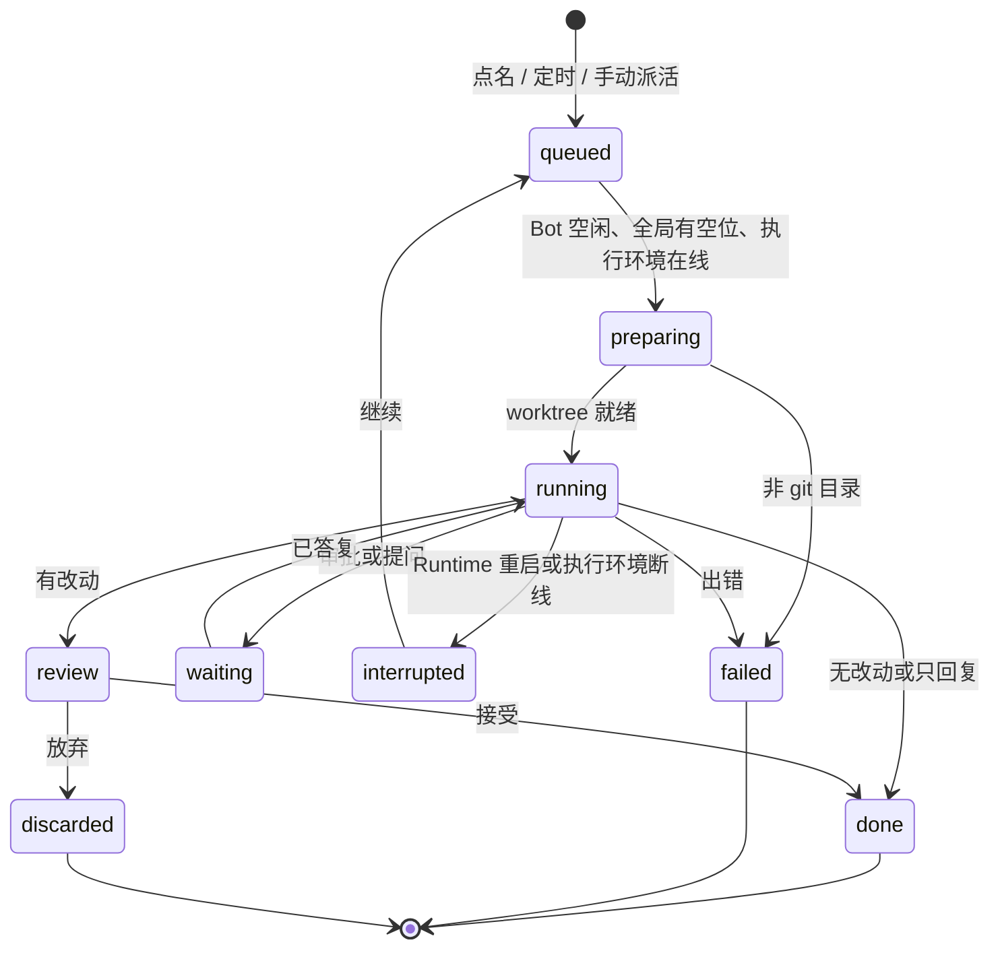

# Bot 服务设计草案

状态：B1（Bot 注册表）已实现（2026-11-03）：`bot-model.mjs`、`bot-service.mjs`、`runtime/http/routes/bots.mjs`、`runtime/tests/bot-service.test.mjs`。B2（任务与隔离）已实现：`executor.mjs`（本机执行器，只放行 git）、`worktree-manager.mjs`、`bot-task-service.mjs`、任务接口、`runtime/tests/bot-tasks.test.mjs`。B2 与设计的差异：接受后立即删除 worktree、保留分支（不保留 7 天）；停止的任务记为 failed（code `stopped`）；`waiting` 状态与 Bot 的工具范围（`tools`）尚未接入，留到 B3/B4。B3–B6 未开始。`bots` 在 B4 界面完成前不进实验功能清单，所以接口虽在但用户打不开。以代码、测试为准并同步修订本文。上线方式：实验功能 `bots`，默认关闭（见 `src/features/labs/README.md`）。

## 背景、目标与非目标

参考 Grok Bot：用户可以新建多个常驻的 Bot。每个 Bot 有自己的名字、指令、工作目录、权限和触发方式；在渠道里被 @、到了定时时间或被手动派活时，Bot 在后台完成一次**任务**，做完把结果交给人确认，中途需要决定时停下来问。Bot 是用户面对的主体；任务是 Bot 的一次执行，对应会话、隔离目录和交付物。

与 Grok Bot 的差别：Grok Bot 的一切都在 xAI 的云上。Pisper 按 DeepSeek super agent 的思路把 Bot 拆成可以分开放置的几层（见「架构：大脑、数据、执行环境分开」）：Bot 的大脑和数据可以放在一台常开的服务器上，真正改代码、跑命令的执行环境可以是另一台机器。Bot 页面要如实写明每个 Bot 的大脑和执行环境各在哪里、是否在线。

## 架构：大脑、数据、执行环境分开

本地代理通常把三样东西绑在同一台机器上：跑 Agent 循环的计算、会话状态，以及执行环境。DeepSeek 的 super agent 设计把它们拆开：Agent 循环无状态、可迁移；状态进持久存储；执行环境留在代码和凭据所在的机器上，由一个**不保存会话状态**的轻量守护进程按需执行命令。Pisper 的对应关系：

| 层 | 内容 | 放在哪 | 现状 |
| --- | --- | --- | --- |
| 大脑 | Agent 循环、Bot 注册表、分派、审批、渠道连接 | Bot 所在的 Pisper Runtime：本机，或一台常开的服务器 | 已支持把整个 Runtime 放到服务器（npm 版）并由桌面、手机配对连接（远程工作区、远程访问） |
| 数据 | Bot 配置、任务、会话、记忆 | 只存在大脑所在 Runtime 的数据目录，经 Store 接口读写 | 本地 JSON；Store 接口为以后换存储留位置，第一版不做 |
| 执行环境 | 仓库、工作区、命令、工具链、内网依赖 | 每个 Bot 自选：本机，或另一台运行 Pisper 执行节点的机器；以后加 SSH、容器 | 引擎的 `bash` / `read` / `edit` / `write` 等工具已有可替换的 `operations` 接口，用于把执行委托给远端；Pisper 尚未使用 |
| 凭据 | 仓库权限、内网账号、工具链令牌 | 留在执行环境一侧，不进大脑、不进模型上下文 | 计算机操作已有按引用使用密钥的做法（`computer-use-secure-refs.mjs`） |
| 模型 | 推理 | 提供方 API，大脑调用 | 本来就分开；执行节点不需要模型密钥 |
| 入口 | 渠道、定时、Web/TUI/手机 | 属于大脑 | 已有 |

由此得到两种典型部署，第一版都要支持：

1. **全在本机**：大脑、数据、执行环境都在桌面版里。最简单，桌面关闭则 Bot 停。
2. **大脑上云、执行在本地**：Pisper Runtime 跑在服务器上（全天在线、接渠道），Bot 的执行环境指向你的开发机上的执行节点。开发机离线时，任务停在“等待执行环境”，开发机重新连上后继续。这正是 super agent 的“间歇在线设备”场景。

### 执行环境接口

```ts
interface Executor {
  id: string
  capabilities: { files: true, shell: boolean, git: boolean, browser: boolean }
  roots: string[]                     // 执行节点允许访问的根目录，由节点自己强制
  online(): boolean
  operations(cwd: string): {          // 直接交给引擎的工具
    bash: BashOperations, read: ReadOperations, edit: EditOperations, write: WriteOperations, ls, grep, find
  }
  exec(file: 'git', args: string[], cwd: string, signal?: AbortSignal): Promise<{ code, stdout, stderr }>
}
```

- `LocalExecutor`：现有行为，本机文件与进程。
- `NodeExecutor`：另一台机器上的 **Pisper 执行节点**。节点是 npm 包里的一个无状态守护进程（`pisper executor`），**主动连回大脑**（穿透 NAT，不需要开放端口），沿用远程访问已有的 TLS 证书指纹配对。节点不保存会话、不持有模型密钥，只在自己配置的根目录内执行文件操作和命令。
- 以后：`SshExecutor`（引擎接口本身就以 SSH 为例）、`ContainerExecutor`（本机 Docker 沙箱）。

不在 `operations` 覆盖范围内的工具（浏览器自动化、计算机操作、本地启动的 MCP 服务器）只能在大脑本机使用；Bot 选了远程执行环境时，这些工具在设置里禁用并写明原因，不假装可用。worktree 管理（下文）也通过 `Executor.exec('git', …)` 在执行环境上运行，而不是在大脑本机。

第一版（Bot 骨架）做：

1. Bot 的新建、编辑、暂停、删除；多个 Bot 并存。
2. 每个 Bot 的指令、模型档位、工作目录与隔离方式、执行权限上限、可用工具、交付方式。
3. 触发：渠道里按名字 @ 或用前缀 `/<名字>` 叫它；Bot 自己的定时计划；在 Bots 页手动派活。
4. 隔离：git 仓库里每个任务用独立的 worktree 和分支，交付物是一份待确认的 diff。
5. 注意力集中：任务需要人决定的事（审批、问题、待确认）进看板 attention 泳道，并回推到来源渠道。
6. 运行环境可选：每个 Bot 选择执行环境——本机，或另一台机器上的 Pisper 执行节点（见下一节）。

非目标（第二版及以后）：

- 每个 Bot 独立的记忆范围、独立的浏览器登录态。
- 每个 Bot 绑定自己的渠道机器人账号（第一版共用现有渠道连接）。
- GitHub webhook 触发、录屏教学（teach-a-task）。
- LLM 路由器自动拆分请求；拆分继续交给已有的 goal/team 模式。
- 自动合并或推送。

## 现状与复用

| 模块 | 已有能力 | Bot 如何复用 | 缺口 |
| --- | --- | --- | --- |
| `channels/channel-service.mjs` | 飞书/微信/QQ/Telegram 收发；`/approve` `/deny` `/stop`；连接级 `accessMode` | 收到消息先问 Bot 服务“是否点名了某个 Bot”；点名了就交给 Bot，没点名则保持现有的直接对话 | 没有按名字分派；没有规则级发送者白名单 |
| `schedule-service.mjs` | 频率、时区、重启补偿、运行记录；目标类型 `prompt` / `workflow` | 新增目标类型 `bot`（`botId` + 本次指令），Bot 的定时计划就是指向它的定时任务 | 无 |
| `agent-profiles.mjs` | 子代理定义：frontmatter（模型档位、思考强度、工具范围）+ 正文说明 | Bot 的模型档位、思考强度、工具范围沿用同一套解析与校验；可“从子代理定义创建 Bot” | 无 |
| `goal-service.mjs` / `team-workflow.mjs` | 长期目标、token 预算、任务依赖图 | Bot 的运行模式为 goal/team 时原样交给它们 | 无 |
| `shared/session-board-status.mjs` + `board-event-hub.mjs` | 四泳道、SSE 增量 | 任务卡片复用泳道规则，增加 `review` 状态与 Bot 头像 | 没有“待确认”交付状态 |
| `git-changes-service.mjs` | `execFile` 调 git、diff、提交 | worktree 的 diff 和提交复用 | 没有 worktree 管理 |
| `storage/json-file.mjs` | 原子写入 | Bot 与任务的状态文件沿用 | 无 |

## 概念模型

四个对象：**Bot**（常驻配置）、**Intake**（一次触发）、**BotTask**（一次执行，即任务）、**Workspace**（任务的隔离目录）。任务是 Bot 执行记录的唯一权威；会话仍归会话服务所有，任务只引用 `sessionId`。

### Bot（持久化）

```ts
{
  id: string                     // bot_ + base64url
  name: string                   // 1–24 字符，全局唯一（不区分大小写），用于 @ 与 /<名字>
  avatar: { glyph: string, color: 1 | 2 | 3 | 4 | 5 | 6 }  // 一个字或 emoji + 调色板序号
  enabled: boolean               // false = 已暂停，不接新任务
  instructions: string           // ≤ 12_000 字符，作为该 Bot 每次任务的固定说明
  model: { tier: 'fast' | 'standard' | 'strong' } | { ref: string }  // 同 agent-profiles
  thinking?: ThinkingLevel
  runMode: 'plan' | 'goal' | 'team'
  workspace: {
    environmentId: string        // 'local' 或某个已配对执行节点的 id
    cwd: string                  // 执行环境上的目录，必须在该环境的 roots 内
    isolation: 'worktree' | 'shared'
  }
  executionMode: ExecutionMode   // 上限，见「安全边界」
  tools: string[] | null         // null = 继承当前启用的全部工具
  delivery: 'reply-only' | 'diff' | 'commit'
  channels: Array<{               // 哪些聊天可以叫它
    platform: 'feishu' | 'weixin' | 'qq' | 'telegram'
    peerIds: string[] | null      // null = 该平台所有已允许的聊天
    senderIds: string[]           // 谁可以叫它；群聊不得为空
  }>
  defaultIn: string[]             // 作为默认 Bot 的聊天（platform:peerId），见「入口与分派」
  createdAt, updatedAt: string
}
```

定时计划不放在 Bot 里：它们是 `ScheduleService` 中 `targetType = 'bot'` 的定时任务，Bot 详情页按 `botId` 过滤显示。删除 Bot 时一并删除这些定时任务。

### Environment（执行环境，持久化）

```ts
{
  id: string                     // 'local' 固定存在；节点为 env_ + base64url
  kind: 'local' | 'node'         // 以后加 'ssh' | 'container'
  name: string                   // 如“我的 MacBook”“构建机”
  fingerprint: string | null     // 节点证书指纹，配对时确认
  roots: string[]                // 节点上报、节点自己强制的允许目录
  capabilities: { shell: boolean, git: boolean, browser: boolean }
  lastSeenAt: string | null      // 只用于展示；在线与否以实时连接为准
}
```

一个执行环境可以被多个 Bot 共用。删除执行环境时，仍在使用它的 Bot 必须先改用别的环境。

### Intake（一次触发，不持久化全文）

```ts
{
  source: { kind: 'channel' | 'schedule' | 'manual'   // 以后加 'webhook'
            platform?, peerId?, chatType?, senderId?, senderName?
            scheduleTaskId? }
  botId: string                  // 分派结果
  text: string                   // ≤ 12_000 字符；已去掉 @ 和 /<名字> 前缀
  attachments: Attachment[]
  receivedAt: string
}
```

### BotTask（持久化）

```ts
{
  id: string                     // task_ + base64url
  botId: string
  botName: string                // 快照：Bot 改名或删除后历史仍可读
  status: BotTaskStatus          // 见「状态机」
  source: Intake['source']       // 发送者名称只存掩码后的展示名
  title: string                  // 取请求前 80 字符
  request: string                // ≤ 12_000 字符
  sessionId: string | null
  workspace: Workspace | null
  attention: { kind: 'approval' | 'question' | 'review' | 'failed', since: string } | null
  result: { summary: string, changedFiles: number, commit?: string } | null
  error: { code: string, message: string } | null
  createdAt, updatedAt, finishedAt: string | null
}
```

### Workspace

```ts
{
  kind: 'worktree' | 'shared'
  repoRoot: string
  path: string                   // worktree 目录；shared 时等于 repoRoot
  branch: string | null          // pisper/<bot 名字的 slug>/<任务短码>
  baseRef: string | null
  state: 'ready' | 'retained' | 'removed'
}
```

关系：一个 Bot 有多个任务；一个任务对应一次 Intake、一个会话和一个 Workspace。同一聊天里对某个未结束任务的回复（引用回复，或 `/<名字>` 后接任务短码）追加到该任务的会话，不新建任务。

## 状态机

只有 `review` 一处需要人决定是否合入；`waiting` 由会话层已有的审批和提问驱动，任务只镜像。



执行环境离线：任务停在 `queued`，`attention` 为空、附带 `waitingFor: 'environment'`，看板显示“等待 <环境名> 上线”；环境重新连上后按排队顺序继续。运行中途断线的任务进 `interrupted`，环境回来后由人点「继续」，因为命令可能只执行了一半。

并发：**每个 Bot 同时只跑一个任务**（像一个人一次只做一件事，也对应 Grok Bot 的“一台电脑”），其余在该 Bot 名下排队；全局同时运行的任务上限 3。看板泳道映射：`waiting`、`review`、`failed`、`interrupted` 进 attention；`preparing`、`running` 进 running；`queued` 进 queued；`done`、`discarded` 进 done。

## 入口与分派

开关关闭、或消息没有点名任何 Bot 时，渠道行为与现在完全一致（直接和 Pisper 对话）。所以不需要迁移已有渠道配置。

分派是纯函数 `routeChannelMessage(message, bots)`，放在 `runtime/services/bots/bot-routing.mjs`，可独立测试：

1. **点名**：消息以 `/<名字>` 开头，或 @Pisper 后紧跟 `<名字>`（如“@Pisper 审查员 看下这个 PR”）。名字匹配不区分大小写，取最长匹配。
2. **默认 Bot**：没点名，但当前聊天在某个 Bot 的 `defaultIn` 里，且消息 @ 了 Pisper（私聊不需要 @）→ 交给该 Bot。一个聊天最多一个默认 Bot。
3. **校验**：被点名的 Bot 必须已启用、`channels` 覆盖这个平台和聊天、发送者在 `senderIds` 里。任一不满足 → 不建任务，在聊天里回复原因（“审查员已暂停”“审查员不在这个群”“你不在审查员的名单里”），并只在日志记一条脱敏记录。
4. 都不满足 → 交回 `ChannelService` 走原有直接对话。

渠道内命令（处理顺序在现有 `/approve` `/deny` `/stop` 之后）：`/bots` 列出这个聊天可用的 Bot；`/<名字> 状态` 查看该 Bot 当前任务。

定时：`ScheduleService.execute` 遇到 `targetType = 'bot'` 时投递 Intake，不走白名单（计划本身由本机用户配置）。手动：Bots 页“派活”调用 `POST /api/bots/:id/tasks`。

## 隔离执行环境

`isolation = worktree` 时，每个任务在**执行环境上**得到独立 worktree：本机在 `<dataDir>/worktrees/<repoRoot 的 sha256 前 12 位>/<任务 id>`，执行节点在它自己的数据目录下的同名位置。分支名 `pisper/<bot slug>/<任务短码>`。实现放在 `runtime/services/bots/worktree-manager.mjs`，只通过 `Executor.exec('git', [...])` 调用，参数数组。

| 阶段 | 动作 | git 命令（参数数组） |
| --- | --- | --- |
| 创建 | `queued` → `preparing` 时执行；记下 `baseRef` | `rev-parse --show-toplevel`、`rev-parse HEAD`、`worktree add -b <branch> <path> <baseRef>` |
| 交付 | 运行结束后汇总改动；无改动则直接 `done` | `status --porcelain`、`diff <baseRef>` |
| 接受 | 在任务分支上提交；可选“应用到当前分支” | `add -A`、`commit -m`；应用时主工作区干净才 `cherry-pick <commit>` |
| 放弃 | 删除 worktree 和分支 | `worktree remove --force <path>`、`branch -D <branch>` |
| 清理 | 已接受的保留 worktree 7 天后删除、分支保留；启动时清孤儿 | `worktree prune` |

约束：不自动合并、不推送（冲突时 `cherry-pick --abort` 并报 `apply_conflict`）；非 git 目录且要求 `worktree` 时任务 `failed`（`workspace_not_git`），不自动降级；同一仓库同时存在的 worktree 上限 8 个；`node_modules` 等依赖第一版不处理，由 Bot 按需自己安装。`delivery = commit` 时 Bot 可在任务分支上自己提交，但“应用到当前分支”仍由人触发。

## 存储结构

| 文件 | 内容 | 上限 | 权限 |
| --- | --- | --- | --- |
| `<dataDir>/pisper-bots.json` | `{ version: 1, bots: Bot[] }` | 32 个 Bot | 0600 |
| `<dataDir>/pisper-bot-tasks.json` | `{ version: 1, tasks: BotTask[] }` | 500 条；超出时删最早的终态任务，非终态不删 | 0600 |
| `<dataDir>/pisper-environments.json` | `{ version: 1, environments: Environment[] }`（不含 `local`） | 16 个 | 0600 |

以上都只在大脑所在的 Runtime 里；执行节点只保存自己的配对信息、允许目录和 worktree，不保存 Bot、任务或会话。

沿用 `readJson` / `writeJsonAtomic`，写入串行化；读取时逐条 `normalize`，非法条目丢弃不抛错。字段上限见概念模型。

重启恢复：`preparing` → `queued`（先 `worktree prune`）；`running` → `interrupted`（`runtime_restarted`，不自动重跑）；`review` / `waiting` 保持。

删除 Bot：有 `queued` / `preparing` / `running` / `waiting` 任务时拒绝（`invalid_state`），先停止或等待完成；`review` 中的任务要求先接受或放弃。已结束的任务保留，靠 `botName` 快照显示。

回滚：旧版本不读这两个文件；`ScheduleService` 的旧版本遇到 `targetType = 'bot'` 会跳过该任务（需确认现有 normalize 会丢弃未知目标类型，实施时补测试）；残留 worktree 用 `git worktree prune` 清理。

## HTTP/SSE 协议与 capability

只新增，不改已有字段。路由放在 `runtime/http/routes/bots.mjs`；状态转换全部在 `runtime/services/bots/`。请求体一律按 `unknown` 校验。

| 方法 路径 | 用途 |
| --- | --- |
| `GET /api/bots` / `POST /api/bots` | 列表（含每个 Bot 的当前状态汇总）/ 新建 |
| `GET /api/bots/:id` / `PATCH /api/bots/:id` / `DELETE /api/bots/:id` | 详情 / 修改（含暂停、恢复）/ 删除 |
| `POST /api/bots/:id/tasks` | 手动派活：`{ text, attachments? }` |
| `POST /api/bots/:id/messages` | 对话里发一句话（B4）：有改动待确认时是同一任务的追问（同一分支接着改），否则派一个新任务；返回 `{ task }` |
| `GET /api/bot-tasks?botId=&status=&limit=` | 任务列表 |
| `GET /api/bot-tasks/:id` / `GET /api/bot-tasks/:id/diff` | 详情 / 相对 `baseRef` 的 diff（沿用 `MAX_DIFF_CHARS`） |
| `POST /api/bot-tasks/:id/accept` / `discard` / `resume` / `stop` | 接受（`{ apply: boolean }`）/ 放弃 / 继续 / 停止 |
| `GET /api/environments` / `POST /api/environments/pairing` / `DELETE /api/environments/:id` | 执行环境列表（含在线状态）/ 生成配对码 / 移除 |

执行节点与大脑之间是另一条通道：节点主动连到大脑的 `wss://…/api/executor/connect`，用配对码完成首次配对，之后用证书指纹认证。通道上只有“执行这个文件操作 / 命令”和“结果 / 输出流”两类消息，节点不接受其他请求。

错误码：`bot_not_found`、`bot_name_taken`、`bot_task_not_found`、`invalid_state`、`workspace_not_git`、`worktree_limit`、`apply_conflict`、`repo_dirty`、`directory_not_allowed`、`unsupported`。

SSE：复用 `GET /api/board/events`，新增 `bot`、`bot_removed`、`bot_task`、`bot_task_removed` 事件；旧客户端忽略。会话卡片 `card` 增加可选字段 `botTask: { id, botId, botName, avatar }`。

Capability：`features.bots` 与 `features.worktrees`（`features.processes` 为真且探测到 `git`）。手机内置 Runtime 下 Bot 可以存在，但 `isolation = worktree` 保存时返回 `unsupported`。

所有响应与事件必须是严格 JSON/UTF-8，`JSON.parse` 与 TUI 的 `serde_json` 都能解析。

## 客户端

B4 改成 Grok Bot / Dots 那种“和同事聊天”的形态（设计稿 `docs/design/drafts/botim-*.png`，实现截图 `docs/design/built/b4-*.png`），取代早先的卡片网格方案：

| 位置 | 第一版（B4 已实现） |
| --- | --- |
| 侧栏 | 会话列表上方一个「Bots」分组，每个 Bot 一行，像联系人：会动的头像（空闲 / 干活 / 需要你三种状态）、名字、最近一句动态；需要你时那句话是琥珀色。分组标题右边「+」新建。开关关闭时整组不出现，也不加载这部分代码 |
| Bot 页 `/bots/:botId` | 和这个 Bot 的一条长期对话：你说的话在右，Bot 的回复在左，任务以卡片出现在对话里（排队 / 干活中可停止 / 等你批准或回答 / 改动待确认：查看改动、放弃、接受并应用到当前分支 / 失败或中断：继续、放弃 / 完成）。有改动待确认时继续说话，就在同一个分支上接着改 |
| 等你批准或回答 | 运行中的任务在会话里卡在审批或 `ask_user` 时，任务带上 `waiting`（`{ approval, question }`，只在内存里投影，不落盘；审批摘要与看板卡片同一份 `projectApproval`），侧栏那一行写“等你批准一个操作 / 有问题问你”。卡片里直接调会话的审批与回答接口，不弹窗；规则与会话页一致：高风险要在卡片里再点一次“确认允许”，参数被截断时只给“拒绝”，允许要去完整记录里看全；多项问题与多选题去完整记录回答 |
| 详情栏 | 右侧三个标签：「详情」（头像、它记得的工作说明、接收新任务开关、执行权限上限、交付方式）、「改动」（文件列表 + diff）、「电脑」（它在哪台电脑、哪个目录工作，每次任务独立分支或直接改目录）。窄屏（≤900px）盖在对话上 |
| 新建 Bot | 对话框：名字、角色（12 种）与颜色（6 种）、本机工作目录 |
| 头像 | `src/features/bots/avatar.ts` 生成 SVG + SMIL 动画，以 data URL 放进 ``（不执行脚本、不引用外部资源）；系统要求减少动态时静止 |
| TUI | 第一版不提供 Bot 界面；Bot 的会话在会话列表里照常可见 |

每个 Bot 有一个长期会话（`threadSessionId`），每个任务的对话是 `turns`（`{ text, at, reply? }`）；旧任务没有 `turns` 时按 `request` 读。

与上面设计的差异（B4 留待以后）：没有快捷键迁移（不占 ⌘2）；“电脑”只有本机，执行节点在 B6；工作说明不会自动学习；看板卡片不加 Bot 头像；`tools` 范围尚未生效。

界面约束：沿用 AGENTS.md「组件与样式」——下拉用 `AppSelect` 或 `ui/select`、开关用 `ui/switch`、标签页用 `Tabs`、空状态用 `InlineEmptyState compact` / `PageState`、文案走 i18n 双语、请求经领域 API 模块。

## 安全边界

- **执行权限上限**：每个 Bot 的 `executionMode` 是上限。只要 Bot 的 `channels` 里含群聊，就不能选 `full-access`；渠道里的 `/mode` 不能超过上限。
- **谁能叫 Bot**：群聊的 `senderIds` 不得为空；`/approve` `/deny` 以及任务的接受/放弃只接受该 Bot 白名单里的发送者。现有渠道的连接级 `accessMode = all`（Telegram 新连接默认如此）不影响 Bot 的白名单校验。
- **指令与消息的边界**：Bot 指令由本机用户编写，作为固定说明进入会话；渠道消息和附件以普通用户消息进入，不拼进系统提示。Bot 不能通过工具修改任何 Bot 的配置（不提供这样的工具）。
- **目录与命令**：`workspace.cwd` 保存时经 `validateDirectory`；worktree 删除前确认在 `<dataDir>/worktrees/` 之下；只调 `git`，参数数组，分支名由 Runtime 生成。
- **日志与展示**：发送者和聊天 id 用 `maskedId` 掩码；错误经 `secret-redaction.mjs`；被拒绝的点名只记脱敏摘要。
- **定时任务默认值**：现有 `DEFAULT_SCHEDULE_EXECUTION_MODE` 是 `full-access`；`targetType = 'bot'` 的定时任务不使用这个默认值，而是取 Bot 自己的上限。
- **执行节点**：节点信任大脑——这是 super agent 设计里作者自己也承认未解决的问题：大脑一旦被攻破或被提示注入，所有连着的节点都会暴露。缓解办法：节点只在自己配置的 `roots` 内做文件操作（由节点强制，不信任大脑传来的路径）；审批仍在大脑侧执行，节点另有本地开关，可随时暂停接受命令；建议用专门的系统用户或容器运行节点，因为 shell 命令能访问该用户能访问的一切；配对需要在节点那台机器上确认指纹。
- **凭据不离开执行环境**：节点不把环境变量、密钥文件内容主动上报；工具输出照常回到大脑和模型，所以“命令打印出的密钥会进上下文”这一风险与本地运行相同，第一版不额外解决，在执行环境设置页写明。

## 分阶段实施与验证

前置：实验功能页 L1、L2 先完成，以下全部挂在 `bots` 开关后面。

| 阶段 | 交付 | 验证 | 完成标准 |
| --- | --- | --- | --- |
| B1 Bot 注册表 | `bots/` 服务、存储、CRUD 接口、capability | 新增 Bot 校验（名字唯一、群聊白名单、权限上限）、读写与恢复测试；`npm test` | 能通过接口增删改 Bot |
| B2 任务与隔离 | 任务状态机、`Executor` 接口与 `LocalExecutor`（经引擎 `operations` 接入）、`worktree-manager.mjs`、手动派活、接受/放弃 | 临时 git 仓库集成测试（并行、冲突、路径穿越、重启）；不依赖网络与个人目录 | 两个 Bot 并行改同一仓库互不覆盖；本机执行行为与现在一致 |
| B3 触发 | `bot-routing.mjs`、渠道接入、`ScheduleService` 的 `bot` 目标 | 分派纯函数测试（点名、默认 Bot、拒绝原因）；现有渠道与定时任务测试全过 | 开关关闭或未点名时渠道行为不变 |
| B4 界面（已完成，形态见「客户端」） | 侧栏 Bots 分组、Bot 对话页、新建对话框、详情栏、i18n | 契约测试（JSON + `serde_json`）、`npm run check`、`npm run test:ui`、`frontend-boundaries` 与 `legacy-ui-retirement` 守卫、快捷键迁移测试；`npm run tui:test` | 在界面上完成“新建 Bot → 飞书 @ 它 → review → 接受” |
| B5 渠道回推 | 通知模板、`/bots`、`/<名字> 状态` | 假网关测试；真实飞书/微信验收单列为未验证项 | 不开应用也能处理审批与待确认 |
| B6 执行节点 | `pisper executor` 守护进程（npm 包）、`NodeExecutor`、配对、断线排队与恢复、执行环境管理页 | 同机起大脑与节点两个进程的集成测试（配对、根目录越界被节点拒绝、断线后排队、重连继续）；`npm run npm:pack:check` | 大脑在服务器、执行在开发机，开发机离线再上线后任务继续 |

不在范围内的验证：Android/iOS 真机、SEA 打包（B2 后补一次 `npm run sidecar:sea:smoke`，确认 SEA 里能找到 `git`）。

## 已定事项（2026-11-03）

| 问题 | 结论 |
| --- | --- |
| 产品形态 | 参考 Grok Bot：多个常驻 Bot；工作项改为“Bot 的任务” |
| 入口位置 | 侧栏会话列表上方的「Bots」分组（B4 起取代“顶层入口 + ⌘2”）；每个 Bot 一条长期对话 |
| 渠道 | 共用现有渠道连接，按名字 @ 或 `/<名字>` 分派；每个 Bot 独立机器人账号放到第二版 |
| 第一版范围 | Bot 骨架；独立记忆与独立浏览器登录态放到第二版 |
| 上线方式 | 实验功能 `bots`，默认关闭；关闭或未点名时渠道保持直接对话 |
| 并发 | 每个 Bot 一次一个任务；全局最多 3 个同时运行，不开放设置 |
| 依赖目录 | worktree 里不处理 `node_modules`，由 Bot 按需安装 |
| `delivery = commit` | 允许 Bot 在任务分支上自己提交；应用到当前分支仍由人触发 |
| `review` 放哪 | 先放 attention 泳道，不改泳道协议 |
| 现有渠道 `accessMode = all` | 不在 Bot 里处理；Bot 有自己的白名单。是否收紧连接级默认值另行决定 |
| 运行环境 | 按 super agent 思路拆成大脑、数据、执行环境三层；每个 Bot 自选执行环境。第一版支持本机与 Pisper 执行节点，SSH 与容器以后加 |
| 之后先做什么 | 第二版先做每个 Bot 的独立记忆，其次 GitHub webhook、SSH 执行环境 |

## 参考

- [Exploring Super-agent Design（DeepSeek Harness，2026-11-01，GitHub 摘录）](https://github.com/yu-iskw/agent-works/issues/184)：计算、状态与执行环境分离；无状态的端点守护进程；Router/Worker 两层会话；间歇在线设备；安全模型的未解问题。
- [DeepSeek Super-Agent 开源原型介绍（Tech Insider）](https://tech-insider.org/deepseek-super-agent-open-source-prototype-dsh-superagent-2026/)：入口、工作项、独立会话与目录、审阅面板。
- [What Is Grok Bot（Layer3 Labs）](https://www.layer3labs.io/guides/what-is-grok-bot) 与 [How to use Grok Bot](https://www.layer3labs.io/guides/how-to-use-grok-bot)：每个 Bot 独立环境与登录、后台持续运行、自然语言规则、结果完成或停下提问、高风险操作需人工批准。
